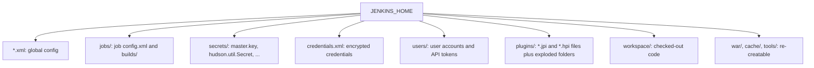
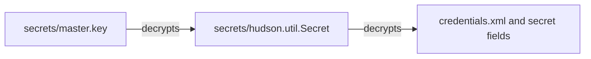
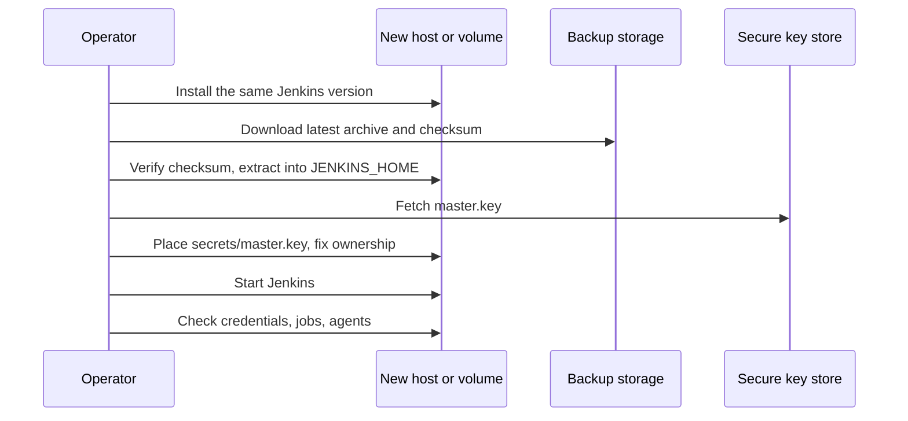

# Backup and Restore

## Introduction

A Jenkins controller holds more than you think: job definitions, build history, test trends, credentials, plugin versions, user accounts and the encryption keys that protect secrets. Lose the disk and you lose all of it, unless you have a backup you have actually tested.

Backups protect you against three different problems:

1. **Disaster**: the VM, disk or Kubernetes volume is gone.
2. **Bad change**: an upgrade, a plugin or a configuration edit broke Jenkins and you want yesterday's state back.
3. **Accidental deletion**: someone deleted a job or folder along with its build history.

Think of `JENKINS_HOME` as a database. You would not run a production database without backups and a restore drill, and the same is true here.

In this page you will:

1. Learn what in `JENKINS_HOME` must be backed up and what can be skipped.
2. Handle the encryption key (`master.key`) correctly.
3. Compare filesystem snapshots, the thinBackup plugin and a shell script.
4. Write a working backup script and restore procedure.
5. Validate a backup by booting it on a separate port.

:::tip Backups and JCasC are partners
If you use [Configuration as Code (JCasC)](./0-jenkins-configuration-as-code.mdx) and [Job DSL](./1-jenkins-job-dsl.mdx), you can rebuild configuration and jobs from Git. You still need backups for **data** that is not in Git: build history, archived artifacts, test trends, fingerprints, and the credentials store if it is not fully codified.
:::

## What Lives in JENKINS_HOME



The official guide on [backing up Jenkins](https://www.jenkins.io/doc/book/system-administration/backing-up/) groups the contents like this:

| Path | Back up? | Why |
| --- | --- | --- |
| `*.xml` in the root (including `config.xml`, `credentials.xml`) | **Yes** | Global and plugin configuration, encrypted credentials |
| `jobs/*/config.xml` | **Yes** | Job definitions |
| `jobs/*/builds/` | Usually yes | Build history, logs and test results |
| `jobs/*/builds/*/archive/` | If needed | Archived artifacts. Can be very large |
| `users/` | **Yes** | Local users, API tokens, preferences |
| `secrets/` (except `master.key`) | **Yes** | Encrypted secret material needed to decrypt credentials |
| `secrets/master.key` | **Separately** | See below |
| `plugins/*.jpi`, `plugins/*.hpi` | **Yes** | The exact plugin versions in use |
| `plugins/<name>/` folders | No | Re-extracted from the `.jpi` files on startup |
| `workspace/`, `jobs/*/workspace/` | No | Re-created by a fresh checkout |
| `war/` | No | Exploded WAR, re-created on startup |
| `cache/`, `tools/` | No | Downloaded tools, re-downloaded as needed |
| `fingerprints/`, `nodes/`, `userContent/` | Usually yes | Small and useful |

Skipping workspaces and caches often shrinks a backup dramatically, which makes backups faster and restores quicker.

## The Encryption Key

Credentials in `credentials.xml` and secret fields in other XML files are encrypted. The chain is:



The Jenkins documentation is emphatic: **do not include `master.key` in your regular backups.** Store it separately, in a very secure place (for example a secrets manager or an offline vault), because anyone holding both a backup and the key can decrypt every credential.

- `master.key` is small and rarely changes, so backing it up once (and after any rotation) is enough.
- To restore, rebuild `JENKINS_HOME` from the backup, then put `master.key` back into `secrets/`.
- Without `master.key`, Jenkins starts but cannot decrypt credentials. You would have to re-enter every secret.

:::warning
Treat `master.key` like an SSH private key. If your backups are stored in an object store that many people can read, keeping the key inside them makes every credential in Jenkins readable to all of those people.
:::

## Backup Strategies

### Filesystem Snapshots

LVM, ZFS, btrfs, cloud disk snapshots (EBS, Azure Managed Disks, Persistent Disk) and Kubernetes `VolumeSnapshot` objects capture the whole volume at one instant. The Jenkins docs call snapshots the most consistent and fastest option.

- **Pros:** consistent point-in-time copy, very fast, no load on Jenkins.
- **Cons:** captures everything including workspaces, ties you to your storage platform, and includes `master.key` unless you keep `secrets/` on a separate volume.

### The thinBackup Plugin

The Jenkins docs name **thinBackup** as the maintained open-source backup plugin. It supports:

- full backups on a cron schedule, plus differential backups between them,
- waiting until Jenkins is idle (on by default and recommended), with an optional quiet-mode timeout,
- excluding files by regex, optionally including build results and archives,
- keeping a maximum number of backup sets.

It can be configured with JCasC:

```yaml
unclassified:
  thinBackup:
    backupPath: "/mnt/backup/jenkins"
    fullBackupSchedule: "H 2 * * 0"
    diffBackupSchedule: "H 2 * * 1-6"
    nrMaxStoredFull: 4
    waitForIdle: true
    forceQuietModeTimeout: 120
    backupBuildResults: true
    backupBuildArchive: false
    backupPluginArchives: true
    backupUserContents: true
    backupNextBuildNumber: true
    excludedFilesRegex: "^.*\\.(log)$"
    moveOldBackupsToZipFile: true
```

`backupPath` should be a separate disk or mount, then copied off the machine (for example to object storage). A backup on the same disk does not survive a disk failure.

### A Shell Script with Cron

The simplest portable approach is `tar` with exclusions, run nightly, then copied off-host.

```bash
#!/usr/bin/env bash
# /usr/local/bin/jenkins-backup.sh
set -euo pipefail

JENKINS_HOME="${JENKINS_HOME:-/var/lib/jenkins}"
BACKUP_DIR="${BACKUP_DIR:-/mnt/backup/jenkins}"
STAMP="$(date -u +%Y%m%dT%H%M%SZ)"
ARCHIVE="${BACKUP_DIR}/jenkins-home-${STAMP}.tar.gz"
KEEP=14

mkdir -p "$BACKUP_DIR"

tar -C "$JENKINS_HOME" -czf "$ARCHIVE" \
  --exclude='./workspace' \
  --exclude='./jobs/*/workspace*' \
  --exclude='./war' \
  --exclude='./cache' \
  --exclude='./tools' \
  --exclude='./secrets/master.key' \
  --exclude='./logs' \
  .

sha256sum "$ARCHIVE" > "${ARCHIVE}.sha256"
echo "Created $(du -h "$ARCHIVE" | cut -f1) backup: $ARCHIVE"

# Keep the newest $KEEP archives locally
ls -1t "$BACKUP_DIR"/jenkins-home-*.tar.gz | tail -n +$((KEEP + 1)) | while read -r old; do
  rm -f "$old" "${old}.sha256"
done
```

Run it from cron at a quiet time, then copy to remote storage with your usual tool (`aws s3 cp`, `az storage blob upload`, `rclone`, and so on):

```bash
bash -n /usr/local/bin/jenkins-backup.sh && echo "syntax ok"
sudo -u jenkins /usr/local/bin/jenkins-backup.sh
```

Example output:

```text
syntax ok
Created 412M backup: /mnt/backup/jenkins/jenkins-home-20261011T020001Z.tar.gz
```

:::note Consistency
A `tar` of a live controller can capture a build log that is half written. That is usually harmless, but for a cleaner copy you can put Jenkins into quiet mode (no new builds start) before the backup with the CLI `quiet-down` command, and cancel it afterwards with `cancel-quiet-down`. See [REST API and CLI](./8-jenkins-rest-api-and-cli.mdx).
:::

### Docker and Kubernetes

For the official Docker image, data lives in the `/var/jenkins_home` volume. Back up the volume, not the container:

```bash
docker run --rm \
  -v jenkins_home:/data:ro \
  -v "$PWD/backups:/backup" \
  alpine:3.20 \
  tar -C /data -czf "/backup/jenkins-$(date +%F).tar.gz" \
    --exclude=./workspace --exclude=./war --exclude=./secrets/master.key .
ls -lh backups/
```

Example output:

```text
-rw-r--r-- 1 root root 388M Oct 11 02:00 jenkins-2026-10-11.tar.gz
```

On Kubernetes with the `jenkinsci/jenkins` Helm chart, the controller's data is on a PersistentVolumeClaim. Common options are `VolumeSnapshot` objects through your CSI driver, a cluster backup tool such as Velero, or thinBackup writing to a second volume. The chart itself does not ship a backup feature.

## Restoring



A restore on a Linux package install:

```bash
sudo systemctl stop jenkins
cd /mnt/backup/jenkins
sha256sum -c jenkins-home-20261011T020001Z.tar.gz.sha256

sudo mv /var/lib/jenkins /var/lib/jenkins.broken
sudo mkdir -p /var/lib/jenkins
sudo tar -C /var/lib/jenkins -xzf jenkins-home-20261011T020001Z.tar.gz
sudo install -m 600 /secure/master.key /var/lib/jenkins/secrets/master.key
sudo chown -R jenkins:jenkins /var/lib/jenkins
sudo systemctl start jenkins
```

Example output:

```text
jenkins-home-20261011T020001Z.tar.gz: OK
```

After startup, check:

1. You can log in.
2. A job that uses credentials can still authenticate (proves `master.key` matches).
3. Agents reconnect. Inbound agents may need their secrets, which are derived from the restored keys.
4. Plugin Manager shows no failed plugins.

:::caution Version matching
Restore onto the **same Jenkins version** that made the backup (or at least not an older one). Plugins and core migrate data formats on upgrade, and downgrading is not reliably supported. Upgrade after the restore is confirmed working. See [Upgrading Jenkins and LTS Releases](../1-jenkins-installation/6-jenkins-upgrading.mdx).
:::

### Restoring a Single Job

For an accidentally deleted job, you do not need a full restore. Extract only that job's folder and reload:

```bash
tar -C /tmp/restore -xzf jenkins-home-20261011T020001Z.tar.gz ./jobs/billing-service
sudo cp -a /tmp/restore/jobs/billing-service /var/lib/jenkins/jobs/
sudo chown -R jenkins:jenkins /var/lib/jenkins/jobs/billing-service
```

Then use **Manage Jenkins > Reload Configuration from Disk**, or restart. Jobs inside folders live at paths like `jobs/payments/jobs/billing-service`.

## Testing Your Backups

A backup you have never restored is a hope, not a backup. The Jenkins docs suggest a simple validation: extract to a temporary directory and boot Jenkins against it on a different port.

```bash
mkdir -p /mnt/backup-test
tar -C /mnt/backup-test -xzf /mnt/backup/jenkins/jenkins-home-20261011T020001Z.tar.gz
cp /secure/master.key /mnt/backup-test/secrets/master.key
export JENKINS_HOME=/mnt/backup-test
java -jar /usr/share/java/jenkins.war --httpPort=9999
```

Open `http://localhost:9999`, confirm jobs and history are present, then stop it. Before you do this, consider that the test copy will try to run scheduled builds and contact agents. Disable triggers (for example by starting in quiet mode or blocking outbound network access) so the test does not deploy anything for real.

Schedule this drill, for example once a quarter, and record how long it took. That number is your real recovery time.

## Choosing a Schedule: RPO and RTO

Two numbers decide your backup design:

- **RPO (recovery point objective)**: how much data you can afford to lose. A nightly backup means up to 24 hours of build history may be lost.
- **RTO (recovery time objective)**: how long you can be without Jenkins. This includes finding the backup, provisioning a machine, restoring, and verifying.

| Requirement | A design that meets it |
| --- | --- |
| RPO 24 h, RTO 1 day | Nightly `tar` to object storage, manual restore runbook |
| RPO 24 h, RTO 1 h | Nightly backups plus a codified controller image ready to start |
| RPO 1 h, RTO 30 min | Hourly volume snapshots plus automated restore on Kubernetes or a cloud VM |

Be honest about what you lose with each design. Lost build history is usually acceptable; lost credentials and job configuration are not, which is why JCasC and Job DSL in Git reduce the pressure on backups.

### Should a Jenkins Job Run the Backup?

It is tempting to create a Jenkins job that backs up Jenkins. It works for small setups, but be aware of the downsides: the job runs with access to `JENKINS_HOME` (so it must run on the controller or a node that mounts the volume), and if Jenkins is broken, your backup job is broken too. A host-level cron job, a storage snapshot policy, or thinBackup are generally more robust choices.

## Real-World Scenario

Your team runs Jenkins on a single cloud VM. It hosts 150 jobs, keeps 90 days of build history for audit reasons, and stores about 400 GB of archived artifacts. The security team requires that credentials never leave the company's secret manager in plain or decryptable form. The business asks for a recovery time of four hours and at most one day of data loss.

**Solution:**

1. **Configuration from Git**: global config is in JCasC and jobs come from Job DSL. That handles the "bad change" case: revert the commit and reload.
2. **Nightly data backup**: the `tar` script above, excluding workspaces, caches and `master.key`, copied to object storage with versioning and a lifecycle policy.
3. **Artifacts out of Jenkins**: large release artifacts move to an artifact repository (Nexus, Artifactory, or object storage), so Jenkins only archives small reports. The 400 GB problem disappears.
4. **Key escrow**: `master.key` is stored once in the company secret manager, with access limited to two administrators.
5. **Weekly disk snapshots** as a second, fast recovery path.
6. **Quarterly restore drill** on a temporary VM with outbound network blocked.

**Why this approach:** it separates *configuration* (Git), *data* (backups) and *keys* (secret manager), each with the right tool and access control. Moving artifacts out reduces backup size and time.

**When to use it:** any controller where build history or credentials matter.

**When not to:** fully ephemeral controllers where every job is a multibranch pipeline, history has no audit value, and all secrets come from an external secret manager. There, JCasC plus a re-scan may be the whole "restore", and a nightly backup adds little.

### Alternatives and Trade-offs

| Approach | Pros | Cons | Best for |
| --- | --- | --- | --- |
| Disk or volume snapshots | Fast, consistent, simple | Platform-specific, includes everything (also the key) | Cloud VMs and Kubernetes |
| thinBackup plugin | Inside Jenkins, waits for idle, differential backups, JCasC-configurable | Another plugin to maintain, writes to local path | Small to medium controllers |
| `tar` script with cron | Transparent, portable, easy to exclude paths | You maintain the script and the schedule | Linux installs, mixed environments |
| Velero or cluster backup | Backs up PVCs and Kubernetes objects together | Needs cluster-level setup | Jenkins on Kubernetes |
| JCasC and Job DSL only | Configuration fully reproducible from Git | No build history, no artifacts | Ephemeral controllers |

## Common Mistakes

1. **Backing up to the same disk.** A disk failure takes both. Always copy off the host.
2. **Including `master.key` with every backup.** Anyone with the backup can decrypt credentials. Store it separately.
3. **Losing `master.key` entirely.** The opposite mistake: the restore boots but every credential is unreadable.
4. **Backing up workspaces and caches.** Backups become huge and slow for no benefit.
5. **Never testing a restore.** You discover missing files during the outage.
6. **Restoring onto an older Jenkins version.** Data written by a newer version may not load.
7. **Using Jenkins as an artifact repository.** Hundreds of gigabytes of archives make backups painful. Push artifacts to a proper repository.

## Summary

- `JENKINS_HOME` holds configuration, jobs, build history, users, plugins and encrypted secrets.
- Back up root XML files, `jobs/`, `users/`, `secrets/` (minus `master.key`) and plugin archives. Skip workspaces, `war/`, `cache/` and `tools/`.
- Keep `master.key` in a separate, highly protected location.
- Choose snapshots, thinBackup, or a script, and always copy backups off the host.
- Restore onto the same Jenkins version, put `master.key` back, then verify credentials and agents.
- Test restores regularly by booting the backup on another port with outbound actions blocked.

## Further Learning

### Exercises

1. Run Jenkins in Docker, create a job with a credential, and back up the volume with the `alpine` + `tar` command. Delete the volume, restore it, and confirm the credential still works.
2. Repeat the restore **without** `master.key`. What does Jenkins show for the credential?
3. Configure thinBackup through JCasC with a weekly full and daily differential schedule.
4. Write a restore runbook for your team, including who can access `master.key`, and time a full restore drill.

### Related Pages

- [Configuration as Code (JCasC)](./0-jenkins-configuration-as-code.mdx)
- [High Availability and Scaling](./5-jenkins-high-availability.mdx)
- [Build History and Artifacts](../2-jenkins-jobs/4-jenkins-build-history-and-artifacts.mdx)
- [Credentials Management](../11-jenkins-security/3-jenkins-credentials.mdx)
- Official docs: [Backing-up/Restoring Jenkins](https://www.jenkins.io/doc/book/system-administration/backing-up/)
