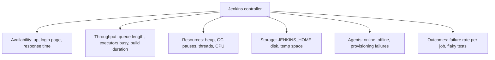
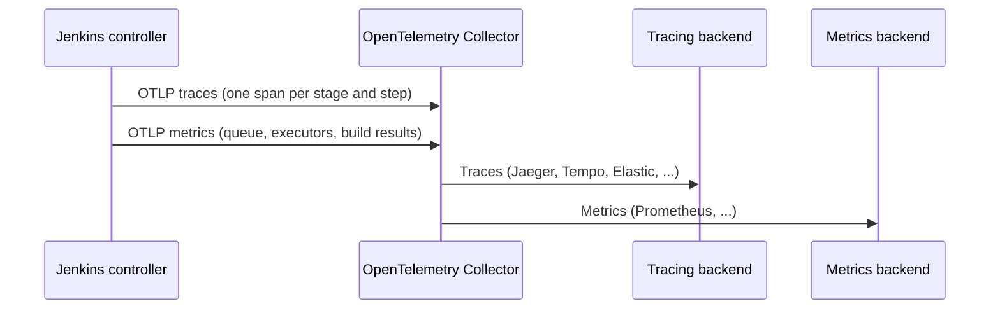

# Monitoring Jenkins

## Introduction

Jenkins usually fails slowly. The build queue creeps up over a week, heap usage climbs, a disk fills with old artifacts, an agent pool quietly goes offline. Developers notice only when their pull request has been "waiting for next available executor" for 40 minutes.

Monitoring turns those slow failures into early warnings. You want to answer three questions at any time:

1. **Is Jenkins up and responsive?** (availability)
2. **Is it keeping up with the work?** (queue length, executor usage, build durations)
3. **Is it about to run out of something?** (heap, disk, threads, agents)

A good analogy is the dashboard of a car. You do not stare at it while driving, but the fuel gauge and the engine warning light save you from being stranded.

In this page you will:

1. Learn which signals matter for a Jenkins controller.
2. Use the built-in health checks of the Metrics plugin.
3. Export metrics to Prometheus and build a Grafana view.
4. Trace pipelines with OpenTelemetry.
5. Write a small set of alerts that are worth waking up for.

## What to Monitor



| Signal | Why it matters | Typical source |
| --- | --- | --- |
| Up and HTTP 200 on `/login` | Basic availability | Blackbox probe |
| Queue length | Builds waiting means not enough capacity | Prometheus plugin |
| Busy vs available executors | Capacity planning | Prometheus plugin |
| Build duration per job | Regressions in speed | Prometheus plugin, OpenTelemetry |
| JVM heap after GC | Memory leaks, undersized heap | JVM metrics |
| Disk free on `JENKINS_HOME` | A full disk corrupts builds and config | Node exporter, Metrics health check |
| Agents online | Missing capacity, broken cloud credentials | Prometheus plugin |
| Failure rate | Broken main branch, flaky infrastructure | Prometheus plugin |

## Built-In Visibility First

Before installing anything, Jenkins already shows a lot:

- **Manage Jenkins > System Information**: JVM properties, environment and memory.
- **Manage Jenkins > Nodes**: each node's free disk, free temp space, clock difference and response time. Nodes that fall below thresholds are taken offline automatically.
- **Load Statistics** (on the Nodes page and per label): graphs of queue length and executor usage over time.
- **Manage Jenkins > System Log**: log recorders (see [Troubleshooting Jenkins](./7-jenkins-troubleshooting.mdx)).

These are great for investigating, but not for alerting. For that you need metrics in a time-series system.

## The Metrics Plugin and Health Checks

The `metrics` plugin is the foundation many other monitoring plugins build on. It provides four servlets:

- **ping**: returns `pong` with HTTP 200, for simple liveness checks.
- **healthcheck**: runs registered health checks and returns JSON. The HTTP status code reflects the overall result.
- **metrics**: all metrics as JSON.
- **threads**: a thread dump of the controller.

Built-in health checks include `disk-space`, `temporary-space`, `plugins` (fails if any plugin did not start) and `thread-deadlock`.

Access is controlled in two ways:

- **Access keys**, created in the **Metrics** section of **Manage Jenkins > System**. Each key can be limited to specific servlets. Use them as `JENKINS_URL/metrics/<key>/healthcheck`.
- **Logged-in users** with the right permissions (Metrics/View, Metrics/HealthCheck, Metrics/ThreadDump) can use `JENKINS_URL/metrics/currentUser/...`.

```bash
curl -s "https://jenkins.example.com/metrics/${METRICS_KEY}/healthcheck?pretty=true"
```

Example output:

```json
{
  "disk-space" : { "healthy" : true },
  "plugins" : { "healthy" : true, "message" : "No failed plugins" },
  "temporary-space" : { "healthy" : true },
  "thread-deadlock" : { "healthy" : true }
}
```

This makes a good target for a load balancer health check or a simple uptime monitor: one call that covers disk, plugins and deadlocks.

## Prometheus and Grafana

The **Prometheus metrics** plugin (`prometheus`) exposes Jenkins metrics in Prometheus text format, including everything from the Metrics plugin.

- Default endpoint: `JENKINS_URL/prometheus/` (the **trailing slash matters**; without it you get a redirect that some scrapers mishandle).
- Default metric prefix: `default` (change it with the `PROMETHEUS_NAMESPACE` environment variable or in the global configuration).
- Collection runs asynchronously, every 120 seconds by default (`COLLECTING_METRICS_PERIOD_IN_SECONDS`).
- Disk usage collection can be expensive on network storage; you can turn it off (`COLLECT_DISK_USAGE`).

```bash
curl -s -u "monitor:${API_TOKEN}" https://jenkins.example.com/prometheus/ \
  | grep -E '^default_jenkins_(executors_queue_length|executors_busy|executors_available|up) '
```

Example output:

```text
default_jenkins_executors_queue_length 3.0
default_jenkins_executors_busy 18.0
default_jenkins_executors_available 2.0
default_jenkins_up 1.0
```

Useful metric names from the plugin documentation:

| Metric | Meaning |
| --- | --- |
| `default_jenkins_up` | Jenkins is ready to serve requests |
| `default_jenkins_executors_queue_length` | Items that could run but wait for an executor |
| `default_jenkins_executors_busy` / `_available` / `_online` | Executor counts |
| `default_jenkins_nodes_online` | Online nodes |
| `default_jenkins_quietdown` | Whether quiet mode is on |
| `default_jenkins_builds_duration_milliseconds_summary` | Build durations per job |
| `default_jenkins_builds_failed_build_count` | Failed builds per job |
| `default_jenkins_builds_last_build_duration_milliseconds` | Duration of the last build |

Metric names can change between plugin versions, so open `/prometheus/` on your own controller and confirm before building dashboards.

### Scrape Configuration

Whether anonymous users can read `/prometheus/` depends on your security setup. A clean pattern is a dedicated read-only "monitor" user with an API token.

```yaml
# prometheus.yml
scrape_configs:
  - job_name: jenkins
    metrics_path: /prometheus/
    scheme: https
    scrape_interval: 60s
    basic_auth:
      username: monitor
      password_file: /etc/prometheus/secrets/jenkins_token
    static_configs:
      - targets: ["jenkins.example.com"]
```

On Kubernetes, the `jenkinsci/jenkins` Helm chart can create a `ServiceMonitor` for the Prometheus Operator when `controller.prometheus.enabled` is set to `true` (it is `false` by default). Remember to install the `prometheus` plugin in `controller.installPlugins` as well.

### PromQL Queries Worth Graphing

```text
# Queue length over time
default_jenkins_executors_queue_length

# Executor utilisation (0..1)
default_jenkins_executors_busy / clamp_min(default_jenkins_executors_online, 1)

# Failed builds in the last hour, summed across jobs
sum(increase(default_jenkins_builds_failed_build_count[1h]))
```

Grafana has community dashboards for this plugin. Import one as a starting point, then delete panels you do not use.

### A Local Monitoring Lab

To experiment safely, run Jenkins, Prometheus and Grafana together with Docker Compose. Prometheus authenticates with a monitor user you create in Jenkins and a token file.

```yaml
# compose.yaml
services:
  jenkins:
    image: jenkins/jenkins:lts-jdk21
    ports: ["8080:8080"]
    volumes: ["jenkins_home:/var/jenkins_home"]
  prometheus:
    image: prom/prometheus:v2.53.0
    ports: ["9090:9090"]
    volumes:
      - ./prometheus.yml:/etc/prometheus/prometheus.yml:ro
      - ./jenkins_token:/etc/prometheus/secrets/jenkins_token:ro
  grafana:
    image: grafana/grafana:11.1.0
    ports: ["3000:3000"]
volumes:
  jenkins_home: {}
```

```yaml
# prometheus.yml for the lab (plain HTTP inside the Compose network)
scrape_configs:
  - job_name: jenkins
    metrics_path: /prometheus/
    scrape_interval: 60s
    basic_auth:
      username: monitor
      password_file: /etc/prometheus/secrets/jenkins_token
    static_configs:
      - targets: ["jenkins:8080"]
```

```bash
docker compose up -d
# After installing the prometheus plugin and creating the monitor user and token:
curl -s "http://localhost:9090/api/v1/query?query=default_jenkins_up" | python3 -m json.tool | grep -A2 '"value"'
```

Example output:

```text
                "value": [
                    1760173200.123,
                    "1"
```

The image tags above are examples that existed at the time of writing; pin versions you have tested. In Grafana (`http://localhost:3000`), add Prometheus at `http://prometheus:9090` as a data source and import a Jenkins dashboard.

### Host and JVM Metrics

The Prometheus plugin focuses on Jenkins concepts. For host-level signals, also run:

- **node_exporter** (or your cloud provider's agent) for CPU, memory, and especially disk free on the `JENKINS_HOME` volume.
- JVM metrics: the Metrics plugin publishes JVM memory and GC data, which also appear on `/prometheus/`. Some teams prefer the Prometheus JMX exporter Java agent for full JVM detail.

## Health Checks for Load Balancers and Kubernetes

Orchestrators need a cheap URL that says "this controller is alive". Options, from cheapest to most thorough:

| Endpoint | Checks | Notes |
| --- | --- | --- |
| `/login` | Web server is answering | Works without plugins or authentication |
| `/metrics/<key>/ping` | Metrics plugin is answering | Returns `pong` |
| `/metrics/<key>/healthcheck` | Disk, temp space, plugins, deadlocks | Can fail for reasons a restart will not fix |
| `/prometheus/` | Full metrics | Too heavy for a liveness probe |

The `jenkinsci/jenkins` Helm chart already configures startup, liveness and readiness probes on the login page. Be careful with liveness probes that are too strict: if a full GC pause or a busy startup makes the probe fail, Kubernetes restarts a controller that was merely slow, which makes things worse. Use generous timeouts and a startup probe that allows several minutes for big controllers.

## Logs as a Signal

Metrics show trends; logs explain them. Ship the controller log (`docker logs`, `journalctl -u jenkins`, or the pod log) to your log platform and alert on a few patterns:

- `SEVERE` lines during startup (failed plugins).
- `OutOfMemoryError`.
- Repeated agent connection failures for the same node.

See [Troubleshooting Jenkins](./7-jenkins-troubleshooting.mdx) for where each install type writes logs.

## Tracing Pipelines with OpenTelemetry

Metrics tell you *that* builds got slower. Traces tell you *where*. The **OpenTelemetry** plugin (`opentelemetry`) exports every pipeline run as a distributed trace: the run is the root span, and stages and steps are child spans.



Configure it under **Manage Jenkins > System > OpenTelemetry**: set the OTLP endpoint (gRPC by default; OTLP over HTTP via the `otel.exporter.otlp.protocol=http/protobuf` property) and an authentication method. The plugin can also pass its configuration to build tools as environment variables, so a Maven build can attach its own spans to the pipeline trace.

Typical wins from tracing:

- Discovering that 60 percent of a pipeline's time is spent waiting for an agent, not building.
- Seeing which stage regressed after a dependency upgrade.
- Correlating slow checkouts with a specific Git server.

:::note
The OpenTelemetry plugin has a moderate install base compared with core plugins. It is actively developed, which also means configuration options change. Follow the setup guide linked from the [plugin page](https://plugins.jenkins.io/opentelemetry/) for your version.
:::

## Other Integrations

The Jenkins [monitoring documentation](https://www.jenkins.io/doc/book/system-administration/monitoring/) also lists:

- **Datadog** (`datadog` plugin) and **New Relic** integrations for teams already on those platforms.
- **JavaMelody** (`monitoring` plugin): an in-process dashboard with memory, CPU, HTTP and SQL statistics. Handy for small installations without a metrics stack.

## Alerts That Matter

Too many alerts teach people to ignore them. Start with a small set, each with a clear action.

```yaml
# jenkins-alerts.yml (Prometheus alerting rules)
groups:
  - name: jenkins
    rules:
      - alert: JenkinsDown
        expr: up{job="jenkins"} == 0 or default_jenkins_up == 0
        for: 5m
        labels: { severity: page }
        annotations:
          summary: "Jenkins is not responding"
      - alert: JenkinsQueueBacklog
        expr: default_jenkins_executors_queue_length > 10
        for: 15m
        labels: { severity: ticket }
        annotations:
          summary: "More than 10 builds waiting for 15 minutes"
      - alert: JenkinsNoAgentsOnline
        expr: default_jenkins_nodes_online < 2
        for: 10m
        labels: { severity: page }
        annotations:
          summary: "Fewer than 2 nodes online"
```

Validate rules before loading them:

```bash
promtool check rules jenkins-alerts.yml
```

Example output:

```text
Checking jenkins-alerts.yml
  SUCCESS: 3 rules found
```

Add host alerts for the `JENKINS_HOME` disk (for example below 15 percent free) and JVM heap after GC staying above 85 percent. The thresholds above are starting points. Tune them to your normal load.

## Real-World Scenario

Your company's single Jenkins controller serves 120 developers. Twice last month, developers complained that "Jenkins is slow". Each time an admin logged in, looked around, and found nothing obviously wrong. Leadership asks for numbers before approving more agents.

**Solution:**

1. Install the `metrics` and `prometheus` plugins via `plugins.txt`, and create a read-only monitor user through [JCasC](./0-jenkins-configuration-as-code.mdx).
2. Scrape `/prometheus/` from the existing Prometheus server. Run node_exporter on the controller VM.
3. Build one Grafana dashboard with five panels: queue length, executor utilization, p90 build duration of the top 10 jobs, heap after GC, and `JENKINS_HOME` disk free.
4. Add the three alerts above plus a disk alert.
5. Install the OpenTelemetry plugin to trace the three slowest pipelines.

After two weeks the data shows the queue peaking at 25 items between 10:00 and 11:00 every weekday, while heap and CPU on the controller stay healthy. The traces show builds waiting about 8 minutes for an agent. The problem is agent capacity, not the controller. The team adds autoscaling [Kubernetes pod agents](../6-jenkins-agents/4-jenkins-kubernetes-agents.mdx) instead of buying a bigger controller VM.

**Why this approach:** it measures the specific signals that distinguish "controller overloaded" from "not enough agents" from "slow builds", and it reuses the company's existing Prometheus stack.

**When to use it:** any shared Jenkins that people depend on daily.

**When not to:** a single-user Jenkins on a laptop. The built-in Load Statistics are enough.

### Alternatives and Trade-offs

| Approach | Pros | Cons | Best for |
| --- | --- | --- | --- |
| Built-in pages only | Zero setup | No history, no alerts | Small or personal instances |
| Metrics plugin health checks | Simple JSON, good for load balancers | Limited metrics, no storage | Uptime checks |
| **Prometheus plugin and Grafana** | Open source, rich queries, alerting | You run Prometheus and Grafana | Most self-hosted teams |
| OpenTelemetry plugin | Per-stage traces, vendor-neutral | Needs a collector and tracing backend | Finding why pipelines are slow |
| Datadog or New Relic | Managed, polished dashboards | Cost, data leaves your network | Teams already paying for them |
| JavaMelody | In-process dashboards, no external system | Adds load to the controller, no fleet view | Quick diagnosis on one controller |

## Best Practices

1. **Monitor from outside too.** A blackbox probe on `/login` catches failures that in-process metrics cannot report (Jenkins being down).
2. **Use a dedicated monitoring user.** Give it only the permissions it needs and rotate its API token.
3. **Alert on symptoms, not causes.** Queue backlog and Jenkins down are actionable. A single GC spike is not.
4. **Watch disk on `JENKINS_HOME`.** Full disks cause corrupted XML files and failed builds. Combine with build discarders.
5. **Keep scrape intervals sensible.** The plugin collects every 120 seconds by default, so scraping every 5 seconds does not give fresher data.
6. **Review dashboards after big changes.** Upgrades, new plugins and new agent types often change baseline behavior.

## Summary

- Monitor availability, throughput (queue, executors, durations), resources (heap, disk, threads) and agents.
- The `metrics` plugin provides ping, health check, metrics and thread dump servlets protected by access keys or permissions.
- The `prometheus` plugin exposes `/prometheus/` (with trailing slash) with metrics such as `default_jenkins_executors_queue_length`.
- OpenTelemetry turns pipelines into traces that show where time goes.
- Keep alerts few and actionable: Jenkins down, queue backlog, agents missing, disk and heap.

## Further Learning

### Exercises

1. Install the Prometheus plugin in a Docker Jenkins, run `curl` against `/prometheus/`, and list every metric with `queue` in its name.
2. Create a Metrics access key that allows only the health check, and call it with `curl`.
3. Write a PromQL query for executor utilization and graph it in Grafana while you run five parallel builds.
4. Run an OpenTelemetry Collector and Jaeger locally with Docker, point Jenkins at the collector, and inspect a pipeline trace.

### Related Pages

- [Performance Tuning](./4-jenkins-performance-tuning.mdx)
- [High Availability and Scaling](./5-jenkins-high-availability.mdx)
- [Troubleshooting Jenkins](./7-jenkins-troubleshooting.mdx)
- [Labels, Executors and Scheduling](../6-jenkins-agents/6-jenkins-labels-and-executors.mdx)
- Official docs: [Monitoring Jenkins](https://www.jenkins.io/doc/book/system-administration/monitoring/), [Prometheus plugin](https://plugins.jenkins.io/prometheus/), [Metrics plugin](https://plugins.jenkins.io/metrics/)
