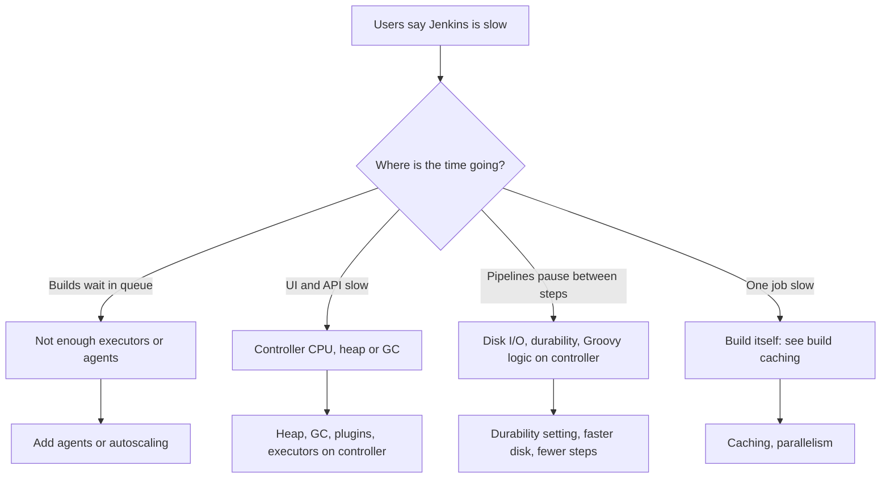

# Jenkins Performance Tuning

## Introduction

A Jenkins controller that served 10 developers comfortably can become sluggish at 100: the UI takes seconds to load, pipelines pause between steps, and once a week the JVM runs out of memory. The instinct is to buy a bigger machine. Sometimes that is right, but more often the controller is doing work it should not do.

Performance tuning for Jenkins follows one guiding idea: **the controller is an orchestrator, not a worker.** It should schedule builds, store results and serve the UI. Compiling code, running tests, parsing huge logs and heavy Groovy logic all belong elsewhere.

Think of an airport control tower. It can coordinate hundreds of flights because controllers do not load luggage. When the tower starts loading luggage, every flight is delayed.

In this page you will:

1. Find out what is actually slow before changing anything.
2. Size the JVM heap and choose garbage collection settings.
3. Use pipeline durability settings to cut disk I/O.
4. Control build history and artifacts.
5. Write pipelines that are cheap for the controller to run.
6. Reduce plugin overhead.

## Measure First



Use the signals from [Monitoring Jenkins](./3-jenkins-monitoring.mdx): queue length, executor usage, heap after GC, GC pause time and disk latency. Without these, tuning is guesswork. Take a few thread dumps when the UI is slow (see [Troubleshooting Jenkins](./7-jenkins-troubleshooting.mdx)); they often point directly at the plugin or operation that is blocking.

## Step 1: No Builds on the Controller

The Jenkins documentation recommends dedicated agents and warns that builds on the controller can exhaust its CPU and memory and cause downtime. They are also a security risk, because builds on the controller can read `JENKINS_HOME`.

```yaml
# JCasC

jenkins:
  numExecutors: 0
```

Set this before anything else. Every other tuning step assumes the controller is not also running Maven builds. See [Controller and Agents](../6-jenkins-agents/0-jenkins-controller-and-agents.mdx).

## Step 2: JVM Heap

The [hardware recommendations](https://www.jenkins.io/doc/book/scaling/hardware-recommendations/) say a controller's memory can range from about 200 MB for a tiny installation to more than 70 GB for a single, massive controller. There is no one right number, so size from observation:

1. Start with a moderate heap (for example 2 to 4 GB for a team-sized controller).
2. Watch **heap used after garbage collection** over a week.
3. If it regularly stays above about 70 to 80 percent of the maximum, increase the heap. If it never exceeds 30 percent, you can reduce it.

Set the heap through the JVM options of your install type:

| Install type | Where JVM options go |
| --- | --- |
| Docker image | `JENKINS_JAVA_OPTS` (recommended) or `JAVA_OPTS` environment variable |
| Linux package (systemd) | `Environment="JAVA_OPTS=..."` via `systemctl edit jenkins` |
| Helm chart | `controller.javaOpts` value |

```bash
docker run -d --name jenkins -p 8080:8080 \
  -v jenkins_home:/var/jenkins_home \
  -e JENKINS_JAVA_OPTS="-Xms4g -Xmx4g -XX:+UseG1GC -XX:+AlwaysPreTouch -XX:+HeapDumpOnOutOfMemoryError -XX:HeapDumpPath=/var/jenkins_home/heapdumps" \
  jenkins/jenkins:lts-jdk21
```

In containers, you can also size the heap as a percentage of the container memory limit with `-XX:MaxRAMPercentage=70.0`. Leave headroom for non-heap memory (metaspace, thread stacks, direct buffers): if the heap equals the container limit, the kernel will kill the container (exit code 137) before Java ever throws `OutOfMemoryError`.

```yaml
# Helm values
controller:
  javaOpts: "-XX:MaxRAMPercentage=70.0 -XX:+UseG1GC -XX:+HeapDumpOnOutOfMemoryError"
  resources:
    requests:
      cpu: "2"
      memory: "6Gi"
    limits:
      memory: "6Gi"
```

Check what the running JVM actually picked up. In **Manage Jenkins > Script Console** (administrators only), run:

```groovy
import java.lang.management.ManagementFactory

def mb = 1024 * 1024
println "Max heap: ${Runtime.runtime.maxMemory().intdiv(mb)} MB"
println "JVM args: ${ManagementFactory.runtimeMXBean.inputArguments.join(' ')}"
```

Example output:

```text
Max heap: 4096 MB
JVM args: -Xms4g -Xmx4g -XX:+UseG1GC -XX:+AlwaysPreTouch -XX:+HeapDumpOnOutOfMemoryError -XX:HeapDumpPath=/var/jenkins_home/heapdumps
```

**Manage Jenkins > System Information** also lists the JVM arguments, without running code.

## Step 3: Garbage Collection

Jenkins requires Java 21 or newer on current LTS lines, and G1 is the default collector on modern JVMs for server-class machines. For most controllers, G1 with a fixed heap (`-Xms` equal to `-Xmx`, or at least half of it) is the right choice.

The Jenkins project's well-known GC tuning article (from 2016, written for Java 8) recommended G1 plus a handful of extra flags:

```text
-XX:+UseG1GC
-XX:+ExplicitGCInvokesConcurrent
-XX:+ParallelRefProcEnabled
-XX:+UseStringDeduplication
-XX:+AlwaysPreTouch
```

On Java 21 some of these are already defaults or behave differently, and its Java 8 GC logging flags (`-Xloggc`, `-XX:+PrintGCDetails`) no longer exist. On modern Java use unified logging instead:

```text
-Xlog:gc*:file=/var/jenkins_home/logs/gc.log:time,uptime:filecount=5,filesize=20m
```

:::caution
Do not copy long lists of JVM flags from old blog posts. Unknown or removed flags stop the JVM from starting. Add one flag at a time, with a reason, and confirm it in the GC log.
:::

The Jenkins pipeline scaling guide notes that GC tuning becomes worthwhile once the heap exceeds roughly 6 GB. Below that, sensible defaults plus enough heap usually suffice.

## Step 4: Pipeline Durability

By default, Pipeline writes its state to disk very often so that running builds survive a controller crash. That costs a lot of disk I/O. The [Scaling Pipelines](https://www.jenkins.io/doc/book/pipeline/scaling-pipeline/) guide describes three durability levels:

| Setting | Durability | Speed | Use for |
| --- | --- | --- | --- |
| `MAX_SURVIVABILITY` (default) | Survives crashes, atomic writes | Slowest | Production deployments, audited jobs |
| `SURVIVABLE_NONATOMIC` | Writes every step, non-atomic | Faster, notably on network filesystems | Middle ground |
| `PERFORMANCE_OPTIMIZED` | Running builds may not resume after an unclean shutdown | Fastest, far less I/O | Most build-and-test pipelines that can simply be re-run |

The trade-off: with `PERFORMANCE_OPTIMIZED`, if the controller crashes or is killed (not shut down gracefully), running pipelines may fail to resume. A graceful shutdown still lets them resume.

You can set it:

- **Globally**: **Manage Jenkins > System > Pipeline Speed/Durability Settings**.
- **Per job**: the "Custom Pipeline Speed/Durability Level" option in job configuration.
- **In a Declarative Pipeline**: the `durabilityHint` option.

```groovy
pipeline {
    agent { label 'linux' }
    options {
        durabilityHint('PERFORMANCE_OPTIMIZED')
        buildDiscarder(logRotator(numToKeepStr: '30', artifactNumToKeepStr: '5'))
        timeout(time: 30, unit: 'MINUTES')
    }
    stages {
        stage('Test') {
            steps {
                sh './gradlew test'
            }
        }
    }
}
```

A good pattern from the guide: make `PERFORMANCE_OPTIMIZED` the global default, and set `MAX_SURVIVABILITY` explicitly on critical deployment pipelines. See also [Pipeline Options and Tuning](../4-jenkins-pipeline-advanced/6-jenkins-pipeline-options.mdx).

## Step 5: Keep History Under Control

Every build adds files to `JENKINS_HOME`: logs, test results, coverage data, archived artifacts. Jenkins loads build records lazily, but large histories still slow down job pages, increase disk usage and lengthen backups.

- Add a **build discarder** to every job (`buildDiscarder(logRotator(...))` as above, or configured globally).
- Keep **artifacts** for fewer builds than logs (`artifactNumToKeepStr`).
- Store release artifacts in an artifact repository, not with `archiveArtifacts`.
- For multibranch jobs, configure an **orphaned item strategy** so deleted branches are cleaned up.

A quick way to find the heaviest jobs:

```bash
sudo du -sh /var/lib/jenkins/jobs/* 2>/dev/null | sort -rh | head -5
```

Example output:

```text
48G	/var/lib/jenkins/jobs/mobile-app
12G	/var/lib/jenkins/jobs/monolith
3.1G	/var/lib/jenkins/jobs/payments
900M	/var/lib/jenkins/jobs/website
410M	/var/lib/jenkins/jobs/docs
```

## Step 6: Cheap Pipelines

Pipeline code (Groovy) runs **on the controller** inside the CPS engine, even when the `sh` steps run on agents. Each step is serialized and persisted. That means pipeline design directly affects controller load.

Habits that keep the controller healthy, all from the official scaling guidance:

1. **Fewer, bigger steps.** Ten `sh` calls in a row cost ten persisted steps. One `sh` that runs a script costs one.
2. **Do heavy work in shell, not Groovy.** Parsing a 50 MB JSON file in Groovy happens on the controller. Run `jq` or Python on the agent instead.
3. **Keep logs small.** Huge console logs are stored and streamed by the controller. Redirect verbose output to a file and archive it.
4. **Use `@NonCPS` carefully** for pure data processing, and never call pipeline steps from inside it.
5. **Avoid busy-waiting.** A `waitUntil` loop or `sleep` loop polling an API every second creates many steps. Use webhooks or longer intervals.

```groovy
// Expensive: many small steps, parsing on the controller
def files = sh(script: 'ls reports', returnStdout: true).trim().split('\n')
for (f in files) {
    def json = readJSON file: "reports/${f}"
    echo "${f}: ${json.failures} failures"
}

// Cheaper: one step on the agent does the work
sh '''
  python3 scripts/summarize_reports.py reports/ > summary.txt
  cat summary.txt
'''
```

```python
# scripts/summarize_reports.py
import json
import pathlib
import sys

root = pathlib.Path(sys.argv[1])
for f in sorted(root.glob("*.json")):
    data = json.loads(f.read_text())
    print(f"{f.name}: {data.get('failures', 0)} failures")
```

Example output:

```text
api.json: 0 failures
ui.json: 2 failures
```

See [Groovy Essentials for Pipelines](../4-jenkins-pipeline-advanced/5-jenkins-groovy-for-pipelines.mdx) for more on CPS and `@NonCPS`.

## Step 7: Plugins and Background Work

Each plugin adds classes to memory and sometimes background tasks or UI work on every page load.

- Remove plugins nobody uses ([Avoiding Plugin Sprawl and Dependency Problems](../7-jenkins-plugins/2-jenkins-plugin-dependency-hell.mdx)).
- Replace **SCM polling** with webhooks. Hundreds of jobs polling Git every minute create constant load on both Jenkins and the Git server.
- Spread scheduled jobs with the `H` symbol in cron (for example `H 2 * * *`) so they do not all start at 02:00.
- Review periodic folder scans in multibranch and organization folders; once a day is usually enough when webhooks are working.

## Step 8: Disk and Storage

The pipeline scaling guide recommends fast SSD storage and avoiding NFS or magnetic disks for `JENKINS_HOME` where possible, because Pipeline is I/O heavy. The architecture guidance favors larger over faster disks for general data, so the practical answer is: SSD-backed storage of generous size, with expandable volumes (LVM, ZFS, or cloud volumes you can grow).

## Step 9: Workspaces and Agent Disks

Slow builds are often caused by full or slow agent disks, not the controller.

- Jenkins runs a workspace cleanup thread that removes stale workspaces on agents (by default, workspaces unused for 30 days, checked every 24 hours). It is controlled by system properties such as `hudson.model.WorkspaceCleanupThread.retainForDays`.
- Inside pipelines, `cleanWs()` from the Workspace Cleanup plugin, or `deleteDir()`, removes the workspace at the end of a build when you do not need it.
- Ephemeral agents (Docker or Kubernetes pods) avoid the problem entirely, because every build starts with a fresh disk. The trade-off is losing warm caches; see [Build Caching and Speed](../9-jenkins-build-and-test/8-jenkins-build-caching.mdx).

```groovy
pipeline {
    agent { label 'linux' }
    stages {
        stage('Build') {
            steps { sh './gradlew build' }
        }
    }
    post {
        cleanup {
            cleanWs(deleteDirs: true, notFailBuild: true)
        }
    }
}
```

## A Tuning Checklist

Work through this list in order. Each item is cheap, and earlier items usually matter more than later ones.

| # | Check | How to verify | Typical fix |
| --- | --- | --- | --- |
| 1 | No executors on the controller | **Manage Jenkins > Nodes > Built-In Node** shows 0 executors | `numExecutors: 0` in JCasC |
| 2 | Heap after GC below about 70 percent | GC log or JVM metrics | Larger heap, fewer loaded builds |
| 3 | No long GC pauses | GC log | G1 with fixed heap, check heap size |
| 4 | Every job has a build discarder | Script Console query or Job DSL template | `buildDiscarder(logRotator(...))` |
| 5 | Durability matches the job | Job config | `PERFORMANCE_OPTIMIZED` default, max for deploys |
| 6 | Webhooks instead of polling | Job triggers | Git server webhooks |
| 7 | `JENKINS_HOME` on SSD with free space | `df -h`, disk latency metrics | Faster, larger volume |
| 8 | Unused plugins removed | Plugin usage review | Remove from `plugins.txt` |
| 9 | Pipelines use few, large steps | Pipeline Graph View step counts | Scripts instead of step loops |

A Script Console query for item 4 (read-only):

```groovy
import jenkins.model.Jenkins

Jenkins.instance.getAllItems(hudson.model.Job).findAll { it.buildDiscarder == null }.each {
    println "${it.fullName}: ${it.builds.size()} builds kept, no discarder"
}
return null
```

Example output:

```text
mobile-app/main: 2814 builds kept, no discarder
legacy/nightly-report: 1290 builds kept, no discarder
```

Be aware that `builds.size()` loads build records into memory; on a huge controller, run it during quiet hours.

## Real-World Scenario

Your controller has 8 CPUs, 16 GB RAM and a 4 GB heap. It runs 300 pipeline jobs, all on agents. Every weekday afternoon the UI freezes for 10 to 30 seconds at a time, and twice this month Jenkins crashed with `OutOfMemoryError`.

**Investigation:**

1. GC logs show full collections lasting many seconds during the freezes, and heap after GC near 95 percent.
2. A heap dump taken on the next `OutOfMemoryError` shows huge numbers of build records and test result objects loaded.
3. `du` shows several jobs with thousands of builds and no build discarder. One job archives a 2 GB build directory every run.
4. Thread dumps during freezes show many threads rendering test trend graphs for jobs with enormous histories.

**Fixes, in order of impact:**

1. Add a default build discarder (30 builds, artifacts for 5) to all jobs through the shared library template.
2. Stop archiving the 2 GB directory; push the real artifact to the artifact repository.
3. Raise the heap to 8 GB with `-Xms8g -Xmx8g`, keep G1, enable unified GC logging.
4. Set `PERFORMANCE_OPTIMIZED` as the global durability, with `MAX_SURVIVABILITY` on deployment jobs.
5. Replace SCM polling on 120 jobs with webhooks.

**Result:** the freezes stop and heap after GC settles well below the maximum.

**Why this approach:** the heap increase alone would have postponed the crash, not fixed it. The root cause was the controller holding far more data than necessary.

**When to tune like this:** when monitoring shows controller-side pressure (heap, GC, CPU, I/O). If the problem is a long queue with an idle controller, you need more agents, not tuning.

### Alternatives and Trade-offs

| Approach | Pros | Cons | Best for |
| --- | --- | --- | --- |
| Bigger controller (vertical scaling) | Quick, no process change | Hides root causes, very large heaps have longer GC pauses | Short-term relief |
| **Reduce controller work** (discarders, durability, cheaper pipelines) | Fixes root causes, cheap | Requires changes across jobs | Most slow controllers |
| JVM and GC tuning | Targeted improvement | Easy to over-tune, flags change across Java versions | Large heaps with GC pauses |
| Split into multiple controllers | Isolates teams, smaller blast radius | More instances to maintain | Very large organizations ([High Availability and Scaling](./5-jenkins-high-availability.mdx)) |

## Common Mistakes

1. **Running builds on the controller.** Set executors on the built-in node to 0.
2. **Heap equal to container memory.** The container is OOM-killed. Leave 25 to 30 percent headroom.
3. **Copying outdated JVM flags.** Java 8 GC logging flags prevent a Java 21 JVM from starting.
4. **No build discarder.** History grows without limit.
5. **Treating Groovy as a scripting language for heavy work.** It runs on the controller and every step is persisted.
6. **Tuning without measurement.** Always confirm the bottleneck first.

## Summary

- The controller orchestrates. Keep builds, heavy parsing and large files off it.
- Size the heap from "heap after GC" observations, use G1, and leave container headroom.
- Use modern unified GC logging, not Java 8 flags.
- `PERFORMANCE_OPTIMIZED` durability greatly reduces disk I/O for re-runnable pipelines.
- Build discarders and an artifact repository keep `JENKINS_HOME` small.
- Fewer, larger steps and shell-based processing make pipelines cheaper.
- Replace polling with webhooks and spread schedules with `H`.

## Further Learning

### Exercises

1. Run Jenkins in Docker with `-Xmx512m`, create a pipeline that echoes 10,000 lines in a Groovy loop, and watch heap and build time. Then replace the loop with a single `sh` step and compare.
2. Set `durabilityHint('PERFORMANCE_OPTIMIZED')` on a test job and compare run times against the default.
3. Enable unified GC logging and read the log after a busy hour. What is the longest pause?
4. Find the five largest jobs in your `JENKINS_HOME` and add build discarders to them.

### Related Pages

- [Monitoring Jenkins](./3-jenkins-monitoring.mdx)
- [High Availability and Scaling](./5-jenkins-high-availability.mdx)
- [Pipeline Options and Tuning](../4-jenkins-pipeline-advanced/6-jenkins-pipeline-options.mdx)
- [Build Caching and Speed](../9-jenkins-build-and-test/8-jenkins-build-caching.mdx)
- Official docs: [Scaling Pipelines](https://www.jenkins.io/doc/book/pipeline/scaling-pipeline/), [Hardware Recommendations](https://www.jenkins.io/doc/book/scaling/hardware-recommendations/)
