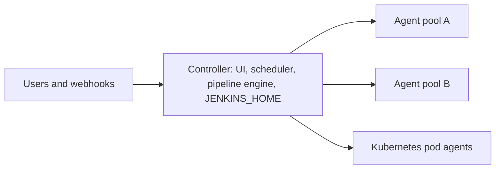
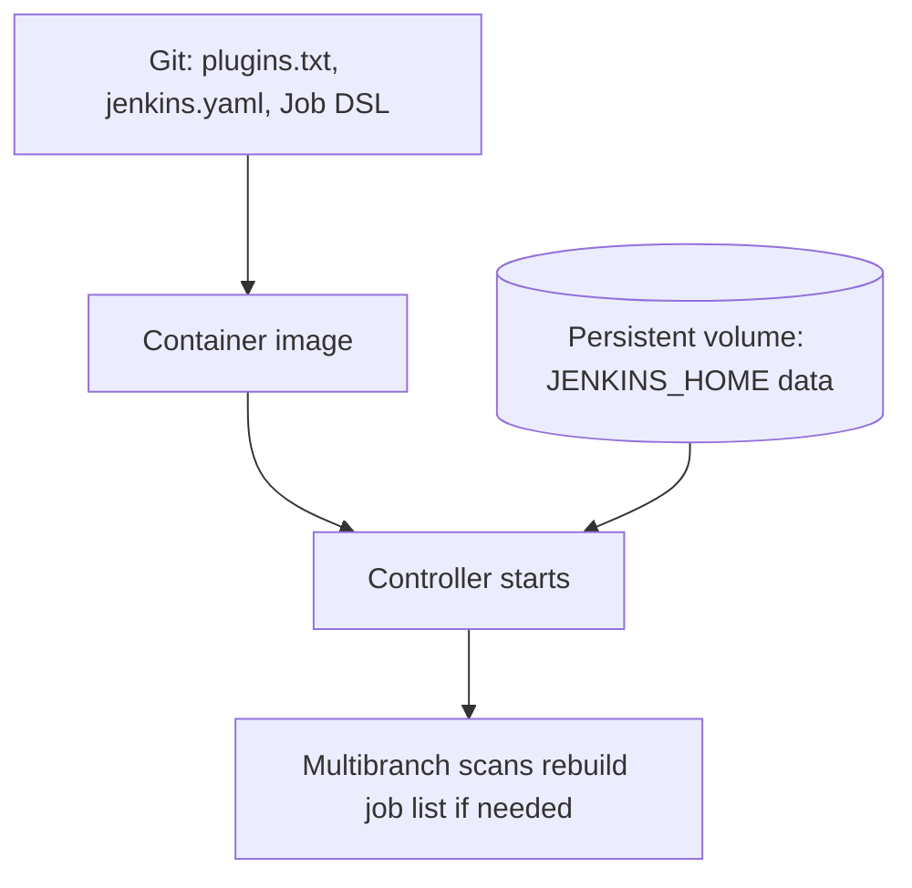
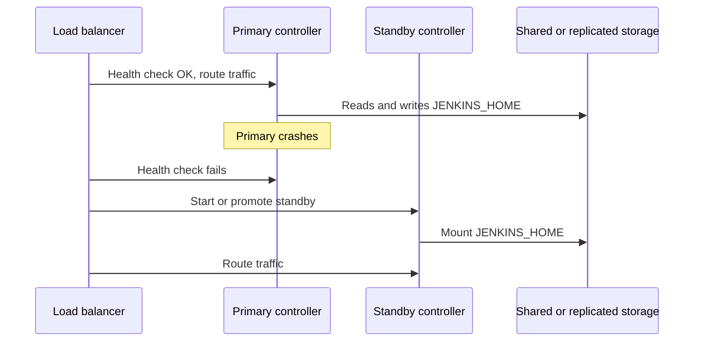
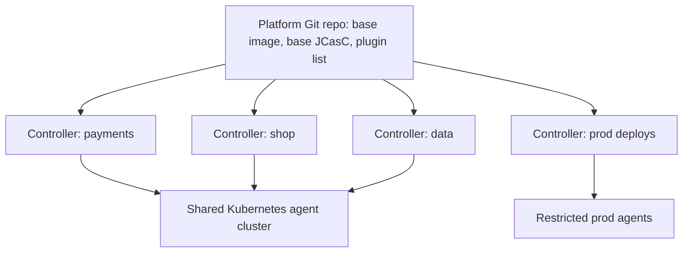

# High Availability and Scaling

## Introduction

Open-source Jenkins has a well-known architectural limit: **one controller process owns one `JENKINS_HOME`**. You cannot run two controllers against the same home directory at the same time, and you cannot put three controllers behind a load balancer and share the work. The controller is a **single point of failure**.

That does not mean Jenkins cannot be reliable or large. It means you get availability and scale in different ways than with a stateless web app:

- **Scale builds** horizontally with agents. This is the easy part.
- **Scale the organization** by running several controllers instead of one giant one.
- **Improve availability** by making the controller fast to recover (minutes), not by running it twice.

An analogy: a restaurant has one head chef (the controller) and many line cooks (agents). You can always add cooks. You cannot have two head chefs giving orders in the same kitchen, but you can open a second kitchen, and you can make sure a replacement chef can step in quickly with the same recipes.

In this page you will:

1. Understand exactly what is and is not a single point of failure.
2. Scale build capacity with agents.
3. Design for fast recovery: active-standby, Kubernetes, and "cattle" controllers.
4. Decide when and how to split work across multiple controllers.
5. Compare these options with managed and commercial alternatives.

:::note Honest framing
Commercial distributions (for example CloudBees CI) offer features such as high availability and multi-controller management. This page focuses on open-source Jenkins and only mentions commercial options as alternatives. Check vendors' current documentation for what they offer.
:::

## What Fails, and What Happens



| Component fails | Impact | Recovery |
| --- | --- | --- |
| One static agent | Builds on it fail or are retried. Others continue | Replace agent; labels route work elsewhere |
| A Kubernetes node running pod agents | Those builds fail | New pods start elsewhere automatically |
| **Controller process** | No UI, no scheduling, no webhooks processed. Running pipelines pause | Restart; durable pipelines can resume |
| **Controller disk or `JENKINS_HOME`** | Everything above, plus possible data loss | Restore from backup or snapshot |

Notice that **agents are not the availability problem**. The controller is.

What happens to running pipelines when the controller restarts? Pipelines are designed to survive restarts: the controller persists their state, and after startup they reconnect to their agents and continue. How reliably this works depends on the [durability setting](./4-jenkins-performance-tuning.mdx) and on whether the shutdown was graceful. Freestyle builds do not resume.

## Scaling Builds: Agents

The [Architecting for Scale](https://www.jenkins.io/doc/book/scaling/architecting-for-scale/) guide recommends that the controller handles HTTP requests and coordination while dedicated agents execute builds. That gives you near-unlimited build capacity:

- **Static agents** (SSH or inbound) for predictable workloads or special hardware.
- **Cloud agents** that start on demand: [Kubernetes pod agents](../6-jenkins-agents/4-jenkins-kubernetes-agents.mdx) or [VMs on AWS and Azure](../6-jenkins-agents/5-jenkins-cloud-agents.mdx).

The same guide offers a rough sizing heuristic for executors: about `number of jobs × 0.03`. Treat it as a starting point only; measure queue length and executor utilization ([Monitoring Jenkins](./3-jenkins-monitoring.mdx)) to adjust.

Each connected agent also costs the controller a little: the hardware guide notes that each agent connection uses 2 to 3 threads and roughly 2 MB of memory or more. Thousands of agents on one controller is possible but requires a well-sized controller.

## Availability Option 1: Fast Restore ("Cattle Controller")

The most common modern approach: make the controller cheap to rebuild.



1. **Configuration in Git** with [JCasC](./0-jenkins-configuration-as-code.mdx), plugins in `plugins.txt`, jobs via [Job DSL](./1-jenkins-job-dsl.mdx) or organization folders.
2. **Data on durable storage**: a persistent volume or cloud disk that survives the machine, plus [backups](./2-jenkins-backup-and-restore.mdx).
3. **An orchestrator restarts it**: systemd, Docker's restart policy, or a Kubernetes StatefulSet.

On Kubernetes, the `jenkinsci/jenkins` Helm chart deploys the controller as a **StatefulSet with one replica** backed by a PersistentVolumeClaim. If the node dies, Kubernetes reschedules the pod on another node and reattaches the volume (subject to your storage class and zone constraints). Recovery time is mostly controller startup time.

```yaml
# Helm values sketch for faster, safer recovery
controller:
  javaOpts: "-XX:MaxRAMPercentage=70.0"
  resources:
    requests:
      cpu: "2"
      memory: "6Gi"
    limits:
      memory: "6Gi"
  numExecutors: 0
persistence:
  enabled: true
  size: "100Gi"
  storageClass: "fast-ssd"
```

The storage class name above is an example; use one that exists in your cluster. Check that it supports volume expansion, since `JENKINS_HOME` tends to grow.

:::caution Zones
A typical block-storage volume lives in one availability zone. If the whole zone fails, the pod cannot be rescheduled with that volume elsewhere. Zone-redundant storage or snapshot-based restore into another zone covers that case, at extra cost.
:::

**Typical recovery time:** a few minutes, mostly JVM startup and plugin loading. Controllers with very many jobs take longer to load, which is one reason to keep controllers smaller.

## Availability Option 2: Active-Standby

The scaling guide also describes a setup with a primary controller behind a proxy (for example HAProxy or a hardware load balancer) that sends traffic to a standby controller if the primary fails.



Critical rules for active-standby:

- **Only one controller may run against `JENKINS_HOME` at a time.** Two controllers writing the same directory corrupt data. The standby must be stopped (cold standby) until it takes over, and something must fence the old primary.
- Storage must be shared (for example a SAN or NFS volume that moves) or replicated. Pipeline durability and performance suffer on slow network filesystems, so test carefully.
- The proxy's health check should hit a real endpoint, such as `/login` or the Metrics plugin's health check.

In practice, a Kubernetes StatefulSet or a cloud VM with an auto-recovering disk gives you the same "cold standby" behavior with far less custom plumbing, which is why Option 1 is usually preferred.

## Scaling the Organization: Multiple Controllers

One controller for the whole company eventually hits limits: startup takes too long, one team's plugin breaks everyone, upgrades need everyone's agreement, and a single outage stops all delivery. The scaling guide suggests splitting controllers by:

- **Environment** (for example a separate controller for production deployments),
- **Organization** (one controller per department or team),
- **Product line** (keeps a full pipeline visible in one place).

It also notes the trade-off: each controller needs its own plugin updates, core upgrades, backups and security setup. That cost is exactly what codification removes.



A practical multi-controller design:

1. One **base image** with core plugins, built and tested by the platform team.
2. A **base JCasC** (security, SSO, agents cloud, notifications) plus a small team overlay file.
3. Each controller is a separate Helm release in its own namespace.
4. Agents run in a shared Kubernetes cluster, separated by namespace and service account.
5. Upgrades roll out controller by controller, starting with a canary team.

```bash
for team in payments shop data; do
  helm upgrade --install "jenkins-${team}" jenkinsci/jenkins \
    --namespace "jenkins-${team}" --create-namespace \
    -f base-values.yaml -f "teams/${team}.yaml"
done
helm list -A | grep jenkins-
```

Example output:

```text
jenkins-data      jenkins-data      1  2026-10-11 09:12:03 +0000 UTC  deployed  jenkins-5.9.x  2.580.1
jenkins-payments  jenkins-payments  1  2026-10-11 09:10:41 +0000 UTC  deployed  jenkins-5.9.x  2.580.1
jenkins-shop      jenkins-shop      1  2026-10-11 09:11:22 +0000 UTC  deployed  jenkins-5.9.x  2.580.1
```

(Chart and app versions shown are illustrative; use the current ones from the chart repository.)

### Base Configuration Plus Team Overlays

With JCasC, each controller loads a shared base file plus a small team-specific file. Because JCasC merges files and refuses conflicting values, the base and the overlay must set **different** keys.

```yaml
# base/01-core.yaml (same for every controller)
jenkins:
  numExecutors: 0
  systemMessage: "Managed by the platform team. Changes in the UI are overwritten."
unclassified:
  slackNotifier:
    teamDomain: "acme"
    tokenCredentialId: "slack-bot-token"
    botUser: true
```

```yaml
# teams/payments.yaml (only what differs)
unclassified:
  location:
    url: "https://jenkins-payments.example.com/"
```

### What to Share Between Controllers

| Item | Share? | Why |
| --- | --- | --- |
| Base image and plugin list | Yes | One tested set, fewer surprises |
| Security realm (SSO) | Yes | One login for everyone |
| Shared libraries | Yes | Same build standards everywhere |
| Kubernetes agent cluster | Usually | Efficient, but isolate by namespace |
| Credentials | No, per controller | Limits damage if one controller is compromised |
| Production deploy agents | No | Keep them on the restricted controller only |

## Capacity Planning: A Worked Example

Before choosing an architecture, estimate the load. Here is a rough worked example using the heuristics from the official scaling guide, for a company with 600 jobs.

| Input | Value | Source of the number |
| --- | --- | --- |
| Jobs | 600 | Your inventory |
| Executors (jobs × 0.03) | about 18 concurrent builds | Scaling guide heuristic |
| Controller cores (1 per 100 jobs) | about 6 cores | Scaling guide assumption |
| Peak queue length observed | 25 | Your monitoring |

The heuristic says 18 executors, but the monitoring shows 25 builds waiting at peak. **Trust your measurements over heuristics**: the heuristic assumes an "average" mix of jobs, and your mix may have many short pull request builds that all arrive at 10:00.

A small script helps you size the agent pool from real data. It reads the queue length and busy executors from the Prometheus endpoint (see [Monitoring Jenkins](./3-jenkins-monitoring.mdx)):

```bash
#!/usr/bin/env bash
set -euo pipefail
METRICS=$(curl -sf -u "monitor:${API_TOKEN}" "${JENKINS_URL}/prometheus/")
queue=$(echo "$METRICS" | awk '/^default_jenkins_executors_queue_length /{print $2}')
busy=$(echo "$METRICS" | awk '/^default_jenkins_executors_busy /{print $2}')
online=$(echo "$METRICS" | awk '/^default_jenkins_executors_online /{print $2}')
echo "queue=${queue} busy=${busy} online=${online}"
```

Example output at a busy moment:

```text
queue=12.0 busy=20.0 online=20.0
```

All executors busy plus a queue means you need more agents (or autoscaling with a higher limit), not a bigger controller.

## Measuring Recovery Time

Your real availability is decided by how long a controller takes to come back. Measure it instead of guessing. On Kubernetes:

```bash
NS=jenkins
POD=$(kubectl -n "$NS" get pod -l app.kubernetes.io/component=jenkins-controller -o name)
start=$(date +%s)
kubectl -n "$NS" delete "$POD" --wait=false
until curl -sf -o /dev/null "https://jenkins.example.com/login"; do sleep 5; done
echo "Recovered in $(( $(date +%s) - start )) seconds"
```

Example output:

```text
pod "jenkins-0" deleted
Recovered in 142 seconds
```

The label selector shown matches the `jenkinsci/jenkins` chart's controller pod in recent versions; check yours with `kubectl get pod --show-labels`. Do this drill in staging first.

What makes startup slow, roughly in order:

1. **Many jobs and builds** to load (fix: build discarders, split controllers).
2. **Many plugins** (fix: remove unused plugins).
3. **Slow disks** for `JENKINS_HOME` (fix: SSD-backed volumes).
4. **Plugin installation at startup** (fix: bake plugins into the image instead of downloading them on every start).

## Disaster Recovery Runbook

High availability covers "the server died". Disaster recovery covers "the region or the data is gone". Write the runbook before you need it:

| Step | Action | Owner |
| --- | --- | --- |
| 1 | Declare the incident, post status in the engineering channel | On-call |
| 2 | Provision a controller in the recovery location from the same image tag | Platform |
| 3 | Restore the latest `JENKINS_HOME` backup or snapshot, then `master.key` from the secret store | Platform |
| 4 | Point DNS for the Jenkins URL to the new controller | Platform |
| 5 | Verify login, credentials, one build per agent type | Platform |
| 6 | Re-deliver missed webhooks or trigger scans of organization folders | Platform |
| 7 | Announce recovery and record the timeline | On-call |

Step 6 matters: webhooks sent while Jenkins was down are lost unless your Git server redelivers them. A scan of organization folders and multibranch jobs picks up any branches and pull requests that changed during the outage.

## Reducing Planned Downtime

Unplanned outages are rare compared with planned restarts for upgrades and plugin updates. Make those cheap:

- Use **safe restart** (waits for running builds) or **quiet mode** before restarts, via the UI or [CLI](./8-jenkins-rest-api-and-cli.mdx).
- Upgrade during low traffic, and test the new image on a staging controller first ([Upgrading Jenkins and LTS Releases](../1-jenkins-installation/6-jenkins-upgrading.mdx)).
- Keep startup fast: fewer plugins, build discarders, and not too many jobs per controller.
- Make webhooks resilient. Most Git servers show failed deliveries and can redeliver; multibranch jobs also run periodic scans as a safety net.

## Real-World Scenario

A 400-engineer company runs everything on one Jenkins controller with 2,500 jobs. Startup takes 25 minutes. A plugin upgrade requested by the data team broke the mobile team's builds for a day. A disk failure last year caused six hours of downtime. Leadership asks for "high availability".

**Solution:**

1. **Codify first.** Export JCasC, build `plugins.txt`, move jobs to organization folders and Job DSL.
2. **Split** into four controllers by product line plus one locked-down production deployment controller.
3. **Run on Kubernetes** with the Helm chart, each controller a StatefulSet on SSD-backed, snapshotted volumes.
4. **Shared agent cluster** with autoscaling pod agents. Production deploy agents are separate.
5. **Monitoring and alerts** on each controller, and quarterly restore drills.

The outcome: each controller starts in a few minutes, a bad plugin affects one product line, and a node failure means a short automatic restart instead of a manual rebuild.

**Why this approach:** "HA" was really about **blast radius** and **recovery time**. Smaller codified controllers improve both without fighting Jenkins' single-controller design.

**When to use it:** multiple teams with different plugin needs, or when one controller's startup time and outage impact have become painful.

**When not to:** a single team with a few hundred jobs. One well-monitored, codified controller with backups is simpler and good enough.

### Alternatives and Trade-offs

| Approach | Pros | Cons | Best for |
| --- | --- | --- | --- |
| Single controller, good backups | Simplest | Longest recovery, biggest blast radius | Small teams |
| **Codified controller on Kubernetes or auto-recovering VM** | Automatic restart, recovery in minutes, cheap | Still one controller; zone failure needs extra planning | Most teams |
| Active-standby with shared storage | Can survive host loss | Complex fencing, network filesystem performance, risk of double writes | Teams with strong infra skills and strict requirements |
| **Multiple controllers** | Smaller blast radius, independent upgrades | More instances to manage without automation | Large organizations |
| Commercial distribution with HA features | Vendor-supported HA and management | License cost, vendor dependency | Enterprises needing contractual SLAs |
| Hosted CI (GitHub Actions, GitLab CI) | No controller to run | Different model, migration effort | Teams leaving Jenkins ([Migrating to or from Jenkins](../13-jenkins-best-practices/3-jenkins-migrating-to-other-ci.mdx)) |

## Common Mistakes

1. **Running two controllers on the same `JENKINS_HOME`.** This corrupts data. Only one controller may be active.
2. **Executors on the controller "for capacity".** Use agents; the controller should not build.
3. **Mega-controller with thousands of jobs and plugins.** Startup, upgrades and outages all get worse.
4. **Multiple controllers without automation.** Five hand-configured controllers are five times the drift.
5. **Assuming a StatefulSet means zero downtime.** It means automatic restart. Users will still see a few minutes of downtime.
6. **Never testing failover.** Kill the controller pod in staging and time the recovery.

## Summary

- Open-source Jenkins runs one active controller per `JENKINS_HOME`. The controller is the single point of failure.
- Scale builds with agents, especially on-demand cloud and Kubernetes agents.
- Get availability from fast, automated recovery: codified configuration, durable storage, an orchestrator that restarts the controller.
- Active-standby is possible but needs fencing and careful storage.
- Split into multiple controllers to reduce blast radius, and automate them with a shared image and JCasC.
- Commercial and hosted CI are valid alternatives when HA requirements exceed what you want to build.

## Further Learning

### Exercises

1. Deploy Jenkins with the Helm chart on a local cluster (kind or minikube). Delete the controller pod and time how long until `/login` responds again.
2. Start a long-running pipeline, restart the controller gracefully, and watch it resume. Repeat with a forced kill and `PERFORMANCE_OPTIMIZED` durability.
3. Design a split of your organization's jobs into controllers. Write down which teams share a controller and why.
4. Write a shell loop that deploys two controllers from one base values file plus overlays.

### Related Pages

- [Jenkins Architecture](../0-jenkins-fundamentals/2-jenkins-architecture.mdx)
- [Choosing an Agent Strategy](../6-jenkins-agents/7-jenkins-agent-strategies.mdx)
- [Backup and Restore](./2-jenkins-backup-and-restore.mdx)
- [Installing Jenkins on Kubernetes](../1-jenkins-installation/2-jenkins-install-kubernetes.mdx)
- [Capstone: Production CI/CD Platform with Jenkins](../14-jenkins-projects/6-jenkins-capstone.mdx)
- Official docs: [Architecting for Scale](https://www.jenkins.io/doc/book/scaling/architecting-for-scale/)
