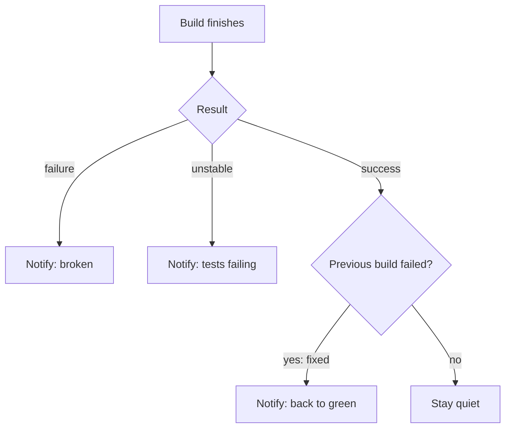

# Notifications: Email, Slack and Teams

## Introduction

A build that fails silently is almost as bad as no build at all. Notifications close the loop: the right people learn quickly that something broke, or that a deployment finished.

But notifications are easy to get wrong. Send every result to everyone and people mute the channel within a week. Send nothing and broken `main` branches stay broken for days. The goal is **the right message, to the right people, at the right moment**:

- A developer wants to know when **their** pull request build fails.
- A team wants to know when **main** breaks and when it is **fixed** again.
- Release managers want to know when a **deployment** starts, needs approval, or finishes.

Think of a smoke detector: useful because it is loud only when there is smoke. A detector that beeps every time you make toast gets its battery removed.

In this page you will:

1. Use `post` conditions to decide *when* to notify.
2. Send email with the built-in Mailer and the Email Extension plugin.
3. Send Slack messages with a bot token, including threads.
4. Send Microsoft Teams messages now that Office 365 connectors are retired.
5. Wrap it all in a reusable function and control noise.

## When to Notify: post Conditions

Notifications almost always live in the `post` section of a Declarative Pipeline (see [Post Conditions](../3-jenkins-pipeline-basics/7-jenkins-post-conditions.mdx)).



| Condition | Runs when | Good for |
| --- | --- | --- |
| `failure` | Current build failed | Alert the team |
| `unstable` | Tests failed but build completed | Alert, lower urgency |
| `fixed` | Success after a failure or unstable build | "Back to green" message |
| `regression` | Worse than the previous build | Alert only on new breakage |
| `changed` | Result differs from the previous build | State-change notifications |
| `always` | Every time | Logging, not people |

Using `failure` plus `fixed` instead of `always` is the single biggest noise reduction you can make.

```groovy
pipeline {
    agent { label 'linux' }
    stages {
        stage('Test') {
            steps { sh './gradlew test' }
        }
    }
    post {
        failure { echo "Notify: ${env.JOB_NAME} #${env.BUILD_NUMBER} failed" }
        fixed   { echo "Notify: ${env.JOB_NAME} is back to green" }
    }
}
```

Example output on a failing build:

```text
[Pipeline] echo
Notify: payments/billing-service/main #42 failed
```

## Email

### The Mailer Plugin and the mail Step

The `mailer` plugin provides basic SMTP configuration and the simple `mail` step. Configure SMTP under **Manage Jenkins > System > E-mail Notification**, or with JCasC:

```yaml
unclassified:
  location:
    url: "https://jenkins.example.com/"
    adminAddress: "Jenkins <jenkins@example.com>"
  mailer:
    smtpHost: "smtp.example.com"
    smtpPort: "587"
    useTls: true
    charset: "UTF-8"
    authentication:
      username: "jenkins@example.com"
      password: "${SMTP_PASSWORD}"
```

Key names can differ between plugin versions. If in doubt, configure it once in the UI and export with **Manage Jenkins > Configuration as Code > View Configuration** (see [Configuration as Code](./0-jenkins-configuration-as-code.mdx)). The `adminAddress` under `location` is the sender address.

```groovy
post {
    failure {
        mail to: 'payments-team@example.com',
             subject: "FAILED: ${env.JOB_NAME} #${env.BUILD_NUMBER}",
             body: "Build failed. Console: ${env.BUILD_URL}console"
    }
}
```

### Email Extension (emailext)

The **Email Extension** plugin (`email-ext`) is the richer option: HTML templates, attachments, and **recipient providers** that work out who should receive the mail.

```groovy
post {
    failure {
        emailext(
            subject: "FAILED: ${env.JOB_NAME} #${env.BUILD_NUMBER}",
            body: """<p>Build failed.</p>
                     <p><a href="${env.BUILD_URL}">Open build</a></p>""",
            mimeType: 'text/html',
            recipientProviders: [culprits(), requestor()],
            attachLog: true
        )
    }
}
```

Useful recipient providers:

| Provider | Who receives it |
| --- | --- |
| `developers()` | Authors of changes in this build |
| `culprits()` | Authors of changes since the last successful build |
| `requestor()` | The user who started the build manually |

The plugin offers more providers (for example suspects of broken tests). Use the [Snippet Generator](../3-jenkins-pipeline-basics/9-jenkins-pipeline-syntax-generator.mdx) on your controller to see the exact list for your version.

:::tip
Culprits are matched to Jenkins users by the email address on their commits. If developers commit with personal addresses, nobody receives the mail. Align commit emails with your SSO identities.
:::

## Slack

The Slack plugin (`slack`) works with a **Slack app bot token** (starts with `xoxb-`). The older "integration token" approach is legacy and less secure.

### Setup

1. At api.slack.com/apps, create an app (the plugin documentation provides a manifest with the needed bot scopes such as `chat:write`).
2. Install the app to your workspace and copy the **Bot User OAuth Token**.
3. Store the token in Jenkins as a **Secret text** credential.
4. Configure the plugin globally and **invite the bot** to each channel it posts to.

With JCasC:

```yaml
credentials:
  system:
    domainCredentials:
      - credentials:
          - string:
              scope: GLOBAL
              id: "slack-bot-token"
              secret: "${SLACK_BOT_TOKEN}"
              description: "Slack bot token"

unclassified:
  slackNotifier:
    teamDomain: "acme"
    tokenCredentialId: "slack-bot-token"
    botUser: true
```

`teamDomain` is the workspace name (the `acme` in `acme.slack.com`), not a full URL.

### Sending Messages

```groovy
post {
    failure {
        slackSend(
            channel: '#payments-ci',
            color: 'danger',
            message: ":red_circle: *FAILED* <${env.BUILD_URL}|${env.JOB_NAME} #${env.BUILD_NUMBER}>"
        )
    }
    fixed {
        slackSend(
            channel: '#payments-ci',
            color: 'good',
            message: ":large_green_circle: *FIXED* ${env.JOB_NAME} is green again"
        )
    }
}
```

Slack's own link syntax `<url|text>` is used inside the Groovy string, which is fine inside a code block.

### Threads for Long Pipelines

`slackSend` returns a response object. Use its `threadId` as the channel of later messages to keep a deployment's updates in one thread, instead of flooding the channel.

```groovy
def slackThread

pipeline {
    agent { label 'linux' }
    stages {
        stage('Start') {
            steps {
                script {
                    def resp = slackSend(channel: '#deploys',
                        message: "Deploying ${env.JOB_NAME} #${env.BUILD_NUMBER}")
                    slackThread = resp.threadId
                }
            }
        }
        stage('Deploy staging') {
            steps {
                sh './deploy.sh staging'
                slackSend(channel: slackThread, message: 'Staging done')
            }
        }
        stage('Deploy production') {
            steps {
                sh './deploy.sh production'
                slackSend(channel: slackThread, message: 'Production done', replyBroadcast: true)
            }
        }
    }
}
```

`replyBroadcast: true` also shows the final reply in the main channel. Slack also supports rich `blocks` messages; colors are not supported together with blocks.

## Microsoft Teams

### Connectors Are Retired; Use Workflows

For years Jenkins posted to Teams through **Office 365 Connectors** ("incoming webhooks" with `outlook.office.com/webhook/...` URLs). Microsoft has retired them: according to Microsoft's April 2026 update, connectors were progressively disabled between May 18 and May 22, 2026. The replacement is **Workflows** (built on Power Automate) with a "post to a channel when a webhook request is received" flow, which gives you a new webhook URL.

If your old Teams notifications stopped working in 2026, this is almost certainly why. Recreate them with Workflows.

Known differences called out by Microsoft: messages are posted by the Workflows bot identity (no custom names or icons), and interactive elements need **Adaptive Cards** instead of the old MessageCard format.

### Option A: The Office 365 Connector Plugin

The `Office-365-Connector` plugin (despite its name) supports Power Automate workflow URLs when you send Adaptive Cards:

```groovy
post {
    failure {
        withCredentials([string(credentialsId: 'teams-workflow-url', variable: 'TEAMS_URL')]) {
            office365ConnectorSend(
                webhookUrl: env.TEAMS_URL,
                status: 'Failure',
                message: "Build failed: [${env.JOB_NAME} #${env.BUILD_NUMBER}](${env.BUILD_URL})",
                adaptiveCards: true
            )
        }
    }
}
```

Store the workflow URL as a Secret text credential: anyone with the URL can post to your channel.

### Option B: Plain HTTP with an Adaptive Card

If you prefer fewer plugins, post JSON yourself with `curl`. The exact payload a workflow accepts depends on how the flow is built; the template "Post to a channel when a webhook request is received" expects a message containing an Adaptive Card attachment.

```groovy
post {
    failure {
        withCredentials([string(credentialsId: 'teams-workflow-url', variable: 'TEAMS_URL')]) {
            writeFile file: 'teams.json', text: """
{
  "type": "message",
  "attachments": [{
    "contentType": "application/vnd.microsoft.card.adaptive",
    "content": {
      "type": "AdaptiveCard",
      "version": "1.4",
      "body": [
        {"type": "TextBlock", "size": "Medium", "weight": "Bolder", "text": "Build failed"},
        {"type": "TextBlock", "wrap": true, "text": "${env.JOB_NAME} #${env.BUILD_NUMBER}"}
      ],
      "actions": [
        {"type": "Action.OpenUrl", "title": "Open build", "url": "${env.BUILD_URL}"}
      ]
    }
  }]
}
"""
            sh 'curl -sS -f -X POST -H "Content-Type: application/json" --data @teams.json "$TEAMS_URL"'
        }
    }
}
```

Note the single quotes around the `sh` script: `$TEAMS_URL` is expanded by the shell, not by Groovy, so the secret is not interpolated into the command string (Jenkins warns about Groovy-interpolated secrets).

## A Reusable notify() Function

Copying notification blocks into 100 Jenkinsfiles is how teams end up with 100 slightly different formats. Put the logic in a [shared library](../8-jenkins-shared-libraries/2-jenkins-global-vars.mdx) step:

```groovy
// vars/notifyBuild.groovy
def call(Map args = [:]) {
    String channel = args.channel ?: '#ci'
    String result = currentBuild.currentResult
    String prev = currentBuild.previousBuild?.result ?: 'NONE'

    boolean broken = result in ['FAILURE', 'UNSTABLE']
    boolean fixed = result == 'SUCCESS' && prev in ['FAILURE', 'UNSTABLE']
    if (!broken && !fixed) {
        echo "notifyBuild: ${result}, nothing to send"
        return
    }

    String icon = broken ? ':red_circle:' : ':large_green_circle:'
    String text = "${icon} *${fixed ? 'FIXED' : result}* <${env.BUILD_URL}|${env.JOB_NAME} #${env.BUILD_NUMBER}>"
    slackSend(channel: channel, color: broken ? 'danger' : 'good', message: text)
}
```

```groovy
// Jenkinsfile
@Library('acme-pipeline-lib@v3') _

pipeline {
    agent { label 'linux' }
    stages {
        stage('Test') { steps { sh './gradlew test' } }
    }
    post {
        always { notifyBuild(channel: '#payments-ci') }
    }
}
```

Example output on a passing build after a passing build:

```text
[Pipeline] echo
notifyBuild: SUCCESS, nothing to send
```

Now a format change, or a switch from Slack to Teams, is one pull request to the library.

## Real-World Scenario

Your company has 30 teams. Some use Slack, the data team uses Teams, and the compliance team needs an email for every production deployment. Today, notifications are hand-written in each Jenkinsfile; half of them notify on every build, so channels are muted, and the Teams ones silently stopped working in May 2026.

**Solution:**

1. Configure SMTP and the Slack bot token centrally through JCasC. Store each team's Teams workflow URL as a credential.
2. Write `notifyBuild` in the shared library. It reads a small per-repository setting (for example `notify: [slack: '#shop-ci']` or `notify: [teams: 'teams-data-url']`), sends only on `failure`, `unstable` and `fixed`, and uses Adaptive Cards for Teams.
3. Production deployment pipelines additionally call `emailext` to the compliance list with the change log, plus a Slack thread for progress.
4. Pull request builds notify only the author (`culprits()` email or a direct message), not the team channel.

**Why this approach:** central credentials, one format, and noise rules applied consistently. Fixing Teams for everyone was a single library change.

**When to use it:** more than a handful of teams or repositories.

**When not to:** one team with three repositories. A few `post` blocks are simpler. Also, if your Git server already reports commit statuses to pull requests ([GitHub Integration and Webhooks](../5-jenkins-scm-integration/2-jenkins-github-integration.mdx)), developers may not need chat messages for PR builds at all.

### Alternatives and Trade-offs

| Approach | Pros | Cons | Best for |
| --- | --- | --- | --- |
| Email (`mail`, `emailext`) | Universal, good for audit trails, reaches culprits | Easy to ignore, SMTP setup | Compliance and individual alerts |
| Slack plugin | Rich messages, threads, widely used | Plugin to maintain, bot must be invited | Team channels |
| Teams via Workflows | Works in Microsoft 365 organizations | Bot identity only, payload format quirks, recent platform change | Teams-based organizations |
| Plain `curl` to webhooks | No plugin, any service | You maintain payloads and error handling | Few plugins, custom formats |
| Commit statuses and PR checks | Shown exactly where developers look | Not a broadcast channel | Pull request feedback |
| Alertmanager or incident tools | Paging, escalation | Overkill for build results | Jenkins outages (see [Monitoring](./3-jenkins-monitoring.mdx)) |

## Common Mistakes

1. **Notifying on `always`.** Channels get muted. Use `failure`, `unstable` and `fixed`.
2. **Hard-coding tokens or webhook URLs in Jenkinsfiles.** Use credentials and `withCredentials`.
3. **Groovy-interpolating secrets into `sh`.** Use single-quoted shell strings so the shell expands the variable.
4. **Forgetting to invite the Slack bot.** Messages fail with a channel error.
5. **Still using Office 365 connector URLs.** They no longer work; move to Workflows.
6. **Letting a notification failure fail the build.** Wrap non-critical notifications in `catchError` or `try`, so a chat outage does not turn a green build red.

## Summary

- Decide *when* with `post` conditions: `failure`, `unstable` and `fixed` cover most needs.
- Email: `mail` for simple messages, `emailext` for HTML and recipient providers like `culprits()`.
- Slack: bot token in a Secret text credential, `slackSend`, threads via `threadId`.
- Teams: Office 365 connectors are retired; use Workflows webhooks with Adaptive Cards, via the Office 365 Connector plugin or `curl`.
- Centralize notification logic in a shared library step and secrets in credentials.

## Further Learning

### Exercises

1. Add `failure` and `fixed` notifications that `echo` messages, break and fix a build, and confirm only two messages appear.
2. Create a Slack app, store its token as a credential, and send a threaded message from a three-stage pipeline.
3. Create a Teams Workflow webhook and post an Adaptive Card from Jenkins with `curl`.
4. Write `notifyBuild` in a shared library and unit-test its "send or stay quiet" logic.

### Related Pages

- [Post Conditions](../3-jenkins-pipeline-basics/7-jenkins-post-conditions.mdx)
- [Credentials Management](../11-jenkins-security/3-jenkins-credentials.mdx)
- [Custom Steps with vars](../8-jenkins-shared-libraries/2-jenkins-global-vars.mdx)
- [Manual Input and Approvals](../4-jenkins-pipeline-advanced/2-jenkins-input-and-approvals.mdx)
- Official docs: [Slack plugin](https://plugins.jenkins.io/slack/), [Email Extension plugin](https://plugins.jenkins.io/email-ext/), [Office 365 Connector plugin](https://plugins.jenkins.io/Office-365-Connector/)
