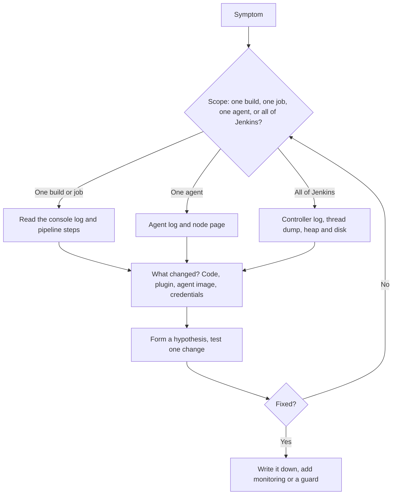

# Troubleshooting Jenkins

## Introduction

Sooner or later something goes wrong: Jenkins will not start after an upgrade, builds hang forever, agents keep disconnecting, the UI freezes, or a pipeline that worked yesterday now fails with a cryptic Groovy error.

Troubleshooting Jenkins is mostly about knowing **where to look**. Jenkins has several layers (JVM, core, plugins, agents, pipelines, your build tools), and each has its own evidence. A doctor does not start with surgery; they take a temperature, ask questions, and order the right test. Do the same here.

In this page you will:

1. Follow a repeatable troubleshooting process.
2. Find and read the right logs, and create log recorders for specific components.
3. Take thread dumps and heap dumps.
4. Fix the most common problems: startup failures, stuck builds, agent disconnects, out-of-memory errors, and pipeline errors.
5. Collect the right information when you need to ask for help or file a bug.

## A Repeatable Process



Two questions solve most problems quickly:

1. **What is the scope?** One build, one job, one agent, or everything?
2. **What changed?** A plugin update, a Jenkins upgrade, a new agent image, a rotated credential, a Jenkinsfile edit. The job's **Changes** page, the plugin manager's update history, and your Git log for JCasC and `plugins.txt` all help here.

## Where the Logs Are

### The Controller Log

| Install type | Where to read it |
| --- | --- |
| Linux package (systemd) | `journalctl -u jenkins.service` |
| Docker | `docker logs <container>` |
| Kubernetes (Helm) | `kubectl logs <pod> -c jenkins` |
| Windows (MSI) | `jenkins.out` and `jenkins.err` in `JENKINS_HOME` |
| In the UI | **Manage Jenkins > System Log** |

```bash
journalctl -u jenkins.service --since "30 min ago" | grep -E "SEVERE|WARNING" | tail -5
```

Example output:

```text
Oct 11 09:14:02 ci jenkins[812]: 2026-10-11 09:14:02.118+0000 [id=41] SEVERE jenkins.InitReactorRunner$1#onTaskFailed: Failed Loading plugin Example Plugin v1.2 (example)
Oct 11 09:14:02 ci jenkins[812]: java.io.IOException: Failed to load: Example Plugin (example 1.2)
Oct 11 09:14:02 ci jenkins[812]:  - Update required: Credentials Plugin (credentials 1300.v0) to be updated to 1400.v0 or higher
```

(Plugin names and versions in the sample are illustrative.) `SEVERE` lines at startup almost always point to plugins.

### Log Recorders

The default log only shows `INFO` and above. To debug a specific component, create a **log recorder**:

1. **Manage Jenkins > System Log > Add recorder**.
2. Name it, for example `git-debug`.
3. Add a logger such as `hudson.plugins.git` at level `FINE` (or `ALL`).
4. Reproduce the problem and read the recorder's page.

Useful loggers:

| Problem | Logger |
| --- | --- |
| Git checkouts | `hudson.plugins.git`, `jenkins.plugins.git` |
| Kubernetes pod agents | `org.csanchez.jenkins.plugins.kubernetes` |
| Agent connections | `hudson.slaves`, `jenkins.slaves` |
| Pipeline execution | `org.jenkinsci.plugins.workflow` |
| JCasC loading | `io.jenkins.plugins.casc` |

Turn debug recorders off afterwards. The Jenkins docs advise against debug-level logging in production. Recorders are kept in memory; the Support Core plugin can write custom logs to disk.

### Build and Agent Logs

- **Console Output** of a build, plus the **Pipeline Steps** or Pipeline Graph View for which step failed and how long each took.
- **Node page > Log** for agent connection logs (why an SSH agent could not start, why an inbound agent was rejected).
- For Kubernetes agents, `kubectl describe pod` and `kubectl get events` in the agent namespace reveal image pull errors and scheduling problems.

## Thread Dumps: "Why Is It Stuck?"

A thread dump shows what every thread in the JVM is doing right now. It is the best tool for freezes, hangs and slow UI.

Ways to get one, from the official guide:

- **Web UI**: `JENKINS_URL/threadDump` (administrators only). For an agent, use the node's **System Information** page.
- **`jstack <pid>`** when the UI is not responding, run as the same user as Jenkins.
- **`kill -3 <pid>`**: the dump goes to the JVM's standard output, which ends up in the controller log.
- The Metrics plugin's `threads` servlet.

```bash
PID=$(pgrep -f jenkins.war)
for i in 1 2 3; do
  sudo -u jenkins jstack "$PID" > "/tmp/threads-$i.txt"
  sleep 10
done
grep -c "java.lang.Thread.State: BLOCKED" /tmp/threads-*.txt
```

Example output:

```text
/tmp/threads-1.txt:37
/tmp/threads-2.txt:41
/tmp/threads-3.txt:39
```

Take **several dumps a few seconds apart**. A thread stuck on the same stack in all of them is your suspect. Look for:

- Many threads `BLOCKED` waiting on the same lock: find the thread that holds it.
- `Handling GET /job/...` threads stuck in a plugin's code: that plugin is slowing the UI.
- `Computer.threadPoolForRemoting` threads waiting on network I/O: agent or Git server problems.

## Heap Dumps and Out-of-Memory Errors

Symptoms: `java.lang.OutOfMemoryError` in the log, long freezes from garbage collection, or the process killed with exit code `137` (killed by the kernel; check `dmesg` or the container's OOMKilled status).

The [Diagnosing Errors](https://www.jenkins.io/doc/book/troubleshooting/diagnosing-errors/) guide distinguishes two patterns:

- Memory peaks during startup or during a specific build phase: the heap is too small.
- Memory climbs steadily and never comes down: likely a leak.

To capture evidence:

```bash
# Always-on safety net: add to the controller's JVM options (Docker example)
JENKINS_JAVA_OPTS="-XX:+HeapDumpOnOutOfMemoryError -XX:HeapDumpPath=/var/jenkins_home/heapdumps"

# Live heap dump on demand
sudo -u jenkins jmap -dump:live,file=/tmp/jenkins.hprof "$PID"

# Smaller alternative: class histogram
sudo -u jenkins jmap -histo:live "$PID" | head -15
```

Example output (histogram, truncated):

```text
 num     #instances         #bytes  class name (module)
-------------------------------------------------------
   1:       2104332      198731664  [B (java.base@21)
   2:       1890221       45365304  java.lang.String (java.base@21)
   3:        412870       29726640  hudson.tasks.junit.CaseResult
```

Lots of `CaseResult` objects, as in this sample, would suggest huge test histories being loaded. Analyze full dumps with a tool such as VisualVM or Eclipse MAT. Heap dumps contain secrets in memory, so handle them as sensitive data.

## Common Problems and Fixes

### Jenkins Will Not Start After an Upgrade

1. Read the startup log for `SEVERE` lines. Usually a plugin needs a newer dependency or a newer core.
2. Check Java: current LTS releases require Java 21 or newer. An old JDK on the host prevents startup.
3. Update the failing plugins (via `jenkins-plugin-cli` in your image, or by placing newer `.jpi` files), or roll back to the previous image or package.
4. If a single plugin is the problem and you need Jenkins up now, disable it by creating a file named `<plugin>.jpi.disabled` next to it in `JENKINS_HOME/plugins`, then restart.

See [Upgrading Jenkins and LTS Releases](../1-jenkins-installation/6-jenkins-upgrading.mdx) and [Avoiding Plugin Sprawl and Dependency Problems](../7-jenkins-plugins/2-jenkins-plugin-dependency-hell.mdx).

### Builds Stuck in the Queue

Hover over the queued item or open it: Jenkins tells you why it waits.

| Queue message | Meaning | Fix |
| --- | --- | --- |
| "Waiting for next available executor on 'docker'" | All agents with that label are busy | Add capacity, check autoscaling |
| "There are no nodes with the label 'dockr'" | Typo or missing label | Fix the label in the Jenkinsfile |
| "All nodes of label 'linux' are offline" | Agents disconnected | Check node logs |
| "Waiting for next available executor" with a Kubernetes cloud | Pods are not starting | `kubectl get events`, check image, quotas, service account |
| "Build #12 is already in progress" | Concurrent builds disabled | Expected, or allow concurrency |

### Builds Running Forever

1. Look at the last lines of the console: is a test hanging, waiting for input, or a process waiting on a prompt (for example `git` asking for credentials)?
2. Add a `timeout` around stages and the pipeline ([Timeouts, Retries and Error Handling](../4-jenkins-pipeline-advanced/3-jenkins-timeouts-and-retries.mdx)).
3. To stop a stuck pipeline, use **Abort**. If that fails, the build page offers stronger options (the URLs `/term` and then `/kill` on the build) that forcibly end the pipeline. Use them as a last resort.

### Agents Disconnecting

- **"Ping response time is too long or timed out"**: Jenkins pings every remoting connection; slow networks, overloaded agents, or long GC pauses on either side cause timeouts.
- **SSH agents**: check host keys, Java version on the agent, and the agent's disk space.
- **Inbound agents**: check that the agent can reach the controller URL (WebSocket) or the TCP agent port, and that a reverse proxy is not closing idle connections.
- **Kubernetes agents**: pods evicted for memory (`OOMKilled`) or ephemeral storage. Raise container limits in the pod template.

See [Controller and Agents](../6-jenkins-agents/0-jenkins-controller-and-agents.mdx) and [Securing Agents and the Controller](../11-jenkins-security/6-jenkins-securing-agents.mdx).

### Pipeline Errors

| Error | Usual cause | Fix |
| --- | --- | --- |
| `Scripts not permitted to use method ...` | Groovy sandbox blocked a method | Approve in **In-process Script Approval** if safe, or move logic to a shared library or shell ([Script Security](../11-jenkins-security/5-jenkins-script-security.mdx)) |
| `java.io.NotSerializableException` | A non-serializable object stored in a variable across steps | Use `@NonCPS` helpers or keep such objects local ([Groovy Essentials](../4-jenkins-pipeline-advanced/5-jenkins-groovy-for-pipelines.mdx)) |
| `No such DSL method 'xyz'` | Plugin providing the step is missing, or a typo | Install the plugin or check the Snippet Generator |
| `WorkflowScript: 12: Expected a step` | Declarative syntax error | Validate with the linter (below) |
| `MissingPropertyException: No such property: foo` | Undefined variable or wrong scope | Define it, or use `env.FOO` / `params.FOO` |
| `ERROR: script returned exit code 1` | Your build command failed | Read the lines above; it is a build problem, not Jenkins |

Validate a Declarative Jenkinsfile before pushing, with the built-in linter endpoint:

```bash
curl -s -X POST -u "alice:${JENKINS_API_TOKEN}" \
  -F "jenkinsfile=<Jenkinsfile" \
  "https://jenkins.example.com/pipeline-model-converter/validate"
```

Example output:

```text
Errors encountered validating Jenkinsfile:
WorkflowScript: 5: Unknown stage section "step". Starting with version 0.5, steps in a stage must be in a 'steps' block. @ line 5, column 9.
```

Use **Replay** ([Restart from Stage and Replay](../4-jenkins-pipeline-advanced/7-jenkins-restart-and-replay.mdx)) to try a fix without pushing commits.

### Reverse Proxy Problems

Many Jenkins installations sit behind nginx, Apache, a cloud load balancer or a Kubernetes ingress. Typical symptoms:

| Symptom | Likely cause | Fix |
| --- | --- | --- |
| "It appears that your reverse proxy set up is broken" on Manage Jenkins | Jenkins URL in configuration does not match the URL users use, or forwarded headers are missing | Set the Jenkins URL correctly; forward `Host` and `X-Forwarded-*` headers |
| Redirects go to `http://` instead of `https://` | Proxy does not send `X-Forwarded-Proto` | Add the header in the proxy |
| Inbound agents or the CLI disconnect after 60 seconds | Proxy closes idle WebSocket connections | Raise proxy timeouts, enable WebSocket upgrade |
| 413 errors when uploading plugins or file parameters | Proxy request size limit | Increase the body size limit |

The Jenkins docs have a dedicated [reverse proxy troubleshooting page](https://www.jenkins.io/doc/book/system-administration/reverse-proxy-configuration-troubleshooting/).

### Disk Full

A full disk on the controller causes strange errors: failed saves, corrupted `config.xml` files, builds that cannot write logs. Check quickly:

```bash
df -h /var/lib/jenkins
sudo du -sh /var/lib/jenkins/{jobs,workspace,plugins,logs} 2>/dev/null
```

Example output:

```text
Filesystem      Size  Used Avail Use% Mounted on
/dev/sdb1       200G  197G  3.0G  99% /var/lib/jenkins
171G	/var/lib/jenkins/jobs
18G	/var/lib/jenkins/workspace
1.2G	/var/lib/jenkins/plugins
640M	/var/lib/jenkins/logs
```

Free space with build discarders and by removing old workspaces, then fix the cause (see [Performance Tuning](./4-jenkins-performance-tuning.mdx)).

### Credentials Not Working

- Check the credential **ID** and **scope** (a folder-scoped credential is not visible to other folders).
- After restoring a backup, failing decryption means `secrets/master.key` does not match ([Backup and Restore](./2-jenkins-backup-and-restore.mdx)).
- Rotated tokens: JCasC may still hold the old value until the next reload.

## The Script Console, Carefully

**Manage Jenkins > Script Console** (`/script`) runs Groovy with full access to Jenkins. It is powerful for diagnosis, and equally dangerous: it can read every credential and change any setting, and its actions may not appear in normal audit logs. Use read-only scripts, and keep them in version control.

```groovy
// List jobs whose last build has been running for more than 2 hours
import jenkins.model.Jenkins

long limit = 2 * 60 * 60 * 1000L
Jenkins.instance.getAllItems(hudson.model.Job).each { job ->
    def b = job.lastBuild
    if (b != null && b.isBuilding() && (System.currentTimeMillis() - b.startTimeInMillis) > limit) {
        println "${job.fullName} #${b.number} running for ${(System.currentTimeMillis() - b.startTimeInMillis).intdiv(60000)} min"
    }
}
return null
```

Example output:

```text
mobile-app/main #812 running for 431 min
```

## Asking for Help

When you ask a colleague, a forum (community.jenkins.io) or file an issue, include:

1. Jenkins version and Java version.
2. Relevant plugin names and versions.
3. Exact error text and stack trace.
4. What changed recently and steps to reproduce.
5. Thread dumps for hangs; heap histograms for memory issues.

The **Support Core** plugin (`support-core`) can generate a support bundle with much of this (versions, plugins, logs, thread dumps, system info) in one click. Review it for sensitive data before sharing.

## Real-World Scenario

Monday morning, developers report that Jenkins pages take 30 seconds to load and some builds sit "pending" forever. Nothing was deployed over the weekend, according to the team.

**Walkthrough:**

1. **Scope:** everything is slow, so the controller is the focus, not a single job.
2. **What changed:** Git history of the JCasC repository shows nothing. But the plugin manager shows that an admin updated plugins on Friday evening through the UI.
3. **Evidence:** three thread dumps 10 seconds apart show dozens of request threads blocked behind one thread inside a recently updated plugin's code that runs during page rendering.
4. **Hypothesis:** the plugin update introduced a slow operation.
5. **Test:** disable the plugin on a staging controller restored from last night's backup: pages are fast again.
6. **Fix:** roll back that plugin version in `plugins.txt`, rebuild the image, redeploy. File an issue with the thread dump.
7. **Prevent:** UI plugin updates are disabled by policy; all changes go through `plugins.txt` and a staging controller.

**Why this approach:** a structured process found the cause in under an hour, instead of restarting Jenkins repeatedly and hoping.

### Alternatives and Trade-offs

| Approach | Pros | Cons | Best for |
| --- | --- | --- | --- |
| Restart and hope | Fast, sometimes works | Destroys evidence, problem returns | Never as a first step |
| Logs and log recorders | Detailed, built in | Noisy, need the right logger | Errors and plugin failures |
| Thread dumps | Shows exactly what is stuck | Needs interpretation | Hangs and slowness |
| Heap dumps | Finds memory hogs and leaks | Large files, contain secrets | Out-of-memory errors |
| Support bundle | Complete snapshot in one file | Must be reviewed before sharing | Asking for outside help |
| Monitoring dashboards | Shows trends before failure | Needs setup in advance | Preventing the next incident ([Monitoring](./3-jenkins-monitoring.mdx)) |

## Common Mistakes

1. **Restarting before collecting evidence.** Take thread dumps first; a restart erases the state you needed.
2. **Leaving debug loggers on.** They slow Jenkins and fill memory.
3. **Approving every script approval request.** Some methods give full controller access. Review each one.
4. **Updating plugins in production through the UI.** Changes are untracked and untested.
5. **Ignoring "what changed".** Most incidents follow a change.
6. **Sharing heap dumps or bundles unreviewed.** They can contain secrets.

## Summary

- Start with scope (build, job, agent, or all) and "what changed".
- Controller logs live in journald, `docker logs`, `kubectl logs`, or **System Log**. Use log recorders for specific components.
- Take several thread dumps for hangs; capture heap dumps or histograms for memory problems.
- Queue messages explain why builds wait; timeouts prevent endless builds.
- Know the common pipeline errors and use the Declarative linter and Replay.
- Use the Script Console carefully, and collect versions, logs and dumps when asking for help.

## Further Learning

### Exercises

1. Create a log recorder for `hudson.plugins.git` at `FINE`, run a build, and read what Jenkins logs about the checkout.
2. Write a pipeline that sleeps for 10 minutes, take a thread dump from `/threadDump`, and find the pipeline's thread.
3. Introduce a Declarative syntax error and catch it with the `pipeline-model-converter/validate` endpoint.
4. Start Jenkins in Docker with a tiny heap (`-Xmx256m`), cause an `OutOfMemoryError` with many builds, and inspect the heap dump.

### Related Pages

- [Monitoring Jenkins](./3-jenkins-monitoring.mdx)
- [Performance Tuning](./4-jenkins-performance-tuning.mdx)
- [REST API and CLI](./8-jenkins-rest-api-and-cli.mdx)
- [Jenkins Anti-Patterns](../13-jenkins-best-practices/1-jenkins-anti-patterns.mdx)
- Official docs: [Troubleshooting Jenkins](https://www.jenkins.io/doc/book/troubleshooting/), [Viewing logs](https://www.jenkins.io/doc/book/system-administration/viewing-logs/)
