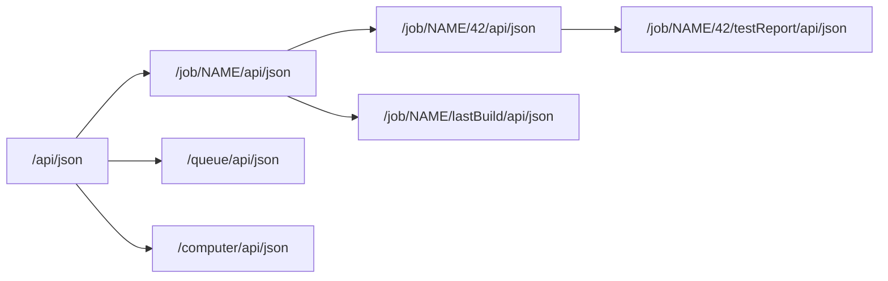
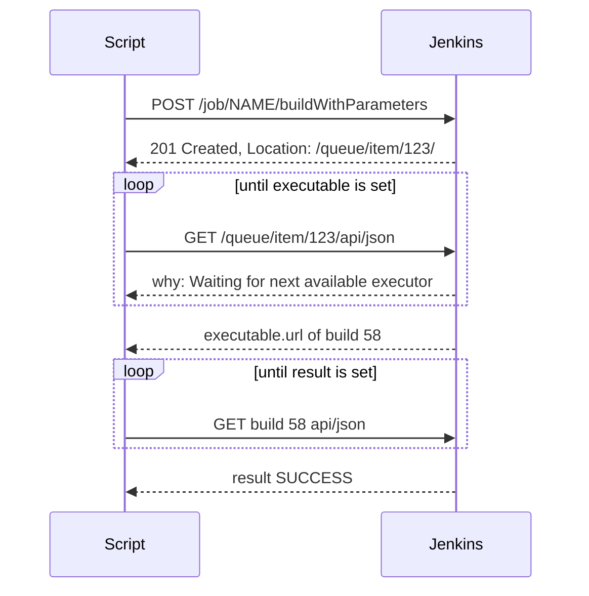

# REST API and CLI

## Introduction

Everything you can click in Jenkins, you can also script. Jenkins exposes:

- a **remote access API** (usually called the REST API) on almost every page, in JSON, XML and Python formats, and
- a **command-line client**, `jenkins-cli.jar`, with commands for builds, jobs, nodes, plugins and administration.

These are how other systems talk to Jenkins: a release script that triggers a deployment, a chatbot that shows build status, a migration script that copies job definitions, a dashboard that lists failing jobs, or an admin putting Jenkins into quiet mode before maintenance.

A useful mental model: the UI is the front desk for humans, the REST API is the service entrance for machines, and the CLI is a set of master keys for administrators.

In this page you will:

1. Authenticate scripts with API tokens.
2. Read data with `/api/json` and trim it with the `tree` parameter.
3. Trigger builds (with parameters), follow them through the queue and read the result.
4. Read and write job configuration.
5. Use the Jenkins CLI for administration.
6. Wrap it in a small Python client.

## Authentication: API Tokens

Scripts should authenticate with a **user name and API token** over HTTP Basic authentication, never with a password.

1. Log in as the user the script should act as (ideally a dedicated service account with only the permissions it needs).
2. Open the user menu, then **Security** (or `JENKINS_URL/me/configure` on older versions), and **Add new Token**.
3. Copy the token once and store it in your secret manager.

```bash
export JENKINS_URL="https://jenkins.example.com"
export JENKINS_USER="release-bot"
export JENKINS_API_TOKEN="<token from your secret manager>"

curl -s -u "$JENKINS_USER:$JENKINS_API_TOKEN" "$JENKINS_URL/whoAmI/api/json"
```

Example output:

```json
{"_class":"hudson.security.WhoAmI","anonymous":false,"authenticated":true,"authorities":["authenticated"],"name":"release-bot"}
```

:::note CSRF crumbs
Jenkins protects state-changing requests against CSRF with "crumbs". Requests authenticated with an **API token** do not need a crumb, which is one more reason to use tokens. Scripts that use passwords or session cookies must fetch a crumb from `JENKINS_URL/crumbIssuer/api/json` first. Avoid that path.
:::

Permissions still apply: the API can only do what the token's user is allowed to do. See [Authorization and Role-Based Access](../11-jenkins-security/2-jenkins-authorization.mdx).

## Reading Data: /api/json

Add `/api/json` (or `/api/xml`, `/api/python`) to the URL of almost any Jenkins object: the root, a folder, a job, a build, a node, the queue. Open `/api/` on any page in a browser to see the documentation for that object.



Jobs in folders use nested `job/` segments: the job `payments/billing-service` lives at `/job/payments/job/billing-service/`. A multibranch branch adds another level: `/job/payments/job/billing-service/job/main/` (branch names with slashes are URL-encoded, for example `feature%252Flogin` for `feature/login`).

### The tree Parameter

Without filtering, responses can be huge. The `tree` query parameter selects exactly the fields you need, which is faster for both Jenkins and your script.

```bash
curl -s -u "$JENKINS_USER:$JENKINS_API_TOKEN" \
  "$JENKINS_URL/api/json?tree=jobs[name,color]" | python3 -m json.tool
```

Example output:

```json
{
    "_class": "hudson.model.Hudson",
    "jobs": [
        {"_class": "com.cloudbees.hudson.plugins.folder.Folder", "name": "payments"},
        {"_class": "org.jenkinsci.plugins.workflow.job.WorkflowJob", "name": "website", "color": "blue"}
    ]
}
```

`color` encodes the last result: `blue` (success), `red` (failure), `yellow` (unstable), `notbuilt`, `disabled`, and an `_anime` suffix while building.

Nest fields with brackets and limit list size with braces:

```bash
curl -s -g -u "$JENKINS_USER:$JENKINS_API_TOKEN" \
  "$JENKINS_URL/job/website/api/json?tree=builds[number,result,duration]{0,3}"
```

Example output:

```json
{"_class":"org.jenkinsci.plugins.workflow.job.WorkflowJob","builds":[{"_class":"org.jenkinsci.plugins.workflow.job.WorkflowRun","duration":0,"number":57,"result":null},{"_class":"org.jenkinsci.plugins.workflow.job.WorkflowRun","duration":184233,"number":56,"result":"SUCCESS"},{"_class":"org.jenkinsci.plugins.workflow.job.WorkflowRun","duration":201871,"number":55,"result":"FAILURE"}]}
```

`-g` stops `curl` from interpreting the brackets and braces as its own URL globbing. A `result` of `null` means the build is still running.

Prefer `tree` over the older `depth` parameter: `depth=2` on the root can make Jenkins serialize most of its memory and slow the controller for everyone.

### Console Output

```bash
curl -s -u "$JENKINS_USER:$JENKINS_API_TOKEN" \
  "$JENKINS_URL/job/website/lastBuild/consoleText" | tail -3
```

Example output:

```text
[Pipeline] }
[Pipeline] // node
Finished: SUCCESS
```

For streaming logs of a running build, `logText/progressiveText?start=N` returns new output since byte `N` and sets `X-More-Data` and `X-Text-Size` headers. Client libraries and the CLI's `console -f` command use this.

## Triggering Builds



- `POST /job/NAME/build` for jobs without parameters.
- `POST /job/NAME/buildWithParameters` with form data for parameterized jobs.
- For multibranch pipelines and organization folders, `POST /job/NAME/build` triggers a **scan**.

```bash
curl -s -i -X POST -u "$JENKINS_USER:$JENKINS_API_TOKEN" \
  "$JENKINS_URL/job/deploy-service/buildWithParameters" \
  --data-urlencode "ENVIRONMENT=staging" \
  --data-urlencode "VERSION=1.8.2" | grep -i -E "^HTTP|^location"
```

Example output:

```text
HTTP/2 201
location: https://jenkins.example.com/queue/item/123/
```

The `Location` header points to a **queue item**, not a build, because the build has not started yet. Poll the queue item until it has an `executable`:

```bash
curl -s -u "$JENKINS_USER:$JENKINS_API_TOKEN" \
  "$JENKINS_URL/queue/item/123/api/json?tree=why,cancelled,executable[number,url]"
```

Example output:

```json
{"_class":"hudson.model.Queue$LeftItem","cancelled":false,"executable":{"_class":"org.jenkinsci.plugins.workflow.job.WorkflowRun","number":58,"url":"https://jenkins.example.com/job/deploy-service/58/"},"why":null}
```

Queue items disappear a few minutes after the build starts, so poll promptly.

File parameters use `--form` with `@` and a path, and the form field name must match the parameter name. See [Build Parameters](../2-jenkins-jobs/2-jenkins-build-parameters.mdx).

## Reading and Writing Job Configuration

Every job's configuration is available as XML at `/job/NAME/config.xml`.

```bash
# Download
curl -s -u "$JENKINS_USER:$JENKINS_API_TOKEN" \
  "$JENKINS_URL/job/website/config.xml" -o website.xml

# Create a copy as a new job
curl -s -X POST -u "$JENKINS_USER:$JENKINS_API_TOKEN" \
  -H "Content-Type: application/xml" --data-binary @website.xml \
  "$JENKINS_URL/createItem?name=website-copy" -w "%{http_code}\n"

# Update an existing job
curl -s -X POST -u "$JENKINS_USER:$JENKINS_API_TOKEN" \
  -H "Content-Type: application/xml" --data-binary @website.xml \
  "$JENKINS_URL/job/website-copy/config.xml" -w "%{http_code}\n"
```

Example output:

```text
200
200
```

This is handy for one-off migrations and backups of individual jobs. For ongoing job management, prefer [Job DSL](./1-jenkins-job-dsl.mdx) or multibranch pipelines, which are reviewable and repeatable.

## A Small Python Client

For anything beyond a couple of calls, write a small script. This one uses only `requests`, triggers a build, and waits for the result.

```python
# trigger_and_wait.py
import os
import sys
import time

import requests

JENKINS_URL = os.environ["JENKINS_URL"].rstrip("/")
AUTH = (os.environ["JENKINS_USER"], os.environ["JENKINS_API_TOKEN"])


def job_path(full_name: str) -> str:
    """Turn 'team/app' into '/job/team/job/app'."""
    return "".join(f"/job/{part}" for part in full_name.split("/"))


def trigger(job: str, params: dict) -> str:
    endpoint = "buildWithParameters" if params else "build"
    r = requests.post(f"{JENKINS_URL}{job_path(job)}/{endpoint}",
                      auth=AUTH, data=params, timeout=30)
    r.raise_for_status()
    return r.headers["Location"]


def wait_for_build_url(queue_url: str, timeout_s: int = 600) -> str:
    deadline = time.time() + timeout_s
    while time.time() < deadline:
        item = requests.get(f"{queue_url}api/json", auth=AUTH, timeout=30).json()
        if item.get("cancelled"):
            raise RuntimeError("Queue item was cancelled")
        if item.get("executable"):
            return item["executable"]["url"]
        print(f"queued: {item.get('why')}")
        time.sleep(5)
    raise TimeoutError("Build did not start in time")


def wait_for_result(build_url: str, timeout_s: int = 3600) -> str:
    deadline = time.time() + timeout_s
    while time.time() < deadline:
        build = requests.get(f"{build_url}api/json?tree=result,building",
                             auth=AUTH, timeout=30).json()
        if not build["building"] and build["result"]:
            return build["result"]
        time.sleep(10)
    raise TimeoutError("Build did not finish in time")


if __name__ == "__main__":
    job_name = sys.argv[1]
    params = dict(arg.split("=", 1) for arg in sys.argv[2:])
    queue_url = trigger(job_name, params)
    build_url = wait_for_build_url(queue_url)
    print(f"started: {build_url}")
    result = wait_for_result(build_url)
    print(f"result: {result}")
    sys.exit(0 if result == "SUCCESS" else 1)
```

```bash
pip install requests
python3 trigger_and_wait.py deploy-service ENVIRONMENT=staging VERSION=1.8.2
```

Example output:

```text
queued: Waiting for next available executor on 'linux'
started: https://jenkins.example.com/job/deploy-service/58/
result: SUCCESS
```

The Jenkins docs also list ready-made libraries: **python-jenkins**, **JenkinsAPI** and **api4jenkins** for Python, **jenkins_api_client** for Ruby, and **jenkins-rest** for Java.

## The Jenkins CLI

The CLI client is served by your controller at `JENKINS_URL/jnlpJars/jenkins-cli.jar`, so its version always matches.

```bash
curl -sO "$JENKINS_URL/jnlpJars/jenkins-cli.jar"
echo "$JENKINS_USER:$JENKINS_API_TOKEN" > ~/.jenkins-cli-auth
chmod 600 ~/.jenkins-cli-auth

java -jar jenkins-cli.jar -s "$JENKINS_URL" -auth @"$HOME/.jenkins-cli-auth" who-am-i
```

Example output:

```text
Authenticated as: release-bot
Authorities:
  authenticated
```

Connection and authentication options:

| Option | Meaning |
| --- | --- |
| `-webSocket` | Default transport; works through most reverse proxies |
| `-http` | Older HTTP transport, must be requested explicitly |
| `-ssh -user NAME` | SSH transport using the user's registered public key (SSH server disabled by default) |
| `-auth user:token` | Credentials on the command line (visible in shell history) |
| `-auth @file` | Credentials from a file (recommended) |
| `JENKINS_USER_ID`, `JENKINS_API_TOKEN` | Environment variables, overridden by `-auth` |

Run `help` to see every command your controller supports, including commands added by plugins. Commands you may not see are hidden by your permissions, which `who-am-i` helps diagnose.

Common commands:

```bash
CLI="java -jar jenkins-cli.jar -s $JENKINS_URL -auth @$HOME/.jenkins-cli-auth"

$CLI list-jobs
$CLI build deploy-service -p ENVIRONMENT=staging -p VERSION=1.8.2 -s -v
$CLI console website 56
$CLI get-job website > website.xml
$CLI create-job website-copy < website.xml
$CLI quiet-down
$CLI cancel-quiet-down
$CLI safe-restart
$CLI reload-jcasc-configuration
```

- `build ... -s -v` waits for the build and streams its output; the CLI exits non-zero if the build fails, which suits scripts.
- `quiet-down` stops new builds from starting (useful before maintenance and [backups](./2-jenkins-backup-and-restore.mdx)); `safe-restart` waits for running builds first.
- `reload-jcasc-configuration` exists when the JCasC plugin is installed ([Configuration as Code](./0-jenkins-configuration-as-code.mdx)).
- `groovy` runs a script like the Script Console. It requires administrator permission; treat it with the same care.

Example output from `build -s -v` (shortened):

```text
Started deploy-service #59
[Pipeline] Start of Pipeline
...
Finished: SUCCESS
Completed deploy-service #59 : SUCCESS
```

## Real-World Scenario

Your release team uses a small internal tool to cut releases. After tagging, it must trigger the Jenkins `deploy-service` job for staging, wait, run smoke tests, and only then trigger production. They also want the nightly maintenance window to drain Jenkins safely before the OS patching runs.

**Solution:**

1. Create a `release-bot` service user with permission to build only the deploy jobs (role-based authorization), and an API token stored in the company secret manager.
2. The release tool uses the Python client above: `buildWithParameters`, poll the queue item, poll the build, stop on anything but `SUCCESS`.
3. The maintenance script uses the CLI: `quiet-down`, wait until `/computer/api/json?tree=busyExecutors` reports 0 busy executors, patch, then `cancel-quiet-down`.
4. Both scripts log the build URL so humans can click through.

**Why this approach:** the REST API is language-neutral and needs only HTTP; the CLI gives concise admin commands with sensible exit codes.

**When to use it:** integrating Jenkins with other tools, admin automation, migrations, reporting.

**When not to:** building a second CI system on top of Jenkins with dozens of chained API calls. If jobs trigger each other heavily, use pipeline features (`build` step, upstream triggers) inside Jenkins instead. And do not use the API to change global configuration that belongs in JCasC.

### Alternatives and Trade-offs

| Approach | Pros | Cons | Best for |
| --- | --- | --- | --- |
| **REST API with curl or HTTP client** | Any language, no extra tools | Must handle queue polling and errors yourself | Integrations, dashboards |
| Client libraries (python-jenkins, jenkins-rest) | Convenience functions | Another dependency; may lag behind Jenkins | Larger tools |
| **Jenkins CLI** | Concise admin commands, exit codes | Needs Java on the client | Admin scripts, maintenance |
| Webhooks from Git | Event-driven, no polling | Only for SCM events | Starting CI on push |
| `build` step inside pipelines | Native, visible in Jenkins | Only from inside Jenkins | Chaining jobs |
| JCasC and Job DSL | Declarative, reviewed | Not for runtime actions | Configuration and jobs |

## Common Mistakes

1. **Using passwords instead of API tokens.** Tokens can be revoked individually and avoid CSRF crumb handling.
2. **Huge `depth` queries.** Use `tree` to select fields.
3. **Treating the `Location` header as the build URL.** It is a queue item; poll it until `executable` appears.
4. **Forgetting folder paths.** `payments/billing-service` is `/job/payments/job/billing-service`.
5. **Putting tokens in command lines and CI logs.** Use `-auth @file` or environment variables from a secret store.
6. **Giving the automation user admin rights.** Grant only the job permissions it needs.
7. **Polling too aggressively.** Every few seconds is plenty; hundreds of scripts polling every 100 ms add real load.

## Summary

- Authenticate scripts with a dedicated user and API token; tokens do not need CSRF crumbs.
- Add `/api/json` to any URL, and use `tree` (with `curl -g`) to select fields.
- Trigger with `build` or `buildWithParameters`, then follow the queue item to the build and its result.
- `config.xml` and `createItem` read and write job definitions.
- `jenkins-cli.jar` comes from your controller, uses WebSocket by default, and supports `-auth @file`.
- Prefer JCasC and Job DSL for configuration; use the API and CLI for runtime actions and integrations.

## Further Learning

### Exercises

1. Create an API token and list all jobs with their colors using `tree=jobs[name,color]`.
2. Trigger a parameterized job with `curl`, capture the `Location` header, and poll it until the build number appears.
3. Run `trigger_and_wait.py` against a job that fails, and confirm the exit code is 1.
4. Download `jenkins-cli.jar`, run `help`, and script a `quiet-down` / `cancel-quiet-down` maintenance window.

### Related Pages

- [Build Parameters](../2-jenkins-jobs/2-jenkins-build-parameters.mdx)
- [Build Triggers](../2-jenkins-jobs/1-jenkins-build-triggers.mdx)
- [Authentication and SSO](../11-jenkins-security/1-jenkins-authentication.mdx)
- [Troubleshooting Jenkins](./7-jenkins-troubleshooting.mdx)
- Official docs: [Remote Access API](https://www.jenkins.io/doc/book/using/remote-access-api/), [Jenkins CLI](https://www.jenkins.io/doc/book/managing/cli/)
