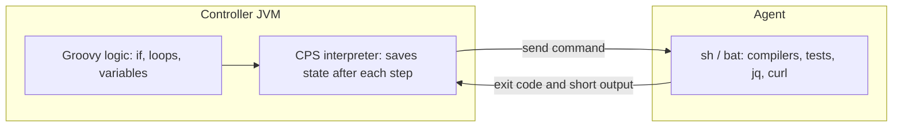

# Pipeline Best Practices

## Introduction

By this point in the tutorial you can write a Jenkinsfile that builds, tests and deploys. This page is about writing one that is still pleasant to live with a year from now, when fifty teams have copied it, the controller runs two hundred builds an hour, and the person who wrote it has moved on.

The official Jenkins documentation has a page called [Pipeline Best Practices](https://www.jenkins.io/doc/book/pipeline/pipeline-best-practices/). Its core message fits in one sentence: **use Groovy as glue, not as the program**. Most of the other advice in this page follows from that idea plus a few lessons about security and resource use.

An analogy: a Jenkinsfile is like the conductor of an orchestra. The conductor decides who plays when and how loud, but never picks up a violin. The moment your pipeline starts doing the real work itself (parsing large JSON files, looping over thousands of items, calling HTTP APIs), the orchestra loses its conductor.

This page covers:

- why Groovy code runs on the controller and what that means for performance,
- a checklist of practices grouped into structure, speed, safety and maintainability,
- a "before and after" refactor of a realistic pipeline,
- how to decide which rules to enforce across many teams.

## Where Your Pipeline Code Actually Runs

Everything else on this page makes more sense once you know this one fact. A pipeline has two kinds of code:

1. **Groovy code** in the Jenkinsfile: `if` statements, loops, variables, method calls, string manipulation. This **always runs on the controller**, inside the CPS (continuation-passing style) interpreter that lets pipelines survive restarts.
2. **Steps that launch processes**, such as `sh`, `bat` and `powershell`. The commands inside them run **on the agent**.



The CPS interpreter is slower than normal Groovy, and every running pipeline shares the controller's CPU and memory. A pipeline that does heavy work in Groovy does not just slow itself down. It slows down **every** build on the instance. You saw this in more detail on [Groovy Essentials for Pipelines](../4-jenkins-pipeline-advanced/5-jenkins-groovy-for-pipelines.mdx).

The rule of thumb that follows: **if a task could be a shell command on the agent, make it one.**

## Structure: Keep the Pipeline Readable

### Prefer Declarative Pipeline

Declarative Pipeline gives you a fixed structure (`agent`, `stages`, `post`, `options`), syntax checking before the build starts, and good support in the Pipeline Graph View plugin. Reach for Scripted Pipeline, or a `script` block, only when you genuinely need dynamic behavior. See [Declarative vs Scripted Pipelines](../3-jenkins-pipeline-basics/4-jenkins-declarative-vs-scripted.mdx).

### One stage, one purpose

Stage names appear in the UI, in notifications and in timing reports. Name them after **what** they do for the team, not how:

| Weak stage name | Better stage name |
| --- | --- |
| `Step 1` | `Build` |
| `mvn` | `Unit Tests` |
| `Run script` | `Publish Image` |
| `Deploy stuff` | `Deploy to Staging` |

Keep the count reasonable. Five to ten stages is typical. Thirty stages usually means the pipeline is doing work that belongs in a build tool or a script.

### Put build logic in the build tool or in scripts

The Jenkinsfile should call `make test`, `./gradlew check` or `./ci/deploy.sh staging`. It should not reimplement them. This has three benefits:

- developers can run the same command on their laptop,
- the logic can be tested without Jenkins,
- moving to another CI system later is much easier (see [Migrating to or from Jenkins](./3-jenkins-migrating-to-other-ci.mdx)).

```groovy
pipeline {
    agent { label 'linux' }
    stages {
        stage('Build') {
            steps {
                sh 'make build'
            }
        }
        stage('Test') {
            steps {
                sh 'make test'
            }
        }
    }
}
```

### Combine consecutive shell steps

Every step has overhead: it is recorded, persisted and shown in the log as a separate node. The official guide says to "combine Pipeline steps into single steps as often as possible."

```groovy
// Slower and noisier: four separate steps
sh 'npm ci'
sh 'npm run lint'
sh 'npm test'
sh 'npm run build'

// Better: one step, one shell, one log block
sh '''
    set -e
    npm ci
    npm run lint
    npm test
    npm run build
'''
```

Keep separate steps when you want separate visibility, for example when "lint" and "test" are different stages that people check independently.

## Speed: Respect the Controller

### Parse data on the agent

`JsonSlurper`, `XmlSlurper` and `readFile` followed by Groovy parsing all run on the controller and load the whole file into controller memory. Parse on the agent and return only the value you need:

```groovy
// Avoid: a 50 MB JSON report loaded into controller memory
// def report = new groovy.json.JsonSlurper().parseText(readFile('report.json'))
// def failed = report.results.findAll { it.status == 'FAILED' }.size()

// Prefer: jq runs on the agent, only a number comes back
def failed = sh(
    script: "jq '[.results[] | select(.status == \"FAILED\")] | length' report.json",
    returnStdout: true
).trim()
echo "Failed checks: ${failed}"
```

Example output:

```text
[Pipeline] sh
+ jq '[.results[] | select(.status == "FAILED")] | length' report.json
[Pipeline] echo
Failed checks: 3
```

For small files, the `readJSON` step from the `pipeline-utility-steps` plugin is acceptable and clearer, but keep the same principle in mind: the parsed result lives on the controller.

### Make HTTP calls on the agent

The same logic applies to HTTP. Call `curl` from an `sh` step instead of using a Groovy HTTP client or the `httpRequest` step for large responses. Filter the response (with `jq`, for example) before returning it to the pipeline.

### Discard old builds

Every build keeps its log, metadata and archived artifacts on the controller's disk. Without a limit, `JENKINS_HOME` grows forever, and job pages get slower to load.

```groovy
options {
    buildDiscarder(logRotator(numToKeepStr: '30', artifactNumToKeepStr: '5'))
}
```

Store large or long-lived artifacts in an artifact repository (Nexus, Artifactory, S3, a container registry), not in Jenkins.

### Cancel superseded builds

On busy branches, a new commit often makes the running build pointless:

```groovy
options {
    disableConcurrentBuilds(abortPrevious: true)
}
```

Use this on pull request and feature branch builds. Think twice before using it on deployment pipelines, where an aborted deploy can leave an environment half-updated.

## Safety: Fail Fast, Fail Clearly, Leak Nothing

### Always set a timeout

A hung test or a stuck `docker pull` can hold an executor for days. Set a pipeline-wide ceiling plus tighter limits on risky stages:

```groovy
options {
    timeout(time: 45, unit: 'MINUTES')
}
stages {
    stage('Integration Tests') {
        options { timeout(time: 20, unit: 'MINUTES') }
        steps { sh './ci/integration-tests.sh' }
    }
}
```

### Retry only what is flaky for a known reason

`retry` hides problems if you wrap everything in it. Use it around operations that are flaky for infrastructure reasons (artifact downloads, agent provisioning), not around tests that fail randomly. Fix flaky tests instead. See [Timeouts, Retries and Error Handling](../4-jenkins-pipeline-advanced/3-jenkins-timeouts-and-retries.mdx).

### Never interpolate secrets into Groovy strings

This is the most important security rule for Jenkinsfiles. A Groovy double-quoted string (a GString) substitutes `${TOKEN}` **on the controller, before** the command is sent to the agent. The secret then appears in the process arguments, where other processes can see it, and special characters may change it so log masking no longer recognizes it.

```groovy
withCredentials([string(credentialsId: 'deploy-token', variable: 'TOKEN')]) {
    // Wrong: Groovy interpolates the secret into the command line
    // sh "curl -H 'Authorization: Bearer ${TOKEN}' https://deploy.example.com/api"

    // Right: single quotes, the shell reads TOKEN from its environment
    sh 'curl -sf -H "Authorization: Bearer $TOKEN" https://deploy.example.com/api'
}
```

Jenkins itself warns about this. When it detects the problem, the build log contains a message similar to:

```text
Warning: A secret was passed to "sh" using Groovy String interpolation, which is insecure.
         Affected argument(s) used the following variable(s): [TOKEN]
```

### Never interpolate untrusted parameters either

The same mechanism allows command injection. If a user can set a `BRANCH` parameter to `main; rm -rf /`, a double-quoted `sh "git checkout ${params.BRANCH}"` runs both commands. Pass parameters as environment variables and let the shell quote them:

```groovy
pipeline {
    agent any
    parameters {
        string(name: 'BRANCH', defaultValue: 'main', description: 'Branch to build')
    }
    stages {
        stage('Checkout') {
            environment {
                TARGET_BRANCH = "${params.BRANCH}"
            }
            steps {
                sh 'git checkout "$TARGET_BRANCH"'
            }
        }
    }
}
```

Assigning the parameter to an environment variable is fine. What matters is that the `sh` command string itself is single-quoted, so the shell (not Groovy) expands the value and treats it as one argument.

### Do not wait for humans while holding an agent

An `input` step inside a stage that has an agent keeps that agent's executor busy while someone goes to lunch. Put approval stages on `agent none`, or use the stage-level `input` directive, which runs before the agent is allocated:

```groovy
stage('Approve Production') {
    agent none
    input {
        message 'Deploy to production?'
        ok 'Deploy'
        submitter 'release-managers'
    }
    steps {
        echo 'Approved'
    }
}
```

Combine it with a `timeout` so forgotten approvals do not sit there for weeks. See [Manual Input and Approvals](../4-jenkins-pipeline-advanced/2-jenkins-input-and-approvals.mdx).

### Always clean up and always report

Use `post` blocks so cleanup and notifications happen whatever the result:

```groovy
post {
    always {
        junit allowEmptyResults: true, testResults: '**/build/test-results/**/*.xml'
    }
    failure {
        echo "Build failed: ${env.BUILD_URL}"
    }
    cleanup {
        cleanWs()
    }
}
```

`cleanWs()` comes from the Workspace Cleanup plugin. With ephemeral container or Kubernetes agents, the workspace disappears with the pod, so you often do not need it there.

## Environment: Builds Should Be Reproducible

### Use ephemeral, containerized agents

A static agent collects leftovers: old Node versions, cached files, half-finished Docker images. A build that passes there may fail on a clean machine. The official guide recommends building "in distinct containers" that start from scratch. Docker agents or Kubernetes pod agents give each build a known, clean toolchain:

```groovy
pipeline {
    agent {
        docker {
            image 'node:22-alpine'
            args '-v $HOME/.npm:/root/.npm'
        }
    }
    stages {
        stage('Test') {
            steps { sh 'npm ci && npm test' }
        }
    }
}
```

See [Docker Agents](../6-jenkins-agents/3-jenkins-docker-agents.mdx) and [Kubernetes Pod Agents](../6-jenkins-agents/4-jenkins-kubernetes-agents.mdx).

### Pin versions

Pin image tags, tool versions and shared library versions. `node:latest` and `@Library('ci-lib') _` (which follows the default branch) both mean that a build from last week may not be reproducible today.

```groovy
@Library('ci-lib@v3.4.1') _
```

### Do not share workspaces between concurrent builds

Two builds writing to the same directory corrupt each other. If two pipelines truly need the same resource (a test database, a hardware device), use the `lock` step from the Lockable Resources plugin, and keep the locked section short.

## Maintainability: Scale to Many Teams

### Move repeated code to a shared library, carefully

When ten repositories have the same 80-line deploy stage, put it in a [shared library](../8-jenkins-shared-libraries/0-jenkins-shared-libraries-introduction.mdx). But follow the official guidance for libraries too:

- do not override built-in steps such as `sh` or `timeout`,
- keep `vars/` files small, because they are loaded for each pipeline that uses the library,
- avoid huge libraries, which slow down checkout and use memory for every running job,
- version and test the library like any other product.

### Avoid `Jenkins.instance` in pipelines

Calls like `Jenkins.instance` or `Jenkins.getInstance()` inside a pipeline usually mean the pipeline is doing administration work. They also need script approval and break easily between versions. If you really need that access, the official advice is to write a small plugin that wraps the API safely.

### Keep pipeline state serializable

Pipelines save local variables so they can resume after a restart. Holding a non-serializable object (a `Matcher`, an open connection) in a variable across a step causes `NotSerializableException`. Compute such values when you need them, and use `@NonCPS` only for small pure helpers that do not call pipeline steps.

### Validate before you commit

Use the Declarative linter so syntax errors do not cost a full build cycle:

```bash
curl -s -X POST -u "$JENKINS_USER:$JENKINS_TOKEN" \
  -F "jenkinsfile=<Jenkinsfile" \
  "$JENKINS_URL/pipeline-model-converter/validate"
```

Example output:

```text
Jenkinsfile successfully validated.
```

## A Before-and-After Refactor

Here is a pipeline that "works" but breaks many of the rules above:

```groovy
// Before
node {
    checkout scm
    def pkg = new groovy.json.JsonSlurper().parseText(readFile('package.json'))
    def version = pkg.version
    sh 'npm install'
    sh 'npm test'
    sh 'npm run build'
    withCredentials([string(credentialsId: 'npm-token', variable: 'NPM_TOKEN')]) {
        sh "echo //registry.npmjs.org/:_authToken=${NPM_TOKEN} > .npmrc && npm publish"
    }
    input 'Deploy to production?'
    sh "./deploy.sh ${version}"
}
```

Problems: no timeout, no build discarder, JSON parsed on the controller, `npm install` instead of a lockfile install, secret interpolated by Groovy, `input` holding the executor, no test reports, no cleanup, and an agent with whatever Node version happens to be installed.

```groovy
// After
pipeline {
    agent none
    options {
        timeout(time: 30, unit: 'MINUTES')
        buildDiscarder(logRotator(numToKeepStr: '30'))
        disableConcurrentBuilds()
    }
    stages {
        stage('Build and Test') {
            agent { docker { image 'node:22-alpine' } }
            steps {
                sh '''
                    set -e
                    npm ci
                    npm test
                    npm run build
                '''
                script {
                    env.APP_VERSION = sh(script: 'node -p "require(\'./package.json\').version"',
                                         returnStdout: true).trim()
                }
                stash name: 'dist', includes: 'dist/**'
            }
            post {
                always { junit allowEmptyResults: true, testResults: 'reports/junit.xml' }
            }
        }
        stage('Publish') {
            agent { docker { image 'node:22-alpine' } }
            when { branch 'main' }
            steps {
                unstash 'dist'
                withCredentials([string(credentialsId: 'npm-token', variable: 'NPM_TOKEN')]) {
                    sh '''
                        echo "//registry.npmjs.org/:_authToken=${NPM_TOKEN}" > .npmrc
                        npm publish
                        rm -f .npmrc
                    '''
                }
            }
        }
        stage('Approve Production') {
            when { branch 'main' }
            options { timeout(time: 1, unit: 'DAYS') }
            input { message 'Deploy to production?' }
            steps { echo "Approved ${env.APP_VERSION}" }
        }
        stage('Deploy') {
            agent { label 'deployer' }
            when { branch 'main' }
            steps { sh './deploy.sh "$APP_VERSION"' }
        }
    }
}
```

Note that the `.npmrc` line now uses `${NPM_TOKEN}` inside a **single-quoted** Groovy string, so it is shell syntax, expanded by the shell on the agent.

## Real-World Scenario

Your company runs one Jenkins controller for 40 product teams. The controller regularly hits 90% CPU in the afternoon, the disk filled up twice last quarter, and a security review found a deploy token in a build log. The platform team is asked to "fix the pipelines" without rewriting every team's Jenkinsfile.

**The solution** is a short, enforced baseline instead of a long wiki page:

1. Publish a **pipeline checklist** of eight rules: Declarative syntax, global `timeout`, `buildDiscarder`, single-quoted `sh` with credentials, no `JsonSlurper` or `Jenkins.instance`, containerized agents, pinned library versions, `post` with test reports.
2. Put the defaults in the shared library's standard pipeline (see [Pipeline Templates for Many Teams](../8-jenkins-shared-libraries/7-jenkins-pipeline-templates.mdx)) so teams get them for free.
3. Add a lint stage in the shared library repository and a simple check in each team's PR build that greps for the worst patterns:

```bash
#!/usr/bin/env bash
# ci/jenkinsfile-lint.sh: fail on known-bad patterns
set -u
status=0
check() {
  if grep -nE "$1" Jenkinsfile; then
    echo "LINT: $2"
    status=1
  fi
}
check 'JsonSlurper|XmlSlurper'        'parse data on the agent (jq, yq) instead'
check 'Jenkins\.(instance|getInstance)' 'do not access Jenkins internals from a pipeline'
check 'sh +"[^"]*\$\{[A-Z_]*(TOKEN|PASSWORD|SECRET)' 'secret interpolated by Groovy, use single quotes'
grep -q 'timeout(' Jenkinsfile || { echo "LINT: no timeout configured"; status=1; }
exit $status
```

Example output:

```text
12:        sh "curl -H 'Authorization: Bearer ${API_TOKEN}' https://api.example.com"
LINT: secret interpolated by Groovy, use single quotes
LINT: no timeout configured
```

4. Track the results on the [monitoring dashboard](../12-jenkins-administration/3-jenkins-monitoring.mdx): controller CPU, queue length, disk use.

**Why this approach:** most controller load and most leaks come from a handful of patterns. Fixing those through defaults and a cheap lint gives the biggest improvement for the least disruption. Teams keep their Jenkinsfiles. They just stop doing the dangerous things.

**When to use it:** any shared Jenkins with more than a few teams. **When not to:** a single small team with three pipelines does not need a lint script. A code review checklist is enough.

### Alternatives and trade-offs

| Approach | Pros | Cons | Best for |
| --- | --- | --- | --- |
| Written guidelines only | Zero effort to start | Nobody reads them, no enforcement | Very small teams |
| Grep-based lint in PR builds | Cheap, fast, catches the worst cases | Regex is fragile, false positives | Most organizations as a first step |
| Mandatory shared pipeline template | Strong consistency, defaults built in | Less flexibility, platform team becomes a bottleneck | Many similar services |
| Script approval and sandbox restrictions | Enforced by Jenkins itself | Only covers security, not performance or style | Security baseline everywhere |
| Move to a hosted CI | No controller to protect | Large migration, different trade-offs | Teams already on one Git host |

## Common Mistakes

- **Treating the Jenkinsfile as an application.** Hundreds of lines of Groovy loops and maps belong in a script or a build tool.
- **No timeout.** One stuck build per day quietly consumes an executor for the whole week.
- **Double-quoted `sh` with secrets or parameters.** It leaks credentials and enables injection. Default to single quotes.
- **Unpinned everything.** `latest` images and unversioned libraries make yesterday's green build red today with no code change.
- **`input` on an agent.** It wastes executors and, on Kubernetes, keeps pods running.
- **Using `retry` to hide flaky tests.** It makes failures rarer and harder to diagnose.
- **Storing big artifacts in Jenkins.** Use an artifact repository and keep `JENKINS_HOME` small.

## Summary

- Groovy in a pipeline runs on the controller. Use it as glue and push real work to `sh` steps on agents.
- Combine shell steps, parse data with `jq` or similar on the agent, and discard old builds.
- Set timeouts, use `post` for cleanup and reporting, and retry only known-flaky infrastructure steps.
- Never put secrets or user parameters into double-quoted Groovy strings passed to `sh`.
- Build on clean, containerized agents with pinned versions.
- Enforce a short baseline through shared library defaults and cheap linting, not just documentation.

## Exercises

1. Take one of your own Jenkinsfiles and list every place where Groovy does work that a shell command could do. Rewrite one of them using `jq` or a script.
2. Add `timeout`, `buildDiscarder` and `disableConcurrentBuilds` options to a pipeline, then push two commits quickly and observe what happens to the first build.
3. Write a pipeline with a deliberate `sh "echo ${TOKEN}"` inside `withCredentials`, run it, and find the interpolation warning in the console log. Then fix it.
4. Extend the lint script above with one more rule your team cares about, such as forbidding `agent any` on production deploy stages.

Related pages:

- [Jenkins Anti-Patterns](./1-jenkins-anti-patterns.mdx) for the larger, architectural mistakes.
- [Pipeline Options and Tuning](../4-jenkins-pipeline-advanced/6-jenkins-pipeline-options.mdx) for every option used here.
- [Credentials Management](../11-jenkins-security/3-jenkins-credentials.mdx) for safe secret handling.
- The general [CI/CD tutorial](/docs/devops/cicd) for language-neutral pipeline design advice.
