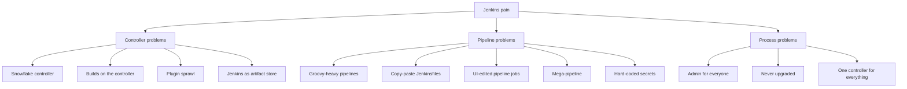

# Jenkins Anti-Patterns

## Introduction

An **anti-pattern** is a solution that looks reasonable at first, is common, and causes more trouble than it solves. Jenkins has been around since 2011 (as Hudson, since 2005), so it has had plenty of time to collect them. Many Jenkins installations that people complain about are not suffering from Jenkins itself. They are suffering from three or four of the anti-patterns on this page, stacked on top of each other.

The [previous page](./0-jenkins-pipeline-best-practices.mdx) covered good habits inside a single Jenkinsfile. This page zooms out to the **whole installation**: how the controller is configured, how plugins are managed, how pipelines are shared, and how people work with Jenkins day to day.

Think of it as a home inspection. A house can have nicely painted rooms (good Jenkinsfiles) and still have a cracked foundation (a hand-configured controller nobody can rebuild). This page is the inspector's checklist.

For each anti-pattern you will see:

- **Symptoms**: how to recognize it,
- **Why it happens**: it usually started for a good reason,
- **Why it hurts**,
- **The fix**, with code where it helps.

## The Anti-Pattern Map



## Controller Anti-Patterns

### 1. The Snowflake Controller

**Symptoms:** All configuration was done through the web UI over several years. Nobody knows why some settings exist. There is a wiki page titled "Jenkins setup (outdated)". The phrase "don't touch it, it works" is used.

**Why it happens:** the UI is the easiest way to get started, and every change is small.

**Why it hurts:** if the server dies, you cannot rebuild it. You cannot test an upgrade on a copy, because you cannot make a faithful copy. Changes are not reviewed, so mistakes and security holes slip in.

**The fix:** describe the controller as code.

- System settings with [Configuration as Code (JCasC)](../12-jenkins-administration/0-jenkins-configuration-as-code.mdx).
- Plugins in a `plugins.txt` file installed with the Plugin Installation Manager tool (see [Managing Plugins as Code](../7-jenkins-plugins/3-jenkins-plugin-installation-manager.mdx)).
- Jobs as Jenkinsfiles discovered by multibranch or organization folders, or created by [Job DSL](../12-jenkins-administration/1-jenkins-job-dsl.mdx).
- The whole thing built into a container image.

```dockerfile
FROM jenkins/jenkins:lts-jdk21
ENV CASC_JENKINS_CONFIG=/var/jenkins_home/casc.yaml
COPY plugins.txt /usr/share/jenkins/ref/plugins.txt
RUN jenkins-plugin-cli --plugin-file /usr/share/jenkins/ref/plugins.txt
COPY casc.yaml /var/jenkins_home/casc.yaml
```

A simple test of success: can you delete the controller and get an identical one back in under an hour, with only the build history lost?

You can migrate gradually. JCasC can export the current configuration (Manage Jenkins, Configuration as Code, View Configuration), which gives you a starting point to clean up and commit.

### 2. Builds Running on the Controller

**Symptoms:** the built-in node has executors. Jobs use `agent any` and some of them land on the controller. Disk fills with workspaces under `JENKINS_HOME`.

**Why it happens:** a fresh test install has executors on the built-in node, so the first jobs run there and nobody changes it.

**Why it hurts:** a build on the controller runs with the controller's file system access. A malicious or careless build script can read `JENKINS_HOME`, including encrypted credentials and the keys that decrypt them. Builds also compete with the web UI and the pipeline engine for CPU and memory. The Jenkins documentation on [controller isolation](https://www.jenkins.io/doc/book/security/controller-isolation/) recommends not running builds on the built-in node.

**The fix:** set the built-in node's executors to 0 and run every build on an agent.

```yaml
# casc.yaml fragment
jenkins:
  numExecutors: 0
  mode: EXCLUSIVE
```

If you need "something small that runs everywhere", add a lightweight agent rather than reopening the controller.

### 3. Plugin Sprawl

**Symptoms:** 250 installed plugins, many with "unused?" in nobody's notes. Upgrades are feared because "something always breaks". Several plugins show warnings that they are deprecated, abandoned or have unresolved security advisories.

**Why it happens:** each plugin solves one person's problem in five minutes. Removing one feels risky because you do not know who depends on it.

**Why it hurts:** every plugin adds dependencies, startup time, memory use, upgrade risk and attack surface. Abandoned plugins may never receive security fixes.

**The fix:**

- Keep the plugin list in version control and review additions like code dependencies.
- Prefer doing work in shell steps over adding a plugin that wraps a CLI tool.
- Periodically remove plugins that are unused. The Plugin Usage plugin can help find which jobs use which plugins.
- Watch the "deprecated" and "security warning" banners in Plugin Manager.

See [Avoiding Plugin Sprawl and Dependency Problems](../7-jenkins-plugins/2-jenkins-plugin-dependency-hell.mdx).

### 4. Jenkins as an Artifact Repository

**Symptoms:** `archiveArtifacts` saves 2 GB installers on every build, forever. Other systems download release binaries from Jenkins build URLs.

**Why it hurts:** the controller disk fills up, backups take hours, and your release process depends on the build history of a CI server. Delete a job and you delete your releases.

**The fix:** publish artifacts to a proper repository (Nexus, Artifactory, a container registry, S3) and keep only small reports in Jenkins, with a `buildDiscarder`.

```groovy
options {
    buildDiscarder(logRotator(numToKeepStr: '20', artifactNumToKeepStr: '3'))
}
```

## Pipeline Anti-Patterns

### 5. Groovy-Heavy Pipelines

**Symptoms:** Jenkinsfiles with hundreds of lines of Groovy, custom classes, `JsonSlurper`, HTTP clients, loops over thousands of items, many `@NonCPS` methods, frequent `NotSerializableException` errors and long lists of pending script approvals.

**Why it happens:** Groovy is a real programming language, so people write real programs in it.

**Why it hurts:** all of that code runs on the controller under the CPS interpreter, which is slow and has quirks (some Groovy features behave differently, see [Groovy Essentials for Pipelines](../4-jenkins-pipeline-advanced/5-jenkins-groovy-for-pipelines.mdx)). It cannot be run or tested outside Jenkins easily.

**The fix:** move logic into scripts in the repository (Bash, Python, Make) or the build tool. The pipeline calls them:

```groovy
// Before: 60 lines of Groovy computing which services changed
// After:
stage('Detect Changes') {
    steps {
        script {
            env.CHANGED = sh(script: './ci/changed-services.sh origin/main',
                             returnStdout: true).trim()
        }
        echo "Changed services: ${env.CHANGED}"
    }
}
```

```bash
#!/usr/bin/env bash
# ci/changed-services.sh: print changed top-level service dirs, comma separated
set -euo pipefail
base="${1:-origin/main}"
git diff --name-only "$base"...HEAD -- services/ \
  | cut -d/ -f2 | sort -u | paste -sd, -
```

Example output:

```text
Changed services: billing,search
```

The script runs on a developer laptop, can be unit tested, and costs the controller nothing.

### 6. Copy-Paste Jenkinsfiles

**Symptoms:** 120 repositories with nearly identical 200-line Jenkinsfiles that have slowly drifted apart. A security fix (for example, changing how registry credentials are used) requires 120 pull requests.

**Why it happens:** copying a working file is the fastest way to start a new service.

**Why it hurts:** fixes and improvements do not spread. Each copy has its own bugs.

**The fix:** a versioned [shared library](../8-jenkins-shared-libraries/0-jenkins-shared-libraries-introduction.mdx) that offers either reusable steps or a full template:

```groovy
// Jenkinsfile in each service repository
@Library('platform-lib@v2') _

standardServicePipeline(
    language: 'java',
    deployTo: ['staging', 'production']
)
```

But do not overcorrect into anti-pattern 8 below. Shared code should cover the common 80%, with escape hatches for the rest.

### 7. Pipeline Jobs Edited in the UI

**Symptoms:** "Pipeline script" jobs where the Groovy is typed into a text box in the job configuration, not loaded from SCM. Heavy use of **Replay** to change production pipelines.

**Why it hurts:** no history, no review, no way to reproduce yesterday's pipeline. It is the snowflake controller problem at job level.

**The fix:** always use "Pipeline script from SCM" or multibranch pipelines. Use Replay for quick experiments only, then commit the change (see [Restart from Stage and Replay](../4-jenkins-pipeline-advanced/7-jenkins-restart-and-replay.mdx)).

### 8. The Mega-Pipeline and the Over-Abstracted Library

These are two opposite failure modes.

**The mega-pipeline:** one pipeline builds, tests, scans, packages, deploys to five environments, runs load tests and sends reports. It takes three hours, fails for a different reason every day, and nobody can change it safely. Fix: split it. Build once, then promote the same artifact through separate deployment pipelines (see [Environments and Promotion](../10-jenkins-deployment/1-jenkins-environments-and-promotion.mdx)).

**The over-abstracted library:** a shared library with a configuration map of 60 options, five layers of classes, and an internal DSL that only its author understands. Teams cannot debug failures because they cannot see what runs. Fix: smaller, composable steps; good error messages; documentation and tests for the library; and an "eject" path that lets a team write its own Jenkinsfile.

### 9. Long-Lived, Hand-Maintained Static Agents

**Symptoms:** agents named `build-03` with tools installed by hand in 2021. Builds pass on one agent and fail on another. Old workspaces fill the disks.

**The fix:** prefer ephemeral agents built from images (Docker, Kubernetes pods, cloud VMs from a template). If you need static agents (special hardware, licensed software), manage their setup with [Ansible](/docs/devops/ansible) or similar so they are reproducible. See [Choosing an Agent Strategy](../6-jenkins-agents/7-jenkins-agent-strategies.mdx).

## Process Anti-Patterns

### 10. Everyone Is an Administrator

**Symptoms:** "Logged-in users can do anything" is still the authorization strategy. Developers install plugins to fix their own builds.

**Why it hurts:** any logged-in user can run arbitrary code on the controller through the script console, read all credentials, and change any job. Administer permission on Jenkins is equivalent to full control of the controller host.

**The fix:** use a real authorization strategy (Matrix-based security or Role-based Strategy plugin), give Administer to a small group, and handle plugin requests through the platform team. See [Authorization and Role-Based Access](../11-jenkins-security/2-jenkins-authorization.mdx).

### 11. Never Upgrading

**Symptoms:** the controller runs an LTS release from years ago. Plugin Manager is full of red security warnings. Upgrading "is a project for next quarter", every quarter.

**Why it hurts:** Jenkins publishes [security advisories](https://www.jenkins.io/security/advisories/) regularly, and publicly known vulnerabilities in an internet-facing Jenkins are actively scanned for. The longer you wait, the bigger and riskier the jump. Newer releases also require newer Java (the current LTS line requires Java 21 or 25), so an old controller can end up stuck on an old OS as well.

**The fix:** upgrade on a schedule, for example within a few weeks of each LTS release (a new LTS baseline arrives roughly every 12 weeks, with point releases in between). Test on a staging controller built from the same code (which requires fixing anti-pattern 1 first). See [Upgrading Jenkins and LTS Releases](../1-jenkins-installation/6-jenkins-upgrading.mdx).

### 12. One Controller for the Whole Company

**Symptoms:** a single controller with 5,000 jobs, 30 teams and every plugin anyone has ever needed. Restarts must be scheduled weeks ahead. One team's bad pipeline slows everyone down.

**Why it hurts:** the controller is a single point of failure, and a single shared plugin set means every team waits for the slowest to be compatible.

**The fix:** several smaller controllers, split by department, security domain or risk level, each managed from the same code (JCasC, plugin list, Helm values). See [High Availability and Scaling](../12-jenkins-administration/5-jenkins-high-availability.mdx).

| Topology | Pros | Cons | Best for |
| --- | --- | --- | --- |
| One big controller | Simple to find things, one place to administer | Single point of failure, plugin conflicts, noisy neighbors | Small organizations |
| Controller per team or department | Isolation, independent upgrades and plugins | More instances to run, needs automation | Medium and large organizations |
| Controller per security domain | Strong separation of production credentials | More operational work | Regulated environments |

### 13. Hard-Coded Secrets and Environment Values in Jenkinsfiles

**Symptoms:** passwords, tokens or internal hostnames written directly in the Jenkinsfile or in a job's plain-text environment variables. Credentials stored as "String parameters" with a default value. The same pipeline copied three times with only the server name changed (`deploy-dev`, `deploy-qa`, `deploy-prod`).

**Why it happens:** it is the fastest way to make a deploy work on day one, and the repository is "private anyway".

**Why it hurts:** anyone who can read the repository, or the job configuration, or the build log, can read the secret. Secrets in Git history stay there even after you delete the line. Rotating a password means editing code in many places. Copying a pipeline per environment means fixes never reach all copies.

Before:

```groovy
pipeline {
    agent any
    environment {
        DB_PASSWORD = 'S3cr3t!'                    // visible in Git and in the job config
        TARGET_HOST = 'prod-app-01.internal.example.com'
    }
    stages {
        stage('Deploy') {
            steps {
                sh "./deploy.sh ${TARGET_HOST} ${DB_PASSWORD}"   // interpolated by Groovy
            }
        }
    }
}
```

After: secrets live in the [credentials store](../11-jenkins-security/3-jenkins-credentials.mdx) (or an [external secret manager](../11-jenkins-security/4-jenkins-external-secrets.mdx)), the environment is a parameter, and the host comes from a small config file in the repository instead of being hard-coded:

```groovy
pipeline {
    agent { label 'deployer' }
    parameters {
        choice(name: 'TARGET_ENV', choices: ['dev', 'qa', 'prod'], description: 'Where to deploy')
    }
    stages {
        stage('Deploy') {
            environment {
                DB_PASSWORD = credentials("db-password-${params.TARGET_ENV}")
                TARGET_ENV  = "${params.TARGET_ENV}"
            }
            steps {
                sh './deploy.sh --env "$TARGET_ENV" --hosts-file "deploy/$TARGET_ENV.hosts"'
            }
        }
    }
}
```

`deploy.sh` reads `DB_PASSWORD` from its environment, so the secret never appears on a command line, and Jenkins masks it if it is printed. If a secret was ever committed, **rotate it**: removing it from the latest commit does not remove it from history.

## Finding Your Anti-Patterns: A Quick Audit

You can detect several anti-patterns from the Jenkins script console or REST API. This read-only script, run from **Manage Jenkins, Script Console** by an administrator, prints a quick health report:

```groovy
import jenkins.model.Jenkins
import org.jenkinsci.plugins.workflow.job.WorkflowJob

def j = Jenkins.get()
println "Jenkins version: ${Jenkins.VERSION}"
println "Built-in node executors: ${j.numExecutors}"
println "Installed plugins: ${j.pluginManager.plugins.size()}"

def all = j.getAllItems(hudson.model.Job)
def pipelines = all.findAll { it instanceof WorkflowJob }
def inline = pipelines.findAll {
    it.definition instanceof org.jenkinsci.plugins.workflow.cps.CpsFlowDefinition
}
println "Jobs: ${all.size()}, Pipeline jobs: ${pipelines.size()}, inline-script pipelines: ${inline.size()}"
def freestyle = all.findAll { it instanceof hudson.model.FreeStyleProject }
println "Freestyle jobs: ${freestyle.size()}"
def noDiscarder = all.findAll { it.buildDiscarder == null }
println "Jobs without a build discarder: ${noDiscarder.size()}"
```

Example output:

```text
Jenkins version: 2.580.1
Built-in node executors: 2
Installed plugins: 214
Jobs: 640, Pipeline jobs: 380, inline-script pipelines: 57
Freestyle jobs: 260
Jobs without a build discarder: 512
```

:::caution
The script console runs with full administrator rights. Read and understand any script before running it, and do not run scripts that change state on a production controller without a backup.
:::

Jobs created by multibranch pipelines may set their discarder through the Jenkinsfile (`options`) rather than the job property, so treat that last number as a hint, not an exact count.

## Real-World Scenario

You join a 200-person company as the first DevOps engineer. The Jenkins controller, installed in 2019, runs 640 jobs. The audit script above shows the numbers in the example output. Last month the controller crashed and was down for two days because the disk filled up. Management asks: "Should we just replace Jenkins?"

**The solution:** before deciding, fix the anti-patterns that cause the pain, in order of risk:

1. **Week 1:** back up `JENKINS_HOME`, set built-in executors to 0, add global build discarders, move big artifacts to an artifact repository. This stops the outages.
2. **Weeks 2 to 4:** export the configuration to JCasC, write `plugins.txt`, build a controller image, and prove you can rebuild a staging copy.
3. **Month 2:** upgrade to the current LTS on staging, then production. Remove unused plugins.
4. **Months 2 to 4:** convert the inline-script pipelines to "from SCM", and start [migrating freestyle jobs](./2-jenkins-migrating-freestyle.mdx), beginning with the most active ones.
5. **Then** decide, with real data, whether to keep Jenkins or [migrate away](./3-jenkins-migrating-to-other-ci.mdx).

**Why this approach:** the outage was caused by anti-patterns, not by Jenkins itself. Fixing them is cheaper than a migration and makes any later migration easier, because codified pipelines and configuration are far easier to translate than UI-only jobs.

**When not to do this:** if the code already lives on GitHub or GitLab, there is no special hardware or compliance need, and the team has no Jenkins skills, it may be better to spend the effort on migrating instead of rescuing.

| Approach | Pros | Cons | Best for |
| --- | --- | --- | --- |
| Fix anti-patterns, keep Jenkins | Lowest disruption, keeps existing integrations | Still need Jenkins skills long-term | Large existing investment, special needs |
| Rebuild a clean Jenkins next to the old one | Fresh start, codified from day one | Two systems during transition | Badly broken but still needed |
| Migrate to hosted CI | No controller to operate | Rewrite all pipelines, new limits | Simple builds on one Git host |
| Do nothing | No effort today | The next outage is a matter of time | Never |

## Common Mistakes When Fixing Anti-Patterns

- **Fixing everything at once.** A big-bang cleanup breaks builds for many teams on the same day. Work in small steps with a staging controller.
- **Removing plugins without checking usage.** Check job configurations and Jenkinsfiles first, and remove on staging before production.
- **Replacing copy-paste with a giant library overnight.** Start with two or three well-tested steps.
- **Skipping backups before changes.** See [Backup and Restore](../12-jenkins-administration/2-jenkins-backup-and-restore.mdx).

## Summary

- Most Jenkins pain comes from a small set of recurring anti-patterns, not from Jenkins itself.
- Controller anti-patterns: snowflake configuration, builds on the controller, plugin sprawl, and using Jenkins as an artifact store.
- Pipeline anti-patterns: Groovy-heavy logic, copy-pasted Jenkinsfiles, UI-edited pipelines, mega-pipelines and over-abstracted libraries, hand-built static agents, hard-coded secrets and per-environment copies.
- Process anti-patterns: everyone is admin, never upgrading, one controller for everything.
- Audit first, fix the riskiest problems first, and make the controller reproducible before larger changes.

## Exercises

1. Run the audit script on a test Jenkins (for example the Docker install from [Installing Jenkins with Docker](../1-jenkins-installation/0-jenkins-install-docker.mdx)) and write down which anti-patterns you can see.
2. Export the configuration of a test controller with JCasC, delete the container, and rebuild it from code. Note everything that was lost.
3. Pick a Groovy-heavy stage from a real or sample Jenkinsfile and move the logic into a shell or Python script. Compare the length and testability.
4. Draw the controller topology you would recommend for a company with three departments, one of which handles payment data.

Related pages:

- [Pipeline Best Practices](./0-jenkins-pipeline-best-practices.mdx)
- [Total Cost of Running Jenkins](./4-jenkins-cost-and-maintenance.mdx)
- [Security Advisories and Hardening](../11-jenkins-security/7-jenkins-security-advisories.mdx)
