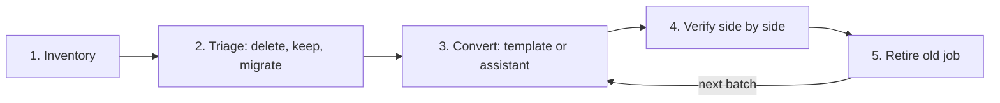
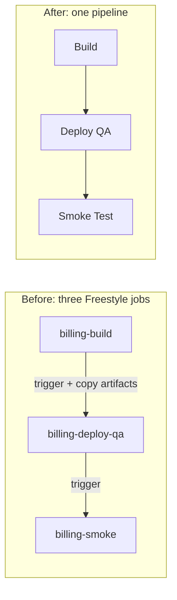

# Migrating Freestyle Jobs to Pipelines

## Introduction

Converting one Freestyle job to a Jenkinsfile is an afternoon's work. You saw the setting-by-setting mapping on [Freestyle vs Pipeline Jobs](../2-jenkins-jobs/5-jenkins-freestyle-vs-pipeline.mdx). Converting **three hundred** of them, owned by a dozen teams, some unchanged since 2017 and some chained together in ways nobody remembers, is a project. This page is about running that project.

Why migrate at all? Freestyle jobs live only in the controller's `config.xml` files. They have no code review, no history beyond the optional Job Config History plugin, no branch builds, and they are the main reason controllers become impossible to rebuild (the "snowflake controller" from [Jenkins Anti-Patterns](./1-jenkins-anti-patterns.mdx)). Pipelines in source control fix all of that.

An analogy: migrating Freestyle jobs is like moving house. You do not carry every box straight into the new house. First you list what you own, throw out what you do not need, pack carefully, check that everything arrived, and only then hand back the keys to the old place.

The process on this page has five phases:



## Phase 1: Inventory

You cannot plan what you cannot see. Every Freestyle job is stored in `JENKINS_HOME/jobs/NAME/config.xml` (with nested `jobs/` folders for items inside folders). You can read them from disk on the controller, or more safely through the REST API, which returns the same XML at `JOB_URL/config.xml`.

This Python script reads a directory of `config.xml` files (for example copied from a backup) and lists, for each Freestyle job, the builders, publishers, triggers and last build time. It uses only the standard library.

```python
#!/usr/bin/env python3
"""inventory.py: summarize Freestyle jobs from a copy of JENKINS_HOME/jobs."""
import csv
import sys
import xml.etree.ElementTree as ET
from datetime import datetime, timezone
from pathlib import Path


def short(tag: str) -> str:
    # 'hudson.tasks.Shell' -> 'Shell'; plugin classes keep the last segment
    return tag.split(".")[-1]


def children(root, path):
    node = root.find(path)
    return [short(c.tag) for c in node] if node is not None else []


def last_build(job_dir: Path) -> str:
    builds = job_dir / "builds"
    if not builds.is_dir():
        return "never"
    times = [p.stat().st_mtime for p in builds.iterdir() if p.name.isdigit()]
    if not times:
        return "never"
    return datetime.fromtimestamp(max(times), tz=timezone.utc).date().isoformat()


def main(jobs_root: str) -> None:
    writer = csv.writer(sys.stdout)
    writer.writerow(["job", "type", "disabled", "builders", "publishers", "triggers", "last_build"])
    for cfg in sorted(Path(jobs_root).rglob("config.xml")):
        root = ET.parse(cfg).getroot()
        if root.tag != "project":  # 'project' is the root tag of Freestyle jobs
            continue
        job_dir = cfg.parent
        name = str(job_dir.relative_to(jobs_root)).replace("/jobs/", "/")
        writer.writerow([
            name,
            "freestyle",
            root.findtext("disabled", "false"),
            ";".join(children(root, "builders")),
            ";".join(children(root, "publishers")),
            ";".join(children(root, "triggers")),
            last_build(job_dir),
        ])


if __name__ == "__main__":
    main(sys.argv[1] if len(sys.argv) > 1 else "jobs")
```

Run it against a copy of the jobs directory:

```bash
python3 inventory.py ./jenkins-backup/jobs > inventory.csv
column -s, -t < inventory.csv | head
```

Example output:

```text
job                  type       disabled  builders                publishers                         triggers      last_build
billing-build        freestyle  false     Shell                   JUnitResultArchiver;ArtifactArchiver SCMTrigger    2026-10-09
billing-deploy-qa    freestyle  false     Shell                   Mailer                             BuildTrigger  2026-10-09
legacy-report        freestyle  true      Shell                   ArtifactArchiver                                 2022-03-14
nightly-db-backup    freestyle  false     Shell                                                      TimerTrigger  2026-10-11
web-build            freestyle  false     Maven;Shell             JUnitResultArchiver;Fingerprinter  SCMTrigger    2026-10-10
```

Then add up which plugin classes appear most often. This tells you what your conversion templates must support:

```bash
cut -d, -f4,5 inventory.csv | tail -n +2 | tr ',;' '\n\n' | grep -v '^$' | sort | uniq -c | sort -rn
```

Example output:

```text
    271 Shell
    188 JUnitResultArchiver
    140 ArtifactArchiver
     92 Mailer
     61 BuildTrigger
     17 Maven
      4 CopyArtifact
      2 CustomInHouseNotifier
```

:::tip
Also record **who owns** each job. Jenkins does not track ownership, so use folder names, the job description, the last person who changed it (Job Config History plugin) or the repository it checks out. Migrations stall when nobody feels responsible for a job.
:::

## Phase 2: Triage

In most long-lived installations a large share of jobs should not be migrated at all. Sort every job into one of four buckets:

| Bucket | Signal | Action |
| --- | --- | --- |
| Delete | Disabled, or no builds for many months, or duplicates another job | Disable now, delete after a grace period |
| Merge | Part of an upstream/downstream chain (`BuildTrigger`, Parameterized Trigger) | Combine the chain into one pipeline with stages |
| Migrate | Builds a repository that is still in use | Convert to a Jenkinsfile in that repository |
| Keep for now | Uses a plugin with no Pipeline support, or is a one-off admin task | Leave as Freestyle, revisit later, or replace with Job DSL |

**Merge** is where the biggest wins are. A chain like `billing-build` to `billing-deploy-qa` to `billing-smoke` usually exists because Freestyle could not express stages. In a pipeline it becomes one job:



The `CopyArtifact` steps between jobs disappear too, because stages in one pipeline can share files with `stash` and `unstash`.

## Phase 3: Convert

### Option A: the Declarative Pipeline Migration Assistant

The [Declarative Pipeline Migration Assistant plugin](https://plugins.jenkins.io/declarative-pipeline-migration-assistant/) (plugin ID `declarative-pipeline-migration-assistant`) generates a starting Jenkinsfile from a Freestyle job. After installing it, open a Freestyle job and click **To Declarative** in the left menu. Jenkins shows the generated Jenkinsfile, which you can copy or download.

It is "best effort". Supported items, such as Git checkout, shell and batch steps, parameters, timer and SCM polling triggers, JUnit, archive artifacts, mail and secret bindings, are converted. Unsupported plugins become **placeholder stages** with a comment, and you finish them by hand. The CloudBees documentation keeps the [current list of supported plugins](https://docs.cloudbees.com/docs/cloudbees-ci/latest/pipelines/declarative-pipeline-migration-assistant).

Use it for the first draft of each job, never as the final result. Expect to clean up quoting, remove redundant steps, and add the [best practices](./0-jenkins-pipeline-best-practices.mdx) the old job never had.

### Option B: a hand-written template per job family

When the inventory shows that 200 jobs follow the same shape ("checkout, run a shell script, publish JUnit, archive a JAR"), write **one** good template and fill it in for each job. Here is a typical Freestyle job and its conversion.

The relevant parts of the old `config.xml`:

```xml
<project>
  <assignedNode>linux</assignedNode>
  <triggers>
    <hudson.triggers.SCMTrigger><spec>H/5 * * * *</spec></hudson.triggers.SCMTrigger>
  </triggers>
  <builders>
    <hudson.tasks.Shell>
      <command>./gradlew clean build</command>
    </hudson.tasks.Shell>
  </builders>
  <publishers>
    <hudson.tasks.junit.JUnitResultArchiver>
      <testResults>build/test-results/test/*.xml</testResults>
    </hudson.tasks.junit.JUnitResultArchiver>
    <hudson.tasks.ArtifactArchiver>
      <artifacts>build/libs/*.jar</artifacts>
    </hudson.tasks.ArtifactArchiver>
    <hudson.tasks.Mailer>
      <recipients>billing-team@example.com</recipients>
    </hudson.tasks.Mailer>
  </publishers>
</project>
```

The new `Jenkinsfile`, committed to the repository the job builds:

```groovy
pipeline {
    agent { label 'linux' }
    options {
        timeout(time: 30, unit: 'MINUTES')
        buildDiscarder(logRotator(numToKeepStr: '30'))
    }
    stages {
        stage('Build and Test') {
            steps {
                sh './gradlew clean build'
            }
        }
    }
    post {
        always {
            junit allowEmptyResults: true, testResults: 'build/test-results/test/*.xml'
        }
        success {
            archiveArtifacts artifacts: 'build/libs/*.jar', fingerprint: true
        }
        failure {
            mail to: 'billing-team@example.com',
                 subject: "Build failed: ${env.JOB_NAME} #${env.BUILD_NUMBER}",
                 body: "See ${env.BUILD_URL}"
        }
    }
}
```

Notice three deliberate improvements over a literal translation:

- **No `pollSCM`.** The new job is a [multibranch pipeline](../5-jenkins-scm-integration/1-jenkins-multibranch-pipelines.mdx) triggered by webhooks, so polling every five minutes goes away.
- **Timeout and discarder** are added, because the old job had neither.
- **Mail only on failure**, which matches what the Freestyle Mailer did by default (it mails on failures and on the first success after a failure). If you need that "back to normal" email too, add a `fixed` condition to `post`.

### Option C: generate Jenkinsfiles with a script

If you have hundreds of jobs in one family, generate the files from the inventory. A small script that reads each `config.xml` and fills a template is faster and more consistent than doing it by hand. Keep the generator simple, and route anything unusual to a human.

### Where should the job definition live?

| Approach | Pros | Cons | Best for |
| --- | --- | --- | --- |
| Jenkinsfile in each app repository (multibranch) | Pipeline changes with the code, branch and PR builds | Needs a repo per job, teams own the file | Application builds |
| Shared library template plus tiny Jenkinsfile | Consistent, fixes spread to all jobs | Library becomes critical infrastructure | Many similar services |
| Job DSL seed job | Can create any job type, including the Freestyle jobs you keep | Another DSL to learn | Admin jobs, jobs without their own repo |
| Pipeline script typed into the UI | Quick | Same problems as Freestyle | Never as an end state |

Jobs without a natural repository, such as `nightly-db-backup`, can live in a shared "ops-jobs" repository and be created by [Job DSL](../12-jenkins-administration/1-jenkins-job-dsl.mdx) or JCasC.

## Phase 4: Verify Side by Side

Do not switch over on trust. For each migrated job:

1. **Run both** the old Freestyle job and the new pipeline on the same commit for a few days. Disable the old job's triggers that have side effects (deployments, emails to customers) and keep only its build.
2. **Compare outputs:** test counts, artifact names and sizes, checksums if the build is reproducible.
3. **Compare behavior:** does the new job trigger on the same events? Does it send the same notifications? Does it fail when the old one fails?

A tiny comparison script for JUnit results helps:

```bash
#!/usr/bin/env bash
# compare-tests.sh OLD_JOB_URL NEW_JOB_URL: compare test counts of two last builds
set -euo pipefail
for url in "$1" "$2"; do
  curl -sf -u "$JENKINS_USER:$JENKINS_TOKEN" \
    "$url/lastCompletedBuild/testReport/api/json?tree=passCount,failCount,skipCount" \
  | jq -r --arg u "$url" '"\($u): pass=\(.passCount) fail=\(.failCount) skip=\(.skipCount)"'
done
```

Example output:

```text
https://ci.example.com/job/billing-build: pass=1204 fail=0 skip=12
https://ci.example.com/job/billing/job/main: pass=1204 fail=0 skip=12
```

Equal counts do not prove equality, but a different count is a clear warning that some tests are no longer found or run.

## Phase 5: Retire the Old Job

Retire in two steps:

1. **Disable** the Freestyle job and add "Migrated to `billing/main`, will be deleted on 2026-12-01" to its description. Disabling keeps history and configuration but stops all builds.
2. **Delete** after the grace period, once nobody has complained and backups contain the old configuration.

Check for **hidden dependents** before deleting: other jobs that trigger it, `CopyArtifact` steps that read from it, scripts or dashboards that call its URL, and external systems that link to its artifacts. A `grep` over all `config.xml` files for the job name catches most job-to-job links.

```bash
grep -rl --include=config.xml "billing-build" ./jenkins-backup/jobs
```

Example output:

```text
./jenkins-backup/jobs/billing-build/config.xml
./jenkins-backup/jobs/billing-deploy-qa/config.xml
./jenkins-backup/jobs/release-dashboard/config.xml
```

The third hit, `release-dashboard`, is a dependent nobody remembered. Fix it before you delete.

## Real-World Scenario

An insurance company has a Jenkins controller with 340 Freestyle jobs, built up over eight years by six teams. The controller cannot be rebuilt from code, upgrades are scary, and the audit team asks for review history on every change to the deployment process. You are asked to migrate within two quarters.

**The plan:**

1. **Inventory** with the script above. Result: 340 jobs, 95 with no build in over a year, 60 that form 18 chains, 150 standard "Gradle build plus JUnit" jobs, and 35 unusual ones.
2. **Triage:** disable the 95 stale jobs immediately (with a notice in the description), plan to merge the 18 chains into 18 pipelines, template the 150 standard jobs, and review the 35 unusual ones one by one.
3. **Pilot** with one willing team: migrate their 30 jobs, run side by side for two weeks, collect feedback, fix the template.
4. **Roll out** team by team, using a shared library template so each repository needs only a four-line Jenkinsfile, and organization folders so new repositories get jobs automatically.
5. **Retire** each team's Freestyle jobs one month after its pipelines go green.

**Why this approach:** batches with a pilot catch template problems on 30 jobs instead of 340. Triage removes more than a quarter of the work before any conversion starts. Side-by-side runs give the audit team evidence that behavior did not change.

**When not to use it:** for ten jobs, skip the tooling and convert them by hand in a day. If you plan to [leave Jenkins entirely](./3-jenkins-migrating-to-other-ci.mdx) within a year, migrate straight to the target system instead of to Jenkins Pipeline first, unless you need the intermediate step to understand what the jobs actually do.

| Strategy | Pros | Cons | Best for |
| --- | --- | --- | --- |
| Big-bang weekend migration | Fast, one cut-over | High risk, many broken builds on Monday | Very small installations |
| Batched by team with pilot | Controlled risk, learning between batches | Takes months, two systems in parallel | Most organizations |
| Opportunistic (convert when a job next changes) | No dedicated project | Never finishes, Freestyle lingers for years | Low-priority legacy |
| Migrate directly to another CI | One migration instead of two | Bigger change at once | Planned exit from Jenkins |

## Common Mistakes

- **Literal translation.** Copying every old setting, including five-minute SCM polling and no timeout, carries old problems into the new system.
- **Skipping triage.** Migrating jobs nobody uses wastes most of the effort.
- **Forgetting chains and hidden dependents.** Downstream jobs, `CopyArtifact` readers and external links break silently.
- **Deleting immediately.** Disable first and keep backups of `config.xml`.
- **Keeping the pipeline in the UI.** A pipeline typed into the job configuration has the same lack of history as the Freestyle job it replaced.
- **No owner per job.** Without an owner, nobody validates the result.

## Summary

- Treat a large Freestyle migration as a project with five phases: inventory, triage, convert, verify, retire.
- `config.xml` files contain everything you need for an inventory. Script it.
- Many jobs should be deleted or merged, not migrated. Upstream/downstream chains become one pipeline with stages.
- Use the Declarative Pipeline Migration Assistant (**To Declarative**) for first drafts and templates or a shared library for job families.
- Verify side by side, then disable before you delete.

## Exercises

1. Create three Freestyle jobs in a test Jenkins, two of them chained with "Build other projects". Run the inventory script on the `jobs` directory.
2. Install the Declarative Pipeline Migration Assistant plugin, use **To Declarative** on one of the jobs, and list everything you had to fix by hand.
3. Merge the chained jobs into a single pipeline using `stash` and `unstash` instead of copying artifacts.
4. Extend `inventory.py` to also print the label expression (`assignedNode`) and the SCM URL of each job.

Related pages:

- [Freestyle vs Pipeline Jobs](../2-jenkins-jobs/5-jenkins-freestyle-vs-pipeline.mdx) for the setting-by-setting mapping.
- [Stash, Unstash and Artifacts](../4-jenkins-pipeline-advanced/4-jenkins-stash-and-artifacts.mdx)
- [Organization Folders](../5-jenkins-scm-integration/5-jenkins-organization-folders.mdx)
- [Pipeline Templates for Many Teams](../8-jenkins-shared-libraries/7-jenkins-pipeline-templates.mdx)
