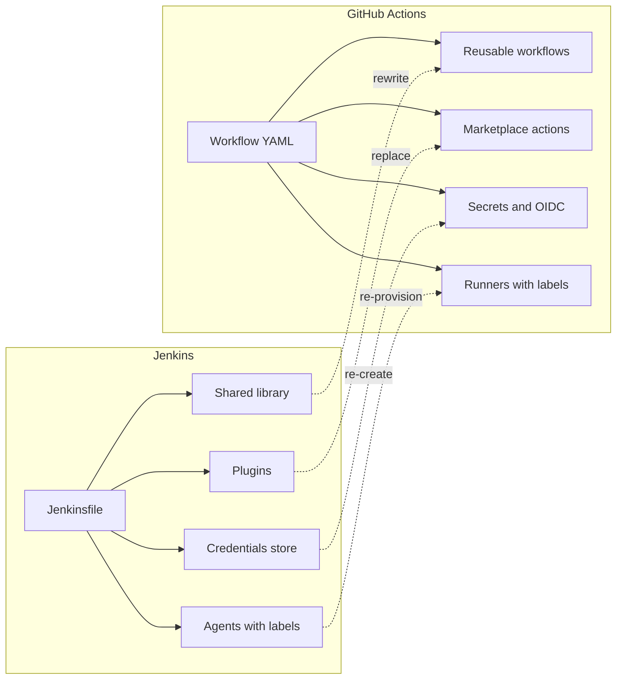
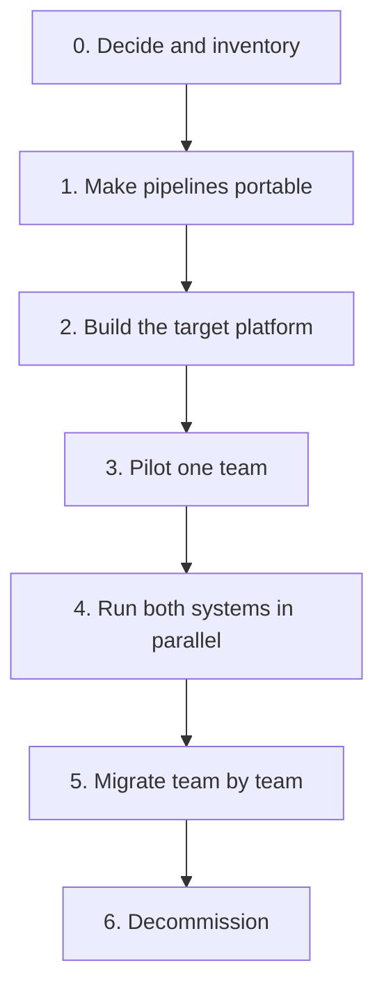

# Migrating to or from Jenkins

## Introduction

Sooner or later many teams ask: "Should we move off Jenkins?" Others ask the opposite: "Our hosted CI cannot do what we need. Should we move to Jenkins?" Both are big decisions. A CI system touches every repository, holds credentials for every environment, and encodes years of small decisions about how software ships.

This page is about **how** to migrate well in either direction. The question of **whether** to use Jenkins is covered on [Jenkins vs GitHub Actions, GitLab CI and Others](../0-jenkins-fundamentals/3-jenkins-vs-alternatives.mdx) and [When Should You Choose Jenkins?](../0-jenkins-fundamentals/4-jenkins-when-to-use.mdx). The cost side is on [Total Cost of Running Jenkins](./4-jenkins-cost-and-maintenance.mdx).

An analogy: a CI migration is like changing the engine of a plane while it is flying. Builds must keep running, releases must keep shipping, and nobody wants to find out mid-flight that the new engine has no fuel line for that one legacy system. So you migrate in pieces, with both engines running for a while.

You will learn:

- the common reasons to migrate in each direction, and the bad reasons,
- how Jenkins concepts map to GitHub Actions and GitLab CI/CD,
- the tools that help: GitHub Actions Importer and the Declarative Pipeline Migration Assistant,
- a phased plan that keeps builds running throughout,
- what to do with the hard parts: shared libraries, credentials, plugins and special agents.

## Why Teams Migrate

| Direction | Good reasons | Weak reasons |
| --- | --- | --- |
| Jenkins to hosted CI | Code already on one Git host; small platform team; controller maintenance is a burden; want built-in PR integration | "Jenkins is old"; one bad incident caused by an anti-pattern that could be fixed |
| Hosted CI to Jenkins | Builds must stay on-premises or air-gapped; special hardware; complex cross-repository orchestration; very high build volume | "We want more control" without a team to run it |
| Jenkins to Jenkins (new controller) | Clean, codified rebuild; split one huge controller | Avoiding the work of fixing the old one properly |

Before migrating away because Jenkins is painful, check whether the pain comes from [Jenkins anti-patterns](./1-jenkins-anti-patterns.mdx). A snowflake controller with 250 plugins is painful in any tool, and the same habits can recreate the mess in the new system.

## Concept Mapping

Most of the work in a migration is translating concepts, not syntax.

| Jenkins | GitHub Actions | GitLab CI/CD |
| --- | --- | --- |
| Controller | GitHub (hosted service) | GitLab instance |
| Agent, label | Runner, `runs-on` label | Runner, `tags` |
| `agent { docker ... }` | `container:` or a Docker action | `image:` |
| `Jenkinsfile` | `.github/workflows/*.yml` | `.gitlab-ci.yml` |
| `stage` | Job (or step group) | `stage:` plus jobs |
| `steps` with `sh` | `steps` with `run` | `script` |
| `parallel` | Jobs run in parallel by default | Jobs in the same stage run in parallel |
| `matrix` | `strategy.matrix` | `parallel: matrix` |
| `environment` | `env` | `variables` |
| `post { always }` | Step with `if: always()` | `after_script` or a job with `when: always` |
| `when { branch 'main' }` | `if: github.ref == 'refs/heads/main'` | `rules: - if: $CI_COMMIT_BRANCH == "main"` |
| `input` approval | Environment protection rules (required reviewers) | `when: manual`, protected environments |
| Credentials store, `withCredentials` | Secrets, OIDC to clouds | CI/CD variables (masked, protected), OIDC, external secrets |
| Shared library | Reusable workflows, composite actions | `include`, CI/CD components |
| `stash` / `unstash` | `actions/upload-artifact`, `download-artifact` | `artifacts` and `needs` |
| Multibranch, organization folder | Built in (every repository and branch) | Built in |
| Plugins | Marketplace actions | Built-in features, templates |



Notice the dotted lines: shared libraries must be **rewritten**, plugins **replaced**, credentials **re-created** (Jenkins cannot export them in plain text, and you should not want it to), and agents **re-provisioned**. These four are where migrations take longest.

## Translating a Pipeline by Hand

Here is a small but realistic Jenkinsfile:

```groovy
pipeline {
    agent { docker { image 'python:3.12-slim' } }
    options { timeout(time: 20, unit: 'MINUTES') }
    stages {
        stage('Test') {
            matrix {
                axes {
                    axis { name 'PY'; values '3.11', '3.12' }
                }
                agent { docker { image "python:${PY}-slim" } }
                stages {
                    stage('pytest') {
                        steps { sh 'pip install -r requirements.txt && pytest --junitxml=report.xml' }
                    }
                }
            }
        }
        stage('Publish') {
            when { branch 'main' }
            environment { TWINE_PASSWORD = credentials('pypi-token') }
            steps {
                sh 'pip install build twine && python -m build && twine upload -u __token__ dist/*'
            }
        }
    }
    post {
        always { junit allowEmptyResults: true, testResults: '**/report.xml' }
    }
}
```

The GitHub Actions equivalent:

```yaml
name: ci
on:
  push:
    branches: [main]
  pull_request:

jobs:
  test:
    runs-on: ubuntu-latest
    timeout-minutes: 20
    strategy:
      matrix:
        py: ["3.11", "3.12"]
    container: python:${{ matrix.py }}-slim
    steps:
      - uses: actions/checkout@v4
      - run: pip install -r requirements.txt && pytest --junitxml=report.xml
      - uses: actions/upload-artifact@v4
        if: always()
        with:
          name: junit-${{ matrix.py }}
          path: report.xml

  publish:
    needs: test
    if: github.ref == 'refs/heads/main'
    runs-on: ubuntu-latest
    container: python:3.12-slim
    steps:
      - uses: actions/checkout@v4
      - run: pip install build twine && python -m build
      - run: twine upload -u __token__ dist/*
        env:
          TWINE_PASSWORD: ${{ secrets.PYPI_TOKEN }}
```

And GitLab CI/CD:

```yaml
stages: [test, publish]

test:
  stage: test
  image: python:${PY}-slim
  timeout: 20m
  parallel:
    matrix:
      - PY: ["3.11", "3.12"]
  script:
    - pip install -r requirements.txt
    - pytest --junitxml=report.xml
  artifacts:
    when: always
    reports:
      junit: report.xml

publish:
  stage: publish
  image: python:3.12-slim
  rules:
    - if: $CI_COMMIT_BRANCH == "main"
  script:
    - pip install build twine
    - python -m build
    - twine upload -u __token__ dist/*
```

In GitLab, `TWINE_PASSWORD` would be a masked and protected CI/CD variable set in the project settings, not in the file.

Some details do not translate one to one:

- **Test reports.** Jenkins' `junit` step shows trends on the job page. GitLab shows JUnit reports in merge requests natively. GitHub Actions needs a third-party action or a job summary to display them.
- **Pinning.** For production use, pin third-party actions to a commit SHA, the same way you pin shared library versions in Jenkins.
- **PyPI tokens.** All three platforms can use PyPI trusted publishing (OIDC) instead of a long-lived token on hosted runners. A migration is a good moment to adopt it.

Always check the official syntax references: [GitHub Actions workflow syntax](https://docs.github.com/en/actions/reference/workflows-and-actions/workflow-syntax) and [GitLab CI/CD YAML reference](https://docs.gitlab.com/ci/yaml/).

## Tools That Help

### GitHub Actions Importer

[GitHub Actions Importer](https://docs.github.com/en/actions/tutorials/migrate-to-github-actions/automated-migrations/jenkins-migration) is a GitHub CLI extension that reads your Jenkins instance through its API and converts jobs to workflows. It runs in a Docker container and does not need to run on the Jenkins server.

```bash
gh extension install github/gh-actions-importer
gh actions-importer configure      # choose Jenkins, enter URL, Jenkins and GitHub tokens
gh actions-importer update         # pull the latest importer image

# 1. Audit: convert everything in memory and write a summary report
gh actions-importer audit jenkins --output-dir tmp/audit

# 2. Forecast: estimate Actions usage from past Jenkins builds
gh actions-importer forecast jenkins --output-dir tmp/forecast

# 3. Dry run: convert one job and write the YAML locally
gh actions-importer dry-run jenkins \
  --source-url https://ci.example.com/job/billing/job/main \
  --output-dir tmp/dry-run

# 4. Migrate: convert one job and open a pull request in the target repo
gh actions-importer migrate jenkins \
  --target-url https://github.com/example/billing \
  --output-dir tmp/migrate \
  --source-url https://ci.example.com/job/billing/job/main
```

The audit report is useful even if you never use the converted YAML. It tells you how many pipelines convert fully, partially or not at all, and which plugins and constructs block conversion. According to GitHub's documentation, `forecast` requires the `paginated-builds` plugin on the Jenkins side, and some constructs need manual work: Scripted Pipeline, secrets, self-hosted runners, unknown plugins, and Declarative features such as `input`, `matrix`, `options` and `parameters`. The list of supported items changes, so read the current docs before planning around it.

### GitLab migration guidance

GitLab's [Migrating from Jenkins](https://docs.gitlab.com/ci/migration/jenkins/) guide recommends a planning step: inventory plugins, agents, shared libraries, authentication and credentials before converting. It also mentions a community "JenkinsFile Wrapper" project that runs a Jenkins instance inside a GitLab CI job for a gradual transition. GitLab notes this is outside its support scope, so treat it as a temporary bridge at most.

### Migrating to Jenkins

There is no general converter **into** Jenkins. If you move from another system to Jenkins, translate by hand using the same table in reverse, and use the [Snippet Generator](../3-jenkins-pipeline-basics/9-jenkins-pipeline-syntax-generator.mdx) for step syntax. If the old pipelines call scripts (`make test`, `./ci/deploy.sh`), translation is mostly a matter of wrapping them in stages.

## Worked Example: Translating a Shared Library Step

Shared libraries are usually the hardest part to move, because many pipelines depend on them. Here is a typical custom step from a library's `vars/` directory:

```groovy
// vars/buildAndPushImage.groovy in the shared library
def call(Map config) {
    def tag = "${config.registry}/${config.name}:${env.GIT_COMMIT.take(7)}"
    withCredentials([usernamePassword(credentialsId: 'registry-creds',
                                      usernameVariable: 'REG_USER',
                                      passwordVariable: 'REG_PASS')]) {
        sh 'echo "$REG_PASS" | docker login -u "$REG_USER" --password-stdin ' + config.registry
        sh "docker build -t ${tag} ."
        sh "docker push ${tag}"
    }
    return tag
}
```

On GitHub Actions, the natural equivalent is a **composite action** stored in a shared repository (or a reusable workflow, if you want to share whole jobs rather than steps):

```yaml
# .github/actions/build-and-push-image/action.yml in a shared repository
name: build-and-push-image
description: Build a Docker image tagged with the short commit SHA and push it
inputs:
  registry:
    required: true
  name:
    required: true
  username:
    required: true
  password:
    required: true
outputs:
  tag:
    value: ${{ steps.build.outputs.tag }}
runs:
  using: composite
  steps:
    - id: build
      shell: bash
      env:
        REG_USER: ${{ inputs.username }}
        REG_PASS: ${{ inputs.password }}
        REGISTRY: ${{ inputs.registry }}
        NAME: ${{ inputs.name }}
      run: |
        tag="$REGISTRY/$NAME:${GITHUB_SHA::7}"
        echo "$REG_PASS" | docker login -u "$REG_USER" --password-stdin "$REGISTRY"
        docker build -t "$tag" .
        docker push "$tag"
        echo "tag=$tag" >> "$GITHUB_OUTPUT"
```

Things to notice:

- **Credentials move from the library to the caller.** A Jenkins library can look up a credential ID itself. A composite action cannot read secrets directly, so the calling workflow passes `secrets.REGISTRY_PASSWORD` as an input. That is more explicit, which is usually a good thing.
- **Return values become outputs.** `return tag` becomes a step output written to `$GITHUB_OUTPUT`.
- **Versioning carries over.** `@Library('ci-lib@v3')` becomes `uses: example/ci-actions/.github/actions/build-and-push-image@v3` (or a commit SHA).
- **The shell logic is unchanged.** If the library step had already been a thin wrapper around a script, the translation would be even smaller. This is why "make pipelines portable" comes first in the plan below.

On GitLab, the same idea is a CI/CD component or an `include`d template with a hidden job (`.build-and-push-image`) that projects `extends`.

## A Phased Migration Plan



**0. Decide and inventory.** List every job, plugin, credential, agent type and integration (chat, ticketing, artifact repository, deploy targets). The GitHub Actions Importer audit or the inventory approach from [Migrating Freestyle Jobs to Pipelines](./2-jenkins-migrating-freestyle.mdx) helps.

**1. Make pipelines portable, while still on the old system.** This is the most valuable step and is useful even if you never migrate. Move logic out of CI-specific code into scripts in the repository:

```groovy
// Jenkinsfile after the "portable" refactor: thin wrapper around scripts
pipeline {
    agent { docker { image 'python:3.12-slim' } }
    stages {
        stage('Test')    { steps { sh './ci/test.sh' } }
        stage('Package') { steps { sh './ci/package.sh' } }
        stage('Deploy') {
            when { branch 'main' }
            steps { sh './ci/deploy.sh staging' }
        }
    }
}
```

Now the new system only needs to call the same three scripts.

**2. Build the target platform.** Runners (and their network access to internal systems), secrets, OIDC trust with cloud providers, reusable workflow templates and branch protection.

**3. Pilot.** One team, a few repositories, ideally simple ones with a motivated owner.

**4. Run both in parallel.** The new CI runs on every PR as a non-blocking check. Once its results match the old system for a week or two, make it required and the old one optional.

**5. Migrate team by team.** Leave the hardest pipelines (special hardware, complex orchestration) for last. Sometimes the right answer is to keep a small Jenkins for them.

**6. Decommission.** Make the old controller read-only, keep a backup of `JENKINS_HOME` for the retention period your audit rules require, then shut it down.

### Hybrid setups

A permanent hybrid is a valid end state. Common patterns:

| Pattern | How it works | When it fits |
| --- | --- | --- |
| Hosted CI for build and test, Jenkins for deploy | Workflow builds and pushes an image, then triggers a Jenkins job through its REST API | Deploy targets are only reachable from inside the network |
| Jenkins for build, GitOps for deploy | Jenkins updates a manifest repository and Argo CD deploys | Kubernetes deployments, see [Jenkins with GitOps and Argo CD](../10-jenkins-deployment/7-jenkins-gitops.mdx) |
| Hosted CI everywhere, small Jenkins for special hardware | Most repositories leave Jenkins; device labs stay | Embedded, mobile device farms, licensed tools |

Triggering a parameterized Jenkins job from another CI system is a single authenticated HTTP call with an API token:

```bash
curl -sf -X POST -u "ci-bot:$JENKINS_API_TOKEN" \
  "https://ci.example.com/job/deploy-billing/buildWithParameters?IMAGE_TAG=1.42.0"
```

See [REST API and CLI](../12-jenkins-administration/8-jenkins-rest-api-and-cli.mdx) for details. Use a dedicated bot user with only the permissions it needs.

## Real-World Scenario

A 60-developer SaaS company has 90 repositories on GitHub.com and one Jenkins controller run part-time by a developer who is leaving. Builds are standard (Node.js and Go, Docker images, deploy to a managed Kubernetes cluster). There are no data-residency rules. Three repositories build firmware for a hardware product on a physical test rig in the office.

**The solution:**

1. Run `gh actions-importer audit jenkins`. The report shows most pipelines convert fully or partially, and that the shared library and the firmware jobs do not.
2. Refactor the shared library's steps into scripts and two reusable workflows.
3. Pilot with the team that owns four Go services. Run Actions as a non-blocking PR check for two weeks.
4. Migrate the remaining web and backend repositories over two months.
5. **Keep a small Jenkins** with one agent attached to the test rig for the three firmware repositories, rebuilt from code with JCasC and a short plugin list. Alternatively, register the rig machine as a GitHub self-hosted runner and compare the effort.

**Why this approach:** the code and most builds are a natural fit for the Git host's built-in CI, and nobody wants to own the controller. The audit report turns a vague worry into a concrete list. Keeping Jenkins only where it adds value avoids forcing hardware tests into a model that does not suit them.

**When not to do this:** if the builds had to stay on-premises, or the company had a platform team and hundreds of pipelines using shared library templates successfully, the migration cost would likely exceed the benefit.

| Approach | Pros | Cons | Best for |
| --- | --- | --- | --- |
| Full migration to hosted CI | One system, no controller | Rewrite libraries, re-create secrets, re-provision special agents | Standard builds on one Git host |
| Hybrid: hosted CI plus small Jenkins | Each tool where it fits | Two systems to understand | Mostly standard builds plus special cases |
| Stay on Jenkins, modernize | No rewrite, keeps integrations | Must staff Jenkins operations | On-premises needs, big existing investment |
| Migrate to Jenkins | Full control, any hardware | You now run a CI platform | Compliance, air-gapped, special hardware |

## Common Mistakes

- **Converting syntax but not habits.** A 400-line Jenkinsfile becomes a 600-line YAML file with the same problems. Make pipelines portable first.
- **Ignoring the forgotten integrations.** Chat notifications, ticket updates, dashboards and scripts that call Jenkins URLs all need a new home.
- **Copying secrets around carelessly.** Re-create credentials in the target system, rotate them during the move, and adopt OIDC where possible.
- **Underestimating network access.** Hosted runners cannot reach private databases or internal deploy targets. Self-hosted runners or a hybrid model may be needed.
- **No parallel run.** Switching overnight means discovering differences in production.
- **Shutting down Jenkins too early.** Keep a backup and a read-only period for audits and history.

## Summary

- Migrate for concrete reasons, and fix anti-patterns first if they are the real problem.
- Most of the effort is in shared libraries, plugins, credentials and special agents, not in YAML syntax.
- Making pipelines portable (thin CI files that call scripts) is the most valuable first step in any direction.
- GitHub Actions Importer can audit, forecast, dry-run and migrate Jenkins jobs. GitLab provides a concept mapping and planning guide.
- Migrate in phases with a pilot and a parallel run. A permanent hybrid is a valid result.

## Exercises

1. Translate one of your Jenkinsfiles into GitHub Actions or GitLab CI/CD YAML by hand, then list every line that did not have a direct equivalent.
2. Refactor a pipeline so every stage is a single call to a script in `ci/`. Run the scripts locally.
3. If you have a test Jenkins and a GitHub account, run `gh actions-importer dry-run` on one job and compare the output with your hand translation.
4. Write a one-page migration proposal for a fictional company, including the inventory, the pilot team and the decommissioning criteria.

Related pages:

- [Jenkins vs GitHub Actions, GitLab CI and Others](../0-jenkins-fundamentals/3-jenkins-vs-alternatives.mdx)
- [Total Cost of Running Jenkins](./4-jenkins-cost-and-maintenance.mdx)
- The [CI/CD tutorial](/docs/devops/cicd) for tool-neutral pipeline concepts.
