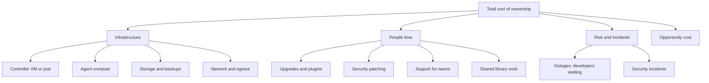

# Total Cost of Running Jenkins

## Introduction

Jenkins is free to download. Running it is not. The license costs nothing, but someone has to provide servers, keep plugins up to date, patch security advisories, restore backups, debug stuck agents and answer "why is my build queued?" messages. Hosted CI services charge you money for some of those things. Jenkins charges you mostly in **time**.

This page helps you put numbers on that, so the question "Is Jenkins cheaper than GitHub Actions or GitLab CI for us?" can be answered with a spreadsheet instead of a feeling.

An analogy: owning a car versus using taxis. The car has a low cost per trip once you own it, but you pay for insurance, servicing, parking and your own time at the garage. Taxis cost more per trip but nothing when you stay home. Which is cheaper depends on how much you drive, and on whether you enjoy fixing engines.

You will learn:

- the cost categories of a Jenkins installation, including the hidden ones,
- a small, runnable cost model you can adapt,
- the maintenance tasks that drive the people cost, and how to shrink them,
- how to compare honestly with hosted CI.

:::note
This page does not quote cloud prices as facts, because they change often and vary by region and contract. Where a number appears, it is an **example input** you should replace with your own figures from your provider's pricing page.
:::

## The Cost Categories



### Infrastructure

- **Controller.** One VM or Kubernetes pod running continuously. It needs enough memory for the JVM heap, which grows with the number of jobs, builds kept and concurrent pipelines. See [Performance Tuning](../12-jenkins-administration/4-jenkins-performance-tuning.mdx).
- **Agents.** Usually the largest infrastructure cost. Static agents cost money 24 hours a day whether they build or not. Ephemeral agents (Kubernetes pods, cloud VMs from templates) cost money only while builds run, plus some startup overhead.
- **Storage.** `JENKINS_HOME` on fast disk, plus backups. Archived artifacts and long build histories make this grow.
- **Network.** Pulling images and dependencies, pushing artifacts, and cross-region or internet egress if your agents live in a different place than your registries.

### People

This is the category most estimates forget, and usually the largest. Typical recurring tasks:

| Task | Typical frequency | What drives the effort |
| --- | --- | --- |
| Jenkins core LTS upgrade | Every LTS point release, roughly monthly; new baseline about every 12 weeks | Number of plugins, whether a staging controller exists |
| Plugin updates | Weekly to monthly | Plugin count, abandoned plugins |
| Security advisories | Whenever published (see [Security Advisories and Hardening](../11-jenkins-security/7-jenkins-security-advisories.mdx)) | How fast you can test and roll out |
| Java runtime upgrades | Every few years (current LTS requires Java 21 or 25) | OS images, agent images |
| Agent image maintenance | Monthly | Number of distinct toolchains |
| Backup testing | Quarterly | Whether restore is automated |
| Helping teams debug builds | Daily | Pipeline quality, documentation, shared library design |
| Shared library development | Ongoing | Number of teams and languages |

### Risk

When the controller is down, every developer who needs a build waits. Jenkins has one active controller per instance (see [High Availability and Scaling](../12-jenkins-administration/5-jenkins-high-availability.mdx)), so its downtime is the CI system's downtime. Price this in: hours of outage per year multiplied by the number of affected developers and the cost of their time. Security incidents are harder to price but potentially much larger, because Jenkins holds credentials to many systems.

### Opportunity cost

Every hour your platform engineers spend upgrading plugins is an hour they do not spend on faster builds, better deployment tooling or developer experience. This is not money you pay, but it is value you do not get.

## A Simple Cost Model

The script below compares a self-hosted Jenkins setup with a hosted CI service on a monthly basis. Every input is an **assumption** you should replace. It is deliberately simple: the point is to make each assumption visible and debatable.

```python
#!/usr/bin/env python3
"""ci_cost_model.py: rough monthly cost comparison, self-hosted Jenkins vs hosted CI.

All numbers are EXAMPLE INPUTS. Replace them with your own prices and data.
"""
from dataclasses import dataclass


@dataclass
class JenkinsCosts:
    controller_monthly: float        # VM or node share for the controller
    storage_backup_monthly: float    # disk + backup storage
    agent_cost_per_hour: float       # cost of one agent instance per hour
    agent_overhead_factor: float     # startup, idle time, bin-packing waste (1.3 = 30% extra)
    admin_hours_monthly: float       # upgrades, plugins, patching, support
    hourly_staff_cost: float         # loaded cost of one engineer hour
    outage_hours_yearly: float       # expected controller downtime per year
    devs_blocked: int                # developers blocked during an outage
    dev_hour_cost: float             # loaded cost of one developer hour

    def monthly(self, build_minutes: float) -> dict:
        agents = build_minutes / 60 * self.agent_cost_per_hour * self.agent_overhead_factor
        people = self.admin_hours_monthly * self.hourly_staff_cost
        outage = self.outage_hours_yearly / 12 * self.devs_blocked * self.dev_hour_cost * 0.5
        return {
            "controller": self.controller_monthly,
            "storage": self.storage_backup_monthly,
            "agents": agents,
            "people": people,
            "outage_risk": outage,
        }


@dataclass
class HostedCosts:
    price_per_minute: float          # per-minute rate for your runner size
    included_minutes: float          # free minutes in your plan
    plan_seats_monthly: float        # any per-seat plan cost attributable to CI
    admin_hours_monthly: float       # runner images, secrets, workflow templates
    hourly_staff_cost: float

    def monthly(self, build_minutes: float) -> dict:
        billable = max(0.0, build_minutes - self.included_minutes)
        return {
            "minutes": billable * self.price_per_minute,
            "plan": self.plan_seats_monthly,
            "people": self.admin_hours_monthly * self.hourly_staff_cost,
        }


def report(name: str, parts: dict) -> float:
    total = sum(parts.values())
    detail = ", ".join(f"{k}={v:,.0f}" for k, v in parts.items())
    print(f"{name:<8} total={total:>9,.0f}  ({detail})")
    return total


if __name__ == "__main__":
    jenkins = JenkinsCosts(
        controller_monthly=150, storage_backup_monthly=60,
        agent_cost_per_hour=0.20, agent_overhead_factor=1.3,
        admin_hours_monthly=40, hourly_staff_cost=90,
        outage_hours_yearly=8, devs_blocked=60, dev_hour_cost=80,
    )
    hosted = HostedCosts(
        price_per_minute=0.006, included_minutes=3000,
        plan_seats_monthly=0, admin_hours_monthly=10, hourly_staff_cost=90,
    )
    for minutes in (20_000, 200_000, 5_000_000):
        print(f"\nBuild minutes per month: {minutes:,}")
        j = report("Jenkins", jenkins.monthly(minutes))
        h = report("Hosted", hosted.monthly(minutes))
        print(f"cheaper: {'Jenkins' if j < h else 'Hosted'}")
```

Example output:

```text
Build minutes per month: 20,000
Jenkins  total=    5,497  (controller=150, storage=60, agents=87, people=3,600, outage_risk=1,600)
Hosted   total=    1,002  (minutes=102, plan=0, people=900)
cheaper: Hosted

Build minutes per month: 200,000
Jenkins  total=    6,277  (controller=150, storage=60, agents=867, people=3,600, outage_risk=1,600)
Hosted   total=    2,082  (minutes=1,182, plan=0, people=900)
cheaper: Hosted

Build minutes per month: 5,000,000
Jenkins  total=   27,077  (controller=150, storage=60, agents=21,667, people=3,600, outage_risk=1,600)
Hosted   total=   30,882  (minutes=29,982, plan=0, people=900)
cheaper: Jenkins
```

How to read this:

- With these example inputs, **people time dominates** the Jenkins total at low and medium volume. The infrastructure is cheap. The 40 admin hours per month are not.
- As build minutes grow, the per-minute hosted price grows linearly, while Jenkins agent cost grows more slowly per minute. Somewhere the lines cross. With these inputs the crossing is roughly 2.7 million minutes per month, which is why the third row favors Jenkins.
- The `0.5` factor in the outage cost assumes developers lose about half their productive time during an outage. Change it if you disagree. That is the point of the model.
- The per-minute rate of `0.006` matches the Linux 2-core rate listed on [GitHub's Actions billing page](https://docs.github.com/en/billing/concepts/product-billing/github-actions) when this page was written, and the 3,000 included minutes match the Team plan there. Both can change, so check the current page. Larger runners, Windows and macOS cost more per minute.

:::caution
Hosted CI often lets you bring your **own** runners (GitHub self-hosted runners, GitLab runners) to cut per-minute charges for heavy workloads. At the time of writing, GitHub's billing documentation says Actions usage on self-hosted runners is free, but pricing policies change. A fair comparison includes that option, and then the difference becomes "who runs the controller", not "who runs the compute".
:::

Run the model and check it compiles:

```bash
python3 -m py_compile ci_cost_model.py && python3 ci_cost_model.py | tail -4
```

## Shrinking the People Cost

The most effective way to make Jenkins cheaper is to reduce the hours it consumes. Each item below links to the page that covers it.

| Practice | Effect on maintenance |
| --- | --- |
| Controller fully in code: [JCasC](../12-jenkins-administration/0-jenkins-configuration-as-code.mdx), [plugins as code](../7-jenkins-plugins/3-jenkins-plugin-installation-manager.mdx), container image | Upgrades become "change a tag, test on staging, deploy". Rebuilds take minutes. |
| Small plugin list | Fewer updates, fewer conflicts, fewer advisories to react to |
| No builds on the controller, ephemeral agents | No hand-maintained build machines, fewer "works on agent 3" tickets |
| Automated, tested [backups](../12-jenkins-administration/2-jenkins-backup-and-restore.mdx) | Restore is a procedure, not an emergency |
| [Monitoring](../12-jenkins-administration/3-jenkins-monitoring.mdx) with alerts on queue length, disk and heap | Problems found before developers report them |
| Good shared library with documentation | Fewer support questions per team |
| Scheduled upgrade cadence | Small, routine upgrades instead of risky big jumps |

A codified upgrade can be as small as this change, reviewed and rolled out by the pipeline that builds your controller image:

```dockerfile
# Dockerfile for the controller image
FROM jenkins/jenkins:2.580.1-lts-jdk21
COPY plugins.txt /usr/share/jenkins/ref/plugins.txt
RUN jenkins-plugin-cli --plugin-file /usr/share/jenkins/ref/plugins.txt
COPY casc/ /var/jenkins_home/casc/
ENV CASC_JENKINS_CONFIG=/var/jenkins_home/casc/
```

Pinning an exact LTS version in the tag (rather than `lts-jdk21`) makes upgrades explicit and reviewable. A scheduled job or a dependency bot can open the pull request that bumps it.

### Measuring maintenance time

You cannot reduce what you do not measure. A lightweight approach: label every Jenkins-related ticket or chat request with a tag such as `ci-platform`, and every month count the tickets and the hours logged against them. Watch the trend, not the absolute number.

You can also measure some infrastructure signals directly. This shell snippet reports the size of `JENKINS_HOME` and its largest jobs, which is often where storage cost hides:

```bash
du -sh /var/jenkins_home
du -sh /var/jenkins_home/jobs/* 2>/dev/null | sort -rh | head -5
```

Example output:

```text
412G    /var/jenkins_home
188G    /var/jenkins_home/jobs/installer-nightly
61G     /var/jenkins_home/jobs/mobile-app
22G     /var/jenkins_home/jobs/billing
9.4G    /var/jenkins_home/jobs/web
4.1G    /var/jenkins_home/jobs/docs
```

One nightly job using almost half the disk is a classic case for a build discarder and an external artifact repository.

## Cost-Saving Tactics for Agents

Agent compute is the infrastructure cost you can tune most:

- **Scale to zero.** Kubernetes or cloud agents that exist only while builds run. See [Kubernetes Pod Agents](../6-jenkins-agents/4-jenkins-kubernetes-agents.mdx) and [Cloud Agents on AWS and Azure](../6-jenkins-agents/5-jenkins-cloud-agents.mdx).
- **Spot or preemptible instances** for build agents, with `retry` conditions that re-run a stage if the agent disappears. Do not use them for long deploy stages that must not be interrupted.
- **Right-size pod requests.** Over-requested CPU and memory wastes cluster capacity.
- **Cache dependencies and Docker layers** so builds spend less time downloading. See [Build Caching and Speed](../9-jenkins-build-and-test/8-jenkins-build-caching.mdx).
- **Cancel superseded builds** with `disableConcurrentBuilds(abortPrevious: true)` on PR branches.
- **Build only what changed** in monorepos. See [Building Monorepos](../5-jenkins-scm-integration/6-jenkins-monorepo-builds.mdx).

```groovy
pipeline {
    agent {
        kubernetes {
            yaml '''
                apiVersion: v1
                kind: Pod
                spec:
                  containers:
                  - name: build
                    image: maven:3.9-eclipse-temurin-21
                    command: ["sleep"]
                    args: ["infinity"]
                    resources:
                      requests: { cpu: "1", memory: "2Gi" }
                      limits:   { memory: "3Gi" }
            '''
            defaultContainer 'build'
        }
    }
    options {
        disableConcurrentBuilds(abortPrevious: true)
        buildDiscarder(logRotator(numToKeepStr: '20'))
    }
    stages {
        stage('Build') {
            steps {
                retry(count: 2, conditions: [kubernetesAgent(), nonresumable()]) {
                    sh 'mvn -B -q verify'
                }
            }
        }
    }
}
```

The `retry` conditions `kubernetesAgent()` and `nonresumable()` retry the block only when the pod or agent was lost (for example, a spot node was reclaimed), not when the build itself fails. Check the [Kubernetes plugin documentation](https://plugins.jenkins.io/kubernetes/) for the current list of retry conditions.

## Real-World Scenario

A logistics company runs Jenkins on three always-on VMs (one controller, two large static agents) for 25 developers. Monthly build volume is about 60,000 minutes. One engineer spends roughly a third of their time on Jenkins. The CFO asks whether moving to the Git host's built-in CI would save money.

**The analysis:**

1. Put real numbers into the cost model: VM invoices, the engineer's loaded cost for a third of their time, last year's two outages (one lasted a full day).
2. The result, similar to the first two rows of the example output above: the hosted option is clearly cheaper, and almost all of Jenkins' cost is people time, not servers.
3. Check for requirements that would force self-hosting: none of the builds need on-premises data or special hardware, but deploys target servers in a private network.
4. **Recommendation:** migrate build and test to hosted CI and use one self-hosted runner inside the private network for deploys (see [Migrating to or from Jenkins](./3-jenkins-migrating-to-other-ci.mdx)).

**Why this approach:** at this scale, the fixed people cost of running a controller cannot be spread across enough builds. The analysis also shows what would change the answer.

**When the answer flips:** a company with 500 developers, millions of build minutes, a platform team that already runs Kubernetes, or strict data-residency rules may find Jenkins (or self-hosted runners for another CI) cheaper and a better fit. Modernizing an existing Jenkins (codifying it, removing plugins, ephemeral agents) can also cut the people cost enough to change the result.

| Option | Pros | Cons | Best for |
| --- | --- | --- | --- |
| Self-hosted Jenkins, static agents | Predictable infra bill, full control | Highest people cost, idle capacity | Special hardware, small fixed workloads |
| Self-hosted Jenkins, ephemeral agents on Kubernetes | Pay for compute only while building, scales | Needs Kubernetes skills, controller still yours | Large volume, existing platform team |
| Hosted CI with hosted runners | Lowest operations effort | Per-minute cost grows with volume, network limits | Small and medium teams on one Git host |
| Hosted CI with self-hosted runners | Cheap heavy compute, private network access | You run the runners | High volume or private deploy targets |
| Commercial Jenkins distribution (for example CloudBees CI) | Vendor support, extra management features | License cost | Enterprises that want Jenkins with support |

### A second scenario: the close call

Now take a 400-developer company with a platform team that already runs Kubernetes. It builds about 4 million minutes a month on ephemeral pod agents, and roughly one full-time engineer works on Jenkins. Reuse the model's classes with new inputs. These are again example numbers, not quotes:

```python
# scenario_enterprise.py: run next to ci_cost_model.py
from ci_cost_model import JenkinsCosts, HostedCosts, report

jenkins = JenkinsCosts(
    controller_monthly=600, storage_backup_monthly=300,
    agent_cost_per_hour=0.12, agent_overhead_factor=1.2,   # bin-packed pods on existing cluster
    admin_hours_monthly=160, hourly_staff_cost=90,          # about one full-time engineer
    outage_hours_yearly=4, devs_blocked=400, dev_hour_cost=80,
)
hosted = HostedCosts(
    price_per_minute=0.006, included_minutes=50000,         # enterprise plan allowance
    plan_seats_monthly=0, admin_hours_monthly=80, hourly_staff_cost=90,
)
minutes = 4_000_000
print(f"Build minutes per month: {minutes:,}")
report("Jenkins", jenkins.monthly(minutes))
report("Hosted", hosted.monthly(minutes))
```

Example output:

```text
Build minutes per month: 4,000,000
Jenkins  total=   30,233  (controller=600, storage=300, agents=9,600, people=14,400, outage_risk=5,333)
Hosted   total=   30,900  (minutes=23,700, plan=0, people=7,200)
```

The totals are within about 2% of each other, which is well inside the error of any of the inputs. This is a common and useful result. It tells you that **cost alone should not decide**. The decision moves to other factors: data rules, special hardware, existing skills, how much the shared library is worth, and the cost of migrating 400 developers' pipelines (which this monthly model does not include at all). It also shows the levers. Bringing self-hosted runners to the hosted option would cut its `minutes` line sharply, while halving Jenkins admin hours through better automation would cut 7,200 from the Jenkins side.

:::tip
Add a one-time **migration cost** (engineer hours to rewrite pipelines, parallel-run period, training) when you compare options. Spread it over the period you expect to keep the new system, for example 36 months, before comparing monthly totals.
:::

## Common Mistakes

- **"Jenkins is free."** The license is. Operation is not. Count people time explicitly.
- **Counting only servers.** The infrastructure line is often the smallest part of the total.
- **Comparing list prices only.** Compare total cost, including the option of self-hosted runners for hosted CI and ephemeral agents for Jenkins.
- **Ignoring outage cost.** A single day of no CI for 60 developers can cost more than a year of controller hosting.
- **Static agents sized for the peak.** They sit idle most of the day. Autoscale instead.
- **Using stale prices.** Prices and free tiers change. Re-check official pricing pages each time you run the model.

## Summary

- The real cost of Jenkins is infrastructure plus people time plus risk. People time usually dominates.
- Build a simple, explicit model with your own numbers. The example script shows the structure.
- Codifying the controller, keeping plugins few, ephemeral agents and scheduled upgrades shrink the people cost.
- Hosted CI tends to win at low and medium volume without special requirements. Jenkins (or self-hosted runners) can win at high volume, with special hardware or with strict data rules.
- Re-check prices and assumptions regularly. They change.

## Exercises

1. Run `ci_cost_model.py` with numbers from your own team. Which single input changes the result the most?
2. Add a field for "hours saved per month by faster builds" to the model and see how much a 20% faster pipeline is worth.
3. Measure the size of `JENKINS_HOME` on a test or real controller and find the three largest jobs. Propose discarder settings for each.
4. Write down every Jenkins maintenance task your team did last quarter and estimate the hours. Compare it with the 40 hours per month in the example.
5. Add a `migration_one_time` input to the model, amortize it over 36 months, and see whether it changes the result of the close-call scenario.

Related pages:

- [Jenkins Anti-Patterns](./1-jenkins-anti-patterns.mdx)
- [When Should You Choose Jenkins?](../0-jenkins-fundamentals/4-jenkins-when-to-use.mdx)
- [Choosing an Agent Strategy](../6-jenkins-agents/7-jenkins-agent-strategies.mdx)
- [Upgrading Jenkins and LTS Releases](../1-jenkins-installation/6-jenkins-upgrading.mdx)
