# Project: CI/CD for a Java Microservice

## Introduction

This project puts together everything from the earlier sections into one working pipeline for a real-looking service. You will build CI/CD for **orders-service**, a small Spring Boot REST API that a shop uses to create and look up orders.

By the end, every push to the repository will:

1. Compile the code and run unit tests with Maven inside a container
2. Publish JUnit test results and JaCoCo code coverage in Jenkins
3. Run static analysis and stop the build if the SonarQube quality gate fails
4. Build a Docker image tagged with the version and Git commit
5. Push the image to a registry (only from `main`)
6. Deploy the image to a staging server and run a smoke test
7. Notify the team about the result

Think of it as an assembly line in a factory. Each station checks or adds one thing, and a part that fails inspection never reaches the shipping dock. The Jenkinsfile is the blueprint of that line, and it lives in the same repository as the code it builds.

The page is a walkthrough, not a concept lesson. Each step links back to the page that explains the idea in depth.

:::info What you need
- A Jenkins controller on a current LTS release (2.580.x at the time of writing) with at least one Linux agent that has Docker installed. See [Installing Jenkins with Docker](../1-jenkins-installation/0-jenkins-install-docker.mdx).
- A Git repository you can push to (GitHub, GitLab or Bitbucket).
- A container registry account and, optionally, a SonarQube server. The SonarQube stage can be skipped with a parameter.
:::

## Architecture of the Pipeline

```mermaid
flowchart LR
    DEV["Developer push"] --> SCM["Git repository"]
    SCM -->|"webhook"| J["Jenkins multibranch job"]
    J --> B["Build and Unit Test (Maven container)"]
    B --> Q["Static Analysis + Quality Gate"]
    Q --> I["Docker Image Build"]
    I -->|"main only"| P["Push to Registry"]
    P --> S["Deploy to Staging"]
    S --> SM["Smoke Test"]
    SM --> N["Notify"]
```



Branch builds and pull requests run the first three stages and build the image (to prove the Dockerfile still works). Only `main` pushes the image and deploys. That split is the most important design decision in the project: it gives fast feedback on every change but keeps the registry and staging clean.

## Step 1: The Service and Repository Layout

The application code is ordinary Spring Boot. What matters for CI is the layout:

```text
orders-service/
├── Jenkinsfile
├── Dockerfile
├── .dockerignore
├── pom.xml
├── deploy/
│   └── compose.staging.yaml
└── src/
    ├── main/java/com/example/orders/
    │   ├── OrdersApplication.java
    │   └── OrderController.java
    └── test/java/com/example/orders/
        └── OrderControllerTest.java
```

A minimal controller and test are enough to exercise the pipeline:

```java
package com.example.orders;

import java.util.Map;
import java.util.concurrent.ConcurrentHashMap;
import java.util.concurrent.atomic.AtomicLong;
import org.springframework.http.ResponseEntity;
import org.springframework.web.bind.annotation.*;

@RestController
@RequestMapping("/orders")
public class OrderController {

    private final Map<Long, String> orders = new ConcurrentHashMap<>();
    private final AtomicLong ids = new AtomicLong();

    @PostMapping
    public Map<String, Object> create(@RequestBody String item) {
        long id = ids.incrementAndGet();
        orders.put(id, item);
        return Map.of("id", id, "item", item);
    }

    @GetMapping("/{id}")
    public ResponseEntity<String> get(@PathVariable long id) {
        String item = orders.get(id);
        return item == null ? ResponseEntity.notFound().build() : ResponseEntity.ok(item);
    }
}
```

```java
package com.example.orders;

import static org.springframework.test.web.servlet.request.MockMvcRequestBuilders.*;
import static org.springframework.test.web.servlet.result.MockMvcResultMatchers.*;

import org.junit.jupiter.api.Test;
import org.springframework.beans.factory.annotation.Autowired;
import org.springframework.boot.test.autoconfigure.web.servlet.WebMvcTest;
import org.springframework.test.web.servlet.MockMvc;

@WebMvcTest(OrderController.class)
class OrderControllerTest {

    @Autowired
    MockMvc mvc;

    @Test
    void unknownOrderReturns404() throws Exception {
        mvc.perform(get("/orders/999")).andExpect(status().isNotFound());
    }

    @Test
    void createdOrderCanBeRead() throws Exception {
        mvc.perform(post("/orders").content("book")).andExpect(status().isOk());
        mvc.perform(get("/orders/1")).andExpect(content().string("book"));
    }
}
```

:::note
Package names for Spring Boot test annotations can move between major Spring Boot versions. If your IDE cannot find `WebMvcTest`, check the Spring Boot reference documentation for your version. The pipeline does not care which framework you use, only that `mvn verify` runs the tests and writes reports.
:::

## Step 2: Make Maven Produce the Reports Jenkins Needs

Jenkins does not run tests or measure coverage itself. It reads files that the build tool writes. So the first job is to make Maven produce:

- JUnit XML from Surefire in `target/surefire-reports/`
- A JaCoCo XML report in `target/site/jacoco/jacoco.xml`
- A Checkstyle XML report in `target/checkstyle-result.xml`

Surefire writes JUnit XML by default. Add JaCoCo and Checkstyle to the `pom.xml` build section:

```xml
<build>
  <plugins>
    <plugin>
      <groupId>org.springframework.boot</groupId>
      <artifactId>spring-boot-maven-plugin</artifactId>
    </plugin>

    <plugin>
      <groupId>org.jacoco</groupId>
      <artifactId>jacoco-maven-plugin</artifactId>
      <version>${jacoco.version}</version>
      <executions>
        <execution>
          <goals><goal>prepare-agent</goal></goals>
        </execution>
        <execution>
          <id>report</id>
          <phase>verify</phase>
          <goals><goal>report</goal></goals>
        </execution>
      </executions>
    </plugin>

    <plugin>
      <groupId>org.apache.maven.plugins</groupId>
      <artifactId>maven-checkstyle-plugin</artifactId>
      <version>${checkstyle-plugin.version}</version>
      <configuration>
        <configLocation>google_checks.xml</configLocation>
        <failOnViolation>false</failOnViolation>
      </configuration>
    </plugin>
  </plugins>
</build>
```

Set `jacoco.version` and `checkstyle-plugin.version` in `<properties>` to the current releases listed on Maven Central. `failOnViolation` is `false` on purpose: we want Jenkins to collect the warnings and decide what to do with them through a quality gate, instead of Maven failing on the first one.

Run it locally once before involving Jenkins:

```bash
./mvnw -B verify checkstyle:checkstyle
ls target/surefire-reports/*.xml target/site/jacoco/jacoco.xml target/checkstyle-result.xml
```

Example output:

```text
[INFO] Tests run: 2, Failures: 0, Errors: 0, Skipped: 0
[INFO] --- jacoco:report (report) @ orders-service ---
[INFO] BUILD SUCCESS
target/checkstyle-result.xml
target/site/jacoco/jacoco.xml
target/surefire-reports/TEST-com.example.orders.OrderControllerTest.xml
```

If a report does not exist locally, Jenkins will not find it either. This "run it locally first" habit saves many red builds.

## Step 3: The Dockerfile

A multi-stage Dockerfile is not needed here because Maven already ran in the pipeline. We copy the JAR that the build stage produced into a small JRE image:

```dockerfile
FROM eclipse-temurin:21-jre

RUN groupadd --system app && useradd --system --gid app app
WORKDIR /app

ARG JAR_FILE=target/orders-service.jar
COPY ${JAR_FILE} app.jar

USER app
EXPOSE 8080
HEALTHCHECK --interval=30s --timeout=3s CMD wget -qO- http://localhost:8080/actuator/health || exit 1
ENTRYPOINT ["java", "-XX:MaxRAMPercentage=75", "-jar", "/app/app.jar"]
```

And a `.dockerignore` so the build context stays small:

```text
.git
src
*.md
target/*
!target/orders-service.jar
```

Set `<finalName>orders-service</finalName>` in the `pom.xml` `<build>` section so the JAR name does not change with every version.

:::tip
Building the JAR in the pipeline and copying it in means the image contains exactly the bytes that passed the tests. A multi-stage Dockerfile that runs `mvn package` again is a reasonable alternative when developers also build images locally. See [Building and Pushing Docker Images](../9-jenkins-build-and-test/7-jenkins-docker-image-builds.mdx) for both styles.
:::

## Step 4: Prepare Jenkins

### Plugins

Install these plugins (IDs as shown on plugins.jenkins.io). Most come with the suggested plugin set:

| Plugin ID | Used for |
| --- | --- |
| `workflow-aggregator` | Pipeline itself |
| `git`, `github-branch-source` | Checkout and multibranch discovery |
| `docker-workflow` | `agent { docker ... }` and `docker.build` |
| `junit` | Test result trends |
| `coverage` | JaCoCo coverage via `recordCoverage` |
| `warnings-ng` | Checkstyle results via `recordIssues` |
| `sonar` | `withSonarQubeEnv` and `waitForQualityGate` |
| `credentials-binding` | `withCredentials` |
| `ssh-agent` | `sshagent` for the staging deploy |
| `pipeline-graph-view` | Stage visualization (Blue Ocean replacement) |

The older JaCoCo and Cobertura plugins are superseded by the `coverage` plugin. Do not install both. See [Code Coverage](../9-jenkins-build-and-test/5-jenkins-code-coverage.mdx).

### Credentials

Create these under **Manage Jenkins > Credentials** (or with JCasC, as in [Project: Fully Codified Jenkins Instance](./5-jenkins-project-jenkins-as-code.mdx)):

| ID | Kind | Purpose |
| --- | --- | --- |
| `registry-creds` | Username with password | Push to the container registry |
| `sonar-token` | Secret text | SonarQube analysis token |
| `staging-ssh` | SSH username with private key | Log in to the staging host |

Use a registry access token instead of your account password, and scope it to push to one repository if the registry supports it. Background in [Credentials Management](../11-jenkins-security/3-jenkins-credentials.mdx).

### SonarQube server

Under **Manage Jenkins > System > SonarQube servers**, add an installation named `sonarqube` that points to your server and uses `sonar-token`. In SonarQube, add a webhook that points to `https://your-jenkins/sonarqube-webhook/`. The trailing slash is required, and without the webhook `waitForQualityGate` waits until it times out.

### The job

Create a **Multibranch Pipeline** job named `orders-service`, point its branch source at the repository, and keep the default script path `Jenkinsfile`. Configure a webhook in the Git host so pushes trigger scans immediately. See [Multibranch Pipelines](../5-jenkins-scm-integration/1-jenkins-multibranch-pipelines.mdx) and [GitHub Integration and Webhooks](../5-jenkins-scm-integration/2-jenkins-github-integration.mdx).

## Step 5: The Jenkinsfile

Here is the complete pipeline. It is long, so the next section walks through it piece by piece.

```groovy
pipeline {
    agent { label 'linux && docker' }

    options {
        timeout(time: 30, unit: 'MINUTES')
        buildDiscarder(logRotator(numToKeepStr: '30', artifactNumToKeepStr: '5'))
        disableConcurrentBuilds(abortPrevious: true)
        timestamps()
    }

    parameters {
        booleanParam(name: 'SKIP_SONAR', defaultValue: false, description: 'Skip SonarQube analysis')
    }

    environment {
        REGISTRY   = 'registry.example.com'
        IMAGE_NAME = 'shop/orders-service'
        STAGING    = 'deploy@staging.example.com'
    }

    stages {
        stage('Prepare') {
            steps {
                script {
                    def pom = readMavenPom file: 'pom.xml'
                    env.APP_VERSION = pom.version
                    env.SHORT_SHA = sh(script: 'git rev-parse --short=8 HEAD', returnStdout: true).trim()
                    env.IMAGE_TAG = "${env.APP_VERSION}-${env.SHORT_SHA}"
                    currentBuild.displayName = "#${env.BUILD_NUMBER} ${env.IMAGE_TAG}"
                }
            }
        }

        stage('Build and Test') {
            agent {
                docker {
                    image 'maven:3.9-eclipse-temurin-21'
                    args '-v maven-repo:/root/.m2'
                    reuseNode true
                }
            }
            steps {
                sh './mvnw -B -ntp verify checkstyle:checkstyle'
            }
            post {
                always {
                    junit testResults: 'target/surefire-reports/*.xml', allowEmptyResults: false
                    recordCoverage(
                        tools: [[parser: 'JACOCO', pattern: 'target/site/jacoco/jacoco.xml']],
                        id: 'jacoco', name: 'JaCoCo Coverage',
                        qualityGates: [
                            [threshold: 70.0, metric: 'LINE', baseline: 'PROJECT', unstable: true]
                        ]
                    )
                    recordIssues(
                        enabledForFailure: true,
                        tools: [checkStyle(pattern: 'target/checkstyle-result.xml')],
                        qualityGates: [[threshold: 1, type: 'NEW', criticality: 'UNSTABLE']]
                    )
                }
            }
        }

        stage('Static Analysis') {
            when { not { expression { params.SKIP_SONAR } } }
            agent {
                docker {
                    image 'maven:3.9-eclipse-temurin-21'
                    args '-v maven-repo:/root/.m2'
                    reuseNode true
                }
            }
            steps {
                withSonarQubeEnv('sonarqube') {
                    sh './mvnw -B -ntp sonar:sonar -Dsonar.projectKey=orders-service'
                }
                timeout(time: 5, unit: 'MINUTES') {
                    waitForQualityGate abortPipeline: true
                }
            }
        }

        stage('Docker Image') {
            steps {
                script {
                    image = docker.build("${REGISTRY}/${IMAGE_NAME}:${IMAGE_TAG}")
                }
            }
        }

        stage('Push Image') {
            when { branch 'main' }
            steps {
                script {
                    docker.withRegistry("https://${REGISTRY}", 'registry-creds') {
                        image.push()
                        image.push('main')
                    }
                }
            }
        }

        stage('Deploy to Staging') {
            when { branch 'main' }
            steps {
                sshagent(credentials: ['staging-ssh']) {
                    sh '''
                        scp -o StrictHostKeyChecking=accept-new deploy/compose.staging.yaml "$STAGING:/opt/orders/compose.yaml"
                        ssh "$STAGING" "cd /opt/orders && IMAGE_TAG=$IMAGE_TAG docker compose pull && IMAGE_TAG=$IMAGE_TAG docker compose up -d --wait"
                    '''
                }
            }
        }

        stage('Smoke Test') {
            when { branch 'main' }
            steps {
                retry(5) {
                    sleep time: 5, unit: 'SECONDS'
                    sh 'curl -fsS https://orders.staging.example.com/actuator/health'
                }
            }
        }
    }

    post {
        success {
            echo "Built ${IMAGE_NAME}:${IMAGE_TAG}"
        }
        failure {
            echo "Build failed: ${env.BUILD_URL}"
            // Replace with slackSend or mail, see the Notifications page
        }
        cleanup {
            sh "docker image rm ${REGISTRY}/${IMAGE_NAME}:${IMAGE_TAG} || true"
            cleanWs()
        }
    }
}
```

:::caution
`image = docker.build(...)` without `def` stores the variable in the script binding so later stages can use it. That is a common trick in Declarative, but it only works within one build and it is not visible inside a shared library. If you prefer to avoid it, rebuild the reference in the push stage with `docker.image("${REGISTRY}/${IMAGE_NAME}:${IMAGE_TAG}")`.
:::

The staging compose file reads the tag from the environment:

```yaml
services:
  orders:
    image: registry.example.com/shop/orders-service:${IMAGE_TAG}
    restart: unless-stopped
    ports:
      - "8080:8080"
    environment:
      SPRING_PROFILES_ACTIVE: staging
    healthcheck:
      test: ["CMD", "wget", "-qO-", "http://localhost:8080/actuator/health"]
      interval: 10s
      retries: 6
```

## Step 6: Walkthrough of Each Stage

### Agent and options

The top-level agent asks for a node with both `linux` and `docker` labels, because later stages call the Docker CLI. The options do four useful things:

- `timeout` kills a hung build after 30 minutes instead of holding an executor forever.
- `buildDiscarder` keeps 30 builds of history but only 5 builds of artifacts, which protects controller disk space.
- `disableConcurrentBuilds(abortPrevious: true)` cancels an older build of the same branch when a newer commit arrives. On a busy branch this saves a lot of agent time.
- `timestamps()` makes slow steps easy to spot in the log.

Details on [Pipeline Options and Tuning](../4-jenkins-pipeline-advanced/6-jenkins-pipeline-options.mdx).

### Prepare: one version for everything

`readMavenPom` comes from the `pipeline-utility-steps` plugin. The stage builds a single `IMAGE_TAG` such as `1.4.0-3f9c2a1b` and writes it into `env`, so every later stage and the compose file use the same value. Setting `currentBuild.displayName` shows that tag in the build history, which makes "which build produced the image in staging?" a one-glance question.

:::tip
Never tag only with `latest`. A tag that includes the commit SHA tells you exactly which source produced an image, and it makes rollbacks a matter of deploying the previous tag. See [Rollbacks](../10-jenkins-deployment/6-jenkins-rollbacks.mdx).
:::

### Build and Test inside a container

The stage runs in `maven:3.9-eclipse-temurin-21`, so the agent does not need Java or Maven installed, and every branch builds with the same toolchain. `reuseNode true` runs the container on the node and workspace already allocated by the top-level agent, so the `target/` folder is still there for the Docker stage.

The named volume `maven-repo` caches downloaded dependencies between builds. Without it, every build downloads the internet. More options on [Build Caching and Speed](../9-jenkins-build-and-test/8-jenkins-build-caching.mdx).

The `post { always { ... } }` block is important: test reports must be recorded even when tests fail, otherwise you lose exactly the information you need. Three publishers run there:

- `junit` records test results and trends. A failing test marks the build as failed through Maven's exit code. See [Test Reports with JUnit](../9-jenkins-build-and-test/4-jenkins-test-reports.mdx).
- `recordCoverage` reads JaCoCo XML. The quality gate marks the build **unstable** if line coverage drops below 70%.
- `recordIssues` reads Checkstyle results. The gate `type: 'NEW'` only complains about warnings introduced since the reference build, which is how you adopt static analysis on legacy code without fixing thousands of old warnings first.

### Static Analysis and the quality gate

`withSonarQubeEnv('sonarqube')` injects the server URL and token as environment variables that the Maven Sonar plugin reads. `waitForQualityGate abortPipeline: true` pauses until SonarQube calls the webhook, then fails the build if the gate is red. The `timeout` around it is your safety net if the webhook is missing. More on [Code Quality with SonarQube](../9-jenkins-build-and-test/6-jenkins-code-quality.mdx).

The `when` condition reads the `SKIP_SONAR` parameter. Use this as an escape hatch while SonarQube is down, not as a habit.

### Docker image on every branch, push only on main

Building the image on pull requests catches broken Dockerfiles before merge. Pushing only from `main` keeps the registry free of hundreds of throwaway tags. `docker.withRegistry` logs in with the `registry-creds` credential and logs out afterwards. The image gets two tags: the immutable `IMAGE_TAG` and a moving `main` tag for humans.

### Deploy and smoke test

The deploy uses `sshagent` to load the private key into an SSH agent for the duration of the block, copies the compose file, and runs `docker compose up -d --wait`, which waits until health checks pass. The smoke test then calls the public health endpoint, retrying up to five times while the service starts.

This is the simplest honest deployment: one server, one container. The [Kubernetes Deployment Pipeline](./3-jenkins-project-kubernetes.mdx) project replaces it with a rolling deployment on a cluster.

### Post actions and cleanup

`cleanup` runs last, whatever the result. It removes the local image so the agent's disk does not fill up, and `cleanWs()` (from the `ws-cleanup` plugin) deletes the workspace. Notifications belong in `success` and `failure`; see [Notifications: Email, Slack and Teams](../12-jenkins-administration/6-jenkins-notifications.mdx) for `slackSend` and `mail`.

## Step 7: Run It and Read the Output

Push the repository and let the multibranch scan find `main`. A successful run looks like this (trimmed):

```text
Started by branch indexing
Running on linux-docker-02 in /home/jenkins/workspace/orders-service_main
[Pipeline] stage (Prepare)
+ git rev-parse --short=8 HEAD
[Pipeline] stage (Build and Test)
+ docker run -t -d -u 1000:1000 -v maven-repo:/root/.m2 ... maven:3.9-eclipse-temurin-21 cat
+ ./mvnw -B -ntp verify checkstyle:checkstyle
[INFO] Tests run: 2, Failures: 0, Errors: 0, Skipped: 0
[INFO] BUILD SUCCESS
Recording test results
[Coverage] Successfully parsed file '/home/jenkins/workspace/orders-service_main/target/site/jacoco/jacoco.xml'
[Coverage] Line coverage: 82.35% (passed quality gate threshold 70.00)
[CheckStyle] Successfully parsed file target/checkstyle-result.xml
[CheckStyle] -> found 0 issues
[Pipeline] stage (Static Analysis)
[INFO] ANALYSIS SUCCESSFUL, you can find the results at: https://sonar.example.com/dashboard?id=orders-service
Checking status of SonarQube task 'AZ1x...' on server 'sonarqube'
SonarQube task 'AZ1x...' status is 'SUCCESS'
SonarQube task 'AZ1x...' completed. Quality gate is 'OK'
[Pipeline] stage (Docker Image)
+ docker build -t registry.example.com/shop/orders-service:1.4.0-3f9c2a1b .
[Pipeline] stage (Push Image)
+ docker push registry.example.com/shop/orders-service:1.4.0-3f9c2a1b
+ docker push registry.example.com/shop/orders-service:main
[Pipeline] stage (Deploy to Staging)
 Container orders-orders-1  Healthy
[Pipeline] stage (Smoke Test)
+ curl -fsS https://orders.staging.example.com/actuator/health
{"status":"UP"}
Built shop/orders-service:1.4.0-3f9c2a1b
Finished: SUCCESS
```

The exact wording of plugin log lines varies between plugin versions, so treat this as a guide to the shape of the log, not a byte-for-byte match.

On a pull request branch, the log stops after **Docker Image**, and the Pipeline Graph View shows the last three stages as skipped.

### Troubleshooting the first runs

| Symptom | Likely cause | Fix |
| --- | --- | --- |
| `docker: not found` | Agent lacks Docker or the `docker` label is wrong | Install Docker on the agent and check the label expression |
| `permission denied ... /var/run/docker.sock` | Agent user not in the `docker` group | Add the user to the group, or use a rootless setup |
| `No test report files were found` | Tests did not run or the path is wrong | Run `mvn verify` locally and compare paths |
| `waitForQualityGate` hangs until timeout | SonarQube webhook missing or wrong URL | Add the webhook with the trailing slash |
| `Host key verification failed` | First SSH connection to staging | Use `accept-new` or pre-populate `known_hosts` |

## Real-World Scenario

Your team of eight runs **orders-service** for an online shop. Today, a senior developer builds the JAR on a laptop and copies it to a staging VM by hand before every demo. Twice in the last month, staging ran code that was never committed. Management wants every change tested and every staging deploy traceable to a commit.

The pipeline above solves that:

- Every pull request gets tests, coverage and a quality gate before review, so reviewers spend their time on design, not on "did you run the tests?"
- Only `main` deploys, and the image tag in staging always matches a commit SHA and a Jenkins build number.
- The deploy step is the same for everyone, so knowledge does not live in one person's shell history.

**Why this approach:** the team already has a Jenkins controller used by other projects, Docker-capable agents and an internal SonarQube. Adding a Jenkinsfile reuses all of it without new infrastructure. Declarative syntax keeps the pipeline readable for developers who are not Jenkins experts.

**When to use it:**

- A single service, or a few services, deployed to VMs or a simple container host
- A team that needs auditability (which commit is where) more than sophisticated release strategies
- An organization that already runs Jenkins and SonarQube

**When not to use it:**

- If you run dozens of similar services, copying this Jenkinsfile into each repository will drift. Move the common parts into a library, as in [Project: Company-Wide Shared Library](./4-jenkins-project-shared-library.mdx).
- If you deploy to Kubernetes, `docker compose` over SSH is the wrong tool. Use the [Kubernetes Deployment Pipeline](./3-jenkins-project-kubernetes.mdx) or GitOps.
- If the repository is on GitHub and the team has no Jenkins yet, GitHub Actions may be cheaper to operate. See [Jenkins vs GitHub Actions, GitLab CI and Others](../0-jenkins-fundamentals/3-jenkins-vs-alternatives.mdx).

**Alternatives and trade-offs:**

| Approach | Pros | Cons | Best for |
| --- | --- | --- | --- |
| This Jenkinsfile (build JAR, then copy into image) | Image contains tested bytes, fast image build | Developers need Maven to build images locally | CI-built images |
| Multi-stage Dockerfile that runs Maven | Same build everywhere, no JDK on host | Tests may run twice, slower without cache mounts | Teams that build images locally too |
| Jib Maven plugin (no Dockerfile) | No Docker daemon needed, reproducible layers | Less control over the image, Java-only | Java teams on Kubernetes agents |
| Cloud Native Buildpacks | No Dockerfile to maintain | Larger images, less transparent | Platform teams standardizing many apps |
| GitHub Actions or GitLab CI | No server to maintain | Different secrets and runners model | Teams without existing Jenkins |

## Common Mistakes

- **Publishing reports only on success.** If `junit` is in `steps` after `mvn verify`, a test failure skips it. Always publish in `post { always { ... } }`.
- **Running `mvn install` in CI.** `install` writes to the shared local repository and can leak snapshot artifacts between branch builds. Use `verify` unless another job needs the artifact, and then publish to a real repository.
- **Tagging images with `latest` only.** You cannot tell which code is running or roll back reliably.
- **Pushing images from pull requests.** Untrusted branches should not have registry credentials. Restrict pushes with `when { branch 'main' }` and keep credentials out of PR builds.
- **Interpolating secrets in Groovy strings.** `sh "docker login -p ${PASSWORD}"` puts the secret in the process list and can leak it in logs. `docker.withRegistry` and `withCredentials` with single-quoted shell strings avoid that. See [Credentials Management](../11-jenkins-security/3-jenkins-credentials.mdx).
- **No dependency cache.** Fresh dependency downloads on every build make the pipeline slow and fragile when the remote repository has an outage.
- **Ignoring disk usage.** Images and workspaces pile up on agents. The `cleanup` block exists for that reason.

## Summary

- A good service pipeline runs build, test, analysis and image build on every branch, and push plus deploy only on `main`.
- Make the build tool produce JUnit, coverage and lint reports, and publish them in `post { always }` with `junit`, `recordCoverage` and `recordIssues`.
- `withSonarQubeEnv` plus `waitForQualityGate` turns SonarQube into a blocking gate, but needs a webhook back to Jenkins.
- Tag images with version and commit SHA, and show that tag as the build's display name.
- Use `docker.withRegistry`, `sshagent` and credential IDs instead of hard-coded secrets.
- Clean up images and workspaces so agents stay healthy.

## Exercises

1. Add a `parallel` block to the Build and Test stage that runs unit tests and Checkstyle as separate branches. Measure whether it is faster. See [Parallel Stages](../4-jenkins-pipeline-advanced/0-jenkins-parallel-stages.mdx).
2. Add a `Deploy to Production` stage with an `input` approval that only runs for Git tags (`when { buildingTag() }`). See [Manual Input and Approvals](../4-jenkins-pipeline-advanced/2-jenkins-input-and-approvals.mdx).
3. Replace the Dockerfile with the Jib Maven plugin and compare image size and build time.
4. Lower the coverage threshold to 95% and observe how the build becomes **unstable**, then decide which stages should still run when the build is unstable (hint: `skipStagesAfterUnstable()`).

Related pages:

- [Building Java Projects with Maven and Gradle](../9-jenkins-build-and-test/0-jenkins-java-builds.mdx)
- [Docker Agents](../6-jenkins-agents/3-jenkins-docker-agents.mdx)
- [Deployment Pipelines](../10-jenkins-deployment/0-jenkins-deployment-pipelines.mdx)
- [Pipeline Best Practices](../13-jenkins-best-practices/0-jenkins-pipeline-best-practices.mdx)
- General CI/CD theory: the [CI/CD tutorial](/docs/devops/cicd) and containers: the [Docker tutorial](/docs/devops/docker)
