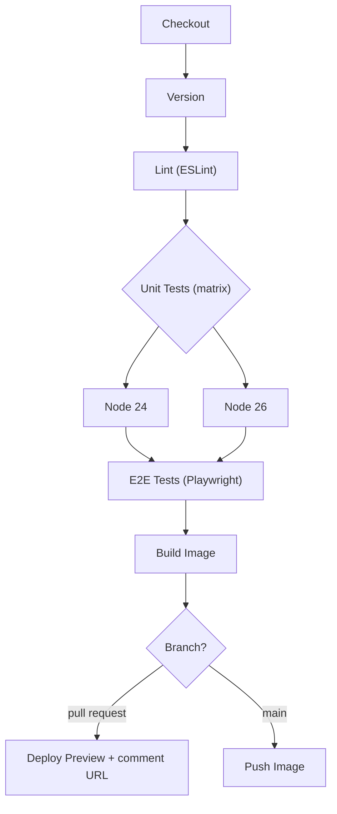

# Project: Node.js Web App Pipeline

## Introduction

In this project you build a complete Jenkins pipeline for **status-board**, a small Node.js web app that shows the health of a company's internal services. It has an Express server, a little frontend, unit tests, and a few browser tests.

Node.js projects bring their own CI challenges:

- `node_modules` is large, so installing dependencies can be the slowest step.
- Tests come in two very different kinds: fast unit tests and slow, flaky-prone browser tests.
- Teams usually support more than one Node.js version during upgrades.
- Reviewers want to **see** a change running before they approve it.

The pipeline you build answers each of those. Every pull request gets lint, unit tests on two Node.js versions, end-to-end tests in a real browser, and a temporary **preview environment** with its own URL. Merges to `main` publish a versioned Docker image.

An analogy: a theater runs a dress rehearsal before opening night. Unit tests check each actor's lines; the end-to-end tests are the dress rehearsal; the preview environment lets the director (the reviewer) watch it before the audience does.

:::info What you need
- A Jenkins LTS controller (2.580.x at the time of writing) and a Linux agent labeled `docker` with Docker Engine and the Compose plugin
- Plugins: `workflow-aggregator`, `github-branch-source`, `docker-workflow`, `junit`, `coverage`, `warnings-ng`, `htmlpublisher`, `pipeline-utility-steps`, `ws-cleanup`, `pipeline-graph-view`
- A preview host where Jenkins can run containers (in this project, the same Docker agent), with a wildcard DNS name such as `*.preview.example.com`
:::

## The Pipeline at a Glance



## Step 1: The Application

The project layout:

```text
status-board/
├── Jenkinsfile
├── Dockerfile
├── .dockerignore
├── package.json
├── package-lock.json
├── eslint.config.js
├── vitest.config.js
├── playwright.config.js
├── src/
│   ├── server.js
│   └── status.js
├── test/
│   └── status.test.js
└── e2e/
    └── home.spec.js
```

A small module with logic worth testing:

```javascript
// src/status.js
export function summarize(services) {
  const down = services.filter((s) => s.status !== 'up');
  return {
    total: services.length,
    down: down.map((s) => s.name),
    healthy: down.length === 0,
  };
}
```

```javascript
// src/server.js
import express from 'express';
import { summarize } from './status.js';

const app = express();
const services = [
  { name: 'billing', status: 'up' },
  { name: 'search', status: 'up' },
];

app.get('/api/summary', (req, res) => res.json(summarize(services)));
app.get('/healthz', (req, res) => res.send('ok'));
app.get('/', (req, res) => {
  const s = summarize(services);
  res.send(`<h1>Status Board</h1><p id="summary">${s.total} services, ${s.down.length} down</p>`);
});

const port = process.env.PORT || 3000;
app.listen(port, () => console.log(`status-board listening on ${port}`));
```

A unit test with Vitest:

```javascript
// test/status.test.js
import { describe, it, expect } from 'vitest';
import { summarize } from '../src/status.js';

describe('summarize', () => {
  it('reports healthy when all services are up', () => {
    expect(summarize([{ name: 'a', status: 'up' }]).healthy).toBe(true);
  });

  it('lists services that are down', () => {
    const result = summarize([
      { name: 'a', status: 'up' },
      { name: 'b', status: 'down' },
    ]);
    expect(result.down).toEqual(['b']);
  });
});
```

And one browser test with Playwright:

```javascript
// e2e/home.spec.js
import { test, expect } from '@playwright/test';

test('home page shows the summary', async ({ page }) => {
  await page.goto('/');
  await expect(page.locator('#summary')).toContainText('services');
});
```

## Step 2: Scripts That Write Machine-Readable Reports

Jenkins reads XML and JSON files, so configure every tool to write one. The key is `package.json`:

```json
{
  "name": "status-board",
  "version": "2.3.0",
  "type": "module",
  "scripts": {
    "start": "node src/server.js",
    "lint": "eslint .",
    "lint:ci": "eslint . --format json --output-file reports/eslint.json",
    "test": "vitest run",
    "test:ci": "vitest run --coverage --reporter=default --reporter=junit --outputFile.junit=reports/junit.xml",
    "e2e": "playwright test"
  },
  "dependencies": {
    "express": "^5.1.0"
  },
  "devDependencies": {
    "@playwright/test": "^1.64.0",
    "@vitest/coverage-v8": "^5.0.0",
    "eslint": "^10.0.0",
    "vitest": "^5.0.0"
  }
}
```

The versions are examples from the time of writing. Use whatever `npm install` resolves for you, and commit `package-lock.json`, because `npm ci` refuses to run without it.

Vitest needs to emit coverage in Cobertura XML, a format the Jenkins `coverage` plugin understands:

```javascript
// vitest.config.js
import { defineConfig } from 'vitest/config';

export default defineConfig({
  test: {
    include: ['test/**/*.test.js'],
    coverage: {
      provider: 'v8',
      reporter: ['text', 'cobertura'],
      reportsDirectory: 'reports/coverage',
    },
  },
});
```

Playwright writes a JUnit file for Jenkins and an HTML report for humans, and keeps a trace when a test fails:

```javascript
// playwright.config.js
import { defineConfig } from '@playwright/test';

export default defineConfig({
  testDir: 'e2e',
  retries: process.env.CI ? 1 : 0,
  reporter: [
    ['list'],
    ['junit', { outputFile: 'reports/e2e-junit.xml' }],
    ['html', { outputFolder: 'reports/playwright', open: 'never' }],
  ],
  use: {
    baseURL: process.env.BASE_URL || 'http://localhost:3000',
    trace: 'retain-on-failure',
  },
  webServer: {
    command: 'npm start',
    url: 'http://localhost:3000/healthz',
    reuseExistingServer: false,
  },
});
```

Check locally:

```bash
npm ci
npm run lint:ci && npm run test:ci && npx playwright test
ls reports
```

Example output:

```text
 ✓ test/status.test.js (2 tests) 4ms
 Test Files  1 passed (1)
      Tests  2 passed (2)
 % Coverage report from v8
Running 1 test using 1 worker
  ✓  1 e2e/home.spec.js:3:1 › home page shows the summary (412ms)
  1 passed (2.1s)
coverage  e2e-junit.xml  eslint.json  junit.xml  playwright
```

## Step 3: The Dockerfile

A multi-stage build installs only production dependencies in the final image and runs as the non-root `node` user that the official image provides:

```dockerfile
FROM node:24-slim AS deps
WORKDIR /app
COPY package.json package-lock.json ./
RUN npm ci --omit=dev

FROM node:24-slim
ENV NODE_ENV=production
WORKDIR /app
COPY --from=deps /app/node_modules ./node_modules
COPY package.json ./
COPY src ./src
USER node
EXPOSE 3000
CMD ["node", "src/server.js"]
```

```text
node_modules
reports
e2e
test
.git
```

The second block is the `.dockerignore`. Leaving `node_modules` out of the build context matters: a local `node_modules` built on macOS can contain native binaries that crash on Linux.

## Step 4: The Jenkinsfile

```groovy
pipeline {
    agent { label 'docker' }

    options {
        timeout(time: 40, unit: 'MINUTES')
        disableConcurrentBuilds(abortPrevious: true)
        buildDiscarder(logRotator(numToKeepStr: '25'))
    }

    environment {
        REGISTRY = 'registry.example.com'
        IMAGE    = "${REGISTRY}/web/status-board"
        NPM_CONFIG_CACHE = "${WORKSPACE}/.npm"
    }

    stages {
        stage('Version') {
            steps {
                script {
                    def pkg = readJSON file: 'package.json'
                    env.TAG = "${pkg.version}-${env.BUILD_NUMBER}"
                    currentBuild.displayName = "#${env.BUILD_NUMBER} ${env.TAG}"
                }
            }
        }

        stage('Lint') {
            agent { docker { image 'node:24-slim'; reuseNode true } }
            steps {
                sh 'npm ci --no-audit --prefer-offline'
                sh 'mkdir -p reports && npm run lint:ci || true'
            }
            post {
                always {
                    recordIssues(
                        enabledForFailure: true,
                        tool: analysisParser(pattern: 'reports/eslint.json', analysisModelId: 'eslint'),
                        qualityGates: [[threshold: 1, type: 'TOTAL_ERROR', criticality: 'FAILURE']]
                    )
                }
            }
        }

        stage('Unit Tests') {
            matrix {
                axes {
                    axis {
                        name 'NODE_MAJOR'
                        values '24', '26'
                    }
                }
                agent {
                    docker {
                        image "node:${NODE_MAJOR}-slim"
                        label 'docker'
                    }
                }
                stages {
                    stage('Test') {
                        steps {
                            sh 'node --version'
                            sh 'npm ci --no-audit --prefer-offline'
                            sh 'npm run test:ci'
                        }
                        post {
                            always {
                                junit testResults: 'reports/junit.xml'
                                script {
                                    if (env.NODE_MAJOR == '24') {
                                        recordCoverage(
                                            tools: [[parser: 'COBERTURA', pattern: 'reports/coverage/cobertura-coverage.xml']],
                                            qualityGates: [[threshold: 80.0, metric: 'LINE', baseline: 'PROJECT', unstable: true]]
                                        )
                                    }
                                }
                            }
                        }
                    }
                }
            }
        }

        stage('E2E Tests') {
            agent {
                docker {
                    image 'mcr.microsoft.com/playwright:v1.64.0-noble'
                    args '--ipc=host'
                    reuseNode true
                }
            }
            environment { CI = 'true' }
            steps {
                sh 'npm ci --no-audit --prefer-offline'
                sh 'npx playwright test'
            }
            post {
                always {
                    junit testResults: 'reports/e2e-junit.xml', allowEmptyResults: true
                    publishHTML(target: [
                        reportName: 'Playwright Report',
                        reportDir: 'reports/playwright',
                        reportFiles: 'index.html',
                        keepAll: true,
                        alwaysLinkToLastBuild: true,
                        allowMissing: true
                    ])
                }
                failure {
                    archiveArtifacts artifacts: 'test-results/**/trace.zip', allowEmptyArchive: true
                }
            }
        }

        stage('Build Image') {
            steps {
                sh 'docker build --pull -t "$IMAGE:$TAG" .'
            }
        }

        stage('Preview') {
            when { changeRequest() }
            environment {
                PREVIEW = "pr-${env.CHANGE_ID}"
            }
            steps {
                sh '''
                    docker rm -f "$PREVIEW" 2>/dev/null || true
                    docker run -d --name "$PREVIEW" \
                      --label "traefik.http.routers.$PREVIEW.rule=Host(\\`$PREVIEW.preview.example.com\\`)" \
                      --network preview \
                      "$IMAGE:$TAG"
                '''
                echo "Preview: https://${PREVIEW}.preview.example.com"
            }
        }

        stage('Publish') {
            when { branch 'main' }
            steps {
                script {
                    docker.withRegistry("https://${REGISTRY}", 'registry-creds') {
                        docker.image("${IMAGE}:${TAG}").push()
                        docker.image("${IMAGE}:${TAG}").push('main')
                    }
                }
            }
        }
    }

    post {
        cleanup {
            cleanWs(deleteDirs: true, patterns: [[pattern: '.npm/**', type: 'EXCLUDE']])
        }
    }
}
```

## Step 5: Walking Through the Design

### Reading the version from package.json

`readJSON` (from `pipeline-utility-steps`) reads the version so the image tag starts with the same number developers see in `package.json`. The build number is appended so two builds of the same version never collide. The [Python project](./2-jenkins-project-python-library.mdx) uses Git tags instead; both work, as long as one source of truth exists.

### npm ci, not npm install

`npm ci` installs exactly what `package-lock.json` says and fails if `package.json` and the lock file disagree. That is what you want in CI: reproducible installs. `npm install` may silently update the lock file, which hides drift.

`NPM_CONFIG_CACHE` points npm's download cache into the workspace, and `--prefer-offline` tells npm to use cached packages when possible. The `cleanWs` call at the end keeps `.npm` and deletes the rest, so the cache survives between builds on the same agent. On ephemeral agents this does not help; use a persistent volume or a registry proxy instead. See [Build Caching and Speed](../9-jenkins-build-and-test/8-jenkins-build-caching.mdx).

:::caution
Lint and E2E use `reuseNode true`, so they run in the main workspace one after the other. The matrix cells do not, so each cell allocates its own executor and workspace (Jenkins appends `@2`, `@3` to the path when they land on the same agent). Never run two `npm ci` commands in the **same** directory at the same time: they corrupt `node_modules`. Declarative also does not allow a `matrix` nested inside a `parallel` branch, which is why Lint is a separate stage rather than a sibling of the matrix. See [Workspaces](../2-jenkins-jobs/3-jenkins-workspaces.mdx).
:::

### Lint with a quality gate

`npm run lint:ci || true` lets ESLint exit non-zero without failing the shell step, so the report is always written. The decision moves to `recordIssues`: the gate `TOTAL_ERROR` with `criticality: 'FAILURE'` fails the build on any ESLint **error**, while warnings only show up as a trend chart. `analysisParser` with `analysisModelId: 'eslint'` selects the ESLint JSON parser by its ID from the analysis-model list of supported formats.

### A matrix for Node.js versions

The unit tests run on Node.js 24 (the active LTS line at the time of writing) and Node.js 26 (the current line, which you may be preparing to adopt). A [matrix](../4-jenkins-pipeline-advanced/1-jenkins-matrix-builds.mdx) generates one cell per value. Coverage is recorded only once (on Node 24); recording it from both cells would publish two coverage results for the same code.

Check the Node.js release schedule before copying the version numbers, because LTS lines change every October.

### E2E tests in the Playwright image

Microsoft publishes a Docker image with browsers and system libraries preinstalled, tagged by Playwright version. **Pin the image tag to the same version as `@playwright/test` in `package.json`**; a mismatch causes "browser executable not found" errors. `--ipc=host` is recommended by the Playwright docs for Chromium in Docker to avoid running out of shared memory.

The `post` block publishes two things:

- the JUnit file, so failures show up in the test results page next to unit tests
- the HTML report through `publishHTML` from the `htmlpublisher` plugin, so anyone can click **Playwright Report** in the build sidebar

On failure, traces are archived. A Playwright trace lets a developer replay the failing test step by step with `npx playwright show-trace trace.zip`, which is far more useful than a screenshot.

:::note
Jenkins serves archived HTML under a strict Content Security Policy by default, so some JavaScript-heavy reports render blank. Administrators can relax the policy or configure a resource root URL. Read the security notes in the `htmlpublisher` plugin documentation before changing it, and see [Securing Agents and the Controller](../11-jenkins-security/6-jenkins-securing-agents.mdx).
:::

### Preview environments for pull requests

`when { changeRequest() }` is true only for pull request builds in a multibranch job. `CHANGE_ID` holds the PR number, so the container is named `pr-42` and gets the hostname `pr-42.preview.example.com`. This example assumes a Traefik reverse proxy on a Docker network named `preview` that routes based on container labels. Any reverse proxy with dynamic configuration works the same way.

A second, small job (or a `post` step on PR close events) must remove previews when PRs are merged or closed. A simple nightly cleanup is often enough:

```bash
# Remove preview containers older than 3 days
docker ps --filter "name=pr-" --format '{{.Names}} {{.CreatedAt}}' |
while read -r name created _; do
  if [ "$(date -d "$created" +%s)" -lt "$(date -d '3 days ago' +%s)" ]; then
    docker rm -f "$name"
  fi
done
```

### Publishing only from main

The image is built on every branch but pushed only from `main`. PR builds never see `registry-creds`. That matters for open-source or forked repositories, where a PR can change the Jenkinsfile itself. See [Pull Request Builds](../5-jenkins-scm-integration/4-jenkins-pull-request-builds.mdx) for how trusted Jenkinsfiles from forks work.

## Step 6: A Pull Request Build

Example console output for PR #42 (trimmed, with matrix lines grouped):

```text
Branch indexing: PR-42
Running on docker-agent-1 in /home/jenkins/workspace/status-board_PR-42
[Pipeline] stage (Version)
[Pipeline] stage (Lint)
+ npm ci --no-audit --prefer-offline
added 212 packages in 6s
+ npm run lint:ci
[ESLint] Successfully parsed file reports/eslint.json
[ESLint] -> found 3 issues (skipped 0 duplicates)
[ESLint] Quality gate: TOTAL_ERROR threshold 1, actual 0 -> PASSED
[Pipeline] stage (Unit Tests)
[Test (NODE_MAJOR = '24')] + node --version
[Test (NODE_MAJOR = '24')] v24.11.0
[Test (NODE_MAJOR = '26')] v26.11.1
[Test (NODE_MAJOR = '24')]  Tests  2 passed (2)
[Test (NODE_MAJOR = '26')]  Tests  2 passed (2)
[Coverage] Line coverage: 91.30%
[Pipeline] stage (E2E Tests)
+ npx playwright test
Running 1 test using 1 worker
  ✓  1 e2e/home.spec.js:3:1 › home page shows the summary (530ms)
[htmlpublisher] Archiving HTML reports...
[Pipeline] stage (Build Image)
+ docker build --pull -t registry.example.com/web/status-board:2.3.0-57 .
[Pipeline] stage (Preview)
+ docker run -d --name pr-42 ...
Preview: https://pr-42.preview.example.com
Stage "Publish" skipped due to when conditional
Finished: SUCCESS
```

Plugin log wording differs between versions; use this to understand the flow, not as an exact transcript.

To post the preview URL on the pull request itself, use the GitHub Checks or a commenting step from your SCM plugin, or a small `curl` call to the GitHub API with a token from `withCredentials`. See [GitHub Integration and Webhooks](../5-jenkins-scm-integration/2-jenkins-github-integration.mdx).

## Real-World Scenario

You work on the internal tools team of a 200-person company. **status-board** is used by support staff, so UI regressions are noticed quickly and loudly. Last quarter, a CSS change broke the page on the support team's browser, and a dependency upgrade worked on Node.js 24 but crashed on the Node.js 26 servers being rolled out.

With this pipeline:

- the Node.js version matrix catches runtime incompatibilities before merge
- Playwright tests and the preview URL let the product owner check UI changes in a real browser before approving
- lint errors block merges, while warnings are tracked over time without blocking anyone

**Why this approach:** the company already runs Jenkins on its own network, close to the internal services the board talks to. Preview environments on an internal Docker host avoid exposing anything to the internet, which a hosted CI service would have needed tunnels for.

**When to use it:** front-end or full-stack Node.js apps with visible UI changes, teams that review in the browser, and organizations with self-hosted infrastructure.

**When not to use it:**

- A pure library with no UI does not need previews or Playwright. Unit tests on a version matrix plus `npm publish` are enough.
- If your frontend is static and deployed to a platform that already creates preview URLs (many static hosting providers do), let that platform handle previews and keep Jenkins for tests.
- One shared Docker host for previews does not scale to hundreds of open PRs. Move previews to Kubernetes namespaces, as in [Project: Kubernetes Deployment Pipeline](./3-jenkins-project-kubernetes.mdx).

**Alternatives and trade-offs:**

| Approach | Pros | Cons | Best for |
| --- | --- | --- | --- |
| Docker agents per stage (this page) | Exact Node.js version per stage, clean environment | Image pulls add time, needs Docker on agents | Most teams |
| NodeJS plugin tool installers (`tools { nodejs 'node-24' }`) | No Docker needed | Tools installed on the agent, versions drift | Agents without Docker |
| Kubernetes pod agent with node and playwright containers | Elastic, isolated | Cluster required, more YAML | Large organizations |
| Preview on a shared Docker host | Simple, cheap | Limited scale, manual cleanup | Small teams |
| Preview via hosting platform | Zero maintenance | Only for supported app types | Static and serverless frontends |

## Common Mistakes

- **Using `npm install` in CI.** It can change the lock file and produce different trees on different builds. Use `npm ci`.
- **Copying `node_modules` into the image from the workspace.** Native modules compiled for the CI container may not match the runtime image. Install inside the Dockerfile.
- **Letting ESLint fail the shell step.** The report is never written and Jenkins shows a generic failure. Write the report, then let `recordIssues` decide.
- **Mismatched Playwright versions.** Keep the Docker tag and the npm package version identical.
- **Retrying flaky E2E tests forever.** One retry in CI is reasonable. If a test needs three, it is broken. Track flaky tests in the test results history and fix them.
- **Orphaned previews.** Without cleanup, preview containers accumulate until the host runs out of memory.
- **Exposing secrets to PR builds.** Keep publishing and deploy credentials behind `when { branch 'main' }`.

## Summary

- Configure every Node.js tool to write a report file: ESLint JSON, Vitest JUnit and Cobertura, Playwright JUnit and HTML.
- Run lint first, then unit tests as a matrix over Node.js versions (matrix cells run in parallel).
- Run browser tests in the official Playwright image pinned to the same version as the npm package.
- Publish JUnit, coverage, issues and the HTML report in `post { always }` so failures are still visible.
- Give each pull request a preview environment, and clean previews up.
- Push images only from `main`.

## Exercises

1. Add a third Node.js version to the matrix and use `excludes` to skip E2E for it. See [Matrix Builds](../4-jenkins-pipeline-advanced/1-jenkins-matrix-builds.mdx).
2. Shard the Playwright tests into two parallel branches with `npx playwright test --shard=1/2` and `--shard=2/2`.
3. Write a separate pipeline job, triggered nightly with `cron`, that removes preview containers for PRs that are closed, using the GitHub API.
4. Replace the shared npm cache with a local npm registry proxy and compare install times on a fresh agent.

Related pages:

- [Building Node.js Projects](../9-jenkins-build-and-test/1-jenkins-node-builds.mdx)
- [Test Reports with JUnit](../9-jenkins-build-and-test/4-jenkins-test-reports.mdx)
- [Code Coverage](../9-jenkins-build-and-test/5-jenkins-code-coverage.mdx)
- [Docker Agents](../6-jenkins-agents/3-jenkins-docker-agents.mdx)
- [Project: CI/CD for a Java Microservice](./0-jenkins-project-java-microservice.mdx)
- General theory: the [CI/CD tutorial](/docs/devops/cicd)
