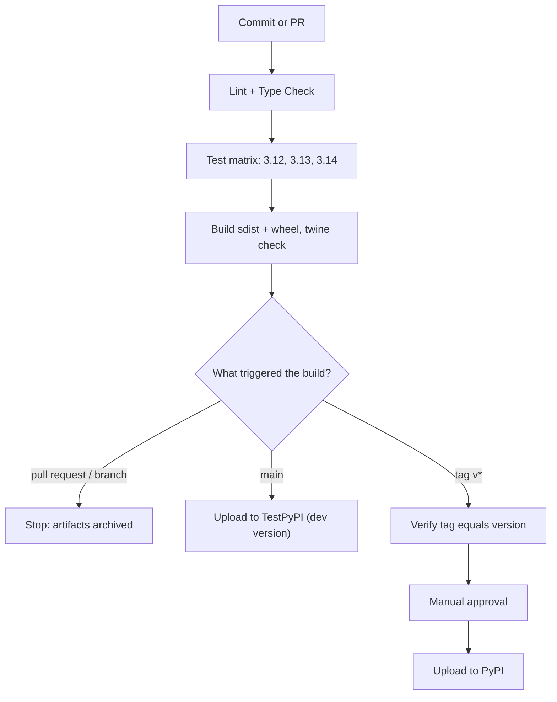

# Project: Python Library Release Pipeline

## Introduction

Applications get **deployed**. Libraries get **released**. A release is permanent in a way a deployment is not: once version `1.4.0` of a package is on PyPI, you can never upload a different file with that same version number. Users pin it, mirrors copy it, and lock files record its hash. So a library pipeline needs to be careful in different ways than an application pipeline.

In this project you build the CI/CD pipeline for **retrykit**, a small Python library that retries flaky function calls with exponential backoff. The pipeline will:

1. Lint and type-check every commit
2. Run the tests on three Python versions and publish JUnit and coverage reports
3. Build the source distribution and wheel once, and check their metadata
4. Upload every `main` build to **TestPyPI** as a rehearsal
5. Publish to **PyPI** only when someone pushes a Git tag like `v1.4.0`, after checking that the tag matches the version in `pyproject.toml` and getting a human approval

Think of it like printing a book. You proofread every draft (lint and tests), print a test copy (TestPyPI), and only send the final print run to the shops (PyPI) after the editor signs off. Mistakes in the shops cannot be recalled, only followed by a new edition.

:::info What you need
- A Jenkins LTS controller (2.580.x at the time of writing) and a Linux agent with Docker, labeled `docker`
- A multibranch pipeline job with **tag discovery** enabled (details below)
- Plugins: `workflow-aggregator`, `github-branch-source`, `docker-workflow`, `junit`, `coverage`, `warnings-ng`, `pipeline-utility-steps`, `credentials-binding`, `basic-branch-build-strategies`
- Accounts on https://test.pypi.org and https://pypi.org with project-scoped API tokens
:::

## The Release Flow



## Step 1: The Library

Project layout using the `src/` layout that the Python Packaging User Guide recommends:

```text
retrykit/
├── Jenkinsfile
├── pyproject.toml
├── README.md
├── src/
│   └── retrykit/
│       ├── __init__.py
│       └── core.py
└── tests/
    └── test_core.py
```

The library code:

```python
# src/retrykit/core.py
import time
from typing import Callable, TypeVar

T = TypeVar("T")


def retry(func: Callable[[], T], attempts: int = 3, base_delay: float = 0.1,
          exceptions: tuple[type[BaseException], ...] = (Exception,)) -> T:
    """Call func, retrying on the given exceptions with exponential backoff."""
    if attempts < 1:
        raise ValueError("attempts must be at least 1")
    for attempt in range(1, attempts + 1):
        try:
            return func()
        except exceptions:
            if attempt == attempts:
                raise
            time.sleep(base_delay * 2 ** (attempt - 1))
    raise AssertionError("unreachable")
```

```python
# src/retrykit/__init__.py
from .core import retry

__all__ = ["retry"]
```

The tests:

```python
# tests/test_core.py
import pytest

from retrykit import retry


def test_returns_value_on_first_success():
    assert retry(lambda: 42) == 42


def test_retries_until_success():
    calls = {"n": 0}

    def flaky():
        calls["n"] += 1
        if calls["n"] < 3:
            raise ConnectionError("try again")
        return "ok"

    assert retry(flaky, attempts=3, base_delay=0) == "ok"
    assert calls["n"] == 3


def test_raises_after_last_attempt():
    with pytest.raises(ConnectionError):
        retry(lambda: (_ for _ in ()).throw(ConnectionError()), attempts=2, base_delay=0)


def test_rejects_zero_attempts():
    with pytest.raises(ValueError):
        retry(lambda: 1, attempts=0)
```

## Step 2: pyproject.toml

All configuration lives in one file. The version is static here, which keeps the "does the tag match?" check simple:

```toml
[build-system]
requires = ["hatchling"]
build-backend = "hatchling.build"

[project]
name = "retrykit"
version = "1.4.0"
description = "Retry flaky calls with exponential backoff"
readme = "README.md"
requires-python = ">=3.12"
license = "MIT"
dependencies = []

[project.optional-dependencies]
dev = ["pytest", "pytest-cov", "ruff", "mypy", "build", "twine"]

[tool.pytest.ini_options]
testpaths = ["tests"]
addopts = "-ra"

[tool.ruff]
line-length = 100

[tool.mypy]
strict = true
files = ["src"]
```

Run the whole thing locally the same way Jenkins will:

```bash
python -m venv .venv && . .venv/bin/activate
pip install -e ".[dev]"
ruff check . && mypy
pytest --junitxml=reports/junit.xml --cov=retrykit --cov-report=xml:reports/coverage.xml
python -m build && twine check dist/*
```

Example output:

```text
All checks passed!
Success: no issues found in 2 source files
tests/test_core.py ....                                         [100%]
---------- coverage: platform linux, python 3.13.16 ----------
Coverage XML written to file reports/coverage.xml
4 passed in 0.05s
Successfully built retrykit-1.4.0.tar.gz and retrykit-1.4.0-py3-none-any.whl
Checking dist/retrykit-1.4.0-py3-none-any.whl: PASSED
Checking dist/retrykit-1.4.0.tar.gz: PASSED
```

`pytest-cov` writes Cobertura-format XML, which the Jenkins `coverage` plugin reads directly.

## Step 3: Configure the Job for Tags

A multibranch pipeline only builds tags if you ask it to, in two places:

1. **Discover tags.** In the job's branch source, add the **Discover tags** behavior.
2. **Build tags.** By default, discovered tags are **not** built automatically, to avoid rebuilding every historic tag after a re-index. Add a build strategy from the `basic-branch-build-strategies` plugin: **Build strategies > Tags**, and set "Ignore tags older than" to 1 day so only new tags trigger builds. Keep "Regular branches" and "Change requests" strategies too, because adding any strategy replaces the default behavior.

Inside the pipeline, `when { buildingTag() }` and `when { tag 'v*' }` detect tag builds, and `env.TAG_NAME` holds the tag.

See [Multibranch Pipelines](../5-jenkins-scm-integration/1-jenkins-multibranch-pipelines.mdx) for the job setup.

### Credentials

| ID | Kind | Contents |
| --- | --- | --- |
| `testpypi-token` | Secret text | A TestPyPI API token scoped to the project |
| `pypi-token` | Secret text | A PyPI API token scoped to the project |

PyPI API tokens are used with the username `__token__`. Create a **project-scoped** token, not an account-wide one, once the project exists. For the very first upload you need an account-wide token, which you should delete right after.

:::note Why not Trusted Publishing?
PyPI's **Trusted Publishing** replaces long-lived tokens with short-lived OIDC tokens issued by the CI system. At the time of writing, PyPI supports it for GitHub Actions, GitLab CI/CD (gitlab.com only), Google Cloud and ActiveState. Jenkins is not on the list, so a Jenkins pipeline uses a project-scoped API token. Check the [PyPI Trusted Publishers docs](https://docs.pypi.org/trusted-publishers/) for the current list. If supply-chain policy requires Trusted Publishing, one option is to build and test in Jenkins and let a GitHub Actions workflow perform only the upload.
:::

## Step 4: The Jenkinsfile

```groovy
pipeline {
    agent none

    options {
        timeout(time: 30, unit: 'MINUTES')
        buildDiscarder(logRotator(numToKeepStr: '30'))
        skipStagesAfterUnstable()
    }

    environment {
        PIP_DISABLE_PIP_VERSION_CHECK = '1'
        PIP_NO_CACHE_DIR = '1'
    }

    stages {
        stage('Lint') {
            agent { docker { image 'python:3.13-slim'; label 'docker' } }
            steps {
                sh '''
                    python -m venv .venv && . .venv/bin/activate
                    pip install -q -e ".[dev]"
                    mkdir -p reports
                    ruff check . --output-format=json --output-file reports/ruff.json || true
                    mypy
                '''
            }
            post {
                always {
                    recordIssues(
                        enabledForFailure: true,
                        tool: analysisParser(pattern: 'reports/ruff.json', analysisModelId: 'ruff'),
                        qualityGates: [[threshold: 1, type: 'TOTAL', criticality: 'FAILURE']]
                    )
                }
            }
        }

        stage('Test') {
            matrix {
                axes {
                    axis {
                        name 'PYTHON'
                        values '3.12', '3.13', '3.14'
                    }
                }
                agent { docker { image "python:${PYTHON}-slim"; label 'docker' } }
                stages {
                    stage('pytest') {
                        steps {
                            sh '''
                                python -m venv .venv && . .venv/bin/activate
                                pip install -q -e ".[dev]"
                                pytest --junitxml=reports/junit-$PYTHON.xml \
                                       --cov=retrykit --cov-report=xml:reports/coverage.xml
                            '''
                        }
                        post {
                            always {
                                junit "reports/junit-${PYTHON}.xml"
                                script {
                                    if (env.PYTHON == '3.13') {
                                        recordCoverage(
                                            tools: [[parser: 'COBERTURA', pattern: 'reports/coverage.xml']],
                                            qualityGates: [[threshold: 90.0, metric: 'LINE', baseline: 'PROJECT', unstable: true]]
                                        )
                                    }
                                }
                            }
                        }
                    }
                }
            }
        }

        stage('Build Distributions') {
            agent { docker { image 'python:3.13-slim'; label 'docker' } }
            steps {
                script {
                    if (env.BRANCH_NAME == 'main') {
                        // Unique dev version for TestPyPI, e.g. 1.4.0.dev57
                        def toml = readTOML file: 'pyproject.toml'
                        env.DIST_VERSION = "${toml.project.version}.dev${env.BUILD_NUMBER}"
                        sh "sed -i 's/^version = .*/version = \"${env.DIST_VERSION}\"/' pyproject.toml"
                    }
                }
                sh '''
                    python -m venv .venv && . .venv/bin/activate
                    pip install -q build twine
                    rm -rf dist && python -m build
                    twine check --strict dist/*
                    ls -l dist
                '''
                archiveArtifacts artifacts: 'dist/*', fingerprint: true
                stash name: 'dist', includes: 'dist/*'
            }
        }

        stage('Publish to TestPyPI') {
            when { branch 'main' }
            agent { docker { image 'python:3.13-slim'; label 'docker' } }
            steps {
                unstash 'dist'
                withCredentials([string(credentialsId: 'testpypi-token', variable: 'TWINE_PASSWORD')]) {
                    sh '''
                        python -m venv .venv && . .venv/bin/activate
                        pip install -q twine
                        TWINE_USERNAME=__token__ twine upload \
                          --repository-url https://test.pypi.org/legacy/ --non-interactive dist/*
                    '''
                }
            }
        }

        stage('Verify Release Tag') {
            when { tag pattern: 'v\\d+\\.\\d+\\.\\d+', comparator: 'REGEXP' }
            agent { label 'docker' }
            steps {
                script {
                    def version = readTOML(file: 'pyproject.toml').project.version
                    if (env.TAG_NAME != "v${version}") {
                        error "Tag ${env.TAG_NAME} does not match pyproject.toml version ${version}"
                    }
                    echo "Releasing retrykit ${version}"
                }
            }
        }

        stage('Approve Release') {
            when { tag pattern: 'v\\d+\\.\\d+\\.\\d+', comparator: 'REGEXP' }
            agent none
            steps {
                timeout(time: 2, unit: 'HOURS') {
                    input message: "Publish ${env.TAG_NAME} to PyPI?", ok: 'Publish', submitter: 'release-managers'
                }
            }
        }

        stage('Publish to PyPI') {
            when { tag pattern: 'v\\d+\\.\\d+\\.\\d+', comparator: 'REGEXP' }
            agent { docker { image 'python:3.13-slim'; label 'docker' } }
            steps {
                unstash 'dist'
                withCredentials([string(credentialsId: 'pypi-token', variable: 'TWINE_PASSWORD')]) {
                    sh '''
                        python -m venv .venv && . .venv/bin/activate
                        pip install -q twine
                        TWINE_USERNAME=__token__ twine upload --non-interactive dist/*
                    '''
                }
            }
        }
    }
}
```

## Step 5: Why Each Piece Is There

### agent none and per-stage containers

The top level has `agent none`, so no executor is held while the pipeline waits, which matters for the **Approve Release** stage: an `input` that waits two hours while holding an agent wastes capacity. Every working stage declares its own `python:*-slim` container. See [Manual Input and Approvals](../4-jenkins-pipeline-advanced/2-jenkins-input-and-approvals.mdx).

### Lint and type check as a gate

`ruff check` writes JSON, and `recordIssues` with `analysisModelId: 'ruff'` parses it (Ruff is in the warnings-ng supported formats list). The quality gate fails the build on any finding. `mypy` runs as a plain shell step: a type error exits non-zero and fails the stage directly, which is fine because mypy output in the console is readable on its own.

### The test matrix

A library has to work on every Python version it claims in `requires-python`. The matrix runs one cell per version, each in its own official `python:X.Y-slim` image. Each cell writes a differently named JUnit file (`junit-3.12.xml` and so on) so test results from different versions do not overwrite each other in the report. Coverage is recorded from one cell only.

Keep the axis in sync with `requires-python` and with the classifiers you publish. When a new Python version is released, add it to the matrix first (perhaps allowed to be unstable), then to the metadata.

### Build once, publish the same files

The **Build Distributions** stage builds the sdist and wheel **once**, runs `twine check --strict` to catch broken metadata (for example a README that will not render on PyPI), archives them with fingerprints, and stashes them. The publish stages `unstash` those exact files. You never rebuild between testing and releasing, so what you tested is what you ship. See [Stash, Unstash and Artifacts](../4-jenkins-pipeline-advanced/4-jenkins-stash-and-artifacts.mdx).

:::tip
`skipStagesAfterUnstable()` in `options` stops the pipeline from publishing when tests passed but coverage dropped and the build turned **unstable**. Without it, an unstable build would still continue to the publish stages.
:::

### TestPyPI as a rehearsal

Every `main` build uploads a unique development version such as `1.4.0.dev57` to TestPyPI. That exercises the whole upload path (credentials, metadata, network access) continuously, so the real release is not the first time anyone runs `twine upload`. The `sed` edit only changes the workspace copy for this build; it is never committed.

Development versions are pre-releases, so `pip install retrykit` does not pick them up by accident. Testers opt in with `pip install --pre -i https://test.pypi.org/simple/ retrykit`.

### Releasing from a tag

Releases are triggered by a tag, not by a parameter or a branch. A tag is a permanent pointer to a commit, it is visible in Git history, and it can be protected in the Git host so only maintainers can create `v*` tags.

The `when { tag pattern: ..., comparator: 'REGEXP' }` condition matches only real version tags like `v1.4.0`, not `v1.4.0-test`. Then three safeguards run in order:

1. **Verify Release Tag** compares `TAG_NAME` with the version read by `readTOML` (from `pipeline-utility-steps`). Tagging `v1.5.0` on a commit whose `pyproject.toml` still says `1.4.0` stops here, instead of failing halfway or, worse, publishing the wrong version.
2. **Approve Release** waits for a member of `release-managers` to click **Publish**. The `timeout` aborts the build if nobody responds.
3. **Publish to PyPI** uploads the stashed files with a project-scoped token. The token is bound with `withCredentials` and read by twine from `TWINE_PASSWORD`, so it never appears in the command line or the log.

:::warning
PyPI does not allow re-uploading a file with the same name, even after you delete a release. If a release is broken, publish a new version (for example `1.4.1`) and, if needed, **yank** the bad one in the PyPI web UI. Plan your pipeline around this: verification belongs **before** the upload.
:::

## Step 6: What a Release Looks Like

Create and push the tag:

```bash
git tag -a v1.4.0 -m "retrykit 1.4.0"
git push origin v1.4.0
```

Example console output for the tag build (trimmed):

```text
Branch indexing: v1.4.0
[Pipeline] stage (Lint)
+ ruff check . --output-format=json --output-file reports/ruff.json
+ mypy
Success: no issues found in 2 source files
[Ruff] -> found 0 issues
[Pipeline] stage (Test)
[pytest (PYTHON = '3.12')] 4 passed in 0.06s
[pytest (PYTHON = '3.13')] 4 passed in 0.05s
[pytest (PYTHON = '3.14')] 4 passed in 0.05s
[Pipeline] stage (Build Distributions)
Successfully built retrykit-1.4.0.tar.gz and retrykit-1.4.0-py3-none-any.whl
Checking dist/retrykit-1.4.0-py3-none-any.whl: PASSED
Checking dist/retrykit-1.4.0.tar.gz: PASSED
Archiving artifacts
Stage "Publish to TestPyPI" skipped due to when conditional
[Pipeline] stage (Verify Release Tag)
Releasing retrykit 1.4.0
[Pipeline] stage (Approve Release)
Publish v1.4.0 to PyPI?
Publish or Abort
Approved by Dana Lee
[Pipeline] stage (Publish to PyPI)
Uploading distributions to https://upload.pypi.org/legacy/
Uploading retrykit-1.4.0-py3-none-any.whl
Uploading retrykit-1.4.0.tar.gz
View at:
https://pypi.org/project/retrykit/1.4.0/
Finished: SUCCESS
```

And a tag that does not match:

```text
[Pipeline] stage (Verify Release Tag)
ERROR: Tag v1.5.0 does not match pyproject.toml version 1.4.0
Finished: FAILURE
```

## Real-World Scenario

Your platform team maintains **retrykit** and five other internal and open-source Python libraries. Releases used to be done from a maintainer's laptop with `twine upload`. Two problems kept happening: a release was uploaded with uncommitted local changes, and a version was published that failed to import on Python 3.12 because nobody ran the tests there.

The pipeline fixes both. Uploads only happen from Jenkins, from a tagged commit, with files built from a clean checkout and tested on every supported version. The laptop tokens are revoked, and only the Jenkins credentials store holds a project-scoped token.

**Why this approach:** the team already uses Jenkins for its services, the libraries must be tested against internal services reachable only from the company network, and approvals must be restricted to a release-managers group from the corporate directory. Jenkins handles all three.

**When to use it:** libraries published to PyPI or an internal index (such as a self-hosted repository manager) by a team already running Jenkins.

**When not to use it:**

- For an open-source library hosted on GitHub with no internal dependencies, GitHub Actions with Trusted Publishing removes the long-lived token entirely. That is a real security advantage.
- For a tiny internal package used by one team, a manual approval stage may be overkill; tag-triggered release without `input` is fine.

**Alternatives and trade-offs:**

| Approach | Pros | Cons | Best for |
| --- | --- | --- | --- |
| Tag-triggered Jenkins release (this page) | Works with internal resources, approval gates, audit trail | Long-lived API token in Jenkins | Teams already on Jenkins |
| GitHub Actions + Trusted Publishing | No stored token, short-lived credentials | GitHub-hosted repos only, separate CI system | Open-source libraries |
| Jenkins builds, GitHub Actions uploads | Keeps tests in Jenkins, gains Trusted Publishing | Two systems to coordinate | Strict supply-chain policies |
| Dynamic versioning from tags (`hatch-vcs`, `setuptools-scm`) | No version bump commits | Version only known at build time | Projects that tag frequently |
| Release tools (`python-semantic-release`) | Automated changelogs and bumps | Commit message conventions required | Teams with conventional commits |

## Common Mistakes

- **Rebuilding distributions in the publish stage.** You then publish files that were never tested. Build once, stash, unstash.
- **Using an account-wide PyPI token.** If leaked, it can upload to every project you own. Use project-scoped tokens.
- **Echoing the token.** `sh "twine upload -p ${TOKEN}"` with double quotes interpolates the secret in Groovy. Use `TWINE_PASSWORD` from `withCredentials` and single-quoted shell scripts.
- **Forgetting the tag build strategy.** Tags are discovered but never built, and people wonder why nothing happened. Configure **Build strategies** for tags.
- **Holding an executor during approval.** Use `agent none` for the `input` stage.
- **Testing on fewer Python versions than you claim.** Keep the matrix, `requires-python` and classifiers aligned.
- **Releasing from a branch build.** A branch moves; a tag does not. Release from tags.

## Summary

- Library releases are permanent, so verify everything before the upload.
- Lint, type check and test on every supported Python version with a matrix of official Python images.
- Build the sdist and wheel once, check them with `twine check --strict`, archive and stash them.
- Rehearse uploads continuously on TestPyPI with dev versions.
- Release from version tags, check that the tag equals the version in `pyproject.toml`, require approval, and upload with a project-scoped token.
- Trusted Publishing is not available for Jenkins at the time of writing; use scoped tokens or delegate only the upload.

## Exercises

1. Switch the project to dynamic versioning with `hatch-vcs` and change the **Verify Release Tag** stage accordingly. What check is still useful?
2. Add a stage that installs the built wheel into a clean virtual environment and runs `python -c "import retrykit"`, before publishing.
3. Make the Python 3.14 cell allowed to fail without failing the build, using `catchError(buildResult: 'SUCCESS', stageResult: 'UNSTABLE')`. See [Timeouts, Retries and Error Handling](../4-jenkins-pipeline-advanced/3-jenkins-timeouts-and-retries.mdx).
4. Publish to an internal package index instead of TestPyPI using `--repository-url` and a username/password credential.

Related pages:

- [Building Python Projects](../9-jenkins-build-and-test/2-jenkins-python-builds.mdx)
- [Matrix Builds](../4-jenkins-pipeline-advanced/1-jenkins-matrix-builds.mdx)
- [Conditional Stages with when](../3-jenkins-pipeline-basics/8-jenkins-when-conditions.mdx)
- [Credentials Management](../11-jenkins-security/3-jenkins-credentials.mdx)
- [Environments and Promotion](../10-jenkins-deployment/1-jenkins-environments-and-promotion.mdx)
