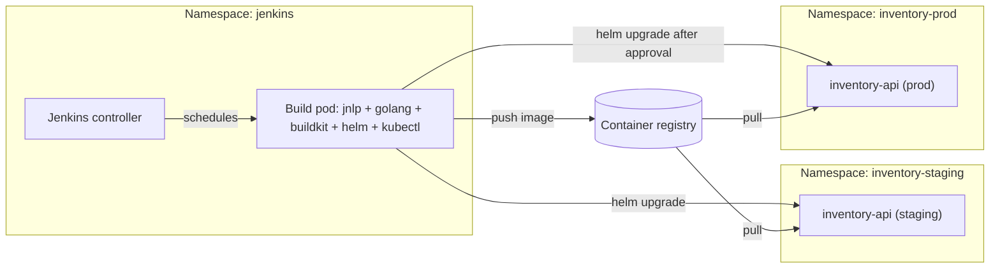

# Project: Kubernetes Deployment Pipeline

## Introduction

In this project, Jenkins builds and deploys **inventory-api**, a small Go service, to a Kubernetes cluster. Everything runs inside the cluster: the build agents are short-lived pods, the image is built without a Docker daemon, and the service is released with Helm to a staging namespace and then, after approval, to production.

You will put together:

- a **pod template** in the repository that defines the build containers (Go, BuildKit, Helm, kubectl)
- a **rootless BuildKit** image build that does not need privileged containers or the Docker socket
- **RBAC** so Jenkins can deploy only to the namespaces it owns
- a **Helm** release with automatic rollback when the rollout fails
- a **promotion** from staging to production that reuses the same image digest

Think of the cluster as a workshop that rents out workbenches by the minute. Each build gets a fresh bench with exactly the tools listed in the pod template, and the bench is cleared away when the build ends. No one leaves half-finished projects or old tools lying around for the next person.

:::info What you need
- A Kubernetes cluster you control (a local `kind` or `minikube` cluster works for practice)
- Jenkins installed with the `jenkinsci/jenkins` Helm chart (chart 5.9.x deploys Jenkins 2.580.x at the time of writing) or any Jenkins with the `kubernetes` plugin configured for the cluster. See [Installing Jenkins on Kubernetes](../1-jenkins-installation/2-jenkins-install-kubernetes.mdx).
- Plugins: `kubernetes`, `workflow-aggregator`, `github-branch-source`, `junit`, `credentials-binding`, `pipeline-utility-steps`, `pipeline-graph-view`
- A container registry that the cluster can pull from
:::

## Architecture



The build pod runs with a dedicated service account, `jenkins-deployer`, that has rights in the two application namespaces and nothing else. The controller never runs builds itself (its executor count is 0, the chart default).

## Step 1: The Service

```text
inventory-api/
├── Jenkinsfile
├── Dockerfile
├── go.mod
├── main.go
├── main_test.go
├── ci/
│   └── pod.yaml
└── chart/
    ├── Chart.yaml
    ├── values.yaml
    ├── values-staging.yaml
    ├── values-prod.yaml
    └── templates/
        ├── deployment.yaml
        └── service.yaml
```

A tiny HTTP service with a health endpoint:

```go
// main.go
package main

import (
	"encoding/json"
	"log"
	"net/http"
	"os"
)

var version = "dev"

func stockHandler(w http.ResponseWriter, r *http.Request) {
	w.Header().Set("Content-Type", "application/json")
	json.NewEncoder(w).Encode(map[string]any{"sku": r.URL.Query().Get("sku"), "inStock": 12})
}

func healthHandler(w http.ResponseWriter, r *http.Request) {
	w.Write([]byte("ok " + version))
}

func main() {
	mux := http.NewServeMux()
	mux.HandleFunc("/stock", stockHandler)
	mux.HandleFunc("/healthz", healthHandler)
	port := os.Getenv("PORT")
	if port == "" {
		port = "8080"
	}
	log.Printf("inventory-api %s listening on :%s", version, port)
	log.Fatal(http.ListenAndServe(":"+port, mux))
}
```

```go
// main_test.go
package main

import (
	"net/http/httptest"
	"strings"
	"testing"
)

func TestHealth(t *testing.T) {
	rec := httptest.NewRecorder()
	healthHandler(rec, httptest.NewRequest("GET", "/healthz", nil))
	if !strings.HasPrefix(rec.Body.String(), "ok") {
		t.Fatalf("unexpected body %q", rec.Body.String())
	}
}

func TestStock(t *testing.T) {
	rec := httptest.NewRecorder()
	stockHandler(rec, httptest.NewRequest("GET", "/stock?sku=A1", nil))
	if !strings.Contains(rec.Body.String(), `"sku":"A1"`) {
		t.Fatalf("unexpected body %q", rec.Body.String())
	}
}
```

The Dockerfile compiles a static binary and ships it in a distroless image:

```dockerfile
FROM golang:1.27 AS build
WORKDIR /src
COPY go.mod ./
RUN go mod download
COPY . .
ARG VERSION=dev
RUN CGO_ENABLED=0 go build -ldflags "-s -w -X main.version=${VERSION}" -o /out/inventory-api .

FROM gcr.io/distroless/static-debian12:nonroot
COPY --from=build /out/inventory-api /inventory-api
EXPOSE 8080
ENTRYPOINT ["/inventory-api"]
```

## Step 2: The Pod Template

Keep the pod definition in the repository, next to the Jenkinsfile. Developers can then add a tool without asking a Jenkins admin, and changes to it go through code review.

```yaml
# ci/pod.yaml
apiVersion: v1
kind: Pod
spec:
  serviceAccountName: jenkins-deployer
  securityContext:
    runAsUser: 1000
    runAsGroup: 1000
    fsGroup: 1000
  containers:
    - name: golang
      image: golang:1.27
      command: ["sleep"]
      args: ["infinity"]
      env:
        - name: GOCACHE
          value: /home/jenkins/agent/.cache/go-build
        - name: GOPATH
          value: /home/jenkins/agent/go
      resources:
        requests: { cpu: "500m", memory: "512Mi" }
        limits: { memory: "1Gi" }
    - name: buildkit
      image: moby/buildkit:v0.34.0-rootless
      command: ["sleep"]
      args: ["infinity"]
      env:
        - name: BUILDKITD_FLAGS
          value: --oci-worker-no-process-sandbox
      securityContext:
        seccompProfile:
          type: Unconfined
        appArmorProfile:
          type: Unconfined
      volumeMounts:
        - name: buildkitd
          mountPath: /home/user/.local/share/buildkit
    - name: helm
      image: alpine/helm:4.3.0
      command: ["sleep"]
      args: ["infinity"]
    - name: kubectl
      image: alpine/kubectl:1.36.2
      command: ["sleep"]
      args: ["infinity"]
  volumes:
    - name: buildkitd
      emptyDir: {}
```

Points to notice:

- The Kubernetes plugin adds the `jnlp` agent container automatically. It shares the workspace volume (`/home/jenkins/agent`) with every container you declare, so files written in `golang` are visible in `buildkit`.
- Every container runs `sleep infinity` so it stays alive; Jenkins `exec`s commands into it with the `container('name')` step.
- All containers run as UID 1000. The Kubernetes plugin docs warn that mixed UIDs across containers cause permission problems on the shared workspace.
- The BuildKit settings (`--oci-worker-no-process-sandbox`, unconfined seccomp and AppArmor) follow the rootless Kubernetes example in the `moby/buildkit` repository. `appArmorProfile` in `securityContext` needs Kubernetes 1.30 or newer.
- Image tags are pinned. Check for current versions before you copy them; `alpine/helm` and `alpine/kubectl` are community images, so mirror them into your own registry for production use.

:::note Why BuildKit and not Kaniko?
Kaniko was the classic way to build images in Kubernetes pods, but Google archived the `GoogleContainerTools/kaniko` repository in June 2025. Forks exist, but for a new pipeline rootless BuildKit is an actively maintained choice. Other options are covered in [Building and Pushing Docker Images](../9-jenkins-build-and-test/7-jenkins-docker-image-builds.mdx).
:::

## Step 3: RBAC for the Deployer

Create the namespaces, a service account in the Jenkins namespace, and a role binding in each target namespace that grants the built-in `edit` ClusterRole there only:

```yaml
# rbac.yaml - applied once by a cluster admin
apiVersion: v1
kind: Namespace
metadata:
  name: inventory-staging
---
apiVersion: v1
kind: Namespace
metadata:
  name: inventory-prod
---
apiVersion: v1
kind: ServiceAccount
metadata:
  name: jenkins-deployer
  namespace: jenkins
---
apiVersion: rbac.authorization.k8s.io/v1
kind: RoleBinding
metadata:
  name: jenkins-deployer-edit
  namespace: inventory-staging
subjects:
  - kind: ServiceAccount
    name: jenkins-deployer
    namespace: jenkins
roleRef:
  apiGroup: rbac.authorization.k8s.io
  kind: ClusterRole
  name: edit
---
apiVersion: rbac.authorization.k8s.io/v1
kind: RoleBinding
metadata:
  name: jenkins-deployer-edit
  namespace: inventory-prod
subjects:
  - kind: ServiceAccount
    name: jenkins-deployer
    namespace: jenkins
roleRef:
  apiGroup: rbac.authorization.k8s.io
  kind: ClusterRole
  name: edit
```

```bash
kubectl apply -f rbac.yaml
kubectl auth can-i create deployments -n inventory-prod --as=system:serviceaccount:jenkins:jenkins-deployer
kubectl auth can-i create deployments -n kube-system --as=system:serviceaccount:jenkins:jenkins-deployer
```

Example output:

```text
namespace/inventory-staging created
namespace/inventory-prod created
serviceaccount/jenkins-deployer created
rolebinding.rbac.authorization.k8s.io/jenkins-deployer-edit created
rolebinding.rbac.authorization.k8s.io/jenkins-deployer-edit created
yes
no
```

The second `can-i` answer is the important one: a compromised build can damage the inventory namespaces, but not the rest of the cluster.

:::caution
Any pipeline that can choose `serviceAccountName: jenkins-deployer` in its pod YAML gets these rights. In a shared Jenkins, restrict which jobs may use it, for example by running deploy pods in a separate agent namespace that only trusted jobs target, or by defining the deploy pod template centrally and not allowing inline YAML for it. See [Kubernetes Pod Agents](../6-jenkins-agents/4-jenkins-kubernetes-agents.mdx) and [Securing Agents and the Controller](../11-jenkins-security/6-jenkins-securing-agents.mdx).
:::

If the target cluster is a different cluster from the one running Jenkins, store a kubeconfig for a scoped service account as a **Secret file** credential instead, and expose it with `withCredentials([file(credentialsId: 'prod-kubeconfig', variable: 'KUBECONFIG')])`.

## Step 4: The Helm Chart

The chart is minimal. The only value the pipeline changes is the image reference:

```yaml
# chart/values.yaml
replicaCount: 2
image:
  repository: registry.example.com/inventory/inventory-api
  tag: ""
  digest: ""
resources:
  requests: { cpu: "100m", memory: "64Mi" }
  limits: { memory: "128Mi" }
```

```yaml
# chart/templates/deployment.yaml
apiVersion: apps/v1
kind: Deployment
metadata:
  name: {{ .Release.Name }}
  labels:
    app: {{ .Release.Name }}
spec:
  replicas: {{ .Values.replicaCount }}
  selector:
    matchLabels:
      app: {{ .Release.Name }}
  template:
    metadata:
      labels:
        app: {{ .Release.Name }}
    spec:
      containers:
        - name: app
          {{- if .Values.image.digest }}
          image: "{{ .Values.image.repository }}@{{ .Values.image.digest }}"
          {{- else }}
          image: "{{ .Values.image.repository }}:{{ .Values.image.tag }}"
          {{- end }}
          ports:
            - containerPort: 8080
          readinessProbe:
            httpGet: { path: /healthz, port: 8080 }
            periodSeconds: 5
          resources:
            {{- toYaml .Values.resources | nindent 12 }}
```

`values-prod.yaml` raises `replicaCount` to 4; `values-staging.yaml` keeps 1. The readiness probe is what makes `helm --wait` meaningful: Helm waits until new pods are **ready**, not just created.

## Step 5: The Jenkinsfile

```groovy
pipeline {
    agent {
        kubernetes {
            yamlFile 'ci/pod.yaml'
            defaultContainer 'golang'
        }
    }

    options {
        timeout(time: 45, unit: 'MINUTES')
        disableConcurrentBuilds()
        buildDiscarder(logRotator(numToKeepStr: '30'))
    }

    environment {
        IMAGE   = 'registry.example.com/inventory/inventory-api'
        RELEASE = 'inventory-api'
    }

    stages {
        stage('Test') {
            steps {
                sh 'go vet ./...'
                sh 'go run gotest.tools/gotestsum@v1.13.0 --junitfile reports/junit.xml -- -race -count=1 ./...'
            }
            post {
                always { junit 'reports/junit.xml' }
            }
        }

        stage('Build and Push Image') {
            steps {
                script {
                    env.TAG = "${env.BUILD_NUMBER}-${env.GIT_COMMIT.substring(0, 8)}"
                }
                container('buildkit') {
                    withCredentials([usernamePassword(credentialsId: 'registry-creds',
                                                      usernameVariable: 'REG_USER',
                                                      passwordVariable: 'REG_PASS')]) {
                        sh '''
                            export DOCKER_CONFIG="$WORKSPACE/.docker"
                            mkdir -p "$DOCKER_CONFIG"
                            AUTH=$(printf '%s:%s' "$REG_USER" "$REG_PASS" | base64 | tr -d '\\n')
                            printf '{"auths":{"registry.example.com":{"auth":"%s"}}}' "$AUTH" > "$DOCKER_CONFIG/config.json"

                            buildctl-daemonless.sh build \
                              --frontend dockerfile.v0 \
                              --local context=. --local dockerfile=. \
                              --opt build-arg:VERSION="$TAG" \
                              --output type=image,name="$IMAGE:$TAG",push=true \
                              --metadata-file build-metadata.json

                            rm -rf "$DOCKER_CONFIG"
                        '''
                    }
                }
                script {
                    def meta = readJSON file: 'build-metadata.json'
                    env.DIGEST = meta['containerimage.digest']
                    echo "Pushed ${env.IMAGE}:${env.TAG} as ${env.DIGEST}"
                }
            }
        }

        stage('Deploy to Staging') {
            when { branch 'main' }
            steps {
                container('helm') {
                    sh '''
                        helm upgrade --install "$RELEASE" ./chart \
                          --namespace inventory-staging \
                          -f chart/values-staging.yaml \
                          --set image.digest="$DIGEST" \
                          --rollback-on-failure --timeout 5m
                    '''
                }
                container('kubectl') {
                    sh 'kubectl -n inventory-staging run smoke-$BUILD_NUMBER --rm -i --restart=Never --image=curlimages/curl -- curl -fsS http://$RELEASE:8080/healthz'
                }
            }
        }

        stage('Approve Production') {
            when { branch 'main' }
            steps {
                timeout(time: 1, unit: 'DAYS') {
                    input message: "Deploy ${env.TAG} to production?", ok: 'Deploy', submitter: 'prod-deployers'
                }
            }
        }

        stage('Deploy to Production') {
            when { branch 'main' }
            steps {
                container('helm') {
                    sh '''
                        helm upgrade --install "$RELEASE" ./chart \
                          --namespace inventory-prod \
                          -f chart/values-prod.yaml \
                          --set image.digest="$DIGEST" \
                          --rollback-on-failure --timeout 10m
                        helm history "$RELEASE" -n inventory-prod --max 3
                    '''
                }
            }
        }
    }

    post {
        failure {
            echo "Deployment pipeline failed for ${env.TAG}: ${env.BUILD_URL}"
        }
    }
}
```

:::caution
The `input` stage above keeps the build pod alive while it waits, which holds cluster resources for up to a day. For long approvals, use `agent none` at the top and give each stage its own `kubernetes` agent, so the approval stage holds no pod. That pattern is shown in the [capstone](./6-jenkins-capstone.mdx). This page keeps one pod to make the example easier to follow.
:::

## Step 6: Walkthrough

### The Kubernetes agent

`yamlFile 'ci/pod.yaml'` loads the pod spec from the repository. `defaultContainer 'golang'` means that steps outside an explicit `container(...)` block run in the Go container. Jenkins schedules the pod, waits for the `jnlp` container to connect back to the controller, then runs the stages. When the build ends, the pod is deleted.

### Testing with JUnit output

`go test` does not write JUnit XML, so the pipeline runs it through `gotestsum`, pinned to a version. `-race` catches data races, and `-count=1` disables Go's test cache so tests really run. Go build and module caches point into the workspace volume; on an ephemeral pod they help within one build only. To persist them across builds, mount a PersistentVolumeClaim, as discussed in [Build Caching and Speed](../9-jenkins-build-and-test/8-jenkins-build-caching.mdx).

### Building with rootless BuildKit

`buildctl-daemonless.sh` starts a BuildKit daemon inside the container for the duration of one command, builds the Dockerfile, and pushes the result. Registry authentication uses a standard Docker `config.json` that the script writes from the `registry-creds` credential and deletes afterwards. The `--metadata-file` output contains the pushed image **digest**, which the pipeline reads with `readJSON`.

### Deploying by digest

Staging and production are both deployed with `image.digest`, not the tag. A tag can be moved to another image; a digest such as `sha256:4f1c...` cannot. So the bytes approved in staging are exactly the bytes that reach production. See [Environments and Promotion](../10-jenkins-deployment/1-jenkins-environments-and-promotion.mdx).

### Helm with automatic rollback

`helm upgrade --install` creates the release the first time and upgrades it afterwards. `--rollback-on-failure` waits for the resources to become ready and rolls back to the previous release if they do not within `--timeout`. In Helm 3 this flag was called `--atomic`; Helm 4 renamed it and keeps `--atomic` only as a deprecated alias. Check `helm version` in your image.

After staging, a one-off `curl` pod calls the service through its cluster DNS name as a smoke test. `--rm` deletes the pod afterwards.

### Production approval

`input` with `submitter: 'prod-deployers'` restricts who can approve. The approver's name is recorded in the build log, which gives you an audit trail for every production change.

## Step 7: Run It

Example console output from a `main` build (trimmed):

```text
Created Pod: kubernetes jenkins/inventory-api-main-57-x2l9k-q8m4d
Agent inventory-api-main-57-x2l9k-q8m4d is provisioned from template inventory-api_main_57-x2l9k
Running on inventory-api-main-57-x2l9k-q8m4d in /home/jenkins/agent/workspace/inventory-api_main
[Pipeline] stage (Test)
+ go vet ./...
+ go run gotest.tools/gotestsum@v1.13.0 --junitfile reports/junit.xml -- -race -count=1 ./...
✓  . (1.12s)
DONE 2 tests in 3.481s
[Pipeline] stage (Build and Push Image)
[Pipeline] container
+ buildctl-daemonless.sh build --frontend dockerfile.v0 ...
#12 exporting to image
#12 pushing layers 1.9s done
#12 pushing manifest for registry.example.com/inventory/inventory-api:57-9c41d2ab
Pushed registry.example.com/inventory/inventory-api:57-9c41d2ab as sha256:4f1c0b9e...
[Pipeline] stage (Deploy to Staging)
+ helm upgrade --install inventory-api ./chart --namespace inventory-staging ...
Release "inventory-api" has been upgraded. Happy Helming!
STATUS: deployed
REVISION: 14
+ kubectl -n inventory-staging run smoke-57 --rm -i --restart=Never --image=curlimages/curl -- curl -fsS http://inventory-api:8080/healthz
ok 57-9c41d2ab
pod "smoke-57" deleted
[Pipeline] stage (Approve Production)
Deploy 57-9c41d2ab to production?
Deploy or Abort
Approved by Priya Nair
[Pipeline] stage (Deploy to Production)
Release "inventory-api" has been upgraded. Happy Helming!
REVISION  UPDATED                   STATUS      CHART                APP VERSION  DESCRIPTION
12        Tue Oct  6 10:02:11 2026  superseded  inventory-api-0.1.0  1.0          Upgrade complete
13        Thu Oct  8 15:40:57 2026  superseded  inventory-api-0.1.0  1.0          Upgrade complete
14        Sun Oct 11 09:14:30 2026  deployed    inventory-api-0.1.0  1.0          Upgrade complete
Finished: SUCCESS
```

And a failed rollout, where the new pods never become ready:

```text
+ helm upgrade --install inventory-api ./chart --namespace inventory-prod ... --rollback-on-failure --timeout 10m
Error: UPGRADE FAILED: release inventory-api failed, and has been rolled back due to rollback-on-failure being set: context deadline exceeded
Finished: FAILURE
```

Exact messages differ between Helm and plugin versions.

## Real-World Scenario

A logistics company runs about 30 Go services on Kubernetes. Their Jenkins used three large VMs as static agents, with Docker installed and the Docker socket shared into builds. A security review flagged two problems: any build could control the host's Docker daemon (effectively root), and agents sat idle at night but were overloaded at 10 a.m.

Moving to this design:

- **Pod agents** scale with demand and disappear after each build, so there is no idle capacity and no leftover state.
- **Rootless BuildKit** removes the Docker socket from builds entirely.
- **Namespace-scoped RBAC** limits what each deploy can touch.
- **Digest-based promotion** guarantees that production runs the image that passed staging.

**Why this approach:** the company already operates Kubernetes well, so running CI on it reuses existing skills, monitoring and capacity. Jenkins stays because several teams depend on shared libraries and approval workflows built on it.

**When to use it:** teams deploying to Kubernetes who want elastic, isolated build agents and a simple push-based deployment.

**When not to use it:**

- If you need a full audit of the desired cluster state in Git, or many clusters, prefer GitOps: Jenkins builds the image and updates a Git repository, and Argo CD or Flux applies it. See [Jenkins with GitOps and Argo CD](../10-jenkins-deployment/7-jenkins-gitops.mdx).
- If your organization does not run Kubernetes yet, do not adopt it just for CI agents. VM or Docker agents are simpler. See [Choosing an Agent Strategy](../6-jenkins-agents/7-jenkins-agent-strategies.mdx).

**Alternatives and trade-offs:**

| Approach | Pros | Cons | Best for |
| --- | --- | --- | --- |
| Push deploy with Helm from Jenkins (this page) | Simple, immediate feedback in the build | Jenkins holds cluster credentials, state not in Git | Small to medium setups |
| GitOps (Jenkins builds, Argo CD deploys) | Desired state in Git, drift detection, no cluster creds in CI | More moving parts | Many services or clusters |
| `kubectl apply` of raw manifests | No Helm to learn | No release history or rollback | Very small services |
| Docker socket on static agents | Familiar, fast with local cache | Root-equivalent access, no isolation | Legacy setups only |
| Rootless BuildKit in pods | No privileged containers, maintained | Needs unconfined seccomp/AppArmor, cold cache | Kubernetes-native CI |

## Common Mistakes

- **Deploying by tag in production.** Tags can move. Promote by digest.
- **Giving the deployer `cluster-admin`.** Use namespace-scoped role bindings and check them with `kubectl auth can-i`.
- **No readiness probe.** `helm --wait` then succeeds as soon as pods start, even if the app crashes a second later.
- **Mismatched container UIDs.** Files written by one container are unreadable by another. Use one UID for the whole pod.
- **Unpinned tool images.** `alpine/helm:latest` can change behavior between builds. Pin tags and mirror images you depend on.
- **Waiting for approval inside a pod.** It holds CPU and memory reservations for hours. Use `agent none` for approval stages in production pipelines.
- **Forgetting resource requests.** Pods without requests can be scheduled onto overloaded nodes and make builds slow and flaky.

## Summary

- Kubernetes pod agents give each build a fresh, isolated set of containers defined in `ci/pod.yaml`.
- Rootless BuildKit builds and pushes images without a Docker daemon or privileged containers.
- A dedicated service account with namespace-scoped RBAC limits what deployments can touch.
- Helm `upgrade --install` with `--rollback-on-failure` (formerly `--atomic`) and a readiness probe gives safe rollouts.
- Promote the same image digest from staging to production, behind an `input` approval.

## Exercises

1. Add a `values-preview.yaml` and deploy each pull request to its own namespace `inventory-pr-NN`, deleting it when the PR closes.
2. Restructure the pipeline with `agent none` at the top so the approval stage does not hold a pod.
3. Mount a PersistentVolumeClaim for the Go module cache and measure the difference in build time.
4. Replace the Helm deploy stages with a commit to a GitOps repository and let Argo CD sync it. Compare the two approaches.

Related pages:

- [Kubernetes Pod Agents](../6-jenkins-agents/4-jenkins-kubernetes-agents.mdx)
- [Deploying to Kubernetes](../10-jenkins-deployment/2-jenkins-deploy-to-kubernetes.mdx)
- [Blue-Green and Canary Deployments](../10-jenkins-deployment/5-jenkins-blue-green-canary.mdx)
- [Rollbacks](../10-jenkins-deployment/6-jenkins-rollbacks.mdx)
- [Building Go and .NET Projects](../9-jenkins-build-and-test/3-jenkins-go-and-dotnet-builds.mdx)
- Kubernetes itself: the [Kubernetes tutorial](/docs/devops/kubernetes)
