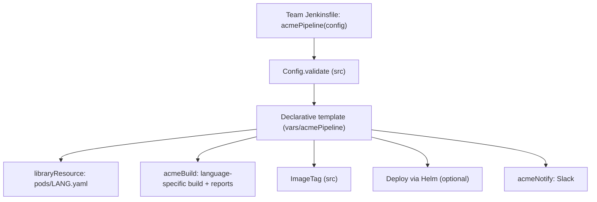

# Project: Company-Wide Shared Library

## Introduction

After the first few projects in this section, you have pipelines that work. Now imagine the company has **40 repositories** with copies of them. A security team asks for a new scan step. A plugin update changes a step's parameters. Someone finds a bug in the image tagging logic. Each change means 40 pull requests, and half the copies have already drifted from the original.

A **shared library** fixes this. In this project you build `acme-pipeline-lib`, the internal library of a fictional company called Acme, so that a typical repository's Jenkinsfile shrinks to this:

```groovy
@Library('acme@v2') _

acmePipeline(
    language: 'java',
    deploy: true,
    slackChannel: '#team-orders'
)
```

The library contains the real pipeline, the pod templates for each language, config validation, notifications, and unit tests. It is released with semantic version tags so teams can upgrade on their own schedule.

An analogy: instead of every restaurant in a chain writing its own recipes, head office publishes a recipe book. Each restaurant chooses its menu (the config map), and when head office improves a recipe, every kitchen gets it with the next edition, without rewriting anything.

This page assumes you have read [Shared Libraries Introduction](../8-jenkins-shared-libraries/0-jenkins-shared-libraries-introduction.mdx) and [Shared Library Structure](../8-jenkins-shared-libraries/1-jenkins-library-structure.mdx).

:::info What you need
- Jenkins LTS (2.580.x at the time of writing) with Kubernetes pod agents (or adapt the agent blocks to Docker agents)
- Plugins: `workflow-aggregator` (includes `pipeline-groovy-lib`), `kubernetes`, `junit`, `coverage`, `pipeline-utility-steps`, `slack`
- A Git repository for the library and admin rights to configure a global library
- JDK 21 and Gradle (wrapper) for the library's unit tests
:::

## Design Goals

Before writing code, agree on what the library should and should not do. These goals come from real problems with company-wide libraries:

1. **Small surface.** Teams call one entry point, `acmePipeline`, with a config map. Fewer public steps mean fewer breaking changes.
2. **Validated input.** A typo such as `langauge: 'java'` fails immediately with a clear message, not 10 minutes later.
3. **Escape hatches.** Teams can add their own stages before and after the standard ones without forking the library.
4. **Versioned.** Every change is released as a tag, and consumers pin a major version.
5. **Tested.** Logic is unit-tested outside Jenkins so a bad release does not break 40 pipelines at once.



## Step 1: Repository Layout

```text
acme-pipeline-lib/
├── Jenkinsfile                      # CI for the library itself
├── build.gradle                     # unit tests only, not used by Jenkins at runtime
├── settings.gradle
├── vars/
│   ├── acmePipeline.groovy          # the template pipeline
│   ├── acmePipeline.txt             # help text shown in Pipeline Syntax
│   ├── acmeBuild.groovy
│   └── acmeNotify.groovy
├── src/com/acme/ci/
│   ├── Config.groovy
│   └── ImageTag.groovy
├── resources/com/acme/ci/pods/
│   ├── java.yaml
│   ├── node.yaml
│   └── python.yaml
└── test/groovy/
    ├── ConfigTest.groovy
    ├── ImageTagTest.groovy
    └── AcmeNotifyTest.groovy
```

`vars/` holds global steps, `src/` holds classes, `resources/` holds non-Groovy files loaded with `libraryResource`. Details in [Shared Library Structure](../8-jenkins-shared-libraries/1-jenkins-library-structure.mdx).

## Step 2: Classes in src

### Config: defaults and validation

```groovy
// src/com/acme/ci/Config.groovy
package com.acme.ci

class Config implements Serializable {
    private static final long serialVersionUID = 1L

    static final List<String> LANGUAGES = ['java', 'node', 'python']
    static final Set<String> KNOWN_KEYS = [
        'language', 'deploy', 'slackChannel', 'helmChart',
        'testCommand', 'beforeBuild', 'afterTests', 'timeoutMinutes'
    ] as Set

    static Map withDefaults(Map user) {
        List<String> unknown = (user.keySet() - KNOWN_KEYS) as List
        if (unknown) {
            throw new IllegalArgumentException(
                "acmePipeline: unknown option(s) ${unknown}. Allowed: ${KNOWN_KEYS.sort()}")
        }
        if (!(user.language in LANGUAGES)) {
            throw new IllegalArgumentException(
                "acmePipeline: 'language' must be one of ${LANGUAGES}, got '${user.language}'")
        }
        Map defaults = [
            deploy        : false,
            slackChannel  : null,
            helmChart     : 'chart',
            testCommand   : null,
            beforeBuild   : null,
            afterTests    : null,
            timeoutMinutes: 45
        ]
        return defaults + user
    }
}
```

`Serializable` matters. Pipeline state is saved to disk between steps so builds survive a controller restart, and non-serializable objects held across steps cause `NotSerializableException`. The [Classes in src](../8-jenkins-shared-libraries/3-jenkins-library-classes.mdx) page explains the CPS rules.

### ImageTag: one tagging rule for the whole company

```groovy
// src/com/acme/ci/ImageTag.groovy
package com.acme.ci

class ImageTag implements Serializable {
    private static final long serialVersionUID = 1L

    static String of(String branch, String buildNumber, String commit) {
        String shortSha = commit ? commit.substring(0, Math.min(8, commit.length())) : 'nocommit'
        String safeBranch = (branch ?: 'detached').toLowerCase().replaceAll(/[^a-z0-9.-]/, '-')
        if (safeBranch.length() > 40) {
            safeBranch = safeBranch.substring(0, 40)
        }
        return "${safeBranch}-${buildNumber}-${shortSha}".toString()
    }
}
```

Docker tags only allow a limited character set and length, and branch names like `feature/ABC-123_new UI` break naive tagging. Centralizing this rule means it is fixed once.

## Step 3: Pod Templates as Resources

```yaml
# resources/com/acme/ci/pods/java.yaml
apiVersion: v1
kind: Pod
spec:
  securityContext:
    runAsUser: 1000
    fsGroup: 1000
  containers:
    - name: build
      image: maven:3.9-eclipse-temurin-21
      command: ["sleep"]
      args: ["infinity"]
      resources:
        requests: { cpu: "1", memory: "2Gi" }
        limits: { memory: "3Gi" }
    - name: helm
      image: alpine/helm:4.3.0
      command: ["sleep"]
      args: ["infinity"]
```

`node.yaml` and `python.yaml` are the same with `node:24-slim` and `python:3.13-slim` in the `build` container. Because every template names its main container `build`, the pipeline code does not need to know which language it is running.

## Step 4: Global Steps in vars

### acmeBuild: language-specific commands

```groovy
// vars/acmeBuild.groovy
def call(Map cfg) {
    switch (cfg.language) {
        case 'java':
            sh cfg.testCommand ?: './mvnw -B -ntp verify'
            junit testResults: '**/target/surefire-reports/*.xml', allowEmptyResults: true
            recordCoverage(tools: [[parser: 'JACOCO']])
            break
        case 'node':
            sh 'npm ci --no-audit'
            sh cfg.testCommand ?: 'npm test'
            junit testResults: 'reports/**/*.xml', allowEmptyResults: true
            break
        case 'python':
            sh '''
                python -m venv .venv && . .venv/bin/activate
                pip install -q -e ".[dev]"
            '''
            sh cfg.testCommand ?: '. .venv/bin/activate && pytest --junitxml=reports/junit.xml'
            junit testResults: 'reports/*.xml', allowEmptyResults: true
            break
        default:
            error "acmeBuild: unsupported language ${cfg.language}"
    }
}
```

### acmeNotify: one place for chat integration

```groovy
// vars/acmeNotify.groovy
def call(String channel, String result) {
    if (!channel) {
        echo 'acmeNotify: no slackChannel configured, skipping'
        return
    }
    String color = result == 'SUCCESS' ? 'good' : (result == 'UNSTABLE' ? 'warning' : 'danger')
    String msg = "${result}: ${env.JOB_NAME} #${env.BUILD_NUMBER} (<${env.BUILD_URL}|open>)"
    slackSend(channel: channel, color: color, message: msg)
}
```

If the company moves from Slack to Teams next year, only this file changes. See [Notifications: Email, Slack and Teams](../12-jenkins-administration/6-jenkins-notifications.mdx).

### acmePipeline: the Declarative template

A `vars` step can contain a whole Declarative `pipeline` block. Only one `pipeline` can run per build, so the consuming Jenkinsfile must not declare its own.

```groovy
// vars/acmePipeline.groovy
import com.acme.ci.Config
import com.acme.ci.ImageTag

def call(Map userConfig = [:]) {
    Map cfg = Config.withDefaults(userConfig)
    String podYaml = libraryResource("com/acme/ci/pods/${cfg.language}.yaml")

    pipeline {
        agent {
            kubernetes {
                yaml podYaml
                defaultContainer 'build'
            }
        }

        options {
            timeout(time: cfg.timeoutMinutes, unit: 'MINUTES')
            buildDiscarder(logRotator(numToKeepStr: '30'))
            disableConcurrentBuilds(abortPrevious: true)
        }

        stages {
            stage('Before Build') {
                when { expression { cfg.beforeBuild != null } }
                steps {
                    script { cfg.beforeBuild.call() }
                }
            }

            stage('Build and Test') {
                steps {
                    acmeBuild(cfg)
                }
            }

            stage('After Tests') {
                when { expression { cfg.afterTests != null } }
                steps {
                    script { cfg.afterTests.call() }
                }
            }

            stage('Image Tag') {
                steps {
                    script {
                        env.ACME_IMAGE_TAG = ImageTag.of(env.BRANCH_NAME, env.BUILD_NUMBER, env.GIT_COMMIT)
                        currentBuild.displayName = "#${env.BUILD_NUMBER} ${env.ACME_IMAGE_TAG}"
                    }
                }
            }

            stage('Deploy to Staging') {
                when {
                    allOf {
                        branch 'main'
                        expression { cfg.deploy }
                    }
                }
                steps {
                    container('helm') {
                        sh "helm upgrade --install \"\${JOB_BASE_NAME}\" ./${cfg.helmChart} --namespace staging --set image.tag=\"\${ACME_IMAGE_TAG}\" --rollback-on-failure --timeout 5m"
                    }
                }
            }
        }

        post {
            always {
                acmeNotify(cfg.slackChannel, currentBuild.currentResult)
            }
        }
    }
}
```

Image building is left out to keep the example readable; in a real library it would be one more stage calling a step like the BuildKit build in [Project: Kubernetes Deployment Pipeline](./3-jenkins-project-kubernetes.mdx).

:::caution
In `sh` strings built with double quotes, escape `$` (written as `\$` in Groovy) for shell variables like `JOB_BASE_NAME`, so the **shell** expands them instead of Groovy. Only interpolate values you control, such as `cfg.helmChart` after validation. Never interpolate secrets into Groovy strings. See [Groovy Essentials for Pipelines](../4-jenkins-pipeline-advanced/5-jenkins-groovy-for-pipelines.mdx).
:::

### Help text

`vars/acmePipeline.txt` is shown under **Pipeline Syntax > Global Variables Reference**. Treat it as the user manual:

```text
acmePipeline(Map config)

Runs the standard Acme CI/CD pipeline.

Required:
  language      'java' | 'node' | 'python'
Optional:
  deploy        true to deploy main to staging (default false)
  slackChannel  e.g. '#team-orders'
  helmChart     path to the Helm chart (default 'chart')
  testCommand   override the default test command
  beforeBuild   closure run before the build
  afterTests    closure run after tests
  timeoutMinutes  default 45
```

## Step 5: Unit Tests for the Library

Testing in production (a broken release failing 40 pipelines) is the most expensive way to find a bug. Two kinds of tests cover most of it:

- **Plain unit tests** for classes in `src/`, which are ordinary Groovy
- **JenkinsPipelineUnit** tests for `vars/` steps, which mock Jenkins steps such as `sh` and `slackSend`

```groovy
// build.gradle
plugins {
    id 'groovy'
}

repositories {
    mavenCentral()
    maven { url 'https://repo.jenkins-ci.org/releases/' }
}

dependencies {
    implementation 'org.apache.groovy:groovy:4.0.28'
    testImplementation 'com.lesfurets:jenkins-pipeline-unit:1.31'
    testImplementation 'org.junit.jupiter:junit-jupiter:5.13.4'
    testRuntimeOnly 'org.junit.platform:junit-platform-launcher'
}

sourceSets {
    main { groovy { srcDirs = ['src', 'vars'] } }
    test { groovy { srcDirs = ['test/groovy'] } }
}

test {
    useJUnitPlatform()
}
```

Check the current versions of JenkinsPipelineUnit (its GitHub releases page), Groovy and JUnit before copying the numbers. Jenkins itself runs pipelines on Groovy 2.4 internally; the Groovy version here is only for running tests, so avoid Groovy 3 or 4 only syntax in library code.

```groovy
// test/groovy/ConfigTest.groovy
import com.acme.ci.Config
import org.junit.jupiter.api.Test
import static org.junit.jupiter.api.Assertions.*

class ConfigTest {
    @Test
    void appliesDefaults() {
        Map cfg = Config.withDefaults(language: 'java')
        assertEquals(false, cfg.deploy)
        assertEquals(45, cfg.timeoutMinutes)
    }

    @Test
    void rejectsUnknownKeys() {
        def e = assertThrows(IllegalArgumentException) {
            Config.withDefaults(language: 'java', langauge: 'java')
        }
        assertTrue(e.message.contains('langauge'))
    }

    @Test
    void rejectsUnsupportedLanguage() {
        assertThrows(IllegalArgumentException) { Config.withDefaults(language: 'cobol') }
    }
}
```

```groovy
// test/groovy/ImageTagTest.groovy
import com.acme.ci.ImageTag
import org.junit.jupiter.api.Test
import static org.junit.jupiter.api.Assertions.assertEquals

class ImageTagTest {
    @Test
    void sanitizesBranchNames() {
        assertEquals('feature-abc-123-new-ui-7-1a2b3c4d',
                     ImageTag.of('feature/ABC-123_new UI', '7', '1a2b3c4d5e6f'))
    }
}
```

```groovy
// test/groovy/AcmeNotifyTest.groovy
import com.lesfurets.jenkins.unit.BasePipelineTest
import org.junit.jupiter.api.BeforeEach
import org.junit.jupiter.api.Test
import static org.junit.jupiter.api.Assertions.*

class AcmeNotifyTest extends BasePipelineTest {

    @BeforeEach
    void setUp() {
        super.setUp()
        binding.setVariable('env', [JOB_NAME: 'orders', BUILD_NUMBER: '12', BUILD_URL: 'https://ci/job/orders/12/'])
        helper.registerAllowedMethod('slackSend', [Map], null)
    }

    @Test
    void sendsRedMessageOnFailure() {
        def step = loadScript('vars/acmeNotify.groovy')
        step.call('#team-orders', 'FAILURE')

        def call = helper.callStack.find { it.methodName == 'slackSend' }
        assertNotNull(call)
        assertEquals('danger', call.args[0].color)
        assertEquals('#team-orders', call.args[0].channel)
    }

    @Test
    void skipsWithoutChannel() {
        loadScript('vars/acmeNotify.groovy').call(null, 'SUCCESS')
        assertTrue(helper.callStack.findAll { it.methodName == 'slackSend' }.isEmpty())
    }
}
```

Run them:

```bash
./gradlew test
```

Example output:

```text
> Task :compileGroovy
> Task :compileTestGroovy
> Task :test

AcmeNotifyTest > sendsRedMessageOnFailure() PASSED
AcmeNotifyTest > skipsWithoutChannel() PASSED
ConfigTest > appliesDefaults() PASSED
ConfigTest > rejectsUnknownKeys() PASSED
ConfigTest > rejectsUnsupportedLanguage() PASSED
ImageTagTest > sanitizesBranchNames() PASSED

BUILD SUCCESSFUL in 9s
```

Unit tests cannot prove that the Declarative template works inside real Jenkins (CPS transformation, plugin steps, sandbox). So the library's own pipeline also runs a **canary**: a sample repository that loads the library from the branch under test. More strategies on [Testing Shared Libraries](../8-jenkins-shared-libraries/6-jenkins-library-testing.mdx).

## Step 6: CI for the Library Itself

```groovy
// Jenkinsfile in acme-pipeline-lib
pipeline {
    agent {
        kubernetes {
            yaml '''
                apiVersion: v1
                kind: Pod
                spec:
                  containers:
                    - name: gradle
                      image: eclipse-temurin:21-jdk
                      command: ["sleep"]
                      args: ["infinity"]
            '''
            defaultContainer 'gradle'
        }
    }
    stages {
        stage('Unit Tests') {
            steps {
                sh './gradlew --no-daemon test'
            }
            post {
                always { junit 'build/test-results/test/*.xml' }
            }
        }
        stage('Canary') {
            steps {
                build job: 'canaries/sample-java-service/main',
                      parameters: [string(name: 'LIB_VERSION', value: env.BRANCH_NAME)],
                      wait: true
            }
        }
    }
}
```

The canary job's Jenkinsfile loads the library dynamically, so it can test any branch:

```groovy
// Jenkinsfile in canaries/sample-java-service
library "acme@${params.LIB_VERSION ?: 'main'}"

properties([parameters([string(name: 'LIB_VERSION', defaultValue: 'main')])])

acmePipeline(language: 'java', deploy: false)
```

The `library` step (instead of the `@Library` annotation) loads the library at run time, which is what allows the version to come from a parameter. That requires **Allow default version to be overridden** to be enabled for the library.

## Step 7: Register and Version the Library

Configure the library globally with JCasC (or under **Manage Jenkins > System > Global Trusted Pipeline Libraries**):

```yaml
unclassified:
  globalLibraries:
    libraries:
      - name: "acme"
        defaultVersion: "v2"
        allowVersionOverride: true
        implicit: false
        includeInChangesets: false
        retriever:
          modernSCM:
            scm:
              git:
                remote: "https://git.example.com/platform/acme-pipeline-lib.git"
                credentialsId: "git-readonly"
```

Global libraries configured by an administrator are **trusted**: their code runs outside the Groovy sandbox and can call any Java API. That is why the library repository needs branch protection and mandatory review; a merged change can do anything the controller can. Folder-level libraries are always sandboxed. See [Script Security and Sandboxing](../11-jenkins-security/5-jenkins-script-security.mdx).

`includeInChangesets: false` stops library commits from appearing in every consumer's change log and from triggering their builds.

### Release scheme

| Ref | Meaning | Who uses it |
| --- | --- | --- |
| `v2.4.1` (tag) | An exact, immutable release | Teams that need fully reproducible builds |
| `v2` (branch) | Latest 2.x release, fast-forwarded on each release | Most teams (default version) |
| `main` | Unreleased changes | Canaries and the platform team only |

Releasing works like this: merge to `main`, let the canaries pass, tag `v2.4.1`, then fast-forward the `v2` branch to that tag. Breaking changes (renamed options, removed languages) go into `v3`, and both lines are maintained during a migration window. Details on [Versioning Shared Libraries](../8-jenkins-shared-libraries/5-jenkins-library-versioning.mdx).

```bash
git tag -a v2.4.1 -m "acme-pipeline-lib 2.4.1: add python 3.14 image"
git push origin v2.4.1
git push origin v2.4.1^{commit}:refs/heads/v2
```

## Step 8: A Team Adopts the Library

A team's repository now needs only:

```groovy
@Library('acme@v2') _

acmePipeline(
    language: 'python',
    deploy: true,
    slackChannel: '#team-search',
    afterTests: {
        sh '. .venv/bin/activate && python scripts/check_migrations.py'
    }
)
```

Example console output (trimmed):

```text
Loading library acme@v2
Attempting to resolve v2 from remote references...
Found match: refs/heads/v2 revision 5d1e0f7c...
Created Pod: kubernetes jenkins/search-api-main-88-n4k2v-0b7rx
[Pipeline] stage (Before Build)
Stage "Before Build" skipped due to when conditional
[Pipeline] stage (Build and Test)
+ pytest --junitxml=reports/junit.xml
42 passed in 3.10s
[Pipeline] stage (After Tests)
+ python scripts/check_migrations.py
migrations OK
[Pipeline] stage (Image Tag)
[Pipeline] stage (Deploy to Staging)
Release "search-api" has been upgraded. Happy Helming!
[Pipeline] slackSend
Slack Send Pipeline step running, values are - channel: #team-search, color: good
Finished: SUCCESS
```

And a typo fails fast, before any agent is allocated:

```text
Loading library acme@v2
java.lang.IllegalArgumentException: acmePipeline: unknown option(s) [slackChanel]. Allowed: [afterTests, beforeBuild, deploy, helmChart, language, slackChannel, testCommand, timeoutMinutes]
Finished: FAILURE
```

## Real-World Scenario

Acme's platform team supports 40 services in Java, Node.js and Python, owned by 12 teams. Before the library, a dependency-scan requirement from the security team took six weeks to roll out, and three teams never finished. With the library, the scan became a new stage in `acmePipeline`, released as `v2.5.0`. Teams on the `v2` default got it on their next build; the rollout took one day, including canary verification.

**Why this approach:** most services follow the same build, test and deploy shape. A template with a validated config map captures that shape, and closures (`beforeBuild`, `afterTests`) cover the 10% of special cases without forks.

**When to use it:** many repositories with similar pipelines, a platform team that can own the library, and a need to roll out cross-cutting changes (security, compliance, notifications).

**When not to use it:**

- Five repositories with very different pipelines. A library would be an abstraction over nothing in common; copy-paste with good examples may be cheaper.
- When nobody owns the library. An unowned shared library becomes a single point of failure that nobody dares to change.
- When teams need full control over their pipelines. Offer smaller building-block steps instead of a full template.

**Alternatives and trade-offs:**

| Approach | Pros | Cons | Best for |
| --- | --- | --- | --- |
| Full template (`acmePipeline`) | Tiny Jenkinsfiles, central rollout | Less flexibility, one team becomes a bottleneck | Homogeneous services |
| Building-block steps only (`acmeBuild`, `acmeNotify`) | Teams keep control of stage layout | More code per repo, slower rollouts | Diverse teams |
| Copy-paste Jenkinsfiles | No abstraction to learn | Drift, slow fleet-wide changes | Very few repositories |
| Pipeline templates via Job DSL or Templating Engine plugins | Pipelines defined outside repos | Extra plugin, different mental model | Strict governance |
| Reusable workflows in GitHub Actions or GitLab CI includes | Built into those platforms | Not Jenkins | Teams on those platforms |

See also [Pipeline Templates for Many Teams](../8-jenkins-shared-libraries/7-jenkins-pipeline-templates.mdx).

## Common Mistakes

- **Using `@Library('acme')` without a version.** Consumers get whatever the default is today. Pin at least a major version.
- **Breaking changes in a minor release.** Renaming a config key is a major change. Keep old keys working with a deprecation warning for one major version.
- **Non-serializable fields in classes.** Fields like `Matcher` or open streams cause `NotSerializableException`. Implement `Serializable` and keep state simple.
- **Too much logic in Groovy.** Heavy computation in CPS-transformed code is slow and hits sandbox and serialization limits. Push it into shell scripts or tools called with `sh`.
- **No tests for the library.** One bad merge breaks every pipeline in the company. Unit-test `src/` and `vars/`, and run canaries.
- **Unreviewed changes to a trusted library.** Trusted library code runs with controller privileges. Protect the branch and require review.
- **Library commits triggering all builds.** Set `includeInChangesets: false` unless you really want that.

## Summary

- A company-wide library gives every repository a short Jenkinsfile and lets a platform team roll out changes centrally.
- Keep the public surface small: one template step with a validated config map, plus escape-hatch closures.
- Put logic in serializable `src/` classes, steps in `vars/`, and pod templates in `resources/`.
- Unit-test with plain JUnit and JenkinsPipelineUnit, and verify real behavior with canary jobs.
- Release with semantic tags and a moving major branch; consumers pin `@Library('acme@v2')`.
- Global libraries are trusted code: review them like production code.

## Exercises

1. Add a `go` language with its own pod template and default test command. Write the unit tests first.
2. Add a deprecation path: accept the old key `slack` as an alias for `slackChannel`, print a warning, and add a test.
3. Add an optional `extraStages` closure that runs inside a `parallel` block next to the standard tests. What are the limits of Declarative here?
4. Set up a canary job and make the library's pipeline fail when the canary fails.

Related pages:

- [Custom Steps with vars](../8-jenkins-shared-libraries/2-jenkins-global-vars.mdx)
- [Resources and Templates](../8-jenkins-shared-libraries/4-jenkins-library-resources.mdx)
- [Testing Shared Libraries](../8-jenkins-shared-libraries/6-jenkins-library-testing.mdx)
- [Project: Fully Codified Jenkins Instance](./5-jenkins-project-jenkins-as-code.mdx)
- [Pipeline Best Practices](../13-jenkins-best-practices/0-jenkins-pipeline-best-practices.mdx)
