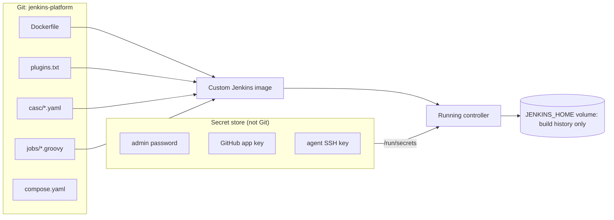

# Project: Fully Codified Jenkins Instance

## Introduction

Most Jenkins servers start life with someone clicking through the setup wizard. Over the years, more clicks follow: a plugin here, a credential there, a job copied from another job. Eventually nobody knows exactly how the server is configured, upgrades are scary, and rebuilding it after a disk failure takes days of guesswork.

In this project you build the opposite: a Jenkins controller that is described **entirely in a Git repository**. From an empty machine, one command brings up a working Jenkins with:

- a pinned Jenkins LTS version and pinned plugins (custom Docker image)
- security, agents, tools and global settings from **Configuration as Code (JCasC)**
- credentials injected from secret files, never committed
- all jobs created by **Job DSL** from code
- a pipeline that tests every change to the Jenkins configuration before it reaches production

The idea is "cattle, not pets". A pet server is unique and nursed back to health when sick. A cattle server is one of many identical copies; if it breaks, you replace it from the recipe. The only thing worth backing up is build history, not configuration.

:::info What you need
- Docker Engine with the Compose plugin on a Linux machine (a laptop is fine for practice)
- A Git repository for the configuration, here called `jenkins-platform`
- Basic familiarity with [Configuration as Code (JCasC)](../12-jenkins-administration/0-jenkins-configuration-as-code.mdx), [Job DSL](../12-jenkins-administration/1-jenkins-job-dsl.mdx) and [Managing Plugins as Code](../7-jenkins-plugins/3-jenkins-plugin-installation-manager.mdx)
:::

## What Lives Where



| Concern | Defined in | Changes by |
| --- | --- | --- |
| Jenkins version | `Dockerfile` base image tag | Pull request |
| Plugins and versions | `plugins.txt` | Pull request |
| System settings, security, agents, tools | `casc/*.yaml` | Pull request |
| Jobs and folders | `jobs/*.groovy` (Job DSL) | Pull request |
| Pipeline logic | Each application's `Jenkinsfile` | Application teams |
| Secrets | Secret files or an external secret manager | Secret management process |
| Build history, logs, artifacts | `JENKINS_HOME` volume | Jenkins at run time (backed up) |

## Step 1: Repository Layout

```text
jenkins-platform/
├── Dockerfile
├── plugins.txt
├── compose.yaml
├── Jenkinsfile               # CI for this repository
├── casc/
│   ├── 01-jenkins.yaml       # system settings, security realm, authorization
│   ├── 02-agents.yaml        # permanent agents
│   ├── 03-credentials.yaml   # credentials built from secrets
│   ├── 04-unclassified.yaml  # URL, libraries, misc plugin settings
│   └── 05-jobs.yaml          # loads Job DSL scripts
├── jobs/
│   ├── folders.groovy
│   └── services.groovy
└── secrets/                  # gitignored, local development only
    ├── admin-password
    ├── github-token
    └── agent-ssh-key
```

Splitting JCasC into several files keeps pull requests readable. JCasC loads every YAML file in a directory when `CASC_JENKINS_CONFIG` points to the directory, and merges them.

## Step 2: Pin Plugins

`plugins.txt` lists plugin IDs, optionally with versions:

```text
configuration-as-code:2133.ve570217cdb_cd
workflow-aggregator:608.v67378e9d3db_1
git:5.10.1
kubernetes:4557.ve746270f672f
job-dsl
github-branch-source
matrix-auth
ssh-slaves
credentials-binding
pipeline-utility-steps
pipeline-graph-view
junit
coverage
warnings-ng
timestamper
ws-cleanup
docker-workflow
```

The first four versions are the defaults shipped in the `jenkinsci/jenkins` Helm chart at the time of writing; the rest are unpinned to keep the example short. In production, **pin every plugin**, including dependencies, so that two image builds a week apart produce identical controllers. `jenkins-plugin-cli` can generate the pins for you:

```bash
docker run --rm -v "$PWD:/work" jenkins/jenkins:2.580.1-lts-jdk21 \
  jenkins-plugin-cli --plugin-file /work/plugins.txt --available-updates --output txt
```

Example output (shortened, versions are illustrative):

```text
configuration-as-code:2133.ve570217cdb_cd
workflow-aggregator:608.v67378e9d3db_1
git:5.10.1
kubernetes:4557.ve746270f672f
job-dsl:1.93
github-branch-source:1917.v9ee8a_39b_3d0d
...
```

Redirect that into `plugins.txt` in a pull request, and the CI pipeline in Step 7 proves the new set starts cleanly. Background on plugin risk in [Avoiding Plugin Sprawl and Dependency Problems](../7-jenkins-plugins/2-jenkins-plugin-dependency-hell.mdx).

## Step 3: The Custom Image

```dockerfile
FROM jenkins/jenkins:2.580.1-lts-jdk21

# Install pinned plugins at build time, not at start-up
COPY --chown=jenkins:jenkins plugins.txt /usr/share/jenkins/ref/plugins.txt
RUN jenkins-plugin-cli --plugin-file /usr/share/jenkins/ref/plugins.txt --verbose

# Configuration as Code and Job DSL scripts are baked into the image
COPY --chown=jenkins:jenkins casc/ /usr/share/jenkins/casc/
COPY --chown=jenkins:jenkins jobs/ /usr/share/jenkins/jobs/

ENV CASC_JENKINS_CONFIG=/usr/share/jenkins/casc
ENV JAVA_OPTS="-Djenkins.install.runSetupWizard=false -Xms1g -Xmx2g"
```

Key decisions:

- **Exact base tag** `2.580.1-lts-jdk21`, not `lts`. Upgrading Jenkins becomes a one-line pull request that goes through CI. Java 21 and Java 25 are both supported by current LTS releases; check the [Java support policy](https://www.jenkins.io/doc/book/platform-information/support-policy-java/) when you upgrade.
- **Plugins installed at build time.** Downloading plugins on every start-up is slow and means a restart can silently pull different versions.
- **Setup wizard disabled.** JCasC creates the admin user, so the wizard would only get in the way.
- **Config baked into the image.** The image tag now identifies the complete configuration. The alternative, mounting `casc/` from a volume or Git checkout, allows faster changes but loses that property.

## Step 4: Configuration as Code

### System settings and security

```yaml
# casc/01-jenkins.yaml
jenkins:
  systemMessage: "Managed by jenkins-platform. Manual changes will be overwritten."
  numExecutors: 0
  mode: EXCLUSIVE
  markupFormatter: plainText
  crumbIssuer:
    standard:
      excludeClientIPFromCrumb: false
  securityRealm:
    local:
      allowsSignup: false
      users:
        - id: "admin"
          name: "Platform Admin"
          password: "${admin-password}"
  authorizationStrategy:
    globalMatrix:
      entries:
        - user:
            name: "admin"
            permissions:
              - "Overall/Administer"
        - group:
            name: "authenticated"
            permissions:
              - "Overall/Read"
              - "Job/Read"
              - "Job/Build"
              - "Job/Cancel"
```

- `numExecutors: 0` keeps builds off the controller, which is a basic security rule. See [Securing Agents and the Controller](../11-jenkins-security/6-jenkins-securing-agents.mdx).
- `${admin-password}` is resolved by JCasC from the file `/run/secrets/admin-password`. JCasC treats files in `/run/secrets` (Docker and Kubernetes secrets) as variables named after the file.
- A local user database is fine for a lab. In a company, replace `securityRealm` with OIDC, SAML or LDAP, as covered in [Authentication and SSO](../11-jenkins-security/1-jenkins-authentication.mdx), and map groups in `authorizationStrategy`.

:::tip
You do not have to guess YAML keys. On any running Jenkins with JCasC, **Manage Jenkins > Configuration as Code** offers **View Configuration** (exports the current settings as YAML) and a reference of every supported key for your installed plugins. Configure something once in the UI on a scratch instance, export it, and copy the relevant part into Git.
:::

### Agents

```yaml
# casc/02-agents.yaml
jenkins:
  nodes:
    - permanent:
        name: "linux-docker-1"
        labelString: "linux docker"
        numExecutors: 2
        remoteFS: "/home/jenkins/agent"
        mode: NORMAL
        launcher:
          ssh:
            host: "agent1"
            port: 22
            credentialsId: "agent-ssh"
            launchTimeoutSeconds: 60
            maxNumRetries: 3
            retryWaitTime: 15
            sshHostKeyVerificationStrategy:
              manuallyTrustedKeyVerificationStrategy:
                requireInitialManualTrust: false
```

This uses the SSH launcher from the `ssh-slaves` plugin. In Kubernetes, you would declare a `kubernetes` cloud under `jenkins.clouds` instead; the [Kubernetes project](./3-jenkins-project-kubernetes.mdx) and [Kubernetes Pod Agents](../6-jenkins-agents/4-jenkins-kubernetes-agents.mdx) show that.

`manuallyTrustedKeyVerificationStrategy` with `requireInitialManualTrust: false` trusts the host key on first connection and then pins it. For stricter setups, use `knownHostsFileKeyVerificationStrategy` with a known_hosts file baked into the image.

### Credentials

```yaml
# casc/03-credentials.yaml
credentials:
  system:
    domainCredentials:
      - credentials:
          - basicSSHUserPrivateKey:
              scope: SYSTEM
              id: "agent-ssh"
              username: "jenkins"
              description: "SSH key for permanent agents"
              privateKeySource:
                directEntry:
                  privateKey: "${agent-ssh-key}"
          - usernamePassword:
              scope: GLOBAL
              id: "github"
              username: "acme-ci-bot"
              password: "${github-token}"
              description: "GitHub token for checkout and status updates"
```

`scope: SYSTEM` means the agent key is usable by Jenkins itself (to launch agents) but not by pipelines. `GLOBAL` credentials are available to jobs. The real values never appear in Git, only the variable names.

:::caution
JCasC variable substitution is convenient, but the secrets still end up in Jenkins' encrypted credential store on the controller. For larger setups, prefer an external credentials provider (HashiCorp Vault, AWS Secrets Manager, Azure Key Vault or Kubernetes secrets) so Jenkins reads secrets on demand. See [External Secrets with Vault and Cloud Secret Managers](../11-jenkins-security/4-jenkins-external-secrets.mdx).
:::

### Global settings and shared libraries

```yaml
# casc/04-unclassified.yaml
unclassified:
  location:
    url: "https://jenkins.example.com/"
    adminAddress: "Jenkins <jenkins@example.com>"
  globalLibraries:
    libraries:
      - name: "acme"
        defaultVersion: "v2"
        allowVersionOverride: true
        implicit: false
        retriever:
          modernSCM:
            scm:
              git:
                remote: "https://github.com/acme/acme-pipeline-lib.git"
                credentialsId: "github"
  timestamper:
    allPipelines: true
```

The `acme` library is the one built in [Project: Company-Wide Shared Library](./4-jenkins-project-shared-library.mdx). `location.url` matters more than it looks: webhooks, links in notifications and agent connections all use it.

## Step 5: Jobs as Code with Job DSL

JCasC has a `jobs` root element (provided by the `job-dsl` plugin) that runs Job DSL scripts on start-up:

```yaml
# casc/05-jobs.yaml
jobs:
  - file: /usr/share/jenkins/jobs/folders.groovy
  - file: /usr/share/jenkins/jobs/services.groovy
```

```groovy
// jobs/folders.groovy
folder('services') {
    displayName('Services')
    description('Multibranch pipelines for application services. Managed by jenkins-platform.')
}
folder('platform') {
    description('Jobs that maintain Jenkins itself.')
}
```

```groovy
// jobs/services.groovy
def services = [
    [name: 'orders-service', repo: 'orders-service'],
    [name: 'status-board',   repo: 'status-board'],
    [name: 'inventory-api',  repo: 'inventory-api'],
]

services.each { svc ->
    multibranchPipelineJob("services/${svc.name}") {
        branchSources {
            branchSource {
                source {
                    github {
                        id("gh-${svc.repo}")
                        repoOwner('acme')
                        repository(svc.repo)
                        repositoryUrl("https://github.com/acme/${svc.repo}")
                        configuredByUrl(true)
                        credentialsId('github')
                    }
                }
            }
        }
        orphanedItemStrategy {
            discardOldItems {
                daysToKeep(14)
            }
        }
    }
}
```

Adding a service is now a one-line pull request. Job DSL's generated API depends on the installed plugin versions, so the exact nested method names can differ from this example. Check `https://your-jenkins/plugin/job-dsl/api-viewer/index.html` on your own instance for the authoritative syntax. For whole GitHub organizations, an [Organization Folder](../5-jenkins-scm-integration/5-jenkins-organization-folders.mdx) discovers repositories automatically and may replace the list entirely.

## Step 6: Run It Locally

```yaml
# compose.yaml
services:
  jenkins:
    build: .
    image: registry.example.com/platform/jenkins:dev
    ports:
      - "8080:8080"
    volumes:
      - jenkins_home:/var/jenkins_home
    secrets:
      - admin-password
      - github-token
      - agent-ssh-key
    restart: unless-stopped

  agent1:
    image: jenkins/ssh-agent:latest-jdk21
    environment:
      JENKINS_AGENT_SSH_PUBKEY: ${AGENT_SSH_PUBKEY}

secrets:
  admin-password:
    file: ./secrets/admin-password
  github-token:
    file: ./secrets/github-token
  agent-ssh-key:
    file: ./secrets/agent-ssh-key

volumes:
  jenkins_home:
```

Generate the local secrets and start everything:

```bash
mkdir -p secrets
openssl rand -base64 24 > secrets/admin-password
echo "ghp_replace_me" > secrets/github-token
ssh-keygen -t ed25519 -N "" -f secrets/agent-ssh-key -C jenkins-agent
export AGENT_SSH_PUBKEY="$(cat secrets/agent-ssh-key.pub)"

docker compose up -d --build
docker compose logs -f jenkins | grep -m1 "Jenkins is fully up and running"
```

Example output:

```text
[+] Building 41.2s (9/9) FINISHED
[+] Running 3/3
 ✔ Volume "jenkins-platform_jenkins_home"  Created
 ✔ Container jenkins-platform-agent1-1     Started
 ✔ Container jenkins-platform-jenkins-1    Started
jenkins-1  | 2026-10-11 09:30:12.481+0000 [id=37] INFO  hudson.lifecycle.Lifecycle#onReady: Jenkins is fully up and running
```

Log in at http://localhost:8080 as `admin` with the generated password. Without a single click, you should see the system message, the `services` and `platform` folders, the three multibranch jobs scanning their repositories, and `linux-docker-1` online under **Nodes**.

:::note
`jenkins/ssh-agent:latest-jdk21` is fine for a lab. In production, pin an exact agent image version and build your own agent image with the tools your builds need.
:::

### Changing configuration

Change a YAML file, rebuild and restart:

```bash
docker compose up -d --build jenkins
```

Because `JENKINS_HOME` is a volume, build history survives the restart, while configuration is reapplied from the image. JCasC also supports reloading without restart (from the Configuration as Code page, or via its reload endpoint protected by a token), which is handy for small changes. Restarting from a new image is the more honest test that the code alone is enough.

## Step 7: CI for the Jenkins Configuration

Changes to Jenkins itself deserve a pipeline. This Jenkinsfile lives in `jenkins-platform` and runs on an agent with Docker:

```groovy
pipeline {
    agent { label 'linux && docker' }

    options {
        timeout(time: 20, unit: 'MINUTES')
    }

    environment {
        IMAGE = "registry.example.com/platform/jenkins:b${env.BUILD_NUMBER}"
    }

    stages {
        stage('Lint') {
            steps {
                sh 'docker run --rm -v "$PWD:/work" -w /work cytopia/yamllint -d relaxed casc/'
            }
        }

        stage('Build Image') {
            steps {
                sh 'docker build --pull -t "$IMAGE" .'
            }
        }

        stage('Boot Test') {
            steps {
                sh '''
                    mkdir -p test-secrets
                    echo "test-admin-pw" > test-secrets/admin-password
                    echo "dummy" > test-secrets/github-token
                    ssh-keygen -q -t ed25519 -N "" -f test-secrets/agent-ssh-key

                    docker run -d --name "boot-$BUILD_NUMBER" \
                      -v "$PWD/test-secrets:/run/secrets:ro" \
                      "$IMAGE"

                    for i in $(seq 1 60); do
                      if docker logs "boot-$BUILD_NUMBER" 2>&1 | grep -q "Jenkins is fully up and running"; then
                        break
                      fi
                      sleep 5
                    done

                    docker logs "boot-$BUILD_NUMBER" > boot.log 2>&1
                    grep -q "Jenkins is fully up and running" boot.log
                    if grep -E "ConfiguratorException|Failed Loading plugin|Failed to load" boot.log; then
                      echo "Boot log contains errors"; exit 1
                    fi
                '''
            }
            post {
                always {
                    archiveArtifacts artifacts: 'boot.log', allowEmptyArchive: true
                    sh 'docker rm -f "boot-$BUILD_NUMBER" || true'
                }
            }
        }

        stage('Push') {
            when { branch 'main' }
            steps {
                script {
                    docker.withRegistry('https://registry.example.com', 'registry-creds') {
                        docker.image(env.IMAGE).push()
                    }
                }
            }
        }
    }
}
```

The **Boot Test** is the heart of it. It starts the new image with dummy secrets and fails if Jenkins does not come up, if JCasC rejects a key (`ConfiguratorException`), or if a plugin fails to load. It deliberately does not fail on every `SEVERE` line, because the test controller cannot reach real agents or GitHub and will log connection errors. Tune the patterns to your own logs. A bad plugin pin or a typo in YAML is caught in a pull request instead of on the production controller at 9 a.m.

Example output when a YAML key is wrong:

```text
+ grep -E ConfiguratorException|Failed Loading plugin|Failed to load boot.log
SEVERE  jenkins.InitReactorRunner$1#onTaskFailed: Failed ConfigurationAsCode.init
io.jenkins.plugins.casc.ConfiguratorException: Invalid configuration elements for type: class jenkins.model.Jenkins : numExecutor.
Available attributes : agentProtocols, authorizationStrategy, clouds, ...
Boot log contains errors
Finished: FAILURE
```

Deploying the pushed image to production is then a deliberate step: update the image tag in the production compose file or Helm values (for Kubernetes, use `controller.image.tag` in the `jenkinsci/jenkins` chart) and restart during a quiet period. See [Upgrading Jenkins and LTS Releases](../1-jenkins-installation/6-jenkins-upgrading.mdx).

## Real-World Scenario

A fintech company's Jenkins controller ran for four years on one VM. An audit asked: "Who can approve production deployments, and how do you know nobody changed that last month?" Nobody could answer from evidence. A month later the VM's disk failed; restoring took two days, and several jobs were rebuilt from memory.

The platform team moved to this design:

- Every configuration change is a reviewed pull request, so the audit question is answered by `git log casc/01-jenkins.yaml`.
- A new controller can be created from the image in minutes; only `JENKINS_HOME` (build history) needs a backup, as covered in [Backup and Restore](../12-jenkins-administration/2-jenkins-backup-and-restore.mdx).
- Plugin upgrades go through the boot test, then a staging controller, then production.

**Why this approach:** auditability, recoverability and safe upgrades were the actual pain points. Codifying the controller addresses all three, using tools maintained by the Jenkins project (JCasC, Job DSL, the plugin installation manager).

**When to use it:** any Jenkins that more than one team depends on, or any Jenkins subject to audits. Also a good fit for running several identical controllers (for example one per business unit).

**When not to use it:**

- A throwaway Jenkins for a weekend experiment. The wizard is faster.
- If you are about to migrate away from Jenkins entirely, the effort may not pay off. See [Migrating to or from Jenkins](../13-jenkins-best-practices/3-jenkins-migrating-to-other-ci.mdx).

**Alternatives and trade-offs:**

| Approach | Pros | Cons | Best for |
| --- | --- | --- | --- |
| Custom image + JCasC + Job DSL (this page) | Fully reproducible, testable in CI | More upfront work, image rebuild per change | Production controllers |
| Helm chart with JCasC in values | Native on Kubernetes, config reload sidecar | Plugins often installed at start-up unless you build an image | Kubernetes shops |
| JCasC mounted from Git without a custom image | Fast config changes | Plugin set and Jenkins version not pinned together | Small teams |
| Groovy init scripts (`init.groovy.d`) | Can configure anything | Imperative, fragile across upgrades | Gaps JCasC does not cover |
| Manual UI configuration plus backups | No learning curve | Not reviewable, slow and risky to rebuild | Experiments only |

## Common Mistakes

- **Leaving the UI as a second source of truth.** If admins still change settings by hand, the next restart silently reverts them. Restrict `Overall/Administer`, and state in the system message that configuration is managed in Git.
- **Unpinned plugins.** `job-dsl` without a version means a rebuild next month gets a different plugin. Pin everything and update deliberately.
- **Secrets in Git.** Even in a private repository. Use `/run/secrets`, environment variables from a secret manager, or an external credentials provider.
- **Using the `lts` tag.** It moves. Pin `2.580.1-lts-jdk21` (or whatever is current) and upgrade through a pull request.
- **Running builds on the controller.** Keep `numExecutors: 0`.
- **Forgetting `location.url`.** Webhooks and notification links break or point to `localhost`.
- **No boot test.** Without it, the first time you learn that a YAML key changed in a plugin update is when production does not start.

## Summary

- A codified Jenkins is built from a custom image with a pinned Jenkins version and pinned plugins.
- JCasC YAML files describe security, agents, credentials and global settings; secrets are injected from files or a secret manager.
- Job DSL scripts loaded through JCasC create folders and jobs, so new services are one-line pull requests.
- A CI pipeline lints the YAML, builds the image, and boots it with dummy secrets to catch errors before production.
- Only `JENKINS_HOME` build history needs backups; configuration is in Git.

## Exercises

1. Replace the local user database with an OIDC or GitHub OAuth security realm in `01-jenkins.yaml`, mapping a team to `Overall/Administer`.
2. Add a `kubernetes` cloud to `02-agents.yaml` with one pod template, and remove the SSH agent.
3. Extend the boot test to call `/api/json` with the admin password and assert that the `services` folder contains three jobs.
4. Deploy the same image with the `jenkinsci/jenkins` Helm chart, using `controller.image` and `controller.JCasC.configScripts`, and compare the two approaches.

Related pages:

- [Configuration as Code (JCasC)](../12-jenkins-administration/0-jenkins-configuration-as-code.mdx)
- [Job DSL](../12-jenkins-administration/1-jenkins-job-dsl.mdx)
- [Managing Plugins as Code](../7-jenkins-plugins/3-jenkins-plugin-installation-manager.mdx)
- [High Availability and Scaling](../12-jenkins-administration/5-jenkins-high-availability.mdx)
- [Installing Jenkins on Kubernetes](../1-jenkins-installation/2-jenkins-install-kubernetes.mdx)
