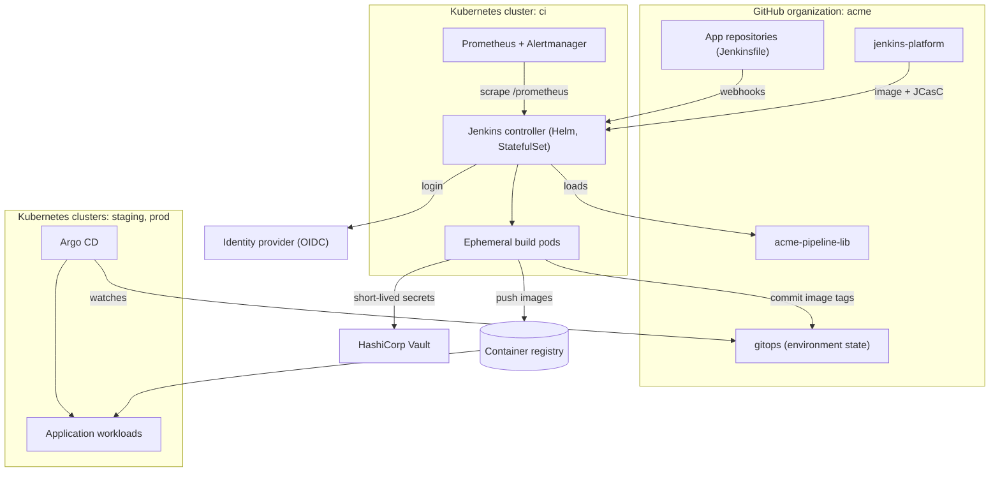
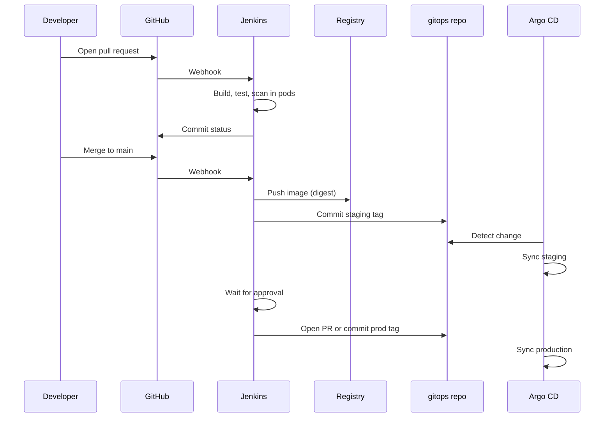
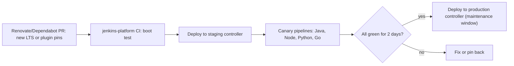

# Capstone: Production CI/CD Platform with Jenkins

## Introduction

The earlier projects each solved one problem: a pipeline for one service, a shared library, a codified controller. In this capstone you combine them into a **platform**: a Jenkins installation that many teams use every day, that a small platform team can operate, and that survives upgrades, outages and audits.

You are the platform team at **Acme Retail**, an online retailer with about 15 development teams and around 80 repositories in Java, Node.js, Python and Go. Today they share an old Jenkins VM full of hand-made freestyle jobs. Your brief:

- Every repository gets CI on every pull request with no tickets to the platform team.
- Deployments to staging and production are traceable, approved and reversible.
- Teams can only see and change their own jobs and secrets.
- The platform can be rebuilt from Git, upgraded safely, and monitored.

This page is a blueprint. It shows the architecture, the key configuration files and the order to build things in, and it links to the pages that explain each piece. Treat it as a project you can carry out over several weeks, not an afternoon exercise.

:::info Prerequisites
This capstone builds on all the projects in this section:
[Java Microservice](./0-jenkins-project-java-microservice.mdx),
[Node.js Web App](./1-jenkins-project-node-webapp.mdx),
[Python Library](./2-jenkins-project-python-library.mdx),
[Kubernetes Deployment](./3-jenkins-project-kubernetes.mdx),
[Shared Library](./4-jenkins-project-shared-library.mdx) and
[Fully Codified Jenkins](./5-jenkins-project-jenkins-as-code.mdx).
Versions referenced (Jenkins 2.580.x LTS, Helm chart 5.9.x, Helm 4) are current at the time of writing; check the official release pages before you start.
:::

## Step 1: Requirements

Write requirements down before choosing tools. They drive every later decision.

| ID | Requirement | Type |
| --- | --- | --- |
| R1 | New repositories get CI automatically when they contain a `Jenkinsfile` | Functional |
| R2 | PR builds report status back to GitHub | Functional |
| R3 | Production deploys need approval by the owning team's leads | Functional |
| R4 | The deployed version per environment is visible in Git | Audit |
| R5 | Teams cannot read other teams' secrets or modify their jobs | Security |
| R6 | No long-lived cloud or cluster credentials in Jenkins jobs | Security |
| R7 | The controller can be rebuilt from Git plus a backup in under an hour | Recovery |
| R8 | Build capacity scales with demand; no builds on the controller | Capacity |
| R9 | Plugin and Jenkins upgrades are tested before production | Operations |
| R10 | Platform health is monitored and alerting goes to the platform on-call | Operations |

Note the target in R7 is a goal you set for your organization, not a property of Jenkins. Measure it with a real restore drill.

## Step 2: Architecture



Key decisions and the reasons behind them:

| Decision | Choice | Why | Requirement |
| --- | --- | --- | --- |
| Where Jenkins runs | Kubernetes via the `jenkinsci/jenkins` Helm chart | Company already runs Kubernetes; pod agents scale on demand | R7, R8 |
| How Jenkins is configured | Custom image + JCasC + Job DSL from `jenkins-platform` | Reproducible, reviewable, testable | R7, R9 |
| Job creation | GitHub Organization Folder | Repositories with a Jenkinsfile appear automatically | R1, R2 |
| Pipeline logic | Versioned shared library with a template step | Consistent pipelines, central rollout | R3, R4 |
| Deployment | GitOps: Jenkins commits tags, Argo CD deploys | Desired state in Git, no cluster admin creds in CI | R4, R6 |
| Secrets | Vault, read per build | No secrets copied into Jenkins per team | R5, R6 |
| Access control | OIDC login + folder-based roles | One identity source, team isolation | R5 |

Why one controller and not many? A single controller is a single point of failure, and Jenkins open source does not offer active-active controllers. At this scale (15 teams), one well-sized controller with ephemeral agents, fast rebuild and backups is usually simpler than several. The alternative, one controller per business unit, is discussed in [High Availability and Scaling](../12-jenkins-administration/5-jenkins-high-availability.mdx) and in the trade-off table at the end of this page.

### The life of a change



## Step 3: Platform Foundation

### Repository: jenkins-platform

Reuse the structure from [Project: Fully Codified Jenkins Instance](./5-jenkins-project-jenkins-as-code.mdx), with these additions:

```text
jenkins-platform/
├── Dockerfile               # FROM jenkins/jenkins:2.580.1-lts-jdk21 + pinned plugins
├── plugins.txt
├── helm/
│   ├── values.yaml          # chart values shared by all controllers
│   ├── values-staging.yaml  # the staging controller used to test upgrades
│   └── values-prod.yaml
├── casc/                    # JCasC files, delivered as chart configScripts
│   ├── security.yaml
│   ├── vault.yaml
│   ├── libraries.yaml
│   └── jobs.yaml
├── jobs/
│   └── org-folder.groovy
└── Jenkinsfile              # lint, build image, boot test, deploy to staging controller
```

Add these plugins to `plugins.txt` on top of the earlier list: `oic-auth` (OpenID Connect login), `role-strategy`, `hashicorp-vault-plugin`, `prometheus`, `github-checks`. Pin every version.

### Helm values

```yaml
# helm/values.yaml
controller:
  image:
    registry: registry.example.com
    repository: platform/jenkins
    tag: "2.580.1-p17"            # built by the jenkins-platform pipeline
    pullPolicy: IfNotPresent
  installPlugins: false            # plugins are baked into the image
  numExecutors: 0
  resources:
    requests:
      cpu: "2"
      memory: "6Gi"
    limits:
      memory: "8Gi"
  javaOpts: "-XX:MaxRAMPercentage=70 -XX:+UseG1GC"
  jenkinsUrl: "https://jenkins.acme.example"
  admin:
    createSecret: false
    existingSecret: jenkins-admin
  ingress:
    enabled: true
    ingressClassName: nginx
    hostName: jenkins.acme.example
    tls:
      - secretName: jenkins-tls
        hosts:
          - jenkins.acme.example
  prometheus:
    enabled: true
  sidecars:
    configAutoReload:
      enabled: true
  JCasC:
    defaultConfig: true
    configScripts: {}              # filled from casc/*.yaml by the deploy script

persistence:
  enabled: true
  size: "100Gi"
  storageClass: fast-ssd

agent:
  enabled: true
  podRetention: "Never"
```

Notes:

- `installPlugins: false` stops the chart from downloading plugins at start-up; the image already contains the pinned set.
- `controller.prometheus.enabled` creates a `ServiceMonitor` so Prometheus scrapes the `prometheus` plugin's metrics endpoint.
- `sidecars.configAutoReload` watches the JCasC ConfigMaps and reloads configuration without restarting the controller.
- `defaultConfig: true` lets the chart configure the Kubernetes cloud that points back to the cluster; your own files add to it.
- Verify every key against the chart's `values.yaml` for your chart version, since keys occasionally move between major chart versions.

Install or upgrade:

```bash
helm repo add jenkins https://charts.jenkins.io
helm repo update
helm upgrade --install jenkins jenkins/jenkins \
  --namespace ci --create-namespace \
  --version 5.9.68 \
  -f helm/values.yaml -f helm/values-prod.yaml \
  --set-file controller.JCasC.configScripts.security=casc/security.yaml \
  --set-file controller.JCasC.configScripts.vault=casc/vault.yaml \
  --set-file controller.JCasC.configScripts.libraries=casc/libraries.yaml \
  --set-file controller.JCasC.configScripts.jobs=casc/jobs.yaml
```

Example output:

```text
Release "jenkins" has been upgraded. Happy Helming!
NAME: jenkins
NAMESPACE: ci
STATUS: deployed
REVISION: 23
NOTES:
1. Get your 'admin' user password by running: ...
```

Installation basics are in [Installing Jenkins on Kubernetes](../1-jenkins-installation/2-jenkins-install-kubernetes.mdx).

### Security: SSO and folder roles

Users log in through the company identity provider with the `oic-auth` plugin. Its JCasC keys depend on the plugin version and your provider, so configure it once in the UI on the staging controller, export it under **Manage Jenkins > Configuration as Code > View Configuration**, and commit the `securityRealm` section with secrets replaced by variables. See [Authentication and SSO](../11-jenkins-security/1-jenkins-authentication.mdx).

Authorization uses the Role-based Authorization Strategy plugin with **item roles** matched by folder name. Each team owns one folder in the organization folder structure:

```yaml
# casc/security.yaml (authorization part)
jenkins:
  authorizationStrategy:
    roleBased:
      roles:
        global:
          - name: "platform-admin"
            description: "Platform team"
            permissions:
              - "Overall/Administer"
            entries:
              - group: "jenkins-platform-admins"
          - name: "everyone"
            description: "All employees can log in and see their folders"
            permissions:
              - "Overall/Read"
            entries:
              - group: "authenticated"
        items:
          - name: "team-orders"
            description: "Orders team"
            pattern: "acme/(orders-.*|checkout-.*)"
            permissions:
              - "Job/Read"
              - "Job/Build"
              - "Job/Cancel"
              - "Run/Replay"
            entries:
              - group: "team-orders"
          - name: "team-search"
            description: "Search team"
            pattern: "acme/search-.*"
            permissions:
              - "Job/Read"
              - "Job/Build"
              - "Job/Cancel"
            entries:
              - group: "team-search"
```

Item patterns are regular expressions on the full item name. Here, repository naming conventions (`orders-*`, `search-*`) map repositories to teams. If your repositories do not follow a convention, use GitHub topics or a mapping file and generate this YAML with a script. Group names come from the identity provider's group claim. Background: [Authorization and Role-Based Access](../11-jenkins-security/2-jenkins-authorization.mdx).

Note that `Job/Configure` is not granted to teams. Pipelines are configured by their `Jenkinsfile`, and the organization folder is configured by the platform team in code.

### Secrets from Vault

```yaml
# casc/vault.yaml
unclassified:
  hashicorpVault:
    configuration:
      vaultUrl: "https://vault.acme.example"
      vaultCredentialId: "vault-approle"
      engineVersion: 2

credentials:
  system:
    domainCredentials:
      - credentials:
          - vaultAppRoleCredential:
              scope: GLOBAL
              id: "vault-approle"
              description: "Jenkins AppRole"
              path: "approle"
              roleId: "${vault-role-id}"
              secretId: "${vault-secret-id}"
```

The AppRole's Vault policy grants read access under `secret/data/ci/*`. In pipelines, the library reads only the paths a job needs, for the duration of a block:

```groovy
def secrets = [
    [path: "secret/ci/${team}/sonar", engineVersion: 2, secretValues: [
        [envVar: 'SONAR_TOKEN', vaultKey: 'token']]]
]
withVault([vaultSecrets: secrets]) {
    sh './mvnw -B sonar:sonar -Dsonar.token="$SONAR_TOKEN"'
}
```

Strict per-team isolation (R5) needs more than this: with one AppRole, any pipeline could request another team's path. Options are a Vault role per team configured at folder level (the Vault plugin supports folder-level configuration), or Vault's Kubernetes auth with a service account per team namespace for build pods. Confirm the exact credential types and JCasC keys for your plugin version by exporting a UI-configured instance. See [External Secrets with Vault and Cloud Secret Managers](../11-jenkins-security/4-jenkins-external-secrets.mdx).

### Organization folder

```yaml
# casc/jobs.yaml
jobs:
  - file: /usr/share/jenkins/jobs/org-folder.groovy
```

The Job DSL script is baked into the custom image at that path, exactly as in the previous project, so the image tag still identifies the complete configuration.

```groovy
// jobs/org-folder.groovy
organizationFolder('acme') {
    description('All repositories in the acme GitHub organization. Managed by jenkins-platform.')
    displayName('Acme')
    organizations {
        github {
            repoOwner('acme')
            apiUri('https://api.github.com')
            credentialsId('github-app')
            traits {
                gitHubBranchDiscovery { strategyId(1) }
                gitHubPullRequestDiscovery { strategyId(1) }
                gitHubTagDiscovery()
            }
        }
    }
    projectFactories {
        workflowMultiBranchProjectFactory {
            scriptPath('Jenkinsfile')
        }
    }
    orphanedItemStrategy {
        discardOldItems { daysToKeep(30) }
    }
    triggers {
        periodicFolderTrigger { interval('1d') }
    }
}
```

Use a **GitHub App** credential (`github-app`) rather than a personal token: it has higher API rate limits and is not tied to one employee. Webhooks from the GitHub App trigger scans immediately; the daily periodic scan is a safety net. Job DSL method names for traits depend on plugin versions, so check the Job DSL API viewer on your controller. See [Organization Folders](../5-jenkins-scm-integration/5-jenkins-organization-folders.mdx) and [GitHub Integration and Webhooks](../5-jenkins-scm-integration/2-jenkins-github-integration.mdx).

## Step 4: The Golden Pipeline (Library v3)

The library from [Project: Company-Wide Shared Library](./4-jenkins-project-shared-library.mdx) evolves into `v3` with three changes for production:

1. **Per-stage agents** (`agent none` at the top), so approvals hold no pods.
2. **Image build, scan and push** with digests.
3. **GitOps promotion** instead of `helm upgrade` from Jenkins.

A team's Jenkinsfile:

```groovy
@Library('acme@v3') _

acmePipeline(
    team: 'orders',
    language: 'java',
    image: 'orders/orders-service',
    environments: ['staging', 'prod'],
    approvers: 'team-orders-leads'
)
```

The core of the template (validation, notifications and language details are the same as in the library project and are omitted):

```groovy
// vars/acmePipeline.groovy (v3, abridged)
import com.acme.ci.Config
import com.acme.ci.ImageTag

def call(Map userConfig = [:]) {
    Map cfg = Config.withDefaults(userConfig)
    String buildPod = libraryResource("com/acme/ci/pods/${cfg.language}.yaml")
    String imagePod = libraryResource('com/acme/ci/pods/buildkit.yaml')
    String toolsPod = libraryResource('com/acme/ci/pods/tools.yaml')

    pipeline {
        agent none

        options {
            timeout(time: 2, unit: 'HOURS')
            buildDiscarder(logRotator(numToKeepStr: '50', artifactNumToKeepStr: '10'))
            disableConcurrentBuilds(abortPrevious: true)
            durabilityHint('PERFORMANCE_OPTIMIZED')
        }

        stages {
            stage('Build and Test') {
                agent { kubernetes { yaml buildPod; defaultContainer 'build' } }
                steps {
                    acmeBuild(cfg)
                    stash name: 'context', includes: '**', excludes: '.git/**'
                }
            }

            stage('Image') {
                agent { kubernetes { yaml imagePod; defaultContainer 'buildkit' } }
                steps {
                    unstash 'context'
                    script {
                        env.IMAGE_TAG = ImageTag.of(env.BRANCH_NAME, env.BUILD_NUMBER, env.GIT_COMMIT)
                        env.IMAGE_DIGEST = acmeImage(name: cfg.image, tag: env.IMAGE_TAG, push: env.BRANCH_NAME == 'main')
                    }
                }
            }

            stage('Scan') {
                when { branch 'main' }
                agent { kubernetes { yaml toolsPod; defaultContainer 'tools' } }
                steps {
                    acmeScan(image: "${cfg.image}@${env.IMAGE_DIGEST}", failOn: 'CRITICAL')
                }
            }

            stage('Promote to staging') {
                when { branch 'main' }
                agent { kubernetes { yaml toolsPod; defaultContainer 'tools' } }
                steps {
                    acmeGitOpsPromote(app: cfg.image, env: 'staging', digest: env.IMAGE_DIGEST, mode: 'commit')
                    acmeWaitForSync(app: cfg.image, env: 'staging', timeoutMinutes: 15)
                }
            }

            stage('Approve production') {
                when { branch 'main' }
                steps {
                    timeout(time: 3, unit: 'DAYS') {
                        input message: "Promote ${env.IMAGE_TAG} to production?",
                              ok: 'Promote',
                              submitter: cfg.approvers
                    }
                }
            }

            stage('Promote to production') {
                when { branch 'main' }
                agent { kubernetes { yaml toolsPod; defaultContainer 'tools' } }
                steps {
                    acmeGitOpsPromote(app: cfg.image, env: 'prod', digest: env.IMAGE_DIGEST, mode: 'pull-request')
                }
            }
        }

        post {
            always { acmeNotify(cfg) }
        }
    }
}
```

Design notes:

- **`agent none` plus per-stage pods.** The approval stage runs with no agent and holds no cluster resources for up to three days.
- **`stash` of the build context** lets the image stage reuse the tested build output without a second checkout. For large repositories, use an artifact repository instead of `stash`, which goes through the controller. See [Stash, Unstash and Artifacts](../4-jenkins-pipeline-advanced/4-jenkins-stash-and-artifacts.mdx).
- **`durabilityHint('PERFORMANCE_OPTIMIZED')`** reduces controller disk writes for pipeline state. The trade-off: a controller crash mid-build may lose the running build. Platform-wide, that is usually worth it; see [Performance Tuning](../12-jenkins-administration/4-jenkins-performance-tuning.mdx).
- **`acmeImage`** wraps the rootless BuildKit build from [Project: Kubernetes Deployment Pipeline](./3-jenkins-project-kubernetes.mdx) and returns the digest. **`acmeScan`** wraps your organization's image scanner; keep the scanner choice inside the library so it can change without touching 80 repositories.
- **Production promotion opens a pull request** in the gitops repository instead of committing directly. The approval in Jenkins records who decided; the pull request gives a second, Git-native review and an easy revert.

### GitOps promotion step

```groovy
// vars/acmeGitOpsPromote.groovy
def call(Map args) {
    String app = args.app.tokenize('/').last()
    String file = "apps/${app}/${args.env}/values.yaml"
    String branch = args.mode == 'pull-request' ? "promote/${app}-${env.BUILD_NUMBER}" : 'main'

    dir('gitops') {
        git url: 'https://github.com/acme/gitops.git', branch: 'main', credentialsId: 'github-app'
        withEnv(["FILE=${file}", "DIGEST=${args.digest}", "BRANCH=${branch}", "APP=${app}", "TARGET=${args.env}"]) {
            withCredentials([gitUsernamePassword(credentialsId: 'github-app')]) {
                sh '''
                    git checkout -B "$BRANCH"
                    yq -i ".image.digest = strenv(DIGEST)" "$FILE"
                    git config user.name "acme-ci"
                    git config user.email "ci@acme.example"
                    git commit -am "Promote $APP to $TARGET: $DIGEST (build $BUILD_URL)"
                    git push origin "$BRANCH"
                '''
            }
        }
        if (args.mode == 'pull-request') {
            acmeOpenPullRequest(repo: 'acme/gitops', head: branch, base: 'main',
                                title: "Promote ${app} to ${args.env}")
        }
    }
}
```

`gitUsernamePassword` is a credentials binding provided by the Git plugin that makes the credential available to command-line `git push` without writing it into the URL. Values are passed to the shell with `withEnv` and a single-quoted script, so nothing is interpolated by Groovy. `acmeOpenPullRequest` is a small step that calls the GitHub REST API with the same credential.

### The gitops repository and Argo CD

```text
gitops/
└── apps/
    └── orders-service/
        ├── base/                 # Helm chart or Kustomize base
        ├── staging/values.yaml   # image.digest updated by Jenkins
        └── prod/values.yaml      # image.digest updated via pull request
```

An Argo CD `Application` per app and environment watches its folder:

```yaml
apiVersion: argoproj.io/v1alpha1
kind: Application
metadata:
  name: orders-service-prod
  namespace: argocd
spec:
  project: orders
  source:
    repoURL: https://github.com/acme/gitops.git
    targetRevision: main
    path: apps/orders-service/base
    helm:
      valueFiles:
        - ../prod/values.yaml
  destination:
    server: https://prod.k8s.acme.example
    namespace: orders
  syncPolicy:
    automated:
      prune: true
      selfHeal: true
```

Jenkins never holds production cluster credentials (R6). Argo CD, running inside each cluster, pulls the desired state. Rolling back is a `git revert` of the promotion commit. `acmeWaitForSync` polls the Argo CD API (read-only token) so the Jenkins build shows whether staging actually became healthy. Background in [Jenkins with GitOps and Argo CD](../10-jenkins-deployment/7-jenkins-gitops.mdx) and [Rollbacks](../10-jenkins-deployment/6-jenkins-rollbacks.mdx).

## Step 5: Operations

### Monitoring and alerting

With the `prometheus` plugin and the chart's `ServiceMonitor`, Prometheus collects Jenkins metrics. Alert on symptoms that users feel:

```yaml
groups:
  - name: jenkins
    rules:
      - alert: JenkinsDown
        expr: up{job="jenkins"} == 0
        for: 5m
        labels: { severity: page }
        annotations:
          summary: "Jenkins controller is not responding"
      - alert: JenkinsQueueBacklog
        expr: jenkins_queue_size_value > 20
        for: 15m
        labels: { severity: ticket }
        annotations:
          summary: "More than 20 builds waiting for 15 minutes"
      - alert: JenkinsHighHeap
        expr: vm_memory_heap_usage > 0.9
        for: 10m
        labels: { severity: ticket }
        annotations:
          summary: "Controller heap above 90% for 10 minutes"
```

Metric names depend on the plugin version and its configuration; check the controller's `/prometheus/` endpoint and adjust the expressions. Add Kubernetes-level alerts for pending build pods and PVC disk usage. Details in [Monitoring Jenkins](../12-jenkins-administration/3-jenkins-monitoring.mdx).

### Backups and disaster recovery

Configuration is in Git and the image. What remains in `JENKINS_HOME` is build history, logs, fingerprints, credentials encrypted with the controller's keys, and job state such as next build numbers. Back up the persistent volume with scheduled CSI volume snapshots (or a tool such as Velero), and include the `secrets/` directory, because without `secrets/master.key` and friends the stored credentials cannot be decrypted.

A restore drill, run every quarter:

1. Create a new namespace and install the chart with the same image and values.
2. Restore the latest snapshot into the new PVC.
3. Start the controller, log in, and check that folders, history and credentials are present.
4. Run one pipeline end to end against staging.
5. Record how long it took and compare with R7.

See [Backup and Restore](../12-jenkins-administration/2-jenkins-backup-and-restore.mdx).

### Upgrades



The staging controller is a full copy (same image, same JCasC, small persistent volume) that runs canary repositories using each supported language. Read the [LTS upgrade guide](https://www.jenkins.io/doc/upgrade-guide/) and security advisories for each release. See [Upgrading Jenkins and LTS Releases](../1-jenkins-installation/6-jenkins-upgrading.mdx) and [Security Advisories and Hardening](../11-jenkins-security/7-jenkins-security-advisories.mdx).

### Runbook entries

| Symptom | First checks | Typical fix |
| --- | --- | --- |
| Builds stuck in queue | Pending pods (`kubectl get pods -n ci`), cloud capacity, labels | Raise node pool size, fix pod template |
| Controller slow or OOM | Heap metrics, thread dumps, recent plugin changes | Increase heap, reduce build log retention, revert plugin |
| Webhooks not triggering | GitHub App delivery log, `jenkinsUrl`, ingress | Fix URL or ingress, redeliver |
| `NotSerializableException` in many builds | Recent library release | Pin teams back to the previous library tag, fix and re-release |
| Credentials missing after restore | `secrets/` directory in backup | Restore the full `JENKINS_HOME`, including `secrets/` |

More in [Troubleshooting Jenkins](../12-jenkins-administration/7-jenkins-troubleshooting.mdx).

## Step 6: Rollout Plan

Do not migrate 80 repositories in one weekend.

| Phase | Scope | Exit criteria |
| --- | --- | --- |
| 0. Foundation | Controller, SSO, RBAC, Vault, monitoring, backups | Restore drill passes, platform team can rebuild from Git |
| 1. Pilot | Two volunteer teams, library `v3` | Both teams deploy to production through GitOps for two weeks |
| 2. Templates | Fix gaps found in the pilot, add Node.js, Python, Go | Canary pipelines green for every language |
| 3. Migration | Remaining teams, a few per week | Old VM jobs disabled per team after a successful release |
| 4. Decommission | Old Jenkins VM read-only, then archived | No builds on the old VM for 30 days |

Migrating freestyle jobs is covered in [Migrating Freestyle Jobs to Pipelines](../13-jenkins-best-practices/2-jenkins-migrating-freestyle.mdx).

## Step 7: Walkthrough of a Production Release

A developer on the orders team merges a pull request. Example console output from the resulting build (trimmed):

```text
Branch event: main of acme/orders-service
Loading library acme@v3
[Pipeline] stage (Build and Test)
Created Pod: kubernetes ci/orders-service-main-212-bld-7k2xq
+ ./mvnw -B -ntp verify
[INFO] Tests run: 148, Failures: 0, Errors: 0, Skipped: 2
Recording test results
[Pipeline] stash
[Pipeline] stage (Image)
Created Pod: kubernetes ci/orders-service-main-212-img-q9d4m
+ buildctl-daemonless.sh build ... --output type=image,name=registry.acme.example/orders/orders-service:main-212-5e1a9c0d,push=true
Image digest: sha256:9a7c3e...
[Pipeline] stage (Scan)
Scan of registry.acme.example/orders/orders-service@sha256:9a7c3e...: 0 critical, 2 high (allowed)
[Pipeline] stage (Promote to staging)
+ yq -i .image.digest = strenv(DIGEST) apps/orders-service/staging/values.yaml
[main 4b7e1f2] Promote orders-service to staging: sha256:9a7c3e... (build https://jenkins.acme.example/job/acme/job/orders-service/job/main/212/)
Waiting for Argo CD application orders-service-staging: Synced / Healthy
[Pipeline] stage (Approve production)
Promote main-212-5e1a9c0d to production?
Promote or Abort
Approved by Maria Gonzalez
[Pipeline] stage (Promote to production)
Created pull request acme/gitops#1847: Promote orders-service to prod
[Pipeline] slackSend
Finished: SUCCESS
```

Once a second reviewer merges `acme/gitops#1847`, Argo CD syncs production. The audit trail now has the Jenkins build with test results and approver, the image digest, and two Git commits that show exactly what changed in which environment and when (R3, R4).

## Real-World Scenario

The scenario on this page is the real-world scenario: a mid-sized company consolidating many hand-made jobs into a platform. Here is the decision analysis the platform team would present to engineering leadership.

**Why this approach:**

- Jenkins was already in use, with years of team knowledge and integrations with internal systems on a private network. Replacing it would be a bigger project than modernizing it.
- Kubernetes pod agents remove the capacity problems and the "snowflake agent" problem at the same time.
- GitOps separates "build and decide" (Jenkins) from "apply to clusters" (Argo CD), which reduces what a compromised CI system can do.
- The shared library lets five platform engineers support 15 teams.

**When to use this design:**

- More than a handful of teams, with a platform team that can own it
- Existing Kubernetes skills and clusters
- Requirements for audit, approval and access control that hosted CI plans may only offer at higher tiers

**When not to use it:**

- A small company with one or two teams on GitHub: hosted GitHub Actions or GitLab CI with their built-in features is usually less work. See [When Should You Choose Jenkins?](../0-jenkins-fundamentals/4-jenkins-when-to-use.mdx).
- No one to own the platform. Jenkins needs ongoing maintenance: plugin updates, security advisories, upgrades. Budget for it honestly, as discussed in [Total Cost of Running Jenkins](../13-jenkins-best-practices/4-jenkins-cost-and-maintenance.mdx).
- No Kubernetes. Use VM-based cloud agents and skip GitOps; the rest of the design (JCasC, library, RBAC) still applies.

**Alternatives and trade-offs:**

| Approach | Pros | Cons | Best for |
| --- | --- | --- | --- |
| One codified controller on Kubernetes (this page) | Simple to operate, one place for libraries and RBAC | Single point of failure, blast radius of bad upgrades | 5 to roughly 30 teams |
| One controller per business unit | Smaller blast radius, independent upgrades | Duplicate config, more to monitor | Large or regulated organizations |
| Jenkins for CI, Argo CD for CD (this page) | No prod creds in CI, Git audit trail | Two systems to learn | Kubernetes deployments |
| Jenkins does CI and CD with `helm upgrade` | One system, simpler | CI holds cluster credentials | Small setups, non-Kubernetes targets |
| Hosted CI (GitHub Actions, GitLab CI) | No controller to run | Different cost model, private network access needs self-hosted runners | Teams without Jenkins investment |
| Commercial Jenkins distribution | Vendor support, HA features | License cost | Enterprises needing support contracts |

## Production Readiness Checklist

| Area | Check |
| --- | --- |
| Configuration | Jenkins version and plugins pinned in the image; JCasC and Job DSL in Git |
| Testing | Boot test in CI; staging controller with canary pipelines |
| Security | SSO login; folder roles; no builds on controller; script approvals reviewed |
| Secrets | Vault or another external provider; no secrets in Git or Jenkinsfiles |
| Agents | Ephemeral pods with resource requests; pinned images from an internal mirror |
| Deployment | Promotion by digest; approvals recorded; production changes via GitOps PR |
| Observability | Metrics, alerts, log retention policy, build discarders everywhere |
| Recovery | Volume snapshots including `secrets/`; quarterly restore drill |
| Upgrades | Monthly LTS cadence; security advisories subscribed |
| Documentation | Onboarding guide for teams; runbook for on-call |

## Common Mistakes

- **Building the platform before writing requirements.** You end up with features nobody asked for and gaps in audit and security.
- **Letting teams configure jobs in the UI.** The codified setup drifts within weeks. Grant `Job/Build`, not `Job/Configure`.
- **One Vault role for all teams.** It defeats team isolation. Scope secrets per team.
- **Approvals inside a pod.** Use `agent none` for `input` stages.
- **Upgrading production first.** Always go through the staging controller and canaries.
- **Backing up configuration but not `secrets/`.** Credentials cannot be decrypted after restore.
- **Unversioned library changes.** A bad commit to the default branch breaks every team at once. Release with tags and test with canaries.
- **Ignoring the controller as a single point of failure.** Plan, measure and rehearse the recovery time instead of assuming it.

## Summary

- Start from written requirements and map every design decision to them.
- Run one codified controller on Kubernetes: custom image, pinned plugins, JCasC through the Helm chart, Job DSL organization folder.
- Use SSO plus folder-based roles for team isolation, and Vault for secrets read per build.
- Give teams a versioned golden pipeline with per-stage pod agents, digest-based images, and GitOps promotion through Argo CD.
- Operate it like a product: monitoring and alerts, backups including `secrets/`, restore drills, staged upgrades and a runbook.
- Roll out in phases, starting with pilot teams.

## Exercises

1. Write the requirements table for your own organization (or a fictional one) and map each requirement to a design decision. Which requirements would make you choose a different design?
2. Implement `acmeWaitForSync` using the Argo CD REST API and a read-only token from Vault, with a timeout and a clear failure message.
3. Add a per-team Vault configuration at folder level so `team-orders` pipelines cannot read `secret/ci/search/*`. Prove it with a failing test pipeline.
4. Run a restore drill on a test cluster and write a one-page report: steps, time taken, problems found, and runbook changes.
5. Compare this design with a second controller per business unit: what changes in JCasC, monitoring and the library release process?

Related pages:

- [Jenkins Architecture](../0-jenkins-fundamentals/2-jenkins-architecture.mdx)
- [Choosing an Agent Strategy](../6-jenkins-agents/7-jenkins-agent-strategies.mdx)
- [Pipeline Templates for Many Teams](../8-jenkins-shared-libraries/7-jenkins-pipeline-templates.mdx)
- [Environments and Promotion](../10-jenkins-deployment/1-jenkins-environments-and-promotion.mdx)
- [Jenkins Security Overview](../11-jenkins-security/0-jenkins-security-overview.mdx)
- [Jenkins Anti-Patterns](../13-jenkins-best-practices/1-jenkins-anti-patterns.mdx)
- The wider picture: the [CI/CD tutorial](/docs/devops/cicd), the [Kubernetes tutorial](/docs/devops/kubernetes) and the [Terraform tutorial](/docs/devops/terraform)
