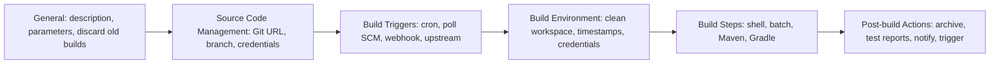
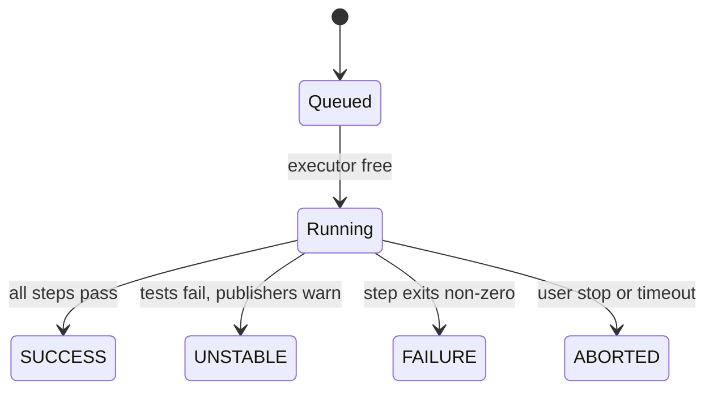
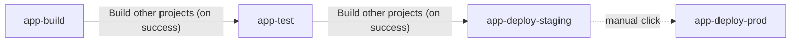

# Freestyle Jobs

## Introduction

A **job** (Jenkins also calls it a **project** or an **item**) is the unit of work Jenkins knows how to run. Every time a job runs, Jenkins creates a **build**: a numbered record with its own console log, result and files.

The oldest and simplest job type is the **Freestyle project**. You configure it entirely through web forms: where the code comes from, what starts a build, which commands to run, and what to do afterwards. No Jenkinsfile, no Groovy.

Think of a Freestyle job as a recipe card pinned to the kitchen wall. It lists the ingredients (source code), when to cook (triggers), the steps (build steps) and how to serve the result (post-build actions). It is quick to write and easy to read, but the card lives only in that one kitchen. If someone changes it, there is no history of who changed what, and you cannot copy it into your Git repository with the code it builds.

That trade-off shapes this whole section. Freestyle jobs are a great way to learn the parts of a Jenkins build, and they are still fine for small utility tasks. For real application pipelines, modern Jenkins teams use **Pipeline jobs** defined in a `Jenkinsfile`, which you will meet in [Pipeline Basics](../3-jenkins-pipeline-basics/0-jenkins-pipeline-introduction.mdx). The final page of this section, [Freestyle vs Pipeline Jobs](./5-jenkins-freestyle-vs-pipeline.mdx), compares the two in detail.

:::info Prerequisites
You need a running Jenkins controller. If you do not have one yet, follow [Installing Jenkins with Docker](../1-jenkins-installation/0-jenkins-install-docker.mdx) and the [Initial Setup Wizard](../1-jenkins-installation/3-jenkins-initial-setup.mdx). The examples were written against the 2.5xx LTS line; menu labels can shift slightly between releases.
:::

## Anatomy of a Freestyle Job

When you open the configuration page of a Freestyle job, you see the same sections every time, in the order Jenkins executes them:



| Section | What it controls | Example |
| --- | --- | --- |
| General | Description, parameters, build retention, concurrency | "Discard old builds: keep 20" |
| Source Code Management | Where the code comes from | Git repo URL and branch `*/main` |
| Build Triggers | What starts a build | "Poll SCM" every 15 minutes |
| Build Environment | Setup and teardown around the steps | "Delete workspace before build starts" |
| Build Steps | The actual work, run in order | "Execute shell": `make test` |
| Post-build Actions | What happens after the steps finish | "Archive the artifacts": `dist/*.tar.gz` |

Some options in these sections come from plugins rather than Jenkins core. For example, the Git option in Source Code Management comes from the Git plugin, and "Delete workspace before build starts" comes from the Workspace Cleanup plugin (`ws-cleanup`). If an option in this page is missing on your controller, check [Plugin Management](../7-jenkins-plugins/0-jenkins-plugin-management.mdx).

## Your First Freestyle Job

Let's build a small job step by step.

### Step 1: Create the job

1. On the Jenkins dashboard, click **New Item**.
2. Enter a name, for example `hello-freestyle`. Avoid spaces; they make workspace paths and URLs awkward.
3. Select **Freestyle project** and click **OK**.

Jenkins opens the configuration page.

### Step 2: Add a shell build step

Scroll to **Build Steps**, click **Add build step** and choose **Execute shell** (on Windows agents, use **Execute Windows batch command**). Paste:

```bash
echo "Hello from Jenkins"
echo "Job:       $JOB_NAME"
echo "Build:     $BUILD_NUMBER"
echo "Workspace: $WORKSPACE"
echo "Node:      $NODE_NAME"
uname -a
```

Click **Save**, then **Build Now** in the left menu. A new entry appears under **Build History**. Click it and open **Console Output**.

Example output:

```text
Started by user admin
Running as SYSTEM
Building in workspace /var/jenkins_home/workspace/hello-freestyle
[hello-freestyle] $ /bin/sh -xe /tmp/jenkins1234567890.sh
+ echo 'Hello from Jenkins'
Hello from Jenkins
+ echo 'Job:       hello-freestyle'
Job:       hello-freestyle
+ echo 'Build:     1'
Build:     1
+ echo 'Workspace: /var/jenkins_home/workspace/hello-freestyle'
Workspace: /var/jenkins_home/workspace/hello-freestyle
+ echo 'Node:      built-in'
Node:      built-in
+ uname -a
Linux 3f2a9c1d7b44 6.8.0 #1 SMP x86_64 GNU/Linux
Finished: SUCCESS
```

Three things to notice:

- Jenkins runs the script with `/bin/sh -xe`. The `-x` flag echoes each command (the lines starting with `+`), and `-e` makes the step **fail on the first command that returns a non-zero exit code**. A failed step marks the build `FAILURE`.
- Jenkins injects **environment variables** such as `JOB_NAME`, `BUILD_NUMBER`, `WORKSPACE` and `BUILD_URL`. You can see the full list at `JENKINS_URL/env-vars.html` on your controller.
- The job ran on the **built-in node** (the controller itself). That is fine for a lab, but in production you should run builds on agents. See [Controller and Agents](../6-jenkins-agents/0-jenkins-controller-and-agents.mdx).

:::tip Use a shebang to change the shell
If the first line of the script is a shebang such as `#!/bin/bash`, Jenkins runs the script with that interpreter instead of `/bin/sh -xe`. You then lose the default `-xe` flags, so add `set -euo pipefail` yourself.
:::

### Step 3: Connect source control

A build that only echoes text is not very useful. Open **Configure** and, under **Source Code Management**, choose **Git**:

- **Repository URL:** `https://github.com/jenkins-docs/simple-java-maven-app.git` (a public sample repository from the Jenkins project)
- **Credentials:** none for a public repository; for private ones, add a credential as described in [Credentials Management](../11-jenkins-security/3-jenkins-credentials.mdx)
- **Branch Specifier:** `*/master` for this sample repository (many newer repositories use `*/main`)

Now replace the shell step with something that uses the code:

```bash
set -eu
echo "Commit: ${GIT_COMMIT:-unknown} on ${GIT_BRANCH:-unknown}"
ls -la
# Count Java source files as a stand-in for a real build
find . -name "*.java" | wc -l
```

Example output:

```text
 > git fetch --tags --force --progress -- https://github.com/jenkins-docs/simple-java-maven-app.git +refs/heads/*:refs/remotes/origin/*
 > git rev-parse refs/remotes/origin/master^{commit}
Checking out Revision 8f1c2e4a... (refs/remotes/origin/master)
+ echo 'Commit: 8f1c2e4a... on origin/master'
Commit: 8f1c2e4a... on origin/master
+ ls -la
total 24
drwxr-xr-x 4 jenkins jenkins 4096 Oct 11 09:12 .
-rw-r--r-- 1 jenkins jenkins 1520 Oct 11 09:12 pom.xml
drwxr-xr-x 4 jenkins jenkins 4096 Oct 11 09:12 src
+ find . -name '*.java'
+ wc -l
2
Finished: SUCCESS
```

The Git plugin adds `GIT_COMMIT`, `GIT_BRANCH` and `GIT_URL` to the environment. Your commit hash will differ. The full Git story, including shallow clones and submodules, is in [Git Integration](../5-jenkins-scm-integration/0-jenkins-git-integration.mdx).

### Step 4: Do a real build

The sample is a Maven project. If Maven and a JDK are installed on the node (or configured under **Manage Jenkins > Tools**), you can use the **Invoke top-level Maven targets** build step, or simply call Maven from the shell:

```bash
set -eu
mvn -B -DskipTests clean package
mvn -B test
ls -l target/*.jar
```

Example output:

```text
[INFO] Building jar: /var/jenkins_home/workspace/hello-freestyle/target/my-app-1.0-SNAPSHOT.jar
[INFO] BUILD SUCCESS
...
[INFO] Tests run: 2, Failures: 0, Errors: 0, Skipped: 0
[INFO] BUILD SUCCESS
+ ls -l target/my-app-1.0-SNAPSHOT.jar
-rw-r--r-- 1 jenkins jenkins 2741 Oct 11 09:14 target/my-app-1.0-SNAPSHOT.jar
Finished: SUCCESS
```

The `-B` flag runs Maven in batch mode, which removes download progress noise from the console log. Building real Java projects is covered in depth in [Building Java Projects with Maven and Gradle](../9-jenkins-build-and-test/0-jenkins-java-builds.mdx).

### Step 5: Add post-build actions

Under **Post-build Actions**, add:

1. **Archive the artifacts** with **Files to archive** set to `target/*.jar`. Jenkins copies the jar out of the workspace and attaches it to the build page, so it survives the next build overwriting the workspace.
2. **Publish JUnit test result report** with **Test report XMLs** set to `target/surefire-reports/*.xml`. This needs the JUnit plugin (`junit`), which the setup wizard installs by default. Jenkins then shows test trends and marks the build `UNSTABLE` (yellow) when tests fail.

Run the job a few times. The job page now shows a test result trend chart and a "Last Successful Artifacts" link. Archiving and history are explained in [Build History and Artifacts](./4-jenkins-build-history-and-artifacts.mdx), and test reports in [Test Reports with JUnit](../9-jenkins-build-and-test/4-jenkins-test-reports.mdx).

## Build Results

Every build ends with one of these results:

| Result | Color | Typical cause |
| --- | --- | --- |
| `SUCCESS` | Green or blue | All steps passed |
| `UNSTABLE` | Yellow | Steps passed but a publisher found problems, such as failing tests |
| `FAILURE` | Red | A build step exited non-zero or threw an error |
| `NOT_BUILT` | Grey | The build or a stage was skipped |
| `ABORTED` | Grey | Someone clicked stop, or a timeout fired |

The distinction between `FAILURE` and `UNSTABLE` matters. A compile error is a failure: there is nothing to test. A test failure after a successful compile is usually reported as unstable, so you still get the test report and artifacts.



## Useful General Options

A few checkboxes in the **General** and **Build Environment** sections are worth knowing on day one:

- **Discard old builds.** Keeps only the last N builds or builds from the last N days. Without it, `JENKINS_HOME` slowly fills with logs and artifacts. More on this in [Build History and Artifacts](./4-jenkins-build-history-and-artifacts.mdx).
- **This project is parameterized.** Adds inputs to the build form. See [Build Parameters](./2-jenkins-build-parameters.mdx).
- **Execute concurrent builds if necessary.** Off by default for Freestyle jobs, so a second trigger waits in the queue. If you turn it on, concurrent builds get separate workspaces (for example `hello-freestyle@2`). See [Workspaces](./3-jenkins-workspaces.mdx).
- **Restrict where this project can be run.** A label expression such as `linux && docker` that pins the job to matching agents. See [Labels, Executors and Scheduling](../6-jenkins-agents/6-jenkins-labels-and-executors.mdx).
- **Delete workspace before build starts** (Workspace Cleanup plugin). Gives every build a clean checkout at the cost of a full clone each time.
- **Add timestamps to the Console Output** (Timestamper plugin). Prefixes each log line with a time, which helps find slow steps.
- **Terminate a build if it's stuck** (Build Timeout plugin). Aborts builds that hang.

## Chaining Freestyle Jobs

Before Pipelines existed, multi-step delivery processes were built by chaining Freestyle jobs together: `build` triggers `test`, which triggers `deploy-staging`.



You can set this up with the core post-build action **Build other projects**, or in the downstream job with the trigger **Build after other projects are built**. The Parameterized Trigger plugin adds the ability to pass parameters such as the version number down the chain.

It works, but it gets painful as the chain grows:

- The logic is spread across several job configurations, so nobody can see the whole process in one place.
- Passing data between jobs needs extra plugins and conventions.
- There is no single build number for the whole release; you have to trace upstream links.
- Restarting from the middle is awkward.

A Pipeline replaces the whole chain with one `Jenkinsfile` whose stages are visible together. That is a big reason Pipeline became the default. See [Build Triggers](./1-jenkins-build-triggers.mdx) for the trigger options themselves.

## Defining Freestyle Jobs as Code

The biggest weakness of a Freestyle job is that its configuration lives only in Jenkins, as an XML file at `JENKINS_HOME/jobs/<job-name>/config.xml`. You can read that XML through the REST API:

```bash
# Replace the user and API token with your own
curl -s -u admin:YOUR_API_TOKEN \
  http://localhost:8080/job/hello-freestyle/config.xml | head -20
```

Example output:

```text
<?xml version='1.1' encoding='UTF-8'?>
<project>
  <description></description>
  <keepDependencies>false</keepDependencies>
  <properties/>
  <scm class="hudson.plugins.git.GitSCM" plugin="git@5.7.0">
    <configVersion>2</configVersion>
    <userRemoteConfigs>
      <hudson.plugins.git.UserRemoteConfig>
        <url>https://github.com/jenkins-docs/simple-java-maven-app.git</url>
      </hudson.plugins.git.UserRemoteConfig>
    </userRemoteConfigs>
  ...
  <builders>
    <hudson.tasks.Shell>
      <command>set -eu
mvn -B -DskipTests clean package
...
```

Plugin versions in the XML will match your installation. Copying XML between controllers is fragile. If you must keep Freestyle jobs, the **Job DSL** plugin (`job-dsl`) lets you describe them in Groovy and keep that in Git:

```groovy
job('hello-freestyle') {
    description('Builds the sample Maven app')
    logRotator {
        numToKeep(20)
    }
    scm {
        git {
            remote {
                url('https://github.com/jenkins-docs/simple-java-maven-app.git')
            }
            branch('*/master')
        }
    }
    triggers {
        scm('H/15 * * * *')
    }
    steps {
        shell('mvn -B clean package')
    }
    publishers {
        archiveArtifacts('target/*.jar')
        junit {
            testResults('target/surefire-reports/*.xml')
        }
    }
}
```

This is covered properly in [Job DSL](../12-jenkins-administration/1-jenkins-job-dsl.mdx). For most new work, a `Jenkinsfile` is simpler.

## Real-World Scenario

Your team runs a small SaaS helpdesk. The main application already builds through a multibranch Pipeline. Operations now asks for two small jobs:

1. A **nightly database backup check** that runs a script against a read replica and fails loudly if the latest backup is older than 26 hours.
2. A **"rotate log bucket" button** that support engineers can click when a log bucket fills up, without shell access to any server.

Neither job builds application code, both are a single shell command, and neither needs to be reviewed alongside an application's source.

### The solution

For the backup check, create a Freestyle job `ops-backup-freshness`:

- **Restrict where this project can be run:** `ops` (an agent with the database client tools)
- **Build periodically:** `H 6 * * *` (once a day, around 06:00; the `H` spreads load, see [Build Triggers](./1-jenkins-build-triggers.mdx))
- **Build Environment:** bind the database password from a credential (Credentials Binding plugin)
- **Execute shell:**

```bash
#!/bin/bash
set -euo pipefail
# DB_PASSWORD comes from the credential binding, never hard-code it
latest=$(PGPASSWORD="$DB_PASSWORD" psql -h replica.internal -U backup_reader -d ops -tA \
  -c "select extract(epoch from now() - max(finished_at))/3600 from backups;")
echo "Latest backup is ${latest} hours old"
awk -v h="$latest" 'BEGIN { exit (h > 26) ? 1 : 0 }' || { echo "Backup is stale!"; exit 1; }
```

Example output:

```text
Latest backup is 7.42 hours old
Finished: SUCCESS
```

- **Post-build Actions:** E-mail Notification (or Slack; see [Notifications: Email, Slack and Teams](../12-jenkins-administration/6-jenkins-notifications.mdx)) on failure.

For the log rotation button, a Freestyle job with a choice parameter (`BUCKET`) and one shell step is enough. Support engineers get **Build with Parameters** permission on that job only (see [Authorization and Role-Based Access](../11-jenkins-security/2-jenkins-authorization.mdx)).

### Why this approach

- The jobs are tiny, so a Freestyle form is quick to set up and easy for operations staff to read.
- Nothing needs code review alongside an application repository.
- Jenkins gives you scheduling, credentials, logs, history and notifications for free, which a bare cron job on a server does not.

### When to use it and when not to

Use a Freestyle job for small, single-purpose utility tasks: a scheduled script, a parameterized "button", or a quick experiment while learning. Do not use it for application CI/CD with several stages, branch builds, pull request checks or approvals. Those are exactly what Pipeline and [Multibranch Pipelines](../5-jenkins-scm-integration/1-jenkins-multibranch-pipelines.mdx) are for. Even for utility jobs, if you run more than a handful, define them as code (Job DSL or a small `Jenkinsfile`) so a lost controller does not mean lost jobs.

### Alternatives and trade-offs

| Approach | Pros | Cons | Best for |
| --- | --- | --- | --- |
| Freestyle job via UI | Fastest to create, no Groovy | Config not in Git, hard to review, drifts | One-off utility jobs, learning |
| Freestyle job via Job DSL | Versioned, reproducible | Extra plugin and DSL to learn | Keeping many legacy utility jobs |
| Pipeline job with a `Jenkinsfile` | Versioned with code, stages, durable | Groovy and CPS quirks | Anything that builds or deploys software |
| Plain cron on a server | No Jenkins needed | No UI, history, credentials store or notifications | Truly local maintenance tasks |
| Scheduled workflow in another CI tool | Lives with the repo | Different tool to manage | Teams already on GitHub Actions or GitLab CI |

## Common Mistakes

- **Treating the UI as the source of truth.** If the controller's disk dies and you have no backup, Freestyle jobs are gone. Back up `JENKINS_HOME` ([Backup and Restore](../12-jenkins-administration/2-jenkins-backup-and-restore.mdx)) or define jobs as code.
- **Writing long scripts in the text box.** A 200-line shell script in a form field has no syntax highlighting, no review and no tests. Put the script in the repository and call it: `./ci/build.sh`.
- **Forgetting `set -e` when using a shebang.** With `#!/bin/bash` you lose the default `-xe`, and a failing command in the middle no longer fails the build.
- **Running builds on the built-in node.** Builds on the controller can read `JENKINS_HOME`, including secrets. Set the built-in node's executors to 0 in production.
- **Never discarding old builds.** Disks fill up quietly until Jenkins stops working.
- **Hard-coding passwords in build steps.** Anyone who can read the job configuration sees them. Use credentials and the Credentials Binding plugin.
- **Building long chains of Freestyle jobs.** If you are wiring together more than two or three jobs, you probably want a Pipeline.

## Summary

- A Freestyle job is a form-configured job: General, Source Code Management, Build Triggers, Build Environment, Build Steps and Post-build Actions.
- Shell steps run with `sh -xe` by default, so the first failing command fails the build.
- Jenkins injects variables such as `BUILD_NUMBER`, `WORKSPACE` and `JOB_NAME`; plugins add more, such as `GIT_COMMIT`.
- Builds end as `SUCCESS`, `UNSTABLE`, `FAILURE`, `NOT_BUILT` or `ABORTED`.
- Freestyle jobs are still fine for small utility tasks, but their config lives only in Jenkins. For real CI/CD, use Pipeline jobs.

## Exercises

1. Create a Freestyle job that clones the sample Maven repository, builds it, archives `target/*.jar` and publishes JUnit results. Break a test on purpose (in a fork) and confirm the build turns `UNSTABLE`, not `FAILURE`.
2. Change the shell step to start with `#!/bin/bash` and add a failing command in the middle. Observe what happens with and without `set -e`.
3. Download your job's `config.xml` with `curl` and find the section that stores your shell command.
4. Rewrite your job in Job DSL syntax on paper, then compare it with the `Jenkinsfile` version you will write in [The Jenkinsfile](../3-jenkins-pipeline-basics/1-jenkins-jenkinsfile.mdx).

Next, learn what can start a job automatically in [Build Triggers](./1-jenkins-build-triggers.mdx). For general CI/CD background, see the [CI/CD tutorial](/docs/devops/cicd).
