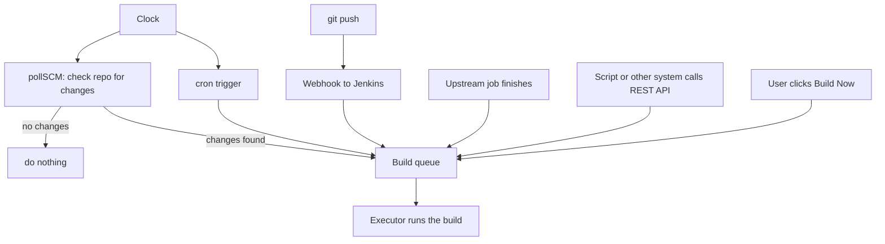
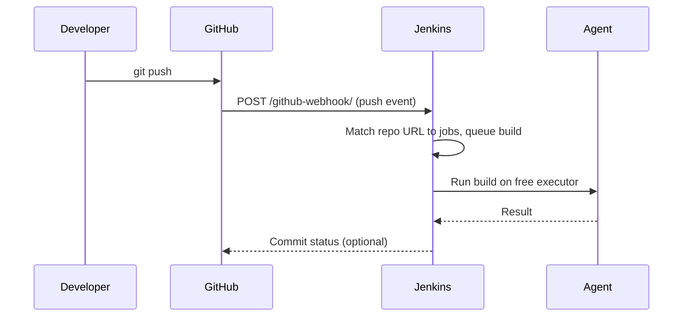

# Build Triggers

## Introduction

A job that only runs when someone clicks **Build Now** is not continuous integration. **Build triggers** tell Jenkins when to start a build automatically: when code is pushed, on a schedule, when another job finishes, or when an external system calls in.

Picking the right trigger is like choosing how a shop learns that a delivery has arrived. The delivery driver can ring the doorbell (a **webhook**), a clerk can walk to the loading dock every 15 minutes to look (**polling**), the shop can open at 9:00 every day no matter what (a **cron schedule**), or the warehouse can phone ahead when a truck leaves (an **upstream trigger**). The doorbell is fastest and wastes the least effort, but only works if the driver can reach the door.

This page covers the triggers you will use most, for both Freestyle jobs and Declarative Pipelines, and when to pick each one.



Every trigger ends in the same place: a request in the **build queue**. The queue applies a short **quiet period** (5 seconds by default, configurable per job and globally) to merge duplicate requests, then waits for a free executor.

## The Trigger Types at a Glance

| Trigger | Freestyle UI label | Declarative syntax | Starts a build when |
| --- | --- | --- | --- |
| Manual | Build Now | none needed | A user clicks the button |
| Schedule | Build periodically | `cron('H 2 * * *')` | The clock matches, changes or not |
| Poll SCM | Poll SCM | `pollSCM('H/15 * * * *')` | The clock matches **and** the repo changed |
| Webhook (GitHub) | GitHub hook trigger for GITScm polling | `githubPush()` | GitHub sends a push event |
| Upstream | Build after other projects are built | `upstream(...)` | Another job finishes with a given result |
| Remote API | Trigger builds remotely | none; call the URL | A script calls the REST endpoint |

In a **Multibranch Pipeline**, you usually do not configure triggers in the Jenkinsfile at all: the branch source (GitHub, GitLab, Bitbucket) receives webhooks and starts builds for the matching branch or pull request. That is covered in [Multibranch Pipelines](../5-jenkins-scm-integration/1-jenkins-multibranch-pipelines.mdx) and [GitHub Integration and Webhooks](../5-jenkins-scm-integration/2-jenkins-github-integration.mdx). The triggers on this page matter most for single-branch jobs, scheduled tasks and job chains.

## Jenkins Cron Syntax

Both **Build periodically** and **Poll SCM** use the same cron-style syntax with five fields:

```text
MINUTE  HOUR  DOM  MONTH  DOW
0-59    0-23  1-31 1-12   0-7 (0 and 7 are Sunday)
```

The usual cron operators work: `*` (every value), `M-N` (range), `*/X` or `M-N/X` (step) and `A,B,C` (list).

### The H symbol

Jenkins adds one important extra: **`H`**, for "hash". Instead of a fixed number, `H` picks a value derived from a hash of the job name. The value is stable for a given job but differs between jobs.

Why does that matter? Imagine 200 jobs all scheduled at `0 2 * * *`. At exactly 02:00 they all hit the queue, clone repositories at the same time, and overload your agents and your Git server. With `H 2 * * *`, each job runs at a different minute between 02:00 and 02:59, spreading the load.

| Expression | Meaning |
| --- | --- |
| `H * * * *` | Once an hour, at a job-specific minute |
| `H/15 * * * *` | Every 15 minutes, offset per job (for example :07, :22, :37, :52) |
| `H(0-29)/10 * * * *` | Every 10 minutes during the first half of each hour |
| `H 2 * * *` | Once a day between 02:00 and 02:59 |
| `H H(0-6) * * 1-5` | Once on each weekday, sometime between midnight and 06:59 |
| `H 9 1 * *` | Monthly, on the 1st, between 09:00 and 09:59 |
| `@daily`, `@midnight` | Aliases that also use hashing; `@midnight` means sometime between 00:00 and 02:59 |

:::tip Prefer H in shared Jenkins instances
The Jenkins docs recommend `H` wherever you do not need an exact minute. Use a fixed minute only when the timing really matters, such as a report that must start at 07:00 sharp.
:::

### Time zones and comments

Schedules use the controller's time zone by default. You can set a time zone per schedule with a `TZ=` line, and add comments with `#`:

```text
TZ=Europe/Berlin
# Nightly integration tests, after the 01:00 database refresh
H 2 * * 1-5
# Weekend full regression
H 4 * * 6
```

Several lines mean several schedules for the same job. When you type a schedule in the UI, Jenkins shows a hint under the field such as "Would last have run at ...; would next run at ...", which is a quick way to check your expression.

## Build Periodically (cron)

A **cron** trigger starts a build on a schedule whether or not anything changed. Use it for work driven by time, not by code:

- nightly integration or end-to-end test suites
- dependency and security scans against new vulnerability data
- data exports, reports and cleanup tasks
- a weekly rebuild to pick up base image updates

In a Declarative Pipeline:

```groovy
pipeline {
    agent any
    triggers {
        // Weekdays, once between 02:00 and 02:59 in the controller's time zone
        cron('H 2 * * 1-5')
    }
    stages {
        stage('Nightly tests') {
            steps {
                echo "Triggered by: ${currentBuild.getBuildCauses()*.shortDescription}"
                sh './run-integration-tests.sh'
            }
        }
    }
}
```

Example output from a scheduled run:

```text
Started by timer
[Pipeline] echo
Triggered by: [Started by timer]
[Pipeline] sh
+ ./run-integration-tests.sh
...
Finished: SUCCESS
```

:::caution Triggers in a Jenkinsfile apply after the first run
Jenkins reads the `triggers` directive when the Pipeline runs. A new Pipeline job therefore has no schedule until it has run once (manually or by webhook). The same applies when you change the schedule: the new one takes effect after the next build.
:::

## Poll SCM

**Poll SCM** also runs on a cron schedule, but each time it fires, Jenkins asks the repository "has anything changed since the last build?" A build starts only if the answer is yes.

```groovy
pipeline {
    agent any
    triggers {
        pollSCM('H/5 * * * *')
    }
    stages {
        stage('Build') {
            steps {
                sh 'make build'
            }
        }
    }
}
```

The job page gets a **Git Polling Log** link that shows each check:

```text
Started on Oct 11, 2026, 10:07:00 AM
Using strategy: Default
[poll] Last Built Revision: Revision 4b2c9e1... (refs/remotes/origin/main)
 > git ls-remote -h -- https://git.example.com/team/app.git # timeout=10
Found 1 remote heads on https://git.example.com/team/app.git
[poll] Latest remote head revision on refs/heads/main is: 9d71fa3...
Done. Took 0.62 sec
Changes found
```

Polling is simple and works when Jenkins cannot receive inbound connections, for example a controller inside a private network that GitHub cannot reach. Its downsides:

- **Latency.** A push waits up to one polling interval before anything happens.
- **Load.** 300 jobs polling every minute is 300 Git requests a minute against your Git server, almost all answering "no changes". Hosted Git providers may rate-limit you.

### Polling plus a nudge

A useful middle ground is to keep a polling trigger with an **empty schedule** and let the Git server "nudge" Jenkins. The Git plugin exposes a `notifyCommit` endpoint. When it is called, every job that uses that repository URL and has polling enabled polls immediately:

```bash
curl -s "https://jenkins.example.com/git/notifyCommit?url=https://git.example.com/team/app.git&token=YOUR_NOTIFY_TOKEN"
```

```groovy
triggers {
    // Empty schedule: never poll on a timer, but allow notifyCommit to trigger a poll
    pollSCM('')
}
```

Recent Git plugin versions require an access token for `notifyCommit` (configured under **Manage Jenkins > System**, Git plugin notifyCommit access tokens). Check the [Git plugin documentation](https://plugins.jenkins.io/git/) for the exact setup on your version.

## Webhooks

A **webhook** is an HTTP request that your Git hosting service sends to Jenkins on every push. It gives near-instant builds with no wasted polling.



For a single-branch job with the GitHub plugin:

1. In the GitHub repository, add a webhook pointing to `https://jenkins.example.com/github-webhook/` (note the trailing slash) for push events.
2. In a Freestyle job, tick **GitHub hook trigger for GITScm polling**. In a Declarative Pipeline, add the trigger below.

```groovy
pipeline {
    agent any
    triggers {
        githubPush()
    }
    stages {
        stage('Build') {
            steps {
                sh 'make build'
            }
        }
    }
}
```

Despite the name, the GitHub hook trigger still uses polling under the hood: the webhook tells Jenkins to check the repository right away, and Jenkins builds if it finds changes.

Webhooks need Jenkins to be **reachable from the Git server**. If your controller is on a private network and your Git host is public, you need a reverse proxy, a webhook relay, or you fall back to polling. GitLab, Bitbucket and Gitea have their own plugins and endpoints; see [GitLab and Bitbucket Integration](../5-jenkins-scm-integration/3-jenkins-gitlab-bitbucket.mdx). The exact trigger names for each plugin are easiest to find with the Declarative Directive Generator described in [Snippet Generator and Pipeline Syntax Tools](../3-jenkins-pipeline-basics/9-jenkins-pipeline-syntax-generator.mdx).

## Upstream Triggers

An **upstream trigger** starts a job when another job finishes. This is how you build pipelines out of separate jobs, for example rebuilding every service image after the shared base image job succeeds.

```groovy
pipeline {
    agent any
    triggers {
        upstream(upstreamProjects: 'base-image,shared-lib', threshold: hudson.model.Result.SUCCESS)
    }
    stages {
        stage('Rebuild') {
            steps {
                sh 'docker build -t my-service .'
            }
        }
    }
}
```

The `threshold` decides which upstream results count: `SUCCESS` only, or also `UNSTABLE` or `FAILURE`. Job names are relative to the current folder; use paths like `../platform/base-image` for jobs in other folders.

The opposite direction is the `build` step, where the upstream job explicitly starts a downstream one and can pass parameters:

```groovy
stage('Trigger deploy') {
    steps {
        build job: 'deploy-staging',
              parameters: [string(name: 'VERSION', value: "1.4.${env.BUILD_NUMBER}")],
              wait: false
    }
}
```

| | `upstream` trigger (pull) | `build` step (push) |
| --- | --- | --- |
| Configured in | The downstream job | The upstream job |
| Passes parameters | No | Yes |
| Can wait for the result | No | Yes (`wait: true`, the default) |
| Good for | "Rebuild me when my dependency changes" | Orchestrating a deployment from a build |

For anything beyond two or three linked jobs, consider stages in one Pipeline instead (see [Freestyle vs Pipeline Jobs](./5-jenkins-freestyle-vs-pipeline.mdx)).

## Triggering Builds Remotely

Any script, chat bot or external system can start a build with an HTTP **POST** to the job URL, authenticated with a Jenkins user and an **API token** (create one under your user's **Security** page):

```bash
JENKINS_URL=https://jenkins.example.com
# A job without parameters
curl -X POST -u "ci-bot:$JENKINS_API_TOKEN" "$JENKINS_URL/job/nightly-report/build"

# A job with parameters
curl -X POST -u "ci-bot:$JENKINS_API_TOKEN" \
  "$JENKINS_URL/job/deploy-staging/buildWithParameters" \
  --data VERSION=1.4.2 --data DRY_RUN=true -i
```

Example output (headers of the second call):

```text
HTTP/1.1 201 Created
Location: https://jenkins.example.com/queue/item/4711/
```

The `Location` header points to the **queue item**. You can poll that URL (with `/api/json` appended) to find out the build number once the build starts. Requests authenticated with an API token are exempt from Jenkins' CSRF crumb requirement, so you do not need to fetch a crumb first. Jobs inside folders use nested paths such as `/job/team-a/job/deploy-staging/build`.

The older **Trigger builds remotely (e.g., from scripts)** checkbox adds an authentication token to the job, but on a secured Jenkins the caller still needs permission to reach the job. If you really need anonymous token-only triggering, the **Build Authorization Token Root** plugin (`build-token-root`) provides a `buildByToken/build?job=NAME&token=TOKEN` endpoint. Treat that token like a password, and prefer a dedicated bot user with an API token and minimal permissions. More API usage is covered in [REST API and CLI](../12-jenkins-administration/8-jenkins-rest-api-and-cli.mdx).

## Who Triggered This Build?

Every build records its **causes**. Your pipeline can read them, for example to skip slow steps on a timer-triggered build:

```groovy
pipeline {
    agent any
    triggers {
        cron('H 3 * * *')
    }
    stages {
        stage('Report cause') {
            steps {
                script {
                    def timer = currentBuild.getBuildCauses('hudson.triggers.TimerTrigger$TimerTriggerCause')
                    if (timer) {
                        echo 'Nightly run: running the full suite'
                    } else {
                        echo 'Push or manual run: running the fast suite'
                    }
                }
            }
        }
    }
}
```

Example output:

```text
Started by timer
[Pipeline] echo
Nightly run: running the full suite
```

In Declarative, the `when` directive offers a cleaner way to do this with `triggeredBy`; see [Conditional Stages with when](../3-jenkins-pipeline-basics/8-jenkins-when-conditions.mdx).

## Real-World Scenario

Your team builds an online booking platform. You have:

- `booking-api`: a service whose main branch should be built on every push
- `booking-e2e`: a 40-minute browser test suite that is too slow to run on every push
- `base-images`: a job that builds the company's hardened Java base image
- a self-hosted GitLab inside the corporate network, and a Jenkins controller in the same network

### The solution

1. **`booking-api`** uses a GitLab webhook (via the GitLab plugin or, better, a Multibranch Pipeline with the GitLab branch source). Builds start within seconds of a push. As a safety net in case a webhook is missed, add a slow poll:

```groovy
triggers {
    pollSCM('H H/4 * * *')   // safety net: check every ~4 hours
}
```

2. **`booking-e2e`** runs on a schedule, weekdays after office hours, and only for the latest successful `booking-api` build:

```groovy
triggers {
    cron('''TZ=America/New_York
H 20 * * 1-5''')
}
```

3. **`booking-api`** also rebuilds when `base-images` succeeds, so security patches in the base image reach production quickly:

```groovy
triggers {
    upstream(upstreamProjects: '../platform/base-images', threshold: hudson.model.Result.SUCCESS)
}
```

4. A release bot calls `buildWithParameters` on `booking-deploy` with a dedicated `release-bot` user's API token.

### Why this approach

- Webhooks give fast feedback for developers where it matters most.
- The slow suite costs 40 minutes of agent time, so a time-based schedule keeps costs predictable.
- Upstream triggers express a real dependency ("my image depends on your image") in the job that has the dependency.
- The `H` symbol keeps nightly jobs from piling onto the same minute.

### When to use each, and when not to

- Use **webhooks** whenever the Git server can reach Jenkins. Do not rely on them alone if webhook delivery is unreliable; add a slow poll as a safety net.
- Use **polling** when Jenkins cannot receive inbound requests. Do not poll every minute across hundreds of jobs.
- Use **cron** for time-based work. Do not use it as a replacement for change-based CI: a nightly build tells you about a broken commit up to a day late.
- Use **upstream triggers** for a few simple dependencies. Do not build long chains of them; use a Pipeline with stages.
- Use the **remote API** for integration with other tools. Do not share an admin's token with scripts.

### Alternatives and trade-offs

| Approach | Pros | Cons | Best for |
| --- | --- | --- | --- |
| Webhook | Near-instant, no wasted requests | Jenkins must be reachable; deliveries can be missed | Main CI on every push |
| Poll SCM | Works behind firewalls, simple | Delay, constant load on Git server | Private networks, safety net |
| Poll SCM with `notifyCommit` | Fast, still poll-based | Needs Git server hook and token setup | Self-hosted Git without plugin support |
| Cron | Predictable, independent of commits | Feedback can be a day late; runs even with no changes | Nightly tests, scans, reports |
| Upstream trigger | Declarative dependency between jobs | No parameters; chains get hard to follow | Rebuild-on-dependency |
| Remote API | Any tool can trigger, supports parameters | Needs token management and permissions | Bots, release tools, other CI systems |

## Common Mistakes

- **Polling every minute.** `* * * * *` across many jobs hammers your Git server. Use webhooks, or at least `H/5` or slower.
- **Using fixed minutes everywhere.** `0 2 * * *` on 100 jobs creates a 02:00 stampede. Use `H 2 * * *`.
- **Expecting a new Jenkinsfile trigger to work immediately.** It is registered only after the first run.
- **Configuring triggers in both the UI and the Jenkinsfile.** For Pipeline jobs, the Jenkinsfile wins on the next run and silently overwrites UI changes. Pick one place; prefer the Jenkinsfile.
- **Forgetting the trailing slash** in `/github-webhook/`. Some proxies redirect the request and GitHub reports a failed delivery.
- **Triggering with a personal admin token.** If that person leaves, automation breaks, and the token is over-privileged. Create a bot user.
- **Cron in the wrong time zone.** The controller often runs in UTC. Add a `TZ=` line when local time matters.

## Summary

- Triggers put builds in the queue: manual, webhook, Poll SCM, cron, upstream or remote API.
- Jenkins cron has five fields, the usual operators, and the `H` symbol to spread load per job.
- **cron** runs regardless of changes; **pollSCM** runs only when the repository changed.
- Webhooks are the fastest and cheapest trigger, but Jenkins must be reachable; polling is the fallback.
- `upstream(...)` pulls from dependencies; the `build` step pushes to downstream jobs with parameters.
- Remote triggering uses `POST /job/NAME/build` or `buildWithParameters` with a bot user's API token.

## Exercises

1. Create a Pipeline job with `cron('H/2 * * * *')`. Run it once manually, then confirm it starts by itself. Check the console for "Started by timer". Remove the trigger when you are done.
2. Write cron expressions for: "every 30 minutes during working hours on weekdays", "once a week on Sunday night" and "on the 1st and 15th of the month". Paste them into a Freestyle job's **Build periodically** field and read the "would next run at" hint.
3. Create two jobs, `lib` and `app`, where `app` has an `upstream` trigger on `lib`. Build `lib` and watch `app` start.
4. Create a bot user with an API token and trigger a parameterized job with `curl`. Follow the `Location` header to find the build number.

Next: [Build Parameters](./2-jenkins-build-parameters.mdx). For webhook setup with real Git hosts, see [GitHub Integration and Webhooks](../5-jenkins-scm-integration/2-jenkins-github-integration.mdx).
