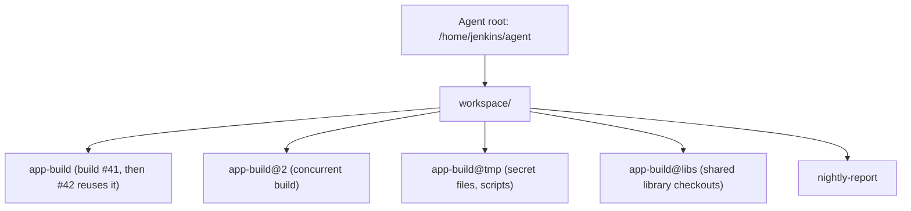

# Workspaces

## Introduction

A **workspace** is the directory on a node where a build does its work: Jenkins checks out the source code there, runs the build steps there, and that is where the build outputs land. It is the build's workbench.

Workbenches have a property that surprises many beginners: **Jenkins does not clean them by default.** The next build of the same job on the same node reuses the same directory, with whatever the previous build left behind. That is great for speed (no full clone, warm caches) and a classic source of "works on Jenkins, but only sometimes" bugs (stale files, leftover artifacts from a deleted branch).

Think of a shared carpentry bench. If each carpenter leaves sawdust and offcuts for the next one, work starts faster because tools are already out, but someone will eventually build a chair using the wrong leftover piece of wood. Understanding workspaces means deciding, on purpose, how much each build should clean up.

## Where Workspaces Live

Each node has a root directory, and workspaces sit under it:

| Node | Default workspace path |
| --- | --- |
| Built-in node (controller) | `$JENKINS_HOME/workspace/<job full name>` |
| Agent | `<agent remote root directory>/workspace/<job name>` |

For example, on the official Docker image, the job `hello-freestyle` on the built-in node uses `/var/jenkins_home/workspace/hello-freestyle`. On an agent with remote root `/home/jenkins/agent`, it uses `/home/jenkins/agent/workspace/hello-freestyle`. Jobs in folders, and especially branch jobs from Multibranch Pipelines, get names that Jenkins may shorten and suffix with a hash to keep paths within operating system limits, so do not hard-code workspace paths in scripts. Use `$WORKSPACE` instead.



### The @ folders

Next to a job's workspace you will see sibling directories with an `@` suffix:

- **`job@2`, `job@3`, ...**: created when **concurrent builds** of the same job run on the same node. Each concurrent build needs its own directory, so Jenkins locks the next free one. The `ws` step documentation describes this: if the requested workspace is in use, a directory with a suffix such as `@2` may be locked instead.
- **`job@tmp`**: a scratch area used by steps such as `sh` (wrapper scripts) and `withCredentials` (temporary secret files). Do not put your own files there.
- **`job@libs`** (or a similar name, depending on version): checkouts of shared libraries used by the Pipeline. See [Shared Libraries Introduction](../8-jenkins-shared-libraries/0-jenkins-shared-libraries-introduction.mdx).
- **`job@script`**: in some setups, a lightweight checkout used to read the Jenkinsfile.

## Seeing Workspace Reuse

This Pipeline proves that files survive between builds:

```groovy
pipeline {
    agent any
    stages {
        stage('Show reuse') {
            steps {
                sh '''
                    echo "Workspace: $WORKSPACE"
                    echo "Build $BUILD_NUMBER was here" >> history.txt
                    cat history.txt
                '''
            }
        }
    }
}
```

Example output on the third build:

```text
+ echo 'Workspace: /home/jenkins/agent/workspace/show-reuse'
Workspace: /home/jenkins/agent/workspace/show-reuse
+ echo 'Build 3 was here'
+ cat history.txt
Build 1 was here
Build 2 was here
Build 3 was here
```

If build 3 landed on a different agent, you would see only one line, because each agent has its own copy of the workspace. Workspaces are **per node**, not shared.

That gives you two rules:

1. Do not rely on files from a previous build being there; it depends on which node you get.
2. Do not assume files from a previous build are **not** there; on the same node they usually are.

For passing files between stages that run on different nodes, use `stash` and `unstash` ([Stash, Unstash and Artifacts](../4-jenkins-pipeline-advanced/4-jenkins-stash-and-artifacts.mdx)). For keeping files after the build, archive them ([Build History and Artifacts](./4-jenkins-build-history-and-artifacts.mdx)).

## How Checkout Behaves in a Reused Workspace

On the second build, the Git plugin does not clone again. It runs `git fetch` and then checks out the new commit. Tracked files are updated, but **untracked files** (build outputs like `target/`, `node_modules/`, `dist/`) stay unless something removes them. This is why a build can pass on Jenkins while failing on a fresh machine: an old generated file is still lying around.

The Git plugin offers **Additional Behaviours** to control this, for example "Clean before checkout" (runs `git clean -fdx`) and "Wipe out repository and force clone". In a Pipeline you can express the same thing with the `checkout` step's extensions; the [Snippet Generator](../3-jenkins-pipeline-basics/9-jenkins-pipeline-syntax-generator.mdx) produces the exact syntax for your plugin version. Details are in [Git Integration](../5-jenkins-scm-integration/0-jenkins-git-integration.mdx).

## Cleaning Workspaces

### deleteDir: built in

The `deleteDir()` step, part of Pipeline's basic steps, recursively deletes the **current directory**. Inside a `dir` block, it deletes only that subdirectory. At the top level of a stage, it deletes the whole workspace.

```groovy
post {
    always {
        deleteDir()   // remove the workspace after the build
    }
}
```

### cleanWs: the Workspace Cleanup plugin

The Workspace Cleanup plugin (`ws-cleanup`) adds `cleanWs`, which supports include and exclude patterns and conditions. To get a truly clean workspace **before** the build, skip the automatic checkout, clean, then check out yourself:

```groovy
pipeline {
    agent any
    options {
        // Required to clean before checkout
        skipDefaultCheckout(true)
    }
    stages {
        stage('Checkout') {
            steps {
                cleanWs()
                checkout scm
            }
        }
        stage('Build') {
            steps {
                sh 'ls -la'
            }
        }
    }
    post {
        always {
            // Keep the workspace small, but never fail the build because cleanup failed
            cleanWs(deleteDirs: true,
                    notFailBuild: true,
                    patterns: [[pattern: '**/node_modules/**', type: 'INCLUDE'],
                               [pattern: '**/target/**', type: 'INCLUDE']])
        }
    }
}
```

Example output from the post section:

```text
[Pipeline] cleanWs
[WS-CLEANUP] Deleting project workspace...
[WS-CLEANUP] Deferred wipeout is used...
[WS-CLEANUP] done
```

By default, `cleanWs` uses **deferred wipeout**: it renames the workspace and lets a background task delete it, so the build finishes faster. In Freestyle jobs, the same plugin adds **Delete workspace before build starts** (Build Environment) and **Delete workspace when build is done** (Post-build Actions).

:::note Ephemeral agents clean up for you
If your builds run on agents that are created per build and destroyed afterwards, such as [Kubernetes Pod Agents](../6-jenkins-agents/4-jenkins-kubernetes-agents.mdx) or [Docker Agents](../6-jenkins-agents/3-jenkins-docker-agents.mdx) with a fresh container, every build gets a clean workspace automatically. That is one of the main reasons teams move to ephemeral agents.
:::

## Working in Subdirectories: dir, ws and customWorkspace

### dir: change directory inside the workspace

`dir` runs the enclosed steps in a subdirectory, creating it if needed. Use it for monorepos or multiple checkouts:

```groovy
stage('Checkout two repos') {
    steps {
        dir('app') {
            git url: 'https://github.com/example/app.git', branch: 'main'
        }
        dir('deploy-config') {
            git url: 'https://github.com/example/deploy-config.git', branch: 'main'
        }
        sh 'ls'
    }
}
```

Example output:

```text
+ ls
app
deploy-config
```

### ws: allocate a different workspace

`ws('some/path')` locks an alternate workspace and runs the enclosed steps there. If that directory is in use by another build, Jenkins may give you `some/path@2` instead and **does not wait** for the exact one. You rarely need `ws`; prefer `dir` unless you have a strong reason, such as a tool that insists on an absolute path.

### customWorkspace: choose the workspace for an agent

In Declarative, you can set a workspace path in the `agent` block. A relative path goes under the node's workspace root; an absolute path is used as given:

```groovy
pipeline {
    agent {
        node {
            label 'linux'
            customWorkspace 'shared-cache/my-app'
        }
    }
    stages {
        stage('Where am I') {
            steps {
                sh 'pwd'
            }
        }
    }
}
```

Example output:

```text
+ pwd
/home/jenkins/agent/workspace/shared-cache/my-app
```

Custom workspaces are sometimes used to keep a path short (very long paths break some Windows tools) or to share a warm cache between two jobs. Sharing is risky: two builds writing to the same directory at the same time corrupt each other. If you do it, serialize access with the `lock` step from the Lockable Resources plugin.

## Concurrency and Workspaces

| Job type | Concurrent builds by default | What happens to the workspace |
| --- | --- | --- |
| Freestyle | No ("Execute concurrent builds if necessary" unchecked) | Second build waits in queue |
| Pipeline | Yes | Second build on same node gets `job@2` |
| Pipeline with `disableConcurrentBuilds()` | No | Second build waits (or aborts the running one with `abortPrevious: true`) |

For branch builds where only the newest commit matters, `disableConcurrentBuilds(abortPrevious: true)` saves agent time: a new push cancels the outdated build. For deployments, plain `disableConcurrentBuilds()` is safer, so two deployments never overlap. See [Pipeline Options and Tuning](../4-jenkins-pipeline-advanced/6-jenkins-pipeline-options.mdx).

## Disk Usage

Workspaces are the biggest consumer of disk on static agents. Each job, each branch and each `@2` copy keeps a full checkout plus build outputs. Common hygiene measures:

```bash
# On a static agent: list the 10 largest workspaces
du -sh /home/jenkins/agent/workspace/* 2>/dev/null | sort -rh | head -10
```

Example output:

```text
4.1G    /home/jenkins/agent/workspace/frontend_PR-1432
3.8G    /home/jenkins/agent/workspace/frontend_main
2.2G    /home/jenkins/agent/workspace/frontend_feature-login
1.1G    /home/jenkins/agent/workspace/backend_main
```

- Clean up in `post { always { cleanWs() } }` for jobs whose outputs are large and cheap to rebuild.
- Use ephemeral agents so the problem disappears.
- Configure node **disk space monitoring** (under **Manage Jenkins > Nodes**), so Jenkins marks a node offline before it fills completely.
- Remember that when a branch is deleted in a Multibranch Pipeline, its workspace on agents may linger. Jenkins has a background workspace cleanup thread for orphaned workspaces, but behaviour and settings vary by version; check your controller's documentation and monitor disk anyway.

More tuning tips are in [Build Caching and Speed](../9-jenkins-build-and-test/8-jenkins-build-caching.mdx) and [Performance Tuning](../12-jenkins-administration/4-jenkins-performance-tuning.mdx).

## Real-World Scenario

Your team maintains a React front end and a Java API in one company Jenkins with four static Linux agents. Two problems keep coming up:

1. Agents run out of disk every few weeks, breaking all builds at once.
2. Occasionally a front-end build passes on Jenkins but the deployed bundle contains a file that was deleted from the repository months ago.

### The diagnosis

Problem 2 comes from workspace reuse: the build copies everything in `dist/` into the deployment bundle, and an old generated file was never removed because nothing cleaned `dist/`. Problem 1 comes from dozens of branch and PR workspaces, each with `node_modules/` and `target/` directories.

### The solution

Clean what must be fresh, keep what is expensive and safe to reuse:

```groovy
pipeline {
    agent { label 'linux' }
    options {
        disableConcurrentBuilds(abortPrevious: true)
        buildDiscarder(logRotator(numToKeepStr: '30'))
    }
    stages {
        stage('Prepare') {
            steps {
                // Remove generated output but keep the git clone for a fast fetch
                sh 'rm -rf dist coverage'
            }
        }
        stage('Install') {
            steps {
                // npm ci always deletes and recreates node_modules from the lockfile
                sh 'npm ci'
            }
        }
        stage('Build') {
            steps {
                sh 'npm run build'
            }
        }
    }
    post {
        always {
            archiveArtifacts artifacts: 'dist/**', allowEmptyArchive: true
        }
        cleanup {
            // PR workspaces are rarely reused, so remove them after the build
            script {
                if (env.CHANGE_ID) {
                    cleanWs(notFailBuild: true)
                }
            }
        }
    }
}
```

Example output for a pull request build:

```text
+ rm -rf dist coverage
+ npm ci
added 1342 packages in 21s
+ npm run build
...
[WS-CLEANUP] Deleting project workspace...
[WS-CLEANUP] done
Finished: SUCCESS
```

In parallel, the platform team starts moving these builds to Kubernetes pod agents, where every build starts clean and the disk problem goes away entirely.

### Why this approach

- Deleting generated output removes the "ghost file" class of bugs while keeping the Git clone warm.
- `npm ci` gives a reproducible dependency tree from the lockfile.
- Cleaning PR workspaces right away frees the most disk, since PR branches rarely get a second build on the same agent.
- `abortPrevious` stops wasting executors on outdated commits.

### When to use it and when not to

Selective cleaning suits static agents with large repositories where a full clone is slow. If clones are fast or you already use ephemeral agents, skip the complexity and start every build clean. Never rely on a warm workspace for correctness; only for speed.

### Alternatives and trade-offs

| Approach | Pros | Cons | Best for |
| --- | --- | --- | --- |
| Reuse workspace, no cleaning | Fastest incremental builds | Stale files, disk growth | Tiny repos, trusted incremental tools |
| Clean generated dirs only | Fast fetch, correct outputs | Must know what to clean | Static agents with big repos |
| `cleanWs()` before every build | Always correct | Full clone each time | Release builds |
| `cleanWs()` after every build | Small disk footprint | Next build re-clones | Large PR volumes |
| Ephemeral agents (Kubernetes, Docker) | Clean by design, scales | Need caching strategy for dependencies | Most modern setups |

## Common Mistakes

- **Assuming a fresh workspace.** Static agents reuse it; old untracked files persist.
- **Assuming the previous build's files are available.** A different node means a different workspace. Use stash or artifacts.
- **Hard-coding workspace paths.** Folder and branch names change paths, and concurrent builds get `@2`. Use `$WORKSPACE` and relative paths.
- **Sharing a custom workspace between jobs without a lock.** Concurrent builds corrupt each other.
- **Writing into `@tmp`.** It belongs to Jenkins steps and may be cleaned at any time.
- **Cleaning before the default checkout.** Calling `cleanWs()` in the first stage without `skipDefaultCheckout(true)` deletes the code that was just checked out.
- **Running builds on the built-in node.** Its workspaces sit inside `JENKINS_HOME`, next to secrets and configuration.

## Summary

- A workspace is a per-node, per-job directory where the build runs; `$WORKSPACE` holds its path.
- Jenkins reuses workspaces by default, which speeds builds up but leaves stale files.
- `@2` directories appear for concurrent builds; `@tmp` and `@libs` belong to Jenkins.
- Clean with `deleteDir()`, `cleanWs()` (plugin `ws-cleanup`), Git clean options, or ephemeral agents.
- Use `dir` for subdirectories; `ws` and `customWorkspace` only when you need a specific path.
- Monitor agent disk space; workspaces are usually what fills it.

## Exercises

1. Run the "Show reuse" Pipeline three times. Then add `cleanWs()` in a `post { always { } }` block and run it again. What changes?
2. Enable concurrent builds (Pipelines allow them by default), add `sleep 60` to a stage, and start two builds quickly. Find the `@2` directory on the node.
3. Use `dir` to check out two repositories into one workspace and list both.
4. Write a short shell command that finds workspace directories on an agent not modified in 30 days. Discuss why deleting them blindly could break a running build.

Next: [Build History and Artifacts](./4-jenkins-build-history-and-artifacts.mdx). For moving files between stages on different nodes, see [Stash, Unstash and Artifacts](../4-jenkins-pipeline-advanced/4-jenkins-stash-and-artifacts.mdx).
