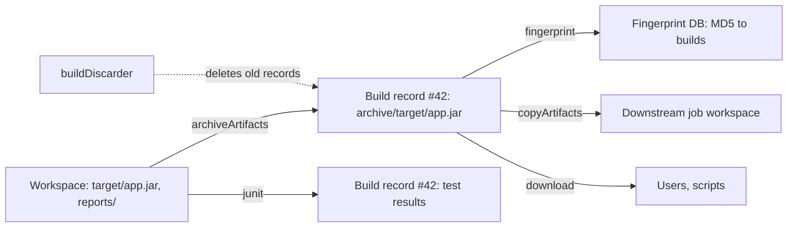

# Build History and Artifacts

## Introduction

Every time a job runs, Jenkins keeps a **build record**: the build number, who or what started it, the parameters, the console log, test results, the result, and any files you chose to keep. The list of those records is the job's **build history**.

The files you choose to keep are **artifacts**: the jar, the zip, the coverage report, the generated documentation. Archiving copies them out of the [workspace](./3-jenkins-workspaces.mdx), which the next build will overwrite, into the build record, where they stay until the build is deleted.

A good analogy is a lab notebook. Each experiment (build) gets a numbered page with the date, the inputs, what happened, and samples stored in a labelled jar (artifacts). The notebook is invaluable when you need to answer "what exactly did we ship last Tuesday?" But if nobody ever throws old pages away, the shelf collapses. This page covers both halves: keeping the right things, and throwing away the rest.



## What Jenkins Stores per Build

Builds live on the controller under the job's directory:

```text
$JENKINS_HOME/jobs/my-app/
├── config.xml              # job configuration (Freestyle, or Pipeline job definition)
├── nextBuildNumber
└── builds/
    ├── 41/
    │   ├── build.xml       # result, causes, parameters, actions
    │   ├── log             # console output
    │   └── archive/        # archived artifacts
    └── 42/
        ├── build.xml
        ├── log
        ├── junitResult.xml # test results (JUnit plugin)
        └── archive/
            └── target/app.jar
```

Jobs inside folders live under nested `jobs/` directories. Pipeline builds also store their flow-node data in the build directory. The exact files vary by plugin and version, but the lesson is clear: **every build and every artifact takes disk space on the controller** unless you configure external artifact storage.

The UI exposes the same data. On a build page you see the result, duration, causes ("Started by GitHub push by alice"), changes, parameters, test results, artifacts and the console log. For Pipelines, the **Pipeline Graph View** plugin (`pipeline-graph-view`) shows stages as a graph with per-stage logs. The older Blue Ocean UI is deprecated and receives no new features, so do not start new work with it.

## Archiving Artifacts

### Pipeline

Use the core `archiveArtifacts` step, usually in a `post` section so it runs even when later stages fail:

```groovy
pipeline {
    agent any
    stages {
        stage('Build') {
            steps {
                sh '''
                    mkdir -p dist
                    echo "app v1.0 build $BUILD_NUMBER" > dist/app.txt
                    tar czf dist/app-$BUILD_NUMBER.tar.gz dist/app.txt
                '''
            }
        }
    }
    post {
        success {
            archiveArtifacts artifacts: 'dist/*.tar.gz',
                             fingerprint: true,
                             onlyIfSuccessful: true
        }
    }
}
```

Example output:

```text
[Pipeline] archiveArtifacts
Archiving artifacts
Recording fingerprints
Finished: SUCCESS
```

The build page now lists `app-7.tar.gz` (for build 7) under **Build Artifacts**, with a download link.

The arguments you will use most:

| Argument | Meaning |
| --- | --- |
| `artifacts` | Ant-style pattern(s) relative to the workspace, comma-separated, e.g. `'dist/**, reports/*.html'` |
| `excludes` | Patterns to skip, e.g. `'**/*.map'` |
| `allowEmptyArchive` | If `true`, nothing matching gives a warning instead of failing the build |
| `onlyIfSuccessful` | Archive only when the build succeeded |
| `fingerprint` | Record an MD5 fingerprint of each file (see below) |
| `followSymlinks`, `caseSensitive`, `defaultExcludes` | Fine-grained matching behaviour |

By default, if the pattern matches **nothing**, `archiveArtifacts` fails the build. That is usually what you want for the main deliverable (a missing jar is a real problem) and not what you want for optional reports, where `allowEmptyArchive: true` fits.

### Freestyle

In a Freestyle job, add the post-build action **Archive the artifacts** and enter the same pattern under **Files to archive**. The **Advanced** button reveals the same options.

### Accessing artifacts by URL

Every artifact has a stable URL, and Jenkins also offers permalinks such as `lastSuccessfulBuild`:

```bash
# Download a known artifact from build 7
curl -fsSL -u "ci-bot:$JENKINS_API_TOKEN" -O \
  "https://jenkins.example.com/job/my-app/7/artifact/dist/app-7.tar.gz"

# Download all artifacts of the last successful build as one zip
curl -fsSL -u "ci-bot:$JENKINS_API_TOKEN" -o artifacts.zip \
  "https://jenkins.example.com/job/my-app/lastSuccessfulBuild/artifact/*zip*/archive.zip"

# List artifacts of a build as JSON, asking only for the fields we need
curl -s -u "ci-bot:$JENKINS_API_TOKEN" \
  "https://jenkins.example.com/job/my-app/lastSuccessfulBuild/api/json?tree=number,result,artifacts[relativePath]"
```

Example output of the second command:

```json
{
  "_class": "org.jenkinsci.plugins.workflow.job.WorkflowRun",
  "artifacts": [
    { "_class": "hudson.model.Run$Artifact", "relativePath": "dist/app-7.tar.gz" }
  ],
  "number": 7,
  "result": "SUCCESS"
}
```

Other useful permalinks are `lastBuild`, `lastStableBuild`, `lastFailedBuild` and `lastCompletedBuild`. The `tree` query parameter keeps API responses small; see [REST API and CLI](../12-jenkins-administration/8-jenkins-rest-api-and-cli.mdx).

## Fingerprints: Tracking a File Across Jobs

A **fingerprint** is an MD5 checksum that Jenkins records for a file, together with the job and build that produced or used it. If job A archives `app.jar` with fingerprinting on, and job B later copies or archives the same file with fingerprinting, Jenkins knows both builds handled the identical file.

That lets you answer questions like "which build produced the jar running in staging?" Upload or compute the MD5 and search it on the controller under **Check File Fingerprint** (available from the dashboard, depending on version and permissions), or follow the "See Fingerprints" link on a build page.

```bash
md5sum app-7.tar.gz
```

Example output:

```text
5f2b8c3e9a1d4f7b6c0e2a9d8b7c6e5f  app-7.tar.gz
```

Fingerprints are stored on the controller under `$JENKINS_HOME/fingerprints`. They are cheap for a few large artifacts and wasteful for thousands of small files, so fingerprint deliverables, not everything.

## Using Artifacts in Another Job

The **Copy Artifact** plugin (`copyartifact`) copies archived files from another job's build into the current workspace. It is how a separate deployment job picks up exactly what a build job produced:

```groovy
pipeline {
    agent any
    parameters {
        string(name: 'BUILD_SELECTOR', defaultValue: 'lastSuccessful', description: 'lastSuccessful or a build number')
    }
    stages {
        stage('Fetch build output') {
            steps {
                script {
                    def selector = params.BUILD_SELECTOR == 'lastSuccessful' ?
                        lastSuccessful() : specific(params.BUILD_SELECTOR)
                    copyArtifacts(projectName: 'my-app',
                                  selector: selector,
                                  filter: 'dist/*.tar.gz',
                                  target: 'incoming',
                                  fingerprintArtifacts: true)
                }
                sh 'ls -l incoming/dist'
            }
        }
    }
}
```

Example output:

```text
[Pipeline] copyArtifacts
Copied 1 artifact from "my-app" build number 7
[Pipeline] sh
+ ls -l incoming/dist
-rw-r--r-- 1 jenkins jenkins 182 Oct 11 11:02 app-7.tar.gz
```

For security, the source job must allow being copied from. Add this to the **source** job's Jenkinsfile:

```groovy
options {
    copyArtifactPermission('deploy-*')
}
```

:::tip Artifacts within a single Pipeline
Inside one Pipeline run, you do not need archiving to move files between stages on different agents. Use `stash` and `unstash`, which are faster and are deleted automatically. See [Stash, Unstash and Artifacts](../4-jenkins-pipeline-advanced/4-jenkins-stash-and-artifacts.mdx).
:::

## Controlling Build History

### Discarding old builds

Without retention rules, build records accumulate forever. Configure a build discarder on every job:

```groovy
pipeline {
    agent any
    options {
        buildDiscarder(logRotator(
            numToKeepStr: '50',          // keep the last 50 builds
            daysToKeepStr: '90',         // and nothing older than 90 days
            artifactNumToKeepStr: '10',  // but artifacts only for the last 10
            artifactDaysToKeepStr: ''    // no extra age limit for artifacts
        ))
    }
    stages {
        stage('Build') {
            steps {
                echo 'building'
            }
        }
    }
}
```

When both a count and an age are set, a build is deleted as soon as it breaks either rule. Separate artifact limits let you keep cheap history (logs, test trends) much longer than expensive artifacts. In a Freestyle job, the same settings are under **General > Discard old builds**. Retention runs when a new build completes.

Jenkins never deletes the **last successful** and **last stable** builds through the log rotator, so the permalinks keep working. For a specific build you want to keep, such as a release, click **Keep this build forever** on the build page.

:::caution Changing the Jenkinsfile changes retention
Like triggers and parameters, `options` from a Jenkinsfile are applied when the Pipeline runs. If you reduce `numToKeepStr` from 500 to 20, the next completed build deletes the older 480 records.
:::

### Making history readable

Two small additions make a long history much easier to scan. Set a display name and a description from the Pipeline:

```groovy
stage('Label build') {
    steps {
        script {
            def version = sh(script: 'cat VERSION', returnStdout: true).trim()
            currentBuild.displayName = "#${env.BUILD_NUMBER} v${version}"
            currentBuild.description = "commit ${env.GIT_COMMIT?.take(7)} on ${env.BRANCH_NAME ?: 'main'}"
        }
    }
}
```

Example build history entries after this change:

```text
#58 v1.4.2    commit 9d71fa3 on main
#57 v1.4.1    commit 4b2c9e1 on main
#56 v1.4.1    commit 1aa07c2 on feature-login
```

## Artifacts at Scale

Jenkins' built-in artifact storage is fine for small teams but becomes a problem as you grow:

- Every artifact sits on the controller's disk, which makes backups slow and large.
- Uploading large files streams them through the controller, using its CPU and network.
- Artifacts are tied to build records; deleting the job deletes the artifacts.

Two common answers:

1. **Artifact Manager on S3** (`artifact-manager-s3`) stores `archiveArtifacts` and `stash` data in an S3 bucket. Agents upload directly to S3, and the build page links still work. Similar approaches exist for other storage; check plugins.jenkins.io for current options.
2. **A dedicated artifact repository** such as Nexus, Artifactory, a container registry, or a package registry (Maven, npm, PyPI). Jenkins publishes there with normal build tools (`mvn deploy`, `docker push`, `twine upload`) and only archives small things like reports.

The second option is the norm for real releases: other systems (deployment tools, developers, customers) should fetch release artifacts from a proper repository, not from a CI server's build page. See [Building and Pushing Docker Images](../9-jenkins-build-and-test/7-jenkins-docker-image-builds.mdx).

## Real-World Scenario

Your team ships a desktop reporting tool to enterprise customers. Support regularly asks "which exact build is customer X running?", and auditors want to know that the installer customers received is the one that passed QA. Meanwhile the Jenkins controller's disk is at 85% and growing.

### The solution

1. The build job archives only the installer and the checksums, fingerprints them, and keeps artifacts for the last 15 builds while keeping logs and test history for 200:

```groovy
options {
    buildDiscarder(logRotator(numToKeepStr: '200', artifactNumToKeepStr: '15'))
    copyArtifactPermission('reporting-tool-release')
}
post {
    success {
        sh 'sha256sum dist/*.msi > dist/SHA256SUMS'
        archiveArtifacts artifacts: 'dist/*.msi, dist/SHA256SUMS', fingerprint: true
    }
}
```

2. A separate `reporting-tool-release` job takes a build number as a parameter, uses `copyArtifacts` with `specific(...)` to fetch that exact installer, signs it, uploads it to the company's artifact repository, and marks the source build **Keep this build forever** via the UI or API.
3. Coverage and test HTML reports are archived with `allowEmptyArchive: true` so a missing report never blocks a release.

### Why this approach

- Fingerprints link the QA build, the release job and the uploaded file through one checksum, which answers the audit question.
- Separate artifact retention keeps disk usage flat without losing history.
- The artifact repository, not Jenkins, is the long-term home of what customers download.

### When to use it and when not to

Archiving in Jenkins is right for **short-lived build outputs and reports** that people inspect from the build page or that later jobs consume. It is not right as your only store of release binaries, for large files on every PR build, or for anything you are legally required to retain for years.

### Alternatives and trade-offs

| Approach | Pros | Cons | Best for |
| --- | --- | --- | --- |
| `archiveArtifacts` on the controller | Zero setup, linked to build | Controller disk and bandwidth | Small teams, reports, short retention |
| Artifact Manager on S3 | Off-controller storage, same steps | Cloud setup, IAM, plugin to maintain | Larger Jenkins on AWS |
| Artifact repository (Nexus, Artifactory, registries) | Proper versioning, access control, retention | Separate system to run | Release artifacts, dependencies, images |
| `stash` / `unstash` | Fast, auto-deleted | Only within one run | Passing files between stages |
| No archiving, rebuild on demand | No storage | Rebuilds may not be identical | Cheap, reproducible outputs |

## Common Mistakes

- **No build discarder.** The controller disk fills up and Jenkins becomes slow or stops. Set `buildDiscarder` on every job, or enforce a default through [Configuration as Code (JCasC)](../12-jenkins-administration/0-jenkins-configuration-as-code.mdx) or a shared library.
- **Archiving the whole workspace.** `artifacts: '**'` stores `node_modules`, sources and caches for every build.
- **Archiving inside a stage that might not run.** Put archiving in `post` so results are kept even if a later stage fails.
- **Failing builds on optional reports.** Use `allowEmptyArchive: true` for nice-to-have files.
- **Using Jenkins as the release repository.** Builds get deleted by retention or job removal; publish releases to a real repository.
- **Fingerprinting thousands of small files.** It bloats `$JENKINS_HOME/fingerprints` with little benefit.
- **Forgetting `copyArtifactPermission`.** The downstream `copyArtifacts` then fails with a permission error.

## Summary

- Each build is a record with result, causes, parameters, log, test results and artifacts, stored under `$JENKINS_HOME/jobs/NAME/builds/N`.
- `archiveArtifacts` copies files out of the workspace into the build record; use `post` blocks and patterns carefully.
- Fingerprints track identical files across jobs; `copyArtifacts` moves artifacts between jobs.
- `buildDiscarder(logRotator(...))` controls how long builds and artifacts are kept; set it everywhere.
- At scale, move artifacts off the controller (S3 artifact manager) and publish releases to a dedicated repository.

## Exercises

1. Build the archiving example, run it three times, and download the artifacts of the `lastSuccessfulBuild` permalink as a zip with `curl`.
2. Add `buildDiscarder(logRotator(numToKeepStr: '3', artifactNumToKeepStr: '1'))`, run five more builds, and observe which builds and artifacts remain.
3. Create a second job that uses `copyArtifacts` to fetch a specific build's output. Run it before and after adding `copyArtifactPermission` to the source job.
4. Use the JSON API with a `tree` parameter to print the number and result of the last five builds of a job.

Next: [Freestyle vs Pipeline Jobs](./5-jenkins-freestyle-vs-pipeline.mdx). For JUnit trends on the build page, see [Test Reports with JUnit](../9-jenkins-build-and-test/4-jenkins-test-reports.mdx).
