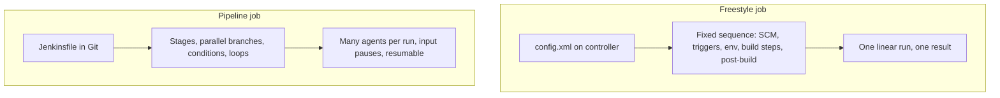
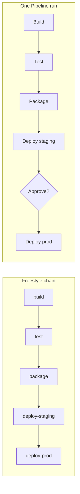
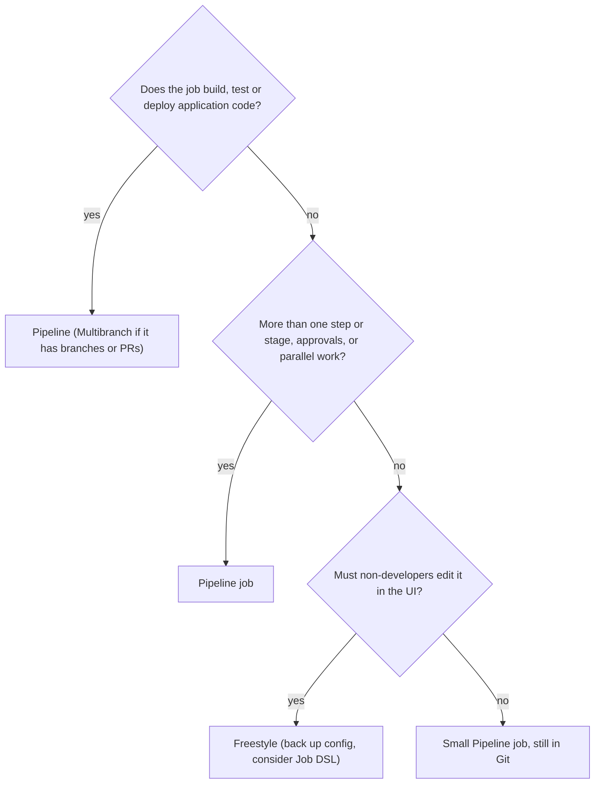

# Freestyle vs Pipeline Jobs

## Introduction

You have now seen the building blocks of a Jenkins job: [Freestyle Jobs](./0-jenkins-freestyle-jobs.mdx), [Build Triggers](./1-jenkins-build-triggers.mdx), [Build Parameters](./2-jenkins-build-parameters.mdx), [Workspaces](./3-jenkins-workspaces.mdx) and [Build History and Artifacts](./4-jenkins-build-history-and-artifacts.mdx). Every one of those concepts exists in both job types. The difference is **where the job definition lives and how much it can express**.

- A **Freestyle job** is a set of forms. Its definition is stored by Jenkins in `config.xml` and edited in the browser.
- A **Pipeline job** runs a program written in a Groovy-based DSL, usually stored as a `Jenkinsfile` in the same Git repository as the code it builds.

An analogy: a Freestyle job is like configuring your home network through the router's web page. It is easy, and fine for one router. A Pipeline is like managing a hundred routers with configuration files in Git: more upfront learning, but you get review, history, reuse and the ability to rebuild everything from scratch.

Jenkins itself treats Pipeline as the primary way to define CI/CD today: most current documentation, plugins and examples assume it. This page explains why, and also when Freestyle is still a sensible choice.

## The Same Job, Two Ways

Here is a small CI job for a Maven project: build on every push to `main`, run tests, publish test results, archive the jar, keep 20 builds, and send an email on failure.

### As a Freestyle job

Configured in the browser:

| Section | Setting |
| --- | --- |
| General | Discard old builds: max 20 |
| Source Code Management | Git, `https://github.com/example/my-app.git`, branch `*/main` |
| Build Triggers | GitHub hook trigger for GITScm polling |
| Build Environment | Add timestamps to the Console Output |
| Build Steps | Execute shell: `mvn -B clean verify` |
| Post-build Actions | Publish JUnit test result report: `target/surefire-reports/*.xml` |
| Post-build Actions | Archive the artifacts: `target/*.jar` |
| Post-build Actions | E-mail Notification: `team@example.com` |

### As a Declarative Pipeline

Stored in the repository as `Jenkinsfile`:

```groovy
pipeline {
    agent { label 'linux' }

    options {
        buildDiscarder(logRotator(numToKeepStr: '20'))
        timestamps()
        timeout(time: 30, unit: 'MINUTES')
    }

    triggers {
        githubPush()
    }

    stages {
        stage('Build') {
            steps {
                sh 'mvn -B -DskipTests clean package'
            }
        }
        stage('Test') {
            steps {
                sh 'mvn -B verify'
            }
            post {
                always {
                    junit 'target/surefire-reports/*.xml'
                }
            }
        }
    }

    post {
        success {
            archiveArtifacts artifacts: 'target/*.jar', fingerprint: true
        }
        failure {
            mail to: 'team@example.com',
                 subject: "FAILED: ${env.JOB_NAME} #${env.BUILD_NUMBER}",
                 body: "See ${env.BUILD_URL}"
        }
    }
}
```

Example console output (abbreviated):

```text
[Pipeline] { (Build)
+ mvn -B -DskipTests clean package
[INFO] BUILD SUCCESS
[Pipeline] { (Test)
+ mvn -B verify
[INFO] Tests run: 14, Failures: 0, Errors: 0, Skipped: 0
[Pipeline] junit
Recording test results
[Pipeline] archiveArtifacts
Archiving artifacts
Finished: SUCCESS
```

The `timestamps()` option needs the Timestamper plugin, and `mail` needs the Mailer plugin; both are common defaults. The Jenkinsfile is a little longer than the table, but it is **text in Git**: it can be reviewed in a pull request, diffed, reverted, and copied to the next project. In a [Multibranch Pipeline](../5-jenkins-scm-integration/1-jenkins-multibranch-pipelines.mdx) you would drop the `triggers` block entirely, because the branch source handles webhooks.

## How They Differ



| Aspect | Freestyle | Pipeline |
| --- | --- | --- |
| Definition | Web forms, stored in `config.xml` | `Jenkinsfile` (Groovy DSL), usually in Git |
| Code review and history | Only via Job Config History plugin | Normal Git history and pull requests |
| Structure | Fixed: build steps, then post-build actions | Stages, steps, `post` per stage and per Pipeline |
| Visualization | A single log | Stage view and graph (Pipeline Graph View) |
| Multiple agents in one run | No (one node per build) | Yes, per stage |
| Parallelism | Only by chaining jobs | `parallel` and `matrix` |
| Conditional logic | Plugins (Conditional BuildStep) | `when`, `script`, Groovy |
| Human approval mid-run | Not really | `input` step |
| Survives controller restart | No, running builds are lost | Yes, running Pipelines can resume (with default durability settings) |
| Branches and pull requests | One job per branch, by hand | Multibranch and organization folders create jobs automatically |
| Reuse across projects | Copy jobs, templates via plugins | Shared libraries |
| Learning curve | Very low | Moderate: Declarative syntax, some Groovy |
| Typical failure modes | Config drift, hidden UI changes | Groovy CPS quirks, script approval, long-running script blocks |

## What Pipeline Gives You

### Pipeline as code

The definition travels with the code. When a developer adds a new build step, it lands in the same pull request as the code that needs it, and the build of that pull request uses the new Jenkinsfile. With Freestyle, the job and the code can get out of sync: someone changes the job for the new code, and suddenly old release branches no longer build.

### Stages and visibility

Stages split a run into named phases (Build, Test, Deploy) with their own timings and logs. When a build fails, you see at a glance that it failed in "Integration tests" after 6 minutes, not just a red ball and a 20,000-line log.

### Durability

A Pipeline's execution state is saved as it runs. If the controller restarts during a build, the Pipeline can usually pick up again where it stopped. The price is the **CPS** (continuation-passing style) transformation that makes this possible: Pipeline Groovy is not quite normal Groovy. Some Groovy and Java features behave differently, non-serializable objects in variables cause errors, and long-running logic in `script` blocks runs on the controller. These quirks are the most common complaint about Jenkins Pipeline. The rule of thumb: keep logic in shell scripts and build tools, and keep the Jenkinsfile as orchestration. See [Groovy Essentials for Pipelines](../4-jenkins-pipeline-advanced/5-jenkins-groovy-for-pipelines.mdx).

### One flow instead of a chain

A deployment process that took five chained Freestyle jobs becomes one Pipeline with five stages, one build number, one history and parameters that flow naturally between stages:



## What Freestyle Still Does Well

Freestyle is not deprecated, and there are honest reasons to use it:

- **No Groovy at all.** Operations staff or testers can create and change simple jobs.
- **No CPS surprises** and no script approval prompts.
- **Very simple jobs stay very simple**: one scheduled shell command is a two-minute setup.
- **Some older plugins** only offer Freestyle build steps or post-build actions. This is less common every year, and many have a Pipeline step now, but check before migrating.

The cost shows up later: no version control by default, drift between jobs, no stages, no parallelism, and no resumption after restarts. If you keep Freestyle jobs, generate them with [Job DSL](../12-jenkins-administration/1-jenkins-job-dsl.mdx) so they are at least defined as code, and track UI changes with the Job Configuration History plugin.

## Declarative or Scripted?

"Pipeline" covers two syntaxes. **Declarative** (the `pipeline` block used on this page) is structured, validated before it runs, and recommended for most jobs. **Scripted** (a `node` block with plain Groovy) is more flexible but easier to misuse. For comparison, here is the core of the same job in Scripted syntax:

```groovy
node('linux') {
    stage('Checkout') {
        checkout scm
    }
    stage('Build and test') {
        try {
            sh 'mvn -B clean verify'
        } finally {
            junit 'target/surefire-reports/*.xml'
        }
    }
    stage('Archive') {
        archiveArtifacts artifacts: 'target/*.jar', fingerprint: true
    }
}
```

Notice what you now have to do yourself: check out explicitly, use `try`/`finally` instead of `post`, and set job properties such as retention with the `properties` step. Declarative handles these for you and validates the structure before running anything.

This tutorial uses Declarative by default. The details are in [Declarative vs Scripted Pipelines](../3-jenkins-pipeline-basics/4-jenkins-declarative-vs-scripted.mdx).

## Converting a Freestyle Job

Most Freestyle settings map directly to Declarative Pipeline:

| Freestyle setting | Declarative equivalent |
| --- | --- |
| Restrict where this project can be run | `agent { label 'linux' }` |
| Source Code Management | Automatic checkout from the job's SCM, or `checkout scm` / `git ...` |
| Discard old builds | `options { buildDiscarder(logRotator(...)) }` |
| This project is parameterized | `parameters { ... }` |
| Build periodically / Poll SCM | `triggers { cron(...) }` / `triggers { pollSCM(...) }` |
| Execute concurrent builds (unchecked) | `options { disableConcurrentBuilds() }` |
| Add timestamps | `options { timestamps() }` |
| Terminate a build if stuck | `options { timeout(...) }` |
| Execute shell | `sh '...'` inside `steps` |
| Use secret text(s) or file(s) | `withCredentials([...]) { ... }` or `environment { X = credentials('id') }` |
| Archive the artifacts | `archiveArtifacts` in `post` |
| Publish JUnit test result report | `junit` in `post { always { ... } }` |
| Build other projects | `build job: '...'` |
| E-mail Notification | `mail` or `emailext` in `post { failure { ... } }` |
| Delete workspace when build is done | `cleanWs()` in `post { cleanup { ... } }` |

The Snippet Generator on any Pipeline job (**Pipeline Syntax** link) generates the exact step syntax for the plugins on your controller; see [Snippet Generator and Pipeline Syntax Tools](../3-jenkins-pipeline-basics/9-jenkins-pipeline-syntax-generator.mdx). A full, careful migration process for many jobs is covered in [Migrating Freestyle Jobs to Pipelines](../13-jenkins-best-practices/2-jenkins-migrating-freestyle.mdx).

## The Pipeline Job Family

"Pipeline" in the **New Item** dialog is actually one of several related job types. All of them run a Jenkinsfile; they differ in how many jobs Jenkins creates for you:

| Job type | What it creates | When to use it |
| --- | --- | --- |
| Pipeline | One job, one Jenkinsfile (inline or from SCM) | Single-branch jobs, scheduled tasks, experiments |
| Multibranch Pipeline | One child job per branch and pull request that contains a Jenkinsfile | Almost every application repository |
| Organization Folder | One Multibranch Pipeline per repository in a GitHub org, GitLab group or Bitbucket project | Many repositories with a shared convention |

The Freestyle equivalent of a Multibranch Pipeline is "one hand-made job per branch", which is the main reason branch-heavy teams left Freestyle. See [Multibranch Pipelines](../5-jenkins-scm-integration/1-jenkins-multibranch-pipelines.mdx) and [Organization Folders](../5-jenkins-scm-integration/5-jenkins-organization-folders.mdx).

## The Honest Costs of Pipeline

Moving to Pipeline is the right default, but it is not free. Three costs catch teams by surprise.

### Groovy that is not quite Groovy

Because of the CPS transformation, some ordinary Groovy code behaves unexpectedly. A classic example is keeping objects that cannot be serialized in local variables while a step runs:

```groovy
pipeline {
    agent any
    stages {
        stage('Parse') {
            steps {
                script {
                    // A java.util.regex.Matcher is not serializable. Keeping it in a
                    // variable across a step boundary can fail with NotSerializableException.
                    def version = readFile('VERSION').trim()
                    def parts = version.tokenize('.')   // plain lists and strings are safe
                    echo "Major version: ${parts[0]}"
                }
            }
        }
    }
}
```

Example output:

```text
[Pipeline] readFile
[Pipeline] echo
Major version: 1
```

The safe habits: use simple types (strings, lists, maps), move complex parsing into a shell or Python script, or into a method marked `@NonCPS` in a shared library when you truly need it. [Groovy Essentials for Pipelines](../4-jenkins-pipeline-advanced/5-jenkins-groovy-for-pipelines.mdx) goes through the details.

### Script security

Pipeline code runs in a Groovy sandbox. When a Jenkinsfile calls a method that is not on the allow list, the build fails with a `RejectedAccessException` and an administrator must approve the signature under **Manage Jenkins > In-process Script Approval**. Approving signatures casually can open security holes; see [Script Security and Sandboxing](../11-jenkins-security/5-jenkins-script-security.mdx).

### Controller load

Pipeline orchestration logic runs on the controller, not on agents. Thousands of tiny `sh` steps, huge `echo` loops or heavy `script` blocks put real load on the controller, which is still a single point of failure in a standard Jenkins setup. Freestyle jobs, by contrast, hand the whole build to the agent. Keep Pipelines coarse-grained: a few large `sh` steps rather than hundreds of small ones. See [Pipeline Best Practices](../13-jenkins-best-practices/0-jenkins-pipeline-best-practices.mdx).

| Cost | Symptom | Mitigation |
| --- | --- | --- |
| CPS quirks | `NotSerializableException`, odd closure behaviour | Simple types, logic in scripts, `@NonCPS` in libraries |
| Script approval | `RejectedAccessException` | Use standard steps; vetted shared libraries |
| Controller load | Slow UI during busy hours | Fewer, larger steps; durability tuning |
| Learning curve | Copy-pasted Jenkinsfiles nobody understands | Templates and shared libraries |

## Decision Guide



## Real-World Scenario

Your company has a Jenkins controller that grew over eight years: 340 Freestyle jobs, many created by copying another job and editing a few fields. A recent incident: a release failed because someone changed a shared shell command in `app-build` two weeks earlier, and nobody knew who or why. Leadership asks whether to "move everything to Pipeline".

### The solution

1. **Inventory and classify.** Use the REST API or a script console query (read-only) to list jobs with their last build date. Delete jobs nobody has run in a year, after archiving their `config.xml`.
2. **Application builds become Multibranch Pipelines.** Each repository gets a Jenkinsfile, written from the conversion table above, and reviewed by the owning team. Common steps go into a [shared library](../8-jenkins-shared-libraries/0-jenkins-shared-libraries-introduction.mdx).
3. **Chains become stages.** The five-job deploy chains become single Pipelines with an `input` approval before production.
4. **Utility jobs stay Freestyle for now**, but are generated from Job DSL scripts in a `jenkins-jobs` repository, so changes go through review.
5. **Install Job Configuration History** in the meantime, so any remaining UI changes are recorded.

### Why this approach

- The incident was a change-control problem; putting definitions in Git with reviews fixes it directly.
- Not every job is worth converting by hand: utility jobs get "as code" cheaply through Job DSL.
- Migrating in priority order (applications first) delivers the value early without a risky big bang.

### When to use it and when not to

Pipeline is the default for anything that builds, tests or deploys software, and for anything with more than one phase. Freestyle remains acceptable for small utility jobs, as long as you can recreate them. Do not migrate a job that nobody uses; delete it. And do not convert Freestyle to Pipeline by stuffing 300 lines of Groovy logic into `script` blocks; move logic into scripts and keep the Jenkinsfile short.

### Alternatives and trade-offs

| Approach | Pros | Cons | Best for |
| --- | --- | --- | --- |
| Freestyle in UI | Easiest start, no code | No review, drift, no stages, lost on restart | Tiny utility jobs, learning |
| Freestyle via Job DSL | Reviewed, reproducible | Still no stages or resumption | Large sets of simple utility jobs |
| Declarative Pipeline | Structured, validated, readable, in Git | Some Groovy and CPS limits | Almost all CI/CD |
| Scripted Pipeline | Full flexibility | Easy to write hard-to-maintain code | Dynamic or unusual flows, library internals |
| Another CI system | YAML workflows close to the repo, hosted runners | Migration cost, different plugin ecosystem | Teams leaving Jenkins; see [Jenkins vs GitHub Actions, GitLab CI and Others](../0-jenkins-fundamentals/3-jenkins-vs-alternatives.mdx) |

## Common Mistakes

- **Starting new application CI as Freestyle "because it is quicker".** It is quicker for a day; you pay for it every month afterwards.
- **Pipeline jobs with the script pasted into the UI.** The "Pipeline script" option is fine for experiments, but production Pipelines should use "Pipeline script from SCM" so the Jenkinsfile lives in Git.
- **Putting business logic in Groovy.** Heavy `script` blocks run on the controller and hit CPS quirks. Call shell scripts or build tools instead.
- **Converting chains one-to-one into chained Pipelines.** Merge them into stages of one Pipeline where it makes sense.
- **Editing Pipeline settings in the UI.** Triggers, parameters and options declared in the Jenkinsfile overwrite UI changes on the next run.
- **Ignoring Pipeline durability settings.** For very high build volumes, the performance-optimized durability mode trades resumability for speed; know which mode you are using. See [Pipeline Options and Tuning](../4-jenkins-pipeline-advanced/6-jenkins-pipeline-options.mdx).

## Summary

- Freestyle jobs are form-based and stored only in Jenkins; Pipeline jobs are code, usually a `Jenkinsfile` in Git.
- Pipeline adds stages, parallelism, approvals, multiple agents per run, resumption after restarts and reuse through shared libraries.
- Pipeline's costs are a learning curve and Groovy CPS quirks; keep Jenkinsfiles as thin orchestration.
- Freestyle is still fine for small utility jobs, ideally generated with Job DSL.
- Most Freestyle settings map directly onto Declarative directives and steps.

## Exercises

1. Take the Freestyle job you built in [Freestyle Jobs](./0-jenkins-freestyle-jobs.mdx) and rewrite it as a Declarative Pipeline using the conversion table. Compare the build pages.
2. Start a long-running Pipeline (`sleep 300` in a stage), restart Jenkins with **Manage Jenkins > Prepare for Shutdown** and a restart, and watch whether the build resumes. Try the same with a Freestyle job.
3. List three jobs on a Jenkins you know and classify each with the decision guide on this page.
4. Write a short argument (five bullet points) for or against migrating your team's oldest Freestyle job, including the trade-offs.

You are ready for the main event: [Pipeline Introduction](../3-jenkins-pipeline-basics/0-jenkins-pipeline-introduction.mdx). For general background on pipelines, see the [CI/CD tutorial](/docs/devops/cicd).
