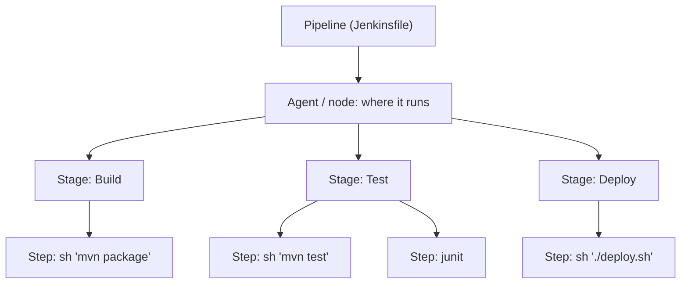
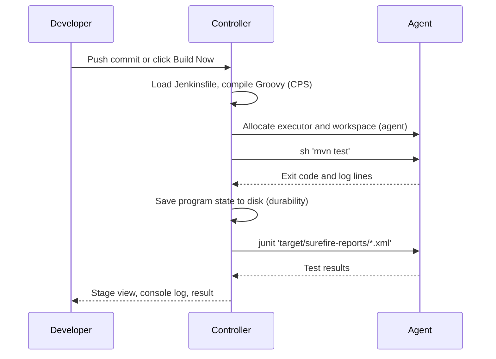
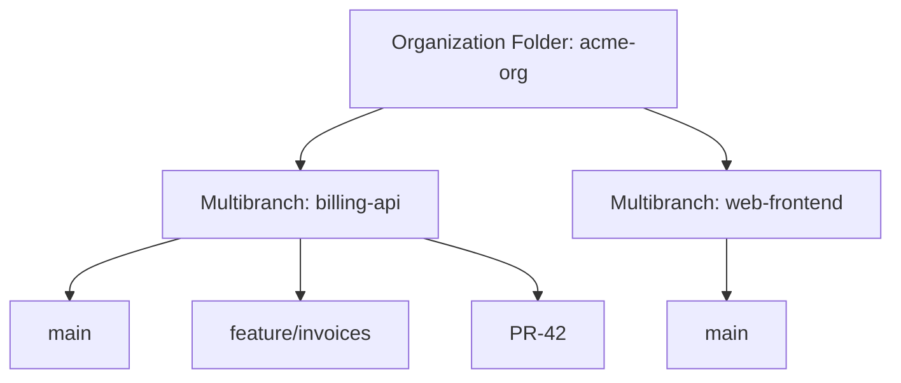

# Pipeline Introduction

## Introduction

In the [Jobs and Builds](../2-jenkins-jobs/0-jenkins-freestyle-jobs.mdx) section you built Freestyle jobs by clicking through forms: pick a Git repository, add a shell build step, tick a box to archive artifacts. That works for one small project. It stops working when you have twenty services, each needing build, test, scan and deploy steps, and nobody can remember who changed which checkbox last Tuesday.

**Jenkins Pipeline** solves this by describing the whole delivery process as **code**. Instead of a form, you write a short Groovy-based script, usually in a file called `Jenkinsfile` that lives next to your application code. Jenkins reads that file and runs it.

An analogy: a Freestyle job is like giving a new cook verbal instructions every time they make a dish. A Pipeline is a written recipe kept in the kitchen. Anyone can read it, improve it, see who changed the salt quantity and when, and cook the same dish in a different kitchen.

The official Jenkins handbook describes Pipeline as "a suite of plugins" for building continuous delivery pipelines in Jenkins. In practice, when people say "a Jenkins pipeline" today they mean a Pipeline job defined by a `Jenkinsfile`.

:::note
This page focuses on Jenkins specifically. For general CI/CD theory, such as what continuous integration and continuous delivery mean, see the [CI/CD tutorial](/docs/devops/cicd) and [CI/CD Concepts for Jenkins Users](../0-jenkins-fundamentals/1-jenkins-ci-cd-concepts.mdx).
:::

## Why Pipeline?

The Jenkins documentation lists five properties that make Pipeline different from older job types:

| Property | What it means in practice |
| --- | --- |
| **Code** | The pipeline is text in source control, so it gets code review, history and diffs like any other code |
| **Durable** | A running pipeline survives a planned or unplanned controller restart and continues where it left off |
| **Pausable** | A pipeline can stop and wait for a human approval before deploying to production |
| **Versatile** | It supports forks, joins, loops and parallel work, which Freestyle jobs cannot express well |
| **Extensible** | Plugins add new steps, and shared libraries let you reuse your own steps across many pipelines |

The first one matters most for day-to-day work. When the pipeline is in Git:

- Every change to the build process goes through a pull request.
- You can roll back a broken pipeline with `git revert`.
- A feature branch can change its own pipeline without affecting `main`.
- Multibranch jobs can create a pipeline for every branch and pull request automatically (see [Multibranch Pipelines](../5-jenkins-scm-integration/1-jenkins-multibranch-pipelines.mdx)).

## The Four Core Concepts

Every Jenkins pipeline is built from four ideas. You will meet them in every page of this section.

| Concept | Definition | Where you see it in code |
| --- | --- | --- |
| **Pipeline** | The full model of your delivery process: build, test, deploy | The `pipeline` block (Declarative) |
| **Node** | A machine, controller or agent, that runs the work and provides a workspace | `agent` (Declarative) or `node` (Scripted) |
| **Stage** | A named group of tasks such as "Build", "Test" or "Deploy" | `stage('Build')` |
| **Step** | One action, such as running a shell command or archiving a file | `sh`, `echo`, `junit`, `archiveArtifacts` |



Stages are mainly for **people**: the UI shows each stage as a box with its duration and status, so you can see at a glance that "Test" failed after 3 minutes. Steps are for **Jenkins**: they are the actual instructions.

## Two Syntaxes: Declarative and Scripted

Jenkins supports two ways of writing a pipeline. Both are stored in a `Jenkinsfile` and both run on the same engine.

**Declarative Pipeline** has a fixed, structured format that starts with `pipeline`:

```groovy
pipeline {
    agent any
    stages {
        stage('Hello') {
            steps {
                echo 'Hello from a Declarative pipeline'
            }
        }
    }
}
```

**Scripted Pipeline** is closer to plain Groovy and starts with `node`:

```groovy
node {
    stage('Hello') {
        echo 'Hello from a Scripted pipeline'
    }
}
```

Declarative is easier to read, validates its structure before running, and has built-in features such as `post`, `when` and `options`. Scripted gives you full programming flexibility. This tutorial prefers Declarative and uses Scripted only where it is the right tool. The detailed comparison is in [Declarative vs Scripted Pipelines](./4-jenkins-declarative-vs-scripted.mdx).

## Your First Pipeline Job

Let us create a pipeline in the UI first, then move it into Git on the next page. You need a running Jenkins controller; if you do not have one, follow [Installing Jenkins with Docker](../1-jenkins-installation/0-jenkins-install-docker.mdx). The "Pipeline" plugin suite (plugin ID `workflow-aggregator`) is included in the suggested plugins of the setup wizard.

1. On the dashboard, click **New Item**.
2. Enter a name such as `hello-pipeline`, choose **Pipeline**, and click **OK**.
3. Scroll to the **Pipeline** section. Leave **Definition** as **Pipeline script**.
4. Paste the script below and click **Save**.
5. Click **Build Now**.

```groovy
pipeline {
    agent any

    stages {
        stage('Checkout info') {
            steps {
                echo "Build number: ${env.BUILD_NUMBER}"
                echo "Running on node: ${env.NODE_NAME}"
            }
        }
        stage('Build') {
            steps {
                sh '''
                    mkdir -p out
                    echo "app version 1.0.${BUILD_NUMBER}" > out/version.txt
                '''
            }
        }
        stage('Test') {
            steps {
                sh 'grep -q "app version" out/version.txt && echo "version file OK"'
            }
        }
    }

    post {
        success {
            archiveArtifacts artifacts: 'out/version.txt'
        }
    }
}
```

Open the build and click **Console Output**.

Example output:

```text
Started by user admin
[Pipeline] Start of Pipeline
[Pipeline] node
Running on Jenkins in /var/jenkins_home/workspace/hello-pipeline
[Pipeline] {
[Pipeline] stage
[Pipeline] { (Checkout info)
[Pipeline] echo
Build number: 1
[Pipeline] echo
Running on node: built-in
[Pipeline] }
[Pipeline] // stage
[Pipeline] stage
[Pipeline] { (Build)
[Pipeline] sh
+ mkdir -p out
+ echo 'app version 1.0.1'
[Pipeline] }
[Pipeline] // stage
[Pipeline] stage
[Pipeline] { (Test)
[Pipeline] sh
+ grep -q 'app version' out/version.txt
+ echo 'version file OK'
version file OK
[Pipeline] }
[Pipeline] // stage
[Pipeline] stage
[Pipeline] { (Declarative: Post Actions)
[Pipeline] archiveArtifacts
Archiving artifacts
[Pipeline] }
[Pipeline] // stage
[Pipeline] }
[Pipeline] // node
[Pipeline] End of Pipeline
Finished: SUCCESS
```

The `[Pipeline]` lines show each step as Jenkins executes it. Notice that `post` shows up as a synthetic stage called "Declarative: Post Actions".

:::caution
`agent any` on a fresh install runs on the **built-in node** (the controller itself). That is fine for learning, but in production you should run builds on separate agents and set the built-in node's executors to 0. See [Controller and Agents](../6-jenkins-agents/0-jenkins-controller-and-agents.mdx) and [Securing Agents and the Controller](../11-jenkins-security/6-jenkins-securing-agents.mdx).
:::

## How Jenkins Runs a Pipeline

It helps to know where each piece of your pipeline actually executes, because it explains many surprises later.



Key points:

- **The Groovy logic runs on the controller.** `if` statements, loops and variable assignments are interpreted there.
- **Steps such as `sh` run on the agent.** The command executes in the agent's workspace.
- **State is checkpointed.** The engine transforms your script with a technique called CPS (continuation-passing style) so it can save progress and resume after a restart. This is what makes pipelines *durable*, and it is also why some ordinary Groovy code behaves oddly in a Jenkinsfile. [Groovy Essentials for Pipelines](../4-jenkins-pipeline-advanced/5-jenkins-groovy-for-pipelines.mdx) covers those quirks.

The practical lesson: do the heavy work in shell steps on agents, and use Groovy only as glue. The official Pipeline best practices page states this directly: Pipeline is "a tool to accomplish a build rather than the core of a build."

## Visualizing Pipelines

Out of the box, the build page shows stages and the console log. Two plugins add better visualization:

- **Pipeline Graph View** (plugin ID `pipeline-graph-view`): adds a **Pipeline Overview** page to each build with a stage graph, a stage list and per-stage logs. This is the actively developed option.
- **Pipeline: Stage View** (`pipeline-stage-view`): the older table of stages on the job page.

:::info
**Blue Ocean** was once the recommended pipeline UI, but it is no longer actively developed and receives only selected fixes. Do not start new setups on it. Use Pipeline Graph View instead. Plugin status changes over time, so check [plugins.jenkins.io](https://plugins.jenkins.io/) for current information.
:::

## Pipeline Job Types

"Pipeline" is also the name of a job type. Jenkins offers a few job types that all run Jenkinsfiles, and choosing the right one early saves rework:

| Job type | What it does | When to choose it |
| --- | --- | --- |
| **Pipeline** | One job, one pipeline, one branch (or an inline script) | Learning, or a single long-lived branch |
| **Multibranch Pipeline** | Scans a repository and creates a child job for every branch and pull request that contains a Jenkinsfile | Most application repositories |
| **Organization Folder** | Scans a whole GitHub organization, GitLab group or Bitbucket project and creates a Multibranch job per repository | Many repositories that should all build automatically |



Every leaf in that tree runs the `Jenkinsfile` found on its own branch. This section uses plain Pipeline jobs so you can focus on syntax; [Multibranch Pipelines](../5-jenkins-scm-integration/1-jenkins-multibranch-pipelines.mdx) and [Organization Folders](../5-jenkins-scm-integration/5-jenkins-organization-folders.mdx) cover the others.

## What Durability Means for You

Because pipelines survive a controller restart, a long build does not have to start over when an admin installs a plugin update and restarts Jenkins. Under the hood, Jenkins writes the pipeline's progress to disk as it goes.

This has two consequences you will notice:

- **Running `sh` steps continue on the agent** while the controller is down, and the pipeline reconnects to them when it comes back.
- **Every variable in your script must be serializable**, because it is saved to disk. Storing something like an open HTTP connection in a variable can fail with a `NotSerializableException`. The fix is usually to keep such objects out of pipeline variables and do the work in a shell step instead.

The amount of disk writing is tunable with the `durabilityHint` option, a trade-off between speed and safety covered in [Pipeline Options and Tuning](../4-jenkins-pipeline-advanced/6-jenkins-pipeline-options.mdx).

## Real-World Scenario

Your team runs a small SaaS helpdesk product: a Java API, a React front end and a worker service. Each currently has a Freestyle job that someone set up two years ago. Last month a build broke because someone edited the API job's shell step to fix a hotfix branch and forgot to change it back. Nobody could tell what the old command had been.

**The solution:** convert each service to a Pipeline job backed by a `Jenkinsfile` in the service's repository.

```groovy
pipeline {
    agent { label 'linux' }

    options {
        timeout(time: 20, unit: 'MINUTES')
        buildDiscarder(logRotator(numToKeepStr: '30'))
    }

    stages {
        stage('Build') {
            steps {
                sh './mvnw -B -DskipTests package'
            }
        }
        stage('Test') {
            steps {
                sh './mvnw -B test'
            }
            post {
                always {
                    junit 'target/surefire-reports/*.xml'
                }
            }
        }
        stage('Package') {
            steps {
                archiveArtifacts artifacts: 'target/*.jar', fingerprint: true
            }
        }
    }
}
```

Now a hotfix branch that needs a different command changes the `Jenkinsfile` **on that branch only**, through a pull request, and `main` is unaffected. When something breaks, `git log Jenkinsfile` shows who changed what.

**Why this approach:** the build definition lives with the code it builds, is reviewed like code, and is versioned per branch. The structure (Build, Test, Package) is visible in the stage view.

**When to use it:** almost always for new Jenkins work. **When not to:** a throwaway admin task, such as a one-off script to clean a disk, may not justify a repository; an inline Pipeline script or a simple Freestyle job is fine there.

| Approach | Pros | Cons | Best for |
| --- | --- | --- | --- |
| Freestyle job | Simple forms, no syntax to learn | No history, hard to review, poor at parallel or conditional logic | Tiny one-off tasks |
| Pipeline with inline script | Pipeline features, quick to try | Script stored in Jenkins, not in Git | Learning and experiments |
| Pipeline from SCM (`Jenkinsfile`) | Versioned, reviewed, per-branch | Need to learn the syntax | Real projects |
| Hosted CI (GitHub Actions, GitLab CI) | No server to run | Less control, different plugin ecosystem | Teams without Jenkins investment, see [Jenkins vs GitHub Actions, GitLab CI and Others](../0-jenkins-fundamentals/3-jenkins-vs-alternatives.mdx) |

## Common Mistakes

1. **Treating the Jenkinsfile as a programming project.** Long Groovy functions, JSON parsing and HTTP calls in the pipeline all run on the controller and slow it down. Put logic in scripts executed by `sh`.
2. **Keeping the pipeline inline in the job.** Inline scripts are great for experiments but lose the main benefit of pipeline-as-code. Move to a `Jenkinsfile` as soon as it works ([The Jenkinsfile](./1-jenkins-jenkinsfile.mdx)).
3. **Building on the controller.** `agent any` on a single-node install uses the controller. Add agents early.
4. **Mixing syntaxes by accident.** Copying a Scripted example (`node { ... }`) into a Declarative pipeline produces confusing errors. Learn to recognize which style an example uses.
5. **Choosing Blue Ocean for new installs.** It is not actively developed; use Pipeline Graph View.

## What This Section Covers

The rest of Pipeline Basics builds on the ideas above, one topic per page:

| Page | You will learn |
| --- | --- |
| [The Jenkinsfile](./1-jenkins-jenkinsfile.mdx) | Storing the pipeline in Git, quoting rules, linting |
| [Declarative Pipeline Syntax](./2-jenkins-declarative-pipeline.mdx) | Every section and directive of the structured syntax |
| [Scripted Pipeline Syntax](./3-jenkins-scripted-pipeline.mdx) | The Groovy-based syntax and its CPS quirks |
| [Declarative vs Scripted Pipelines](./4-jenkins-declarative-vs-scripted.mdx) | How to choose, and how to migrate |
| [Stages and Steps](./5-jenkins-stages-and-steps.mdx) | Organizing work and the most common steps |
| [Environment Variables](./6-jenkins-environment-variables.mdx) | Built-in variables, your own variables, credentials |
| [Post Conditions](./7-jenkins-post-conditions.mdx) | Cleanup, reports and notifications after a run |
| [Conditional Stages with when](./8-jenkins-when-conditions.mdx) | Running stages only on certain branches or changes |
| [Snippet Generator and Pipeline Syntax Tools](./9-jenkins-pipeline-syntax-generator.mdx) | Generating correct syntax from the UI |

## Summary

- Jenkins Pipeline describes your delivery process as code, usually in a `Jenkinsfile` kept in source control.
- Pipelines are durable, pausable, versatile and extensible, which Freestyle jobs are not.
- Four concepts: **pipeline**, **node/agent**, **stage** and **step**.
- There are two syntaxes. Declarative is structured and recommended. Scripted is flexible Groovy.
- Groovy logic runs on the controller, while steps like `sh` run on agents. Keep Groovy as glue.
- Use Pipeline Graph View for visualization; Blue Ocean is no longer actively developed.

## Exercises

1. Create the `hello-pipeline` job above, run it three times, and compare the build numbers in the console output.
2. Add a fourth stage called `Report` that prints the contents of `out/version.txt` with `sh 'cat out/version.txt'`.
3. Make the `Test` stage fail on purpose (for example, grep for a string that is not there). Look at how the stage view and the `post` block behave.
4. Install the Pipeline Graph View plugin and open **Pipeline Overview** for one of your builds.

Next, move the pipeline into source control in [The Jenkinsfile](./1-jenkins-jenkinsfile.mdx), then learn the full structure in [Declarative Pipeline Syntax](./2-jenkins-declarative-pipeline.mdx).
