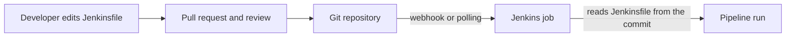

# The Jenkinsfile

## Introduction

A **Jenkinsfile** is a text file that contains a Jenkins pipeline definition. By convention it is named exactly `Jenkinsfile` (capital J, no extension) and sits in the root of your repository, next to `pom.xml`, `package.json` or `pyproject.toml`.

On the [previous page](./0-jenkins-pipeline-introduction.mdx) you pasted a pipeline into a text box in the job configuration. That is handy for experiments, but the script then lives only inside Jenkins. Moving it into a `Jenkinsfile` turns your build process into ordinary source code: reviewed in pull requests, versioned with the application, and different per branch when it needs to be.

Think of the Jenkinsfile as the `Makefile` of your delivery process. The application code says *what the program does*; the Jenkinsfile says *how it gets built, tested and shipped*.

## Inline Script vs Pipeline Script from SCM

A Pipeline job has two ways to get its definition:

| Definition option | Where the script lives | Good for |
| --- | --- | --- |
| **Pipeline script** | In the job's `config.xml` on the controller | Trying out syntax, short-lived experiments |
| **Pipeline script from SCM** | In a file in your Git repository | Every real project |

The Jenkins handbook calls the SCM approach best practice. Benefits it lists:

- Jenkins can create a pipeline for every branch and pull request automatically (with a Multibranch job).
- The pipeline is code-reviewed alongside the application.
- You get an audit trail of every change.
- There is a single source of truth that everyone on the team can read.



## A Minimal Repository Layout

Here is a small Python project you can push to any Git host:

```text
hello-api/
├── Jenkinsfile
├── app.py
├── requirements.txt
└── test_app.py
```

`app.py`:

```python
def add(a: int, b: int) -> int:
    return a + b


if __name__ == "__main__":
    print(add(2, 3))
```

`test_app.py`:

```python
from app import add


def test_add():
    assert add(2, 3) == 5
```

`requirements.txt`:

```text
pytest==8.3.3
```

`Jenkinsfile`:

```groovy
pipeline {
    agent any

    stages {
        stage('Set up Python') {
            steps {
                sh '''
                    python3 -m venv .venv
                    . .venv/bin/activate
                    pip install -q -r requirements.txt
                '''
            }
        }
        stage('Test') {
            steps {
                sh '''
                    . .venv/bin/activate
                    pytest --junitxml=reports/junit.xml
                '''
            }
        }
    }

    post {
        always {
            junit 'reports/junit.xml'
        }
    }
}
```

:::note
This example assumes the agent has `python3` with the `venv` module installed. A cleaner approach is a Docker agent with a Python image, covered in [Docker Agents](../6-jenkins-agents/3-jenkins-docker-agents.mdx) and [Building Python Projects](../9-jenkins-build-and-test/2-jenkins-python-builds.mdx).
:::

## Connecting a Job to the Jenkinsfile

1. **New Item** → name it `hello-api` → choose **Pipeline** → **OK**.
2. In the **Pipeline** section, set **Definition** to **Pipeline script from SCM**.
3. Set **SCM** to **Git** and enter the **Repository URL**.
4. If the repository is private, pick or add a **Credentials** entry (see [Credentials Management](../11-jenkins-security/3-jenkins-credentials.mdx)).
5. Set **Branch Specifier** to `*/main`.
6. Leave **Script Path** as `Jenkinsfile`, or change it if the file lives elsewhere, for example `ci/Jenkinsfile`.
7. Keep **Lightweight checkout** ticked. Jenkins then fetches only the Jenkinsfile to read it, instead of cloning the whole repository on the controller.
8. Save and click **Build Now**.

Example output:

```text
Started by user admin
Obtained Jenkinsfile from git https://github.com/example/hello-api.git
[Pipeline] Start of Pipeline
[Pipeline] node
Running on linux-agent-1 in /home/jenkins/workspace/hello-api
[Pipeline] {
[Pipeline] stage
[Pipeline] { (Declarative: Checkout SCM)
[Pipeline] checkout
 > git rev-parse --resolve-git-dir /home/jenkins/workspace/hello-api/.git
 > git fetch --tags --force --progress -- https://github.com/example/hello-api.git
Checking out Revision 4f2c9d1 (refs/remotes/origin/main)
[Pipeline] }
...
[Pipeline] { (Test)
+ pytest --junitxml=reports/junit.xml
============================= test session starts ==============================
collected 1 item

test_app.py .                                                            [100%]

------------- generated xml file: /home/jenkins/workspace/hello-api/reports/junit.xml -------------
============================== 1 passed in 0.02s ===============================
[Pipeline] junit
Recording test results
...
Finished: SUCCESS
```

Two things to notice:

- **"Obtained Jenkinsfile from git"**: the job read the pipeline from the repository.
- **"Declarative: Checkout SCM"**: Declarative pipelines automatically check out the same commit into the workspace before the first stage. You do not need a `git` step. If you want to control checkout yourself, use `options { skipDefaultCheckout() }` and call `checkout scm` where you need it.

For many branches and pull requests, use a **Multibranch Pipeline** instead of a single Pipeline job. It discovers branches that contain a Jenkinsfile and creates a job for each. See [Multibranch Pipelines](../5-jenkins-scm-integration/1-jenkins-multibranch-pipelines.mdx).

## Groovy Basics You Need for a Jenkinsfile

A Jenkinsfile is Groovy, a JVM language. You only need a few rules to write good pipelines.

### Comments

```groovy
// single-line comment
/*
   multi-line comment
*/
pipeline {
    agent any
    stages {
        stage('Demo') {
            steps {
                echo 'Comments are ignored'  // trailing comment
            }
        }
    }
}
```

### Steps and optional parentheses

Groovy lets you omit parentheses around method arguments. These lines are equivalent:

```groovy
sh 'echo hello'
sh('echo hello')
sh(script: 'echo hello')
sh([script: 'echo hello'])
```

Named arguments are a map, so you can write `git url: 'https://github.com/example/app.git', branch: 'main'`.

### Single vs double quotes

This is the most important Groovy rule for Jenkinsfiles:

- **Single quotes** `'...'` are literal strings. Groovy does not touch `${...}` inside them.
- **Double quotes** `"..."` are GStrings. Groovy replaces `${...}` with values **before** the step runs.
- **Triple quotes** `'''...'''` and `"""..."""` are the multi-line versions of each.

```groovy
pipeline {
    agent any
    environment {
        GREETING = 'hello'
    }
    stages {
        stage('Quotes') {
            steps {
                echo 'Single: ${GREETING}'
                echo "Double: ${GREETING}"
                sh 'echo "Shell sees: $GREETING"'
                sh "echo \"Groovy already replaced it: ${GREETING}\""
            }
        }
    }
}
```

Example output:

```text
[Pipeline] echo
Single: ${GREETING}
[Pipeline] echo
Double: hello
[Pipeline] sh
+ echo 'Shell sees: hello'
Shell sees: hello
[Pipeline] sh
+ echo 'Groovy already replaced it: hello'
Groovy already replaced it: hello
```

In the third line, Groovy passed the literal text `$GREETING` to the shell, and the **shell** expanded it from the environment. In the fourth line, Groovy expanded it first. The result looks the same here, but the difference matters a lot for secrets and user input.

### Quoting and security

Use **single quotes** when a shell command references a secret or a user-supplied parameter:

```groovy
pipeline {
    agent any
    parameters {
        string(name: 'MESSAGE', defaultValue: 'hello', description: 'Text to print')
    }
    stages {
        stage('Safe') {
            steps {
                withCredentials([string(credentialsId: 'api-token', variable: 'API_TOKEN')]) {
                    // Good: the shell reads API_TOKEN from its environment
                    sh 'curl -s -H "Authorization: Bearer $API_TOKEN" https://api.example.com/health'
                }
                // Good: the parameter is passed through the environment, not spliced into the command
                withEnv(["MSG=${params.MESSAGE}"]) {
                    sh 'echo "$MSG"'
                }
            }
        }
    }
}
```

Why this matters:

- **Secrets:** with double quotes, Groovy puts the secret value into the command string itself, where it can show up in process listings on the agent. Jenkins detects this and prints a warning similar to `Warning: A secret was passed to "sh" using Groovy String interpolation, which is insecure.`
- **Injection:** with `sh "echo ${params.MESSAGE}"`, a user who enters `hello; rm -rf ~` runs a second command. Passing the value through an environment variable and letting the shell quote it avoids that.

Credentials are covered in depth in [Credentials Management](../11-jenkins-security/3-jenkins-credentials.mdx).

## Validating a Jenkinsfile Before You Push

Nothing is more frustrating than a ten-commit chain of "fix Jenkinsfile". Jenkins provides a **Declarative linter** that checks syntax without running anything.

### Linting with curl

Create an API token for your user (click your name → **Security** → **API Token** → **Add new Token**), then:

```bash
export JENKINS_URL=https://jenkins.example.com
export JENKINS_AUTH=alice:11a2b3c4d5e6f7a8b9c0d1e2f3a4b5c6d7

curl -s -X POST --user "$JENKINS_AUTH" \
  -F "jenkinsfile=<Jenkinsfile" \
  "$JENKINS_URL/pipeline-model-converter/validate"
```

Example output for a valid file:

```text
Jenkinsfile successfully validated.
```

Example output when `agent` has no value:

```text
Errors encountered validating Jenkinsfile:
WorkflowScript: 2: Not a valid section definition: "agent". Some extra configuration is required. @ line 2, column 3.
WorkflowScript: 1: Missing required section "agent" @ line 1, column 1.
```

### Linting over the Jenkins SSH server

If the Jenkins SSH server is enabled, you can use the CLI command instead:

```bash
ssh -p 2222 alice@jenkins.example.com declarative-linter < Jenkinsfile
```

### A pre-commit hook

Wrap the curl call in a script so it runs before every commit that touches the Jenkinsfile:

```bash
#!/usr/bin/env bash
# .git/hooks/pre-commit  (make it executable with chmod +x)
set -euo pipefail

if git diff --cached --name-only | grep -q '^Jenkinsfile$'; then
  result=$(curl -s -X POST --user "$JENKINS_AUTH" \
    -F "jenkinsfile=<Jenkinsfile" \
    "$JENKINS_URL/pipeline-model-converter/validate")
  echo "$result"
  if ! echo "$result" | grep -q "successfully validated"; then
    echo "Jenkinsfile validation failed; commit aborted." >&2
    exit 1
  fi
fi
```

:::tip
The linter only validates **Declarative** structure. It does not check that a credential ID exists, that a shell command works, or that Scripted Groovy logic is correct. Editor plugins such as the VS Code "Jenkins Pipeline Linter Connector" call the same endpoint from your editor. To try script changes quickly without committing, use **Replay** on a previous build (see [Restart from Stage and Replay](../4-jenkins-pipeline-advanced/7-jenkins-restart-and-replay.mdx)).
:::

## Real-World Scenario

Your company has about 15 microservices, each in its own repository. A platform team wants all services built the same way but allows each team to own its pipeline. Today, half the services use inline pipeline scripts that only two admins can edit.

**Solution:**

1. Each repository gets a `Jenkinsfile` at the root. Teams own and review changes to it through normal pull requests.
2. All jobs switch to **Multibranch Pipeline** so feature branches and pull requests build automatically.
3. A pre-commit hook and a CI check (the linter call above) catch syntax errors before merge.
4. Common pieces (notifications, deploy logic) move into a **shared library** later, so each `Jenkinsfile` stays short ([Shared Libraries Introduction](../8-jenkins-shared-libraries/0-jenkins-shared-libraries-introduction.mdx)).

**Why this approach:** pipeline changes go through the same review process as code, the admins are no longer a bottleneck, and each branch can evolve its build safely.

**When not to use it:** for Jenkins *administration* jobs that are not tied to an application repository, such as a nightly backup or a cleanup script, a dedicated "jenkins-jobs" repository with [Job DSL](../12-jenkins-administration/1-jenkins-job-dsl.mdx) or JCasC is usually a better home.

| Approach | Pros | Cons | Best for |
| --- | --- | --- | --- |
| Inline pipeline script | Fast to try, no repo needed | No review, history only via job config history | Prototyping |
| `Jenkinsfile` per repository | Versioned with the code, per-branch changes | Duplication across repos | Most application teams |
| `Jenkinsfile` plus shared library | Short Jenkinsfiles, common logic in one place | Library needs its own versioning and tests | Organizations with many similar services |
| Central pipeline templates | Strong consistency | Teams lose flexibility | Highly regulated environments, see [Pipeline Templates for Many Teams](../8-jenkins-shared-libraries/7-jenkins-pipeline-templates.mdx) |

## Common Mistakes

1. **Naming the file `jenkinsfile` or `Jenkinsfile.groovy`.** The default Script Path is exactly `Jenkinsfile`. Either use that name or change the Script Path.
2. **Interpolating secrets with double quotes.** Use single quotes so the shell reads the variable.
3. **Adding a `git` step in a Declarative pipeline from SCM.** The automatic checkout already ran, so you clone twice. Use `checkout scm` only when you have disabled the default checkout.
4. **Pushing untested syntax.** Lint locally or use Replay first.
5. **Putting large Groovy programs in the Jenkinsfile.** Move logic to scripts in the repository, such as `ci/build.sh`, and call them with `sh`. Scripts are easier to test locally and run on the agent, not the controller.

## Summary

- A `Jenkinsfile` stores the pipeline in your repository, making it reviewable and versioned.
- Use **Pipeline script from SCM** (or a Multibranch job) and keep **Lightweight checkout** on.
- Declarative pipelines check out your code automatically before the first stage.
- Single quotes are literal, double quotes interpolate. Use single quotes for secrets and user input.
- Validate Declarative syntax with the `pipeline-model-converter/validate` endpoint or the `declarative-linter` CLI command.

## Exercises

1. Push the `hello-api` example to a Git repository and connect a Pipeline job to it with **Pipeline script from SCM**.
2. Move the file to `ci/Jenkinsfile`, update the Script Path, and confirm the build still works.
3. Break the syntax on purpose (delete the `agent` line) and run the curl linter to see the error.
4. Add a `string` parameter and print it safely using `withEnv` and a single-quoted `sh` step.

Continue with [Declarative Pipeline Syntax](./2-jenkins-declarative-pipeline.mdx) to learn every section and directive available in the file.
