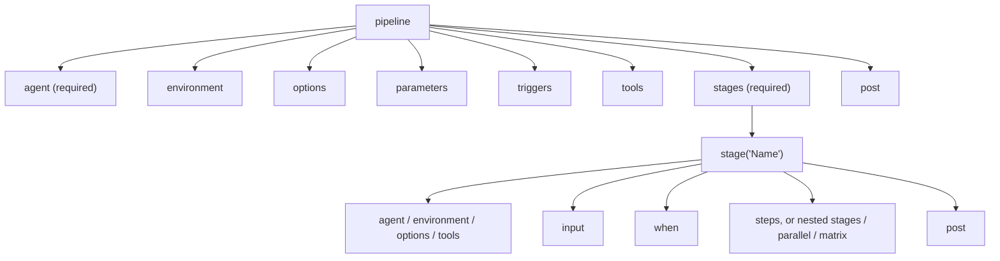
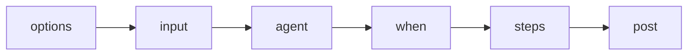

# Declarative Pipeline Syntax

## Introduction

**Declarative Pipeline** is the structured way to write a Jenkinsfile. You describe *what* the pipeline looks like (where it runs, which stages it has, what happens afterwards) inside a fixed set of blocks, and Jenkins takes care of the rest.

Compare it to filling in a well-designed form instead of writing a letter. The form has labeled boxes: "Agent", "Stages", "Post". You cannot put the wrong thing in the wrong box, and Jenkins can check your form before it starts. That is why Declarative is the recommended syntax for most pipelines.

This page is a guided tour of the whole syntax. Several directives get their own deep-dive page later in this section; links are provided as you go. The authoritative reference is the [Pipeline Syntax page](https://www.jenkins.io/doc/book/pipeline/syntax/) in the Jenkins handbook.

## The Skeleton

Every Declarative pipeline has the same outer shape:

```groovy
pipeline {
    agent any                 // where to run (required)

    stages {                  // one or more stages (required)
        stage('Build') {
            steps {           // the actual work (required in a simple stage)
                echo 'Building...'
            }
        }
    }

    post {                    // what to do afterwards (optional)
        always {
            echo 'Pipeline finished'
        }
    }
}
```

Rules that apply everywhere:

- The top-level block must be `pipeline`.
- Statements do not end with semicolons. Each statement goes on its own line.
- Blocks can only contain **sections**, **directives**, **steps** or assignment statements.
- Anything that is not a recognized step, such as an `if` statement or a `for` loop, must go inside a `script` block (covered below).



## Sections

**Sections** are the containers that hold steps or other blocks.

### agent

`agent` tells Jenkins where to run. It is required at the top level and optional on each stage.

| Form | Meaning |
| --- | --- |
| `agent any` | Any available agent |
| `agent none` | No global agent; every stage must declare its own |
| `agent { label 'linux && docker' }` | An agent whose labels match the expression |
| `agent { node { label 'linux'; customWorkspace '/data/ws' } }` | Like `label`, with extra options |
| `agent { docker { image 'maven:3.9-eclipse-temurin-21' } }` | Run inside a container from that image |
| `agent { dockerfile true }` | Build an image from the repository's `Dockerfile` and run inside it |
| `agent { kubernetes { yaml '...' } }` | Run in a Kubernetes pod (requires the `kubernetes` plugin) |

```groovy
pipeline {
    agent none
    stages {
        stage('Build on Linux') {
            agent { label 'linux' }
            steps {
                sh 'uname -a'
            }
        }
        stage('Build in a container') {
            agent {
                docker { image 'node:22-alpine' }
            }
            steps {
                sh 'node --version'
            }
        }
    }
}
```

Example output (abridged):

```text
[Pipeline] { (Build on Linux)
Running on linux-agent-1 in /home/jenkins/workspace/demo
+ uname -a
Linux linux-agent-1 6.8.0-45-generic #45-Ubuntu SMP x86_64 GNU/Linux
[Pipeline] { (Build in a container)
Running on docker-agent-2 in /home/jenkins/workspace/demo
+ docker pull node:22-alpine
...
+ node --version
v22.11.0
```

The `docker` and `dockerfile` agents need the **Docker Pipeline** plugin (`docker-workflow`) and a Docker engine on the agent. Agent types are explained in depth in [Agents and Distributed Builds](../6-jenkins-agents/0-jenkins-controller-and-agents.mdx).

### stages, stage and steps

`stages` contains one or more `stage` blocks. Each `stage` has a name and, in its simplest form, a `steps` block. A stage can instead contain nested `stages`, a `parallel` block or a `matrix` block. More detail is on [Stages and Steps](./5-jenkins-stages-and-steps.mdx).

### post

`post` defines steps that run after the pipeline or a stage, depending on the result: `always`, `success`, `failure`, `unstable`, `changed`, `fixed`, `regression`, `aborted`, `unsuccessful` and `cleanup`. See [Post Conditions](./7-jenkins-post-conditions.mdx).

## Directives

**Directives** configure behavior. Most can appear at the top level, and several can also appear inside a `stage`.

### environment

Sets environment variables for the whole pipeline or one stage. The `credentials()` helper binds a stored credential:

```groovy
environment {
    APP_NAME     = 'billing-api'
    DEPLOY_TOKEN = credentials('deploy-token')   // secret text credential
}
```

Full details on [Environment Variables](./6-jenkins-environment-variables.mdx).

### options

Pipeline-wide settings. Common ones:

```groovy
options {
    timeout(time: 30, unit: 'MINUTES')               // abort if the run takes longer
    buildDiscarder(logRotator(numToKeepStr: '20'))   // keep the last 20 builds
    disableConcurrentBuilds()                        // one run at a time
    timestamps()                                     // prefix log lines with time
    skipStagesAfterUnstable()                        // stop once tests mark the build unstable
}
```

Inside a stage, only a subset is allowed: `skipDefaultCheckout`, `timeout`, `retry` and `timestamps`. All options are described in [Pipeline Options and Tuning](../4-jenkins-pipeline-advanced/6-jenkins-pipeline-options.mdx).

:::note
`timestamps()` needs the Timestamper plugin. Recent versions of Timestamper can also add timestamps to every pipeline globally, so check whether your admin has already enabled that.
:::

### parameters

Declares build parameters. Users see a form when they click **Build with Parameters**, and the pipeline reads values from `params`:

```groovy
pipeline {
    agent any
    parameters {
        string(name: 'VERSION', defaultValue: '1.0.0', description: 'Version to release')
        choice(name: 'TARGET', choices: ['staging', 'production'], description: 'Where to deploy')
        booleanParam(name: 'RUN_E2E', defaultValue: true, description: 'Run end-to-end tests')
    }
    stages {
        stage('Show') {
            steps {
                echo "Releasing ${params.VERSION} to ${params.TARGET}, e2e=${params.RUN_E2E}"
            }
        }
    }
}
```

Example output:

```text
[Pipeline] echo
Releasing 1.0.0 to staging, e2e=true
```

For a `choice` parameter, the first entry is the default. Also available: `text` and `password`.

:::caution
Jenkins only learns about the `parameters` block when the pipeline **runs**. The first build after adding parameters uses defaults and does not show the form; from the second build on, **Build with Parameters** appears. See [Build Parameters](../2-jenkins-jobs/2-jenkins-build-parameters.mdx).
:::

### triggers

Starts the pipeline automatically:

```groovy
triggers {
    cron('H 2 * * 1-5')            // weekdays around 02:00
    pollSCM('H/15 * * * *')        // check for new commits every ~15 minutes
    upstream(upstreamProjects: 'shared-lib-build', threshold: hudson.model.Result.SUCCESS)
}
```

The `H` symbol spreads load by picking a stable "hashed" minute per job. For repositories with webhooks, you usually need no `triggers` block at all. See [Build Triggers](../2-jenkins-jobs/1-jenkins-build-triggers.mdx).

### tools

Puts a tool that an admin configured under **Manage Jenkins → Tools** on the `PATH`:

```groovy
tools {
    maven 'Maven-3.9'
    jdk 'JDK-21'
}
```

The names must match the configured tool names exactly. Supported types include `maven`, `jdk` and `gradle`. Many teams now prefer container agents with tools baked into the image instead, because the build environment then lives in the repository too.

### input

Pauses a stage until someone approves it:

```groovy
stage('Deploy to production') {
    input {
        message 'Deploy to production?'
        ok 'Deploy'
        submitter 'release-managers'
    }
    steps {
        sh './deploy.sh production'
    }
}
```

Covered fully in [Manual Input and Approvals](../4-jenkins-pipeline-advanced/2-jenkins-input-and-approvals.mdx).

### when

Decides whether a stage runs:

```groovy
stage('Deploy') {
    when { branch 'main' }
    steps {
        sh './deploy.sh'
    }
}
```

See [Conditional Stages with when](./8-jenkins-when-conditions.mdx).

## Order of Evaluation Inside a Stage

When a stage has several directives, Jenkins applies them in a fixed order. By default:



This matters in practice. Because `when` is evaluated **after** the agent is allocated by default, a skipped stage may still wait for an agent. Add `beforeAgent true` inside `when` to evaluate it first. Similarly, `beforeInput true` avoids asking for approval on a stage that will be skipped anyway.

## The script Block

Declarative deliberately limits what you can write. When you need a loop, an `if`, or a variable, use `script`:

```groovy
pipeline {
    agent any
    stages {
        stage('Loop') {
            steps {
                script {
                    def services = ['api', 'worker', 'web']
                    for (s in services) {
                        echo "Building ${s}"
                    }
                    if (env.BRANCH_NAME == 'main') {
                        echo 'On main: will tag the release'
                    } else {
                        echo "On branch ${env.BRANCH_NAME ?: 'unknown'}"
                    }
                }
            }
        }
    }
}
```

Example output:

```text
[Pipeline] script
[Pipeline] {
[Pipeline] echo
Building api
[Pipeline] echo
Building worker
[Pipeline] echo
Building web
[Pipeline] echo
On branch unknown
[Pipeline] }
```

`BRANCH_NAME` is only set in Multibranch jobs, so the `?:` (Elvis) operator supplies a fallback. Inside `script` you are writing [Scripted Pipeline](./3-jenkins-scripted-pipeline.mdx). Keep these blocks short. If a `script` block grows beyond a few lines, move the logic into a shell script or a [shared library step](../8-jenkins-shared-libraries/2-jenkins-global-vars.mdx).

## A Complete Example

Here is a realistic pipeline for a Java service that combines most directives:

```groovy
pipeline {
    agent {
        docker {
            image 'maven:3.9-eclipse-temurin-21'
            args '-v $HOME/.m2:/root/.m2'
        }
    }

    parameters {
        booleanParam(name: 'DEPLOY', defaultValue: false, description: 'Deploy to staging after build')
    }

    environment {
        APP_NAME = 'billing-api'
    }

    options {
        timeout(time: 30, unit: 'MINUTES')
        buildDiscarder(logRotator(numToKeepStr: '30'))
        disableConcurrentBuilds()
    }

    stages {
        stage('Build') {
            steps {
                sh 'mvn -B -DskipTests package'
            }
        }
        stage('Test') {
            steps {
                sh 'mvn -B test'
            }
            post {
                always {
                    junit 'target/surefire-reports/*.xml'
                }
            }
        }
        stage('Deploy to staging') {
            when {
                beforeAgent true
                expression { params.DEPLOY }
            }
            environment {
                STAGING_TOKEN = credentials('staging-deploy-token')
            }
            steps {
                sh './scripts/deploy.sh staging'
            }
        }
    }

    post {
        success {
            archiveArtifacts artifacts: 'target/*.jar', fingerprint: true
        }
        failure {
            echo "Build ${env.BUILD_NUMBER} of ${env.APP_NAME} failed: ${env.BUILD_URL}"
        }
    }
}
```

Each block has one job, and someone new to the project can read the file top to bottom and understand the delivery process.

## Real-World Scenario

You maintain the CI for a payments team. Auditors require that (1) every production deployment is approved by a release manager, (2) builds that run longer than 45 minutes are aborted, and (3) build logs are kept for 90 days. Engineers also want to deploy to staging on demand.

**Solution with Declarative directives:**

```groovy
pipeline {
    agent { label 'linux' }

    parameters {
        choice(name: 'TARGET', choices: ['none', 'staging', 'production'], description: 'Deploy target')
    }

    options {
        timeout(time: 45, unit: 'MINUTES')
        buildDiscarder(logRotator(daysToKeepStr: '90'))
    }

    stages {
        stage('Build and test') {
            steps {
                sh './ci/build-and-test.sh'
            }
        }
        stage('Deploy to staging') {
            when { expression { params.TARGET == 'staging' } }
            steps {
                sh './ci/deploy.sh staging'
            }
        }
        stage('Deploy to production') {
            when {
                beforeInput true
                expression { params.TARGET == 'production' }
            }
            input {
                message 'Approve production deployment?'
                submitter 'release-managers'
            }
            steps {
                sh './ci/deploy.sh production'
            }
        }
    }
}
```

**Why this approach:** each audit requirement maps to one visible directive (`input` with `submitter`, `timeout`, `buildDiscarder`). An auditor can read the file without knowing Groovy, and the linter rejects structural mistakes.

**When not to use Declarative:** if the stage list itself must be generated at run time, for example one stage per service discovered in a monorepo, Declarative's fixed structure gets awkward. Scripted, or Declarative with a generated `parallel` map inside `script`, may be clearer. See [Declarative vs Scripted Pipelines](./4-jenkins-declarative-vs-scripted.mdx).

| Approach | Pros | Cons | Best for |
| --- | --- | --- | --- |
| Pure Declarative | Readable, validated, built-in `post`/`when`/`input` | Limited dynamic structure | Most pipelines |
| Declarative with small `script` blocks | Adds a bit of logic where needed | Mixed styles can confuse beginners | Pipelines with a few dynamic bits |
| Scripted | Full Groovy flexibility | No structure validation, easy to write fragile code | Dynamic or generated pipelines |
| Shared library template | One definition for many repos | More moving parts | Platform teams, see [Shared Libraries Introduction](../8-jenkins-shared-libraries/0-jenkins-shared-libraries-introduction.mdx) |

## Common Mistakes

1. **Putting Groovy statements directly in `steps`.** `def x = 1` or `if (...)` in `steps` fails validation. Wrap them in `script`.
2. **Using `agent none` with stages that have no agent.** Any stage that runs `sh` then fails because there is no workspace. Give every such stage an `agent`.
3. **Expecting `tools` to install software magically.** The tool must be configured by name in **Manage Jenkins → Tools**.
4. **Forgetting `beforeAgent true`.** Skipped stages still wait for an agent, which wastes time on busy clusters.
5. **Huge pipelines.** Jenkins compiles the `pipeline` block into a single method, and very large files can hit the JVM "Method code too large" limit. Move logic into shared libraries or scripts long before that point.

## Summary

- Declarative pipelines start with `pipeline` and need `agent` and `stages`.
- Sections: `agent`, `stages`, `steps`, `post`.
- Directives: `environment`, `options`, `parameters`, `triggers`, `tools`, `input`, `when`.
- Inside a stage the default order is options, input, agent, when; `beforeAgent`, `beforeInput` and `beforeOptions` change that.
- Use `script` for small bits of imperative logic, and move anything larger out of the Jenkinsfile.

## Exercises

1. Write a pipeline with `agent none` and two stages that run on different labels (or the same label, if you only have one agent).
2. Add `parameters` with a `choice` of `dev`, `test` and `prod`, and print the selected value. Run it twice and see when the form appears.
3. Add `options { timeout(time: 1, unit: 'MINUTES') }` and a stage with `sh 'sleep 90'`. Observe the result.
4. Use the [Declarative Directive Generator](./9-jenkins-pipeline-syntax-generator.mdx) to build a `triggers` block that runs nightly.

Next, see how the same ideas look in [Scripted Pipeline Syntax](./3-jenkins-scripted-pipeline.mdx).
