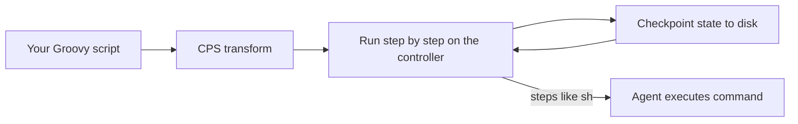

# Scripted Pipeline Syntax

## Introduction

**Scripted Pipeline** was the original way to write Jenkins pipelines. Instead of filling in a fixed structure, you write a Groovy program. Jenkins provides steps such as `node`, `stage` and `sh` as functions you call, and everything else (variables, loops, conditions, error handling) is regular Groovy, with some important restrictions.

If Declarative is a form with labeled boxes, Scripted is a blank sheet of paper. You can write anything, which is powerful, but nothing stops you from writing something hard to read or subtly broken.

Most new pipelines should be [Declarative](./2-jenkins-declarative-pipeline.mdx). You still need to understand Scripted because:

- every `script` block inside a Declarative pipeline **is** Scripted code;
- shared libraries are written in the same style;
- some genuinely dynamic pipelines are clearer in Scripted form;
- you will inherit older Jenkinsfiles written this way.

## The Basic Shape

```groovy
node {
    stage('Checkout') {
        checkout scm
    }
    stage('Build') {
        sh 'make build'
    }
    stage('Test') {
        sh 'make test'
    }
}
```

Compared with Declarative:

| Declarative | Scripted equivalent |
| --- | --- |
| `pipeline` ... `agent any` | `node` |
| `agent { label 'linux' }` | `node('linux')` |
| `stages` / `stage` / `steps` | `stage('Name')` containing steps directly |
| automatic checkout | explicit `checkout scm` |
| `environment` | `withEnv([...])` |
| `post` | `try` / `catch` / `finally` |
| `when` | `if` |
| `parameters`, `triggers`, `options` | `properties([...])` step |
| `parallel` block | `parallel` step with a map of closures |

There is no automatic checkout in Scripted. In a Pipeline-from-SCM or Multibranch job, `checkout scm` checks out the exact commit that triggered the build.

## node: Allocating an Executor and Workspace

`node` grabs an executor on an agent and a workspace directory. Steps like `sh` must run inside a `node`, because they need a machine to run on.

```groovy
echo 'This runs on the controller, outside any node (fine for echo)'

node('linux') {
    echo "Workspace: ${env.WORKSPACE}"
    sh 'hostname'
}
```

Example output:

```text
[Pipeline] echo
This runs on the controller, outside any node (fine for echo)
[Pipeline] node
Running on linux-agent-1 in /home/jenkins/workspace/scripted-demo
[Pipeline] {
[Pipeline] echo
Workspace: /home/jenkins/workspace/scripted-demo
[Pipeline] sh
+ hostname
linux-agent-1
[Pipeline] }
[Pipeline] // node
```

You can use several `node` blocks in one pipeline, for example to build on Linux and Windows. Code **outside** any `node` runs on the controller without an executor, which is useful for waiting on approvals without holding an agent.

## Variables, Conditions and Loops

Inside Scripted Pipeline you write normal Groovy:

```groovy
node {
    def services = ['api', 'worker', 'web']
    def isMain = (env.BRANCH_NAME == 'main')

    stage('Build all') {
        for (svc in services) {
            echo "Building ${svc}"
            sh "echo compiling ${svc}"
        }
    }

    if (isMain) {
        stage('Publish') {
            echo 'Publishing artifacts from main'
        }
    } else {
        echo "Skipping publish on branch ${env.BRANCH_NAME ?: 'none'}"
    }
}
```

Example output (abridged, not on main):

```text
[Pipeline] { (Build all)
[Pipeline] echo
Building api
[Pipeline] sh
+ echo compiling api
compiling api
...
[Pipeline] echo
Skipping publish on branch none
```

Note that with an `if`, the "Publish" stage simply does not exist in the stage view for that build. In Declarative with `when`, the stage appears as **skipped**, which is clearer for readers.

## Capturing Command Output

The `sh` step can return output or an exit code instead of failing the build:

```groovy
node {
    def commit = sh(script: 'git rev-parse --short HEAD || echo nogit', returnStdout: true).trim()
    echo "Commit: ${commit}"

    def status = sh(script: 'test -f README.md', returnStatus: true)
    if (status != 0) {
        echo 'No README.md found, continuing anyway'
    }
}
```

Example output:

```text
[Pipeline] sh
+ git rev-parse --short HEAD
4f2c9d1
[Pipeline] echo
Commit: 4f2c9d1
[Pipeline] sh
+ test -f README.md
[Pipeline] echo
No README.md found, continuing anyway
```

Always call `.trim()` on `returnStdout` results, because the output includes a trailing newline.

## Error Handling with try / catch / finally

Scripted has no `post` block. You use Groovy exception handling instead. A failing step throws an exception.

```groovy
node {
    try {
        stage('Test') {
            sh 'exit 1'   // simulate a failing test command
        }
        currentBuild.result = 'SUCCESS'
    } catch (err) {
        currentBuild.result = 'FAILURE'
        echo "Caught: ${err}"
        throw err        // rethrow so Jenkins still marks the build failed
    } finally {
        echo "Always runs. Result so far: ${currentBuild.currentResult}"
        // cleanup, notifications, junit reports, etc.
    }
}
```

Example output:

```text
[Pipeline] { (Test)
[Pipeline] sh
+ exit 1
[Pipeline] }
[Pipeline] echo
Caught: hudson.AbortException: script returned exit code 1
[Pipeline] echo
Always runs. Result so far: FAILURE
[Pipeline] End of Pipeline
ERROR: script returned exit code 1
Finished: FAILURE
```

:::warning
If you catch an exception and do **not** rethrow it (or set `currentBuild.result`), the build can finish as **SUCCESS** even though a step failed. Also avoid catching everything blindly: when a user clicks **Abort**, Jenkins throws a `FlowInterruptedException`, and swallowing it makes the build impossible to stop cleanly. The `catchError` and `warnError` steps are safer alternatives, covered in [Timeouts, Retries and Error Handling](../4-jenkins-pipeline-advanced/3-jenkins-timeouts-and-retries.mdx).
:::

## Environment Variables with withEnv

```groovy
node {
    withEnv(['APP_ENV=staging', 'LOG_LEVEL=debug']) {
        sh 'echo "env=$APP_ENV level=$LOG_LEVEL"'
    }
    sh 'echo "outside: ${APP_ENV:-unset}"'
}
```

Example output:

```text
+ echo 'env=staging level=debug'
env=staging level=debug
+ echo 'outside: unset'
outside: unset
```

Variables set with `withEnv` are scoped to the block.

## Job Properties: Parameters, Triggers and Options

Scripted uses the `properties` step to configure the job:

```groovy
properties([
    parameters([
        string(name: 'VERSION', defaultValue: '1.0.0', description: 'Release version'),
        booleanParam(name: 'DRY_RUN', defaultValue: true, description: 'Skip the real deploy')
    ]),
    buildDiscarder(logRotator(numToKeepStr: '20')),
    pipelineTriggers([cron('H 3 * * *')])
])

node {
    echo "Version ${params.VERSION}, dry run: ${params.DRY_RUN}"
}
```

:::caution
`properties` **replaces** the job's whole property list each time it runs. If one branch calls `properties` with only `parameters`, any triggers set earlier disappear. Keep a single `properties` call at the top of the Jenkinsfile.
:::

## Running Work in Parallel

The `parallel` step takes a map of branch names to closures:

```groovy
def branches = [:]
for (os in ['linux', 'windows']) {
    def label = os          // copy the loop variable for the closure
    branches[label] = {
        node(label) {
            echo "Testing on ${label}"
        }
    }
}

stage('Cross-platform tests') {
    parallel branches
}
```

The local copy `def label = os` is important: without it, all closures may capture the same loop variable. Parallel work is covered in [Parallel Stages](../4-jenkins-pipeline-advanced/0-jenkins-parallel-stages.mdx).

## How Groovy Runs in Jenkins: CPS

Jenkins runs your script through a **CPS (continuation-passing style) transformation** so it can pause and save state to disk, then resume after a restart. This makes pipelines durable, but it means some ordinary Groovy does not behave as expected.



Things to know:

- **Closures passed to some Groovy and Java methods misbehave.** For example, sorting with a comparator closure, such as `list.sort { a, b -> ... }`, can return wrong results under CPS. The Jenkins log then shows a warning like `expected to call ... but wound up catching ...`.
- **Simple `for` loops are safest.** Iterators such as `.each` work in current versions, but plain `for (x in list)` is the most predictable.
- **`@NonCPS` methods** run as normal Groovy, which is useful for pure data processing, but they must **not** call pipeline steps such as `sh`, `echo` or `node`.
- **Everything is serialized.** Variables holding non-serializable objects (for example a `java.util.regex.Matcher`) can cause `NotSerializableException`. Use the result immediately and do not keep the object in a variable across steps.

```groovy
@NonCPS
def sortVersions(List versions) {
    // Pure Groovy, no pipeline steps here
    return versions.sort { a, b ->
        def pa = a.tokenize('.').collect { it as int }
        def pb = b.tokenize('.').collect { it as int }
        for (int i = 0; i < Math.min(pa.size(), pb.size()); i++) {
            if (pa[i] != pb[i]) {
                return pa[i] <=> pb[i]
            }
        }
        return pa.size() <=> pb.size()
    }
}

node {
    def sorted = sortVersions(['1.10.0', '1.2.0', '1.9.3'])
    echo "Sorted: ${sorted}"
}
```

Example output:

```text
[Pipeline] echo
Sorted: [1.2.0, 1.9.3, 1.10.0]
```

The full story, including script security and sandbox approvals, is in [Groovy Essentials for Pipelines](../4-jenkins-pipeline-advanced/5-jenkins-groovy-for-pipelines.mdx) and [Script Security and Sandboxing](../11-jenkins-security/5-jenkins-script-security.mdx).

## Real-World Scenario

Your team has a monorepo with a `services/` directory. New services are added every few weeks. You want the pipeline to build only services whose files changed, in parallel, without editing the Jenkinsfile whenever a service is added.

```groovy
node('linux') {
    stage('Checkout') {
        checkout scm
    }

    def changed = []
    stage('Detect changes') {
        def out = sh(
            script: 'git diff --name-only HEAD~1 HEAD | awk -F/ \'/^services\\//{print $2}\' | sort -u',
            returnStdout: true
        ).trim()
        changed = out ? out.split('\n') as List : []
        echo "Changed services: ${changed}"
    }

    if (changed.isEmpty()) {
        echo 'No service changes, nothing to build'
        return
    }

    stage('Build changed services') {
        def branches = [:]
        for (svc in changed) {
            def name = svc
            branches[name] = {
                dir("services/${name}") {
                    sh './build.sh'
                }
            }
        }
        parallel branches
    }
}
```

Example output:

```text
[Pipeline] { (Detect changes)
+ git diff --name-only HEAD~1 HEAD
+ awk -F/ '/^services\//{print $2}'
+ sort -u
[Pipeline] echo
Changed services: [billing, notifications]
[Pipeline] { (Build changed services)
[Pipeline] parallel
[Pipeline] { (Branch: billing)
[Pipeline] { (Branch: notifications)
...
```

**Why Scripted here:** the set of stages is computed at run time. Scripted expresses "build N things in parallel, where N comes from git" naturally.

**When not to:** if the list of services is fixed, a Declarative pipeline with `when { changeset 'services/billing/**' }` per stage is easier to read and shows skipped stages clearly. Comparing only `HEAD~1` is also a simplification; real monorepo builds compare against the last successful build or the PR's target branch, as covered in [Building Monorepos](../5-jenkins-scm-integration/6-jenkins-monorepo-builds.mdx).

| Approach | Pros | Cons | Best for |
| --- | --- | --- | --- |
| Scripted with dynamic `parallel` | Fully dynamic, compact | Harder to read, no syntax validation | Generated stage lists |
| Declarative with `script` generating `parallel` | Keeps `post`, `options`, `when` around the dynamic part | Mixed styles | Mostly static pipelines with one dynamic stage |
| Declarative `when { changeset }` per service | Very readable, skipped stages visible | Must edit Jenkinsfile for each new service | Few, stable services |
| Separate job per service | Simple per-service pipelines | Many jobs to manage | Polyrepo setups |

## Common Mistakes

1. **Forgetting `checkout scm`.** Scripted pipelines start with an empty workspace.
2. **Swallowing exceptions.** Always rethrow or set `currentBuild.result`, and do not catch user aborts.
3. **Calling `sh` outside `node`.** You get an error that the step requires a context such as a workspace.
4. **Capturing loop variables in closures.** Copy the loop variable to a local `def` before building a closure.
5. **Calling steps from `@NonCPS` methods.** Keep `@NonCPS` for pure data work.
6. **Holding an executor while waiting for input.** Put `input` outside `node` so no agent sits idle.

## Summary

- Scripted Pipeline is a Groovy program that calls steps like `node`, `stage`, `sh` and `parallel`.
- `node` allocates an executor and workspace; code outside it runs on the controller.
- Use `try` / `catch` / `finally` for error handling, `withEnv` for environment and `properties` for parameters and triggers.
- The CPS transformation makes pipelines durable but changes some Groovy behavior; prefer simple loops and keep `@NonCPS` methods free of steps.
- Choose Scripted for genuinely dynamic pipelines, and Declarative for everything else.

## Exercises

1. Rewrite the first-pipeline example from [Pipeline Introduction](./0-jenkins-pipeline-introduction.mdx) in Scripted syntax, including a `finally` block that always prints the result.
2. Use `returnStatus: true` to check whether a file exists and print a different message for each case.
3. Build a `parallel` map from a list of three strings and run it. Then remove the `def name = svc` copy and see what happens in your Jenkins version.
4. Add a `properties` block with a boolean parameter and use it in an `if` to skip a stage.

Next, compare both styles side by side in [Declarative vs Scripted Pipelines](./4-jenkins-declarative-vs-scripted.mdx).
