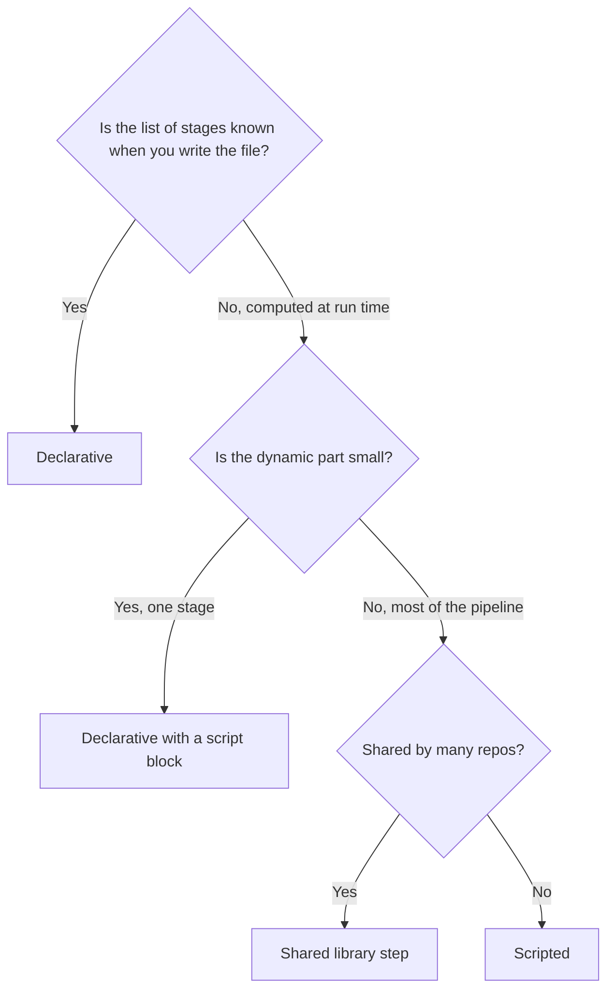

# Declarative vs Scripted Pipelines

## Introduction

Jenkins gives you two syntaxes for the same pipeline engine. You have seen both: [Declarative](./2-jenkins-declarative-pipeline.mdx), which starts with `pipeline`, and [Scripted](./3-jenkins-scripted-pipeline.mdx), which starts with `node`. This page puts them side by side so you can choose deliberately instead of copying whatever example you found first.

A useful analogy: Declarative is like a configuration file such as a Docker Compose file. It has a schema, tools can validate it, and anyone can read it. Scripted is like a shell script. It can do anything, which also means it can do anything wrong.

The short answer: **use Declarative by default, add small `script` blocks when you need a bit of logic, and reach for Scripted (or a shared library) only when the structure of the pipeline itself must be computed.**

## The Same Pipeline, Two Ways

Here is a build that compiles, runs tests, publishes test reports even on failure, deploys only from `main`, and sends a message when it fails.

**Declarative:**

```groovy
pipeline {
    agent { label 'linux' }

    options {
        timeout(time: 20, unit: 'MINUTES')
    }

    environment {
        APP = 'inventory-service'
    }

    stages {
        stage('Build') {
            steps {
                sh './gradlew assemble'
            }
        }
        stage('Test') {
            steps {
                sh './gradlew test'
            }
            post {
                always {
                    junit 'build/test-results/test/*.xml'
                }
            }
        }
        stage('Deploy') {
            when { branch 'main' }
            steps {
                sh './deploy.sh'
            }
        }
    }

    post {
        failure {
            echo "${APP} build ${BUILD_NUMBER} failed"
        }
    }
}
```

**Scripted:**

```groovy
timeout(time: 20, unit: 'MINUTES') {
    node('linux') {
        withEnv(['APP=inventory-service']) {
            try {
                stage('Checkout') {
                    checkout scm
                }
                stage('Build') {
                    sh './gradlew assemble'
                }
                stage('Test') {
                    try {
                        sh './gradlew test'
                    } finally {
                        junit 'build/test-results/test/*.xml'
                    }
                }
                if (env.BRANCH_NAME == 'main') {
                    stage('Deploy') {
                        sh './deploy.sh'
                    }
                }
            } catch (err) {
                echo "${env.APP} build ${env.BUILD_NUMBER} failed"
                throw err
            }
        }
    }
}
```

Both work. Notice what the Scripted version had to spell out by hand: the checkout, the nested `try`/`finally` for test reports, the `if` for the branch, and the outer `catch` for failure handling. Each of those is a place to make a mistake, such as forgetting to rethrow.

## Feature Comparison

| Aspect | Declarative | Scripted |
| --- | --- | --- |
| Starts with | `pipeline` | `node` (usually) |
| Structure | Fixed sections and directives | Free-form Groovy |
| Syntax validation before run | Yes, the whole structure is checked first | No, errors appear when the line runs |
| Linter (`pipeline-model-converter/validate`) | Supported | Not supported |
| Post-build handling | `post` with conditions like `failure`, `fixed`, `cleanup` | `try` / `catch` / `finally` |
| Conditional stages | `when`; skipped stages shown as skipped | `if`; skipped stages are missing from the view |
| Restart from a stage | Supported for top-level stages | Not supported |
| Automatic checkout | Yes (can be disabled) | No, call `checkout scm` |
| Dynamic number of stages | Awkward; needs `script` | Natural |
| Directive Generator support | Yes | Not applicable |
| Learning curve | Lower | Higher; requires Groovy and CPS knowledge |
| Readability for non-Jenkins people | High | Varies with author discipline |



## Where Declarative Shines

### Clear failure handling

The `post` conditions express intent directly. `fixed` ("this build succeeded after a failure") is a one-liner in Declarative, but in Scripted you must compare `currentBuild.previousBuild.result` yourself.

### Early validation

A Declarative pipeline with a typo in a directive fails **before any stage runs**:

```text
org.codehaus.groovy.control.MultipleCompilationErrorsException: startup failed:
WorkflowScript: 5: Invalid option type "timeoutt". Valid option types: [buildDiscarder, catchError, checkoutToSubdirectory, disableConcurrentBuilds, ...] @ line 5, column 9.
           timeoutt(time: 20, unit: 'MINUTES')
           ^
```

A Scripted pipeline with a similar typo might run for twenty minutes and then fail at the line with the mistake.

### Restart from Stage

Declarative pipelines support **Restart from Stage**: rerun a failed deploy stage without rebuilding everything before it. Scripted pipelines do not. See [Restart from Stage and Replay](../4-jenkins-pipeline-advanced/7-jenkins-restart-and-replay.mdx).

### Tooling

The [Snippet Generator and Directive Generator](./9-jenkins-pipeline-syntax-generator.mdx) produce Declarative blocks, and pipeline visualizations show skipped stages and `post` actions clearly.

## Where Scripted Shines

### Dynamic structure

When the set of stages comes from data, such as one stage per directory, per cloud region, or per entry in a config file, Scripted can build it naturally:

```groovy
node {
    checkout scm
    def regions = readFile('regions.txt').readLines().findAll { it.trim() }
    for (r in regions) {
        def region = r.trim()
        stage("Deploy ${region}") {
            sh "./deploy.sh ${region}"
        }
    }
}
```

Example output (with `regions.txt` containing three lines):

```text
[Pipeline] { (Deploy us-east-1)
+ ./deploy.sh us-east-1
[Pipeline] { (Deploy eu-west-1)
+ ./deploy.sh eu-west-1
[Pipeline] { (Deploy ap-southeast-2)
+ ./deploy.sh ap-southeast-2
```

`readFile` is a basic step that ships with the Pipeline plugins. For structured JSON or YAML files, use `readJSON` or `readYaml` from the **Pipeline Utility Steps** plugin (`pipeline-utility-steps`).

### Fine-grained control

Scripted lets you allocate and release agents exactly where you want, for example waiting for approval **outside** any `node` so no executor is held, then allocating an agent only for the deployment.

### Library internals

Shared library steps (`vars/*.groovy`) are written in Scripted style even when they are called from Declarative pipelines.

## Mixing Them: Declarative with script Blocks

The common middle ground is a Declarative pipeline with a small `script` block where the logic lives:

```groovy
pipeline {
    agent { label 'linux' }
    stages {
        stage('Deploy regions') {
            steps {
                script {
                    def regions = readFile('regions.txt').readLines().findAll { it.trim() }
                    def branches = [:]
                    for (r in regions) {
                        def region = r.trim()
                        branches[region] = {
                            sh "./deploy.sh ${region}"
                        }
                    }
                    parallel branches
                }
            }
        }
    }
    post {
        failure {
            echo 'At least one region failed'
        }
    }
}
```

You keep Declarative's `post`, `options` and validation for the overall pipeline, and use Groovy only where it is needed. The rule of thumb from the Jenkins best-practices guide applies: Groovy should be **glue**, not the build itself.

:::tip
If the same `script` block appears in several Jenkinsfiles, it belongs in a shared library as a custom step. Then the Jenkinsfile just calls `deployRegions('regions.txt')`. See [Custom Steps with vars](../8-jenkins-shared-libraries/2-jenkins-global-vars.mdx).
:::

## Conversion Cheat Sheet

When you read or migrate pipelines, these mappings come up again and again:

| Scripted | Declarative |
| --- | --- |
| `node('linux') { ... }` | `agent { label 'linux' }` |
| `checkout scm` | automatic (or `options { skipDefaultCheckout() }` plus `checkout scm`) |
| `withEnv(['A=1']) { ... }` | `environment { A = '1' }` |
| `withCredentials([string(credentialsId: 'tok', variable: 'TOK')]) { ... }` | `environment { TOK = credentials('tok') }` (or keep `withCredentials` inside `steps`) |
| `if (env.BRANCH_NAME == 'main') { stage(...) }` | `stage(...) { when { branch 'main' } }` |
| `try { ... } finally { junit ... }` | `post { always { junit ... } }` |
| `catch (e) { notify(); throw e }` | `post { failure { notify() } }` |
| `timeout(time: 10, unit: 'MINUTES') { ... }` | `options { timeout(time: 10, unit: 'MINUTES') }` |
| `retry(3) { ... }` | `options { retry(3) }` on a stage, or `retry(3) { ... }` as a step |
| `properties([parameters([...])])` | `parameters { ... }` |
| `properties([pipelineTriggers([cron('H 2 * * *')])])` | `triggers { cron('H 2 * * *') }` |
| `parallel a: { ... }, b: { ... }` | `parallel { stage('a') { ... } stage('b') { ... } }` |
| `input message: 'Deploy?'` outside `node` | stage-level `input { message 'Deploy?' }` with `agent none` at the top, or the `input` step |

Steps themselves (`sh`, `junit`, `archiveArtifacts`, `withCredentials`, `dir`, `stash`) are identical in both styles. Only the structure around them changes.

## Performance and Behavior

Both syntaxes compile to the same execution model, so a well-written pipeline in either style performs the same. Differences come from what people tend to write:

- Scripted pipelines more often contain heavy Groovy (JSON parsing, loops over large lists, HTTP calls), which runs on the controller and adds load there.
- Declarative's structure nudges you to keep logic in `sh` steps on agents, which is cheaper for the controller.
- Very large Declarative files can hit a JVM method size limit, because the whole `pipeline` block is compiled into one method. That is a sign that logic should move into a library or scripts.

## Real-World Scenario

You join a team with 40 repositories whose Jenkinsfiles were written in Scripted style years ago. Every file is slightly different. Failures are hard to diagnose, two pipelines silently swallow test failures because of a `catch` without rethrow, and nobody can restart a failed deployment without rebuilding.

**Decision:** migrate to Declarative, gradually.

1. **Inventory.** Classify each Jenkinsfile: "static" (fixed stage list) or "dynamic" (computed stages).
2. **Convert the static ones** to Declarative. Map `try`/`finally` to `post { always }`, `if (env.BRANCH_NAME == 'main')` to `when { branch 'main' }`, and `properties([...])` to `parameters`, `triggers` and `options`.
3. **Wrap the dynamic parts** in a single `script` block, or move them into a shared library step.
4. **Add the linter** to pull request checks so new syntax errors are caught early ([The Jenkinsfile](./1-jenkins-jenkinsfile.mdx)).
5. **Compare results**: run old and new pipelines on the same commit on a branch before switching `main`.

A typical conversion of an error-handling block:

```groovy
// Before (Scripted)
node {
    try {
        sh 'make test'
    } catch (e) {
        echo 'tests failed'   // bug: no rethrow, build turns green
    } finally {
        junit 'reports/*.xml'
    }
}
```

```groovy
// After (Declarative)
pipeline {
    agent any
    stages {
        stage('Test') {
            steps {
                sh 'make test'
            }
            post {
                always {
                    junit 'reports/*.xml'
                }
                failure {
                    echo 'tests failed'
                }
            }
        }
    }
}
```

The bug disappears by construction: a failing `sh` step fails the stage, and `post` cannot accidentally hide it.

**Why this approach:** most of the 40 pipelines have a fixed structure, so Declarative fits them. Converting gradually avoids a big-bang migration, and the linter prevents regressions.

**When not to convert:** a heavily dynamic pipeline that already works and is well tested may not be worth rewriting. Wrap it, document it, and move on.

| Approach | Pros | Cons | Best for |
| --- | --- | --- | --- |
| Keep Scripted as is | No migration effort | Ongoing fragility, no restart from stage | Rarely changed, well-tested pipelines |
| Convert to Declarative | Readable, validated, `post`/`when` built in | Effort; dynamic parts need `script` | Pipelines with a fixed structure |
| Move into a shared library template | One place to fix bugs for all repos | Library needs versioning and tests | Many similar repositories |
| Move off Jenkins | No Groovy at all | Large migration, different trade-offs | See [Migrating to or from Jenkins](../13-jenkins-best-practices/3-jenkins-migrating-to-other-ci.mdx) |

## Common Mistakes

1. **Pasting Scripted code into Declarative `steps`.** Groovy statements must go inside `script`.
2. **Choosing Scripted "for flexibility" by default.** Most pipelines never need it, and you lose validation and restart-from-stage.
3. **Giant `script` blocks.** If a Declarative pipeline is 80% `script`, it is really a Scripted pipeline with extra nesting. Move the logic into a shared library or shell scripts.
4. **Assuming `when` and `if` behave the same.** `when` shows a skipped stage, while `if` hides it. Dashboards and audit trails differ.
5. **Rewriting everything at once.** Migrate incrementally and compare outputs.

## Summary

- Both syntaxes run on the same engine and use the same steps.
- Declarative: structured, validated before running, built-in `post`/`when`/`options`, supports restart from stage. Use it by default.
- Scripted: full Groovy, ideal for dynamic stage lists and library code, but easier to get wrong.
- The common pattern is Declarative with small `script` blocks; repeated logic belongs in a shared library.
- Migrate old Scripted pipelines gradually, starting with the ones that have a fixed structure.

## Exercises

1. Convert the Scripted example on this page back into Declarative without looking at the original.
2. Take the Declarative example and add `post { fixed { ... } }`. Then write the Scripted equivalent and count the extra lines.
3. Write a Declarative pipeline that reads three names from a file and runs them in parallel inside a `script` block.
4. Find an old Jenkinsfile (in your company or on GitHub) and classify it as static or dynamic.

Continue with [Stages and Steps](./5-jenkins-stages-and-steps.mdx) to organize the work inside a pipeline.
