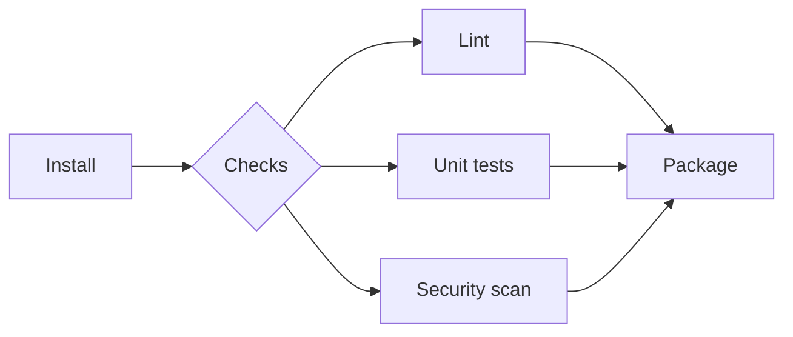

# Stages and Steps

## Introduction

A Jenkins pipeline is made of **stages**, and stages are made of **steps**. Stages are the chapters of your build ("Install", "Test", "Package"); steps are the sentences inside each chapter (`sh 'npm ci'`, `junit 'reports/*.xml'`).

Getting the stage layout right matters more than it seems. Good stages make it obvious *where* a build failed and *how long* each part takes. Bad stages, such as one giant "Build" stage running a 300-line shell script, leave developers scrolling through console logs to find out what went wrong.

This page covers how to structure stages, then tours the steps you will use in nearly every pipeline. The complete list of steps, including those added by plugins, is in the [Pipeline Steps Reference](https://www.jenkins.io/doc/pipeline/steps/).

## Stages

### A basic stage

```groovy
pipeline {
    agent any
    stages {
        stage('Install') {
            steps {
                sh 'echo installing dependencies'
            }
        }
        stage('Test') {
            steps {
                sh 'echo running tests'
            }
        }
    }
}
```

Stage names appear in the UI, in logs and in notifications, so make them short and descriptive. Avoid special characters and keep names unique within a pipeline.

### What a stage can contain

In Declarative syntax, a `stage` must contain **exactly one** of:

- `steps`: a list of steps, which is the common case;
- `stages`: nested sequential stages;
- `parallel`: stages that run at the same time;
- `matrix`: a grid of combinations (see [Matrix Builds](../4-jenkins-pipeline-advanced/1-jenkins-matrix-builds.mdx)).

It can also carry stage-level directives: `agent`, `environment`, `options`, `when`, `input`, `tools` and `post`.

### Sequential nested stages

Nested stages let you group related work and apply one agent or `when` to the whole group:

```groovy
pipeline {
    agent none
    stages {
        stage('Backend') {
            agent { docker { image 'eclipse-temurin:21-jdk' } }
            stages {
                stage('Compile') {
                    steps {
                        sh 'java -version'
                    }
                }
                stage('Unit tests') {
                    steps {
                        sh 'echo running unit tests'
                    }
                }
            }
        }
    }
}
```

The `Compile` and `Unit tests` stages share the same container and workspace, because the agent is declared on the parent stage.

### Parallel stages

Independent work can run concurrently:

```groovy
stage('Checks') {
    parallel {
        stage('Lint') {
            steps { sh 'echo linting' }
        }
        stage('Unit tests') {
            steps { sh 'echo testing' }
        }
        stage('Security scan') {
            steps { sh 'echo scanning' }
        }
    }
}
```



The total time of `Checks` becomes the time of the slowest branch instead of the sum. Details, including `failFast`, are in [Parallel Stages](../4-jenkins-pipeline-advanced/0-jenkins-parallel-stages.mdx).

### How big should a stage be?

| Guideline | Why |
| --- | --- |
| One stage per **phase a human cares about** (install, lint, test, build, deploy) | The stage view answers "where did it fail?" at a glance |
| Avoid stages that last only a second or two | Too many tiny stages clutter the view and add overhead |
| Split a long stage if it has distinct failure reasons | "Unit tests" and "Integration tests" fail for different reasons and owners |
| Keep stage names stable over time | Stage-duration trends and dashboards depend on them |

## Steps

Steps are the actions. In Declarative they live inside `steps`; in Scripted they can appear anywhere inside `node`.

### Running commands: sh, bat and powershell

`sh` runs a shell script on Unix-like agents, `bat` runs a Windows batch script, and `powershell` (or `pwsh` for PowerShell 7+) runs PowerShell.

```groovy
steps {
    sh 'echo single line'

    sh '''
        echo "multi-line script"
        uname -s
        ls -1 | head -3
    '''

    sh label: 'Print Java version', script: 'java -version'
}
```

Example output:

```text
[Pipeline] sh
+ echo single line
single line
[Pipeline] sh
+ echo multi-line script
multi-line script
+ uname -s
Linux
+ ls -1
+ head -3
Jenkinsfile
README.md
src
[Pipeline] sh (Print Java version)
+ java -version
openjdk version "21.0.4" 2024-07-16 LTS
```

Things to know about `sh`:

- By default Jenkins runs the script with `-x` (echo each command, the `+` lines) and `-e` (stop at the first failing command). A non-zero exit code fails the step.
- `-e` does not catch failures in the middle of a pipe such as `cmd | tee log.txt`. Add `set -o pipefail` at the top if your agent's shell is bash, or use a `#!/bin/bash` shebang as the first line.
- Each `sh` call starts a fresh shell. `cd` and exported variables do not carry over to the next `sh`. Use `dir` or `withEnv` instead, or put related commands in one multi-line script.
- `label` changes how the step is shown in the UI, which helps when a pipeline has many `sh` steps.

### Getting values back from a command

```groovy
steps {
    script {
        def version = sh(script: 'cat VERSION 2>/dev/null || echo 0.0.0', returnStdout: true).trim()
        def gitClean = sh(script: 'git diff --quiet', returnStatus: true) == 0
        echo "Version ${version}, clean tree: ${gitClean}"
    }
}
```

Example output:

```text
[Pipeline] sh
+ cat VERSION
[Pipeline] sh
+ git diff --quiet
[Pipeline] echo
Version 2.4.1, clean tree: true
```

`returnStdout` and `returnStatus` need a `script` block in Declarative, because they assign to a variable.

### Working with directories and files

```groovy
steps {
    dir('frontend') {                    // run nested steps in a subdirectory
        sh 'pwd'
    }
    writeFile file: 'build-info.txt', text: "build=${env.BUILD_NUMBER}\n"
    script {
        if (fileExists('build-info.txt')) {
            def content = readFile('build-info.txt').trim()
            echo "File says: ${content}"
        }
    }
    deleteDir()                          // delete the current directory (the workspace here)
}
```

Example output:

```text
[Pipeline] dir
Running in /home/jenkins/workspace/demo/frontend
[Pipeline] {
[Pipeline] sh
+ pwd
/home/jenkins/workspace/demo/frontend
[Pipeline] }
[Pipeline] writeFile
[Pipeline] fileExists
[Pipeline] readFile
[Pipeline] echo
File says: build=17
[Pipeline] deleteDir
```

`dir` creates the directory if it does not exist. `deleteDir` deletes the directory you are in, so be careful where you call it. Many teams use `cleanWs()` from the **Workspace Cleanup** plugin (`ws-cleanup`) in a `post { cleanup { ... } }` block instead.

### Recording results: archiveArtifacts and junit

```groovy
steps {
    sh 'mkdir -p dist && echo "binary" > dist/app.bin'
    archiveArtifacts artifacts: 'dist/**', fingerprint: true
}
post {
    always {
        junit allowEmptyResults: true, testResults: 'reports/**/*.xml'
    }
}
```

- `archiveArtifacts` copies files from the workspace to the controller so they can be downloaded from the build page. Keep artifacts small; use an artifact repository for big binaries ([Build History and Artifacts](../2-jenkins-jobs/4-jenkins-build-history-and-artifacts.mdx)).
- `junit` (from the **JUnit** plugin) parses JUnit-format XML, shows test trends, and marks the build **UNSTABLE** when tests fail. See [Test Reports with JUnit](../9-jenkins-build-and-test/4-jenkins-test-reports.mdx).

### Controlling the result: error, unstable and catchError

```groovy
steps {
    script {
        def coverage = 72
        if (coverage < 60) {
            error "Coverage ${coverage}% is below 60%"        // fails the build
        } else if (coverage < 80) {
            unstable "Coverage ${coverage}% is below target 80%" // marks UNSTABLE, continues
        }
    }
    catchError(buildResult: 'SUCCESS', stageResult: 'FAILURE') {
        sh 'exit 1'   // optional check: stage shows red, build stays green
    }
}
```

Example output:

```text
[Pipeline] unstable
WARNING: Coverage 72% is below target 80%
[Pipeline] catchError
[Pipeline] {
[Pipeline] sh
+ exit 1
[Pipeline] }
ERROR: script returned exit code 1
[Pipeline] // catchError
```

Build results in Jenkins, from best to worst: **SUCCESS**, **UNSTABLE**, **FAILURE**, plus **ABORTED** for cancelled builds and **NOT_BUILT** for skipped work. A result can only get worse during a run, never better.

### Waiting and wrapping: timeout, retry, sleep

```groovy
steps {
    timeout(time: 5, unit: 'MINUTES') {
        retry(3) {
            sh './scripts/flaky-download.sh'
        }
    }
    sleep time: 10, unit: 'SECONDS'
}
```

`timeout` aborts the block if it runs too long, and `retry` re-runs it on failure. Combining them as above means "try up to three times, but give up after five minutes total". More in [Timeouts, Retries and Error Handling](../4-jenkins-pipeline-advanced/3-jenkins-timeouts-and-retries.mdx).

### Quick reference

| Step | Purpose | Provided by |
| --- | --- | --- |
| `sh`, `bat`, `powershell`, `pwsh` | Run commands | Pipeline: Nodes and Processes |
| `echo` | Print a message | Pipeline: Basic Steps |
| `dir`, `deleteDir`, `writeFile`, `readFile`, `fileExists` | Files and directories | Pipeline: Basic Steps |
| `error`, `unstable`, `catchError`, `warnError` | Control the result | Pipeline: Basic Steps |
| `timeout`, `retry`, `sleep`, `waitUntil` | Timing and retries | Pipeline: Basic Steps |
| `archiveArtifacts`, `stash`, `unstash` | Keep or move files | Core / Pipeline plugins |
| `junit` | Test reports | JUnit plugin |
| `checkout`, `git` | Source control | Pipeline: SCM Step, Git plugin |
| `withCredentials` | Bind secrets | Credentials Binding plugin |
| `readJSON`, `readYaml`, `zip` | Structured files | Pipeline Utility Steps plugin |

The [Snippet Generator](./9-jenkins-pipeline-syntax-generator.mdx) on your own controller lists exactly the steps your installed plugins provide.

## Real-World Scenario

Your team builds a Node.js web app. The current pipeline has one stage, `Build`, that runs `./ci.sh`, a 200-line script that installs, lints, tests, builds and uploads. When it fails, developers must read the whole log to learn whether it was a lint error, a failing test, or a network problem during upload. Nobody knows which part is slow.

**Solution:** split the script into stages that match the phases developers care about, keep each stage's command in the repository, and record test results.

```groovy
pipeline {
    agent { docker { image 'node:22-alpine' } }

    options {
        timeout(time: 20, unit: 'MINUTES')
    }

    stages {
        stage('Install') {
            steps {
                sh 'npm ci'
            }
        }
        stage('Quality checks') {
            parallel {
                stage('Lint') {
                    steps { sh 'npm run lint' }
                }
                stage('Unit tests') {
                    steps { sh 'npm test -- --reporters=default --reporters=jest-junit' }
                    post {
                        always { junit allowEmptyResults: true, testResults: 'junit.xml' }
                    }
                }
            }
        }
        stage('Build') {
            steps {
                sh 'npm run build'
                archiveArtifacts artifacts: 'dist/**', fingerprint: true
            }
        }
    }
}
```

The test command assumes a Jest setup with the `jest-junit` reporter installed; adapt it to your test runner ([Building Node.js Projects](../9-jenkins-build-and-test/1-jenkins-node-builds.mdx)).

Now the stage view shows that `Install` takes 40 seconds, `Lint` 10 seconds, `Unit tests` 2 minutes, and `Build` 1 minute, and a red box points straight at the failing phase.

**Why this approach:** stages map to failure reasons and owners; parallel checks cut wall-clock time; test reports give per-test history.

**When not to split further:** a ten-second step does not need its own stage. Over-splitting makes the view noisy and adds small per-stage overhead.

| Approach | Pros | Cons | Best for |
| --- | --- | --- | --- |
| One stage calling a big script | Script runs the same locally and in CI | Poor visibility in Jenkins | Very small projects |
| One stage per phase | Clear failures and timings | Slightly longer Jenkinsfile | Most projects |
| Phases plus parallel checks | Faster feedback | Needs enough executors | Projects with several independent checks |
| Very fine-grained stages | Maximum detail | Noisy UI, overhead | Rarely worth it |

## Common Mistakes

1. **Expecting `cd` to persist.** Each `sh` is a new shell. Use `dir('path')`.
2. **Hiding failures in pipes.** `npm test | tee out.log` returns the exit code of `tee`. Use `set -o pipefail` with bash, or let Jenkins capture the log.
3. **Calling `deleteDir()` in the wrong place.** Inside `dir`, it deletes that subdirectory; at the top level, the whole workspace.
4. **Archiving huge artifacts.** They fill the controller's disk. Push large binaries to an artifact repository.
5. **Duplicate stage names.** They confuse visualizations and restart-from-stage.

## Summary

- Stages are human-facing phases; steps are the actions inside them.
- A Declarative stage contains `steps`, nested `stages`, `parallel` or `matrix`, plus optional directives.
- `sh` runs with `-xe`; each call is a new shell; use `returnStdout` and `returnStatus` to capture results.
- Use `dir`, `writeFile`, `readFile` and `fileExists` for files; `archiveArtifacts` and `junit` to record results.
- `error`, `unstable` and `catchError` control the build result explicitly.

## Exercises

1. Turn a single-stage pipeline of yours into three stages and compare the stage view before and after.
2. Write a stage that uses `returnStdout` to read a version from a file and fails with `error` if it is empty.
3. Create a `parallel` block with two branches that each sleep a different number of seconds, and check the total duration.
4. Use `catchError` so an optional check marks its stage red while the build stays green.

Next, learn how to pass configuration into those steps in [Environment Variables](./6-jenkins-environment-variables.mdx).
