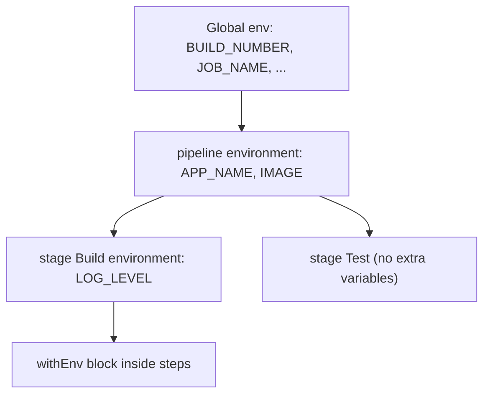

# Environment Variables

## Introduction

Environment variables are how a Jenkins pipeline passes information to the tools it runs. Your Maven build, your deploy script and your Docker commands all read settings from the environment, and Jenkins itself publishes useful facts there: the build number, the branch name, the workspace path.

Think of environment variables as the labels on a parcel moving through a warehouse. Jenkins puts some labels on automatically (build number, job name), you add your own (target environment, image tag), and each station along the conveyor belt, each step, reads the labels it needs.

This page covers three kinds of variables:

1. **Built-in variables** that Jenkins and plugins set for every build.
2. **Your own variables**, set with the `environment` directive or `withEnv`.
3. **Secret variables** bound from Jenkins credentials.

## Built-in Variables

Jenkins exposes built-in variables through the global `env` object. Some useful ones:

| Variable | Example value | Notes |
| --- | --- | --- |
| `BUILD_NUMBER` | `42` | Increments per job |
| `BUILD_ID` | `42` | Same as `BUILD_NUMBER` in modern Jenkins |
| `BUILD_TAG` | `jenkins-billing-api-42` | Handy unique string for labels and file names |
| `BUILD_URL` | `https://jenkins.example.com/job/billing-api/42/` | Link for notifications |
| `JOB_NAME` | `team-a/billing-api/main` | Includes folders and branch for multibranch jobs |
| `JOB_BASE_NAME` | `main` | Last part of the job name |
| `JENKINS_URL` | `https://jenkins.example.com/` | Root URL from System Configuration |
| `WORKSPACE` | `/home/jenkins/workspace/billing-api_main` | Only inside an agent or `node` |
| `NODE_NAME` | `linux-agent-1` | `built-in` when on the controller |
| `EXECUTOR_NUMBER` | `0` | Executor slot on that node |
| `BRANCH_NAME` | `main`, `PR-17` | Multibranch jobs only |
| `CHANGE_ID`, `CHANGE_TARGET`, `CHANGE_AUTHOR` | `17`, `main`, `alice` | Pull request builds only |
| `TAG_NAME` | `v1.4.0` | When building a tag in a multibranch job |
| `GIT_COMMIT`, `GIT_BRANCH` | `4f2c9d1...`, `origin/main` | Set by the Git plugin after checkout |

The exact list depends on your plugins and job type. Your controller documents it at `/pipeline-syntax/globals#env` (for example `https://jenkins.example.com/pipeline-syntax/globals#env`), and the generic list at `/env-vars.html`.

### Reading variables

```groovy
pipeline {
    agent any
    stages {
        stage('Info') {
            steps {
                echo "Job ${env.JOB_NAME}, build #${env.BUILD_NUMBER}"
                echo "Short form works too: ${BUILD_NUMBER}"
                sh 'echo "Shell sees build $BUILD_NUMBER in $WORKSPACE"'
            }
        }
    }
}
```

Example output:

```text
[Pipeline] echo
Job billing-api, build #42
[Pipeline] echo
Short form works too: 42
[Pipeline] sh
+ echo 'Shell sees build 42 in /home/jenkins/workspace/billing-api'
Shell sees build 42 in /home/jenkins/workspace/billing-api
```

In Groovy, `env.BUILD_NUMBER` is the explicit form. In the shell, the variable is a normal environment variable. Prefer `env.X` in Groovy for clarity, especially inside shared libraries.

## The environment Directive

Use `environment` to define your own variables. At the top level they apply to every stage; inside a stage they apply only there.

```groovy
pipeline {
    agent any

    environment {
        APP_NAME    = 'billing-api'
        REGISTRY    = 'registry.example.com'
        IMAGE       = "${REGISTRY}/${APP_NAME}"
    }

    stages {
        stage('Build') {
            environment {
                LOG_LEVEL = 'debug'
            }
            steps {
                sh 'echo "Building $IMAGE with LOG_LEVEL=$LOG_LEVEL"'
            }
        }
        stage('Test') {
            steps {
                sh 'echo "LOG_LEVEL in Test: ${LOG_LEVEL:-not set}"'
            }
        }
    }
}
```

Example output:

```text
[Pipeline] { (Build)
+ echo 'Building registry.example.com/billing-api with LOG_LEVEL=debug'
Building registry.example.com/billing-api with LOG_LEVEL=debug
[Pipeline] { (Test)
+ echo 'LOG_LEVEL in Test: not set'
LOG_LEVEL in Test: not set
```

Notes:

- Variables can refer to earlier ones, like `IMAGE` above. Use double quotes when you want Groovy interpolation.
- All environment variables are **strings**. A value of `'false'` is a non-empty string, which Groovy treats as true in an `if`. Compare explicitly: `if (env.DRY_RUN == 'true')`.



Inner scopes see everything from outer scopes, and can add or override values for their own duration.

### Values computed from commands

You can compute a variable from a shell command:

```groovy
pipeline {
    agent any
    environment {
        GIT_SHORT = sh(script: 'git rev-parse --short HEAD', returnStdout: true).trim()
    }
    stages {
        stage('Tag') {
            steps {
                echo "Image tag will be ${env.GIT_SHORT}"
            }
        }
    }
}
```

Example output:

```text
[Pipeline] sh
+ git rev-parse --short HEAD
[Pipeline] echo
Image tag will be 4f2c9d1
```

This needs a top-level `agent` (not `agent none`), because the command must run somewhere with a workspace. Remember the `.trim()` to remove the trailing newline.

## Setting Variables at Run Time

Sometimes a value is only known in the middle of a run. You have two options.

**Option 1: assign to `env` in a `script` block.** The value is visible to all later stages:

```groovy
stage('Compute') {
    steps {
        script {
            env.RELEASE_CHANNEL = (env.BRANCH_NAME == 'main') ? 'stable' : 'preview'
        }
    }
}
stage('Use') {
    steps {
        sh 'echo "Channel: $RELEASE_CHANNEL"'
    }
}
```

**Option 2: `withEnv` for a block.** The value exists only inside the block:

```groovy
steps {
    withEnv(['NODE_ENV=production', 'PATH+NODE=/opt/node/bin']) {
        sh 'echo "$NODE_ENV"; which node || true'
    }
}
```

The special `PATH+SOMETHING=value` syntax **prepends** `value` to `PATH` instead of replacing it. Use it to add tool directories safely.

:::warning
A variable declared in the `environment` directive cannot be changed later with `env.NAME = 'new value'` in a `script` block. The assignment is silently ignored. If you need to change a value mid-run, either don't declare it in `environment` and set it with `env.NAME = ...`, or override it for a block with `withEnv`.
:::

## Credentials as Environment Variables

Never hard-code passwords or tokens in a Jenkinsfile. Store them in Jenkins credentials ([Credentials Management](../11-jenkins-security/3-jenkins-credentials.mdx)) and bind them at run time.

### The credentials() helper

Inside `environment`, `credentials('id')` binds a credential. What you get depends on the credential type:

| Credential type | What `VAR = credentials('id')` gives you |
| --- | --- |
| Secret text | `VAR` holds the secret |
| Username with password | `VAR` holds `username:password`, plus `VAR_USR` and `VAR_PSW` |
| Secret file | `VAR` holds the path to a temporary file with the content |
| SSH username with private key | `VAR` holds the path to a temporary key file, plus `VAR_USR` (and `VAR_PSW` for the passphrase) |

```groovy
pipeline {
    agent any
    environment {
        REGISTRY_CREDS = credentials('registry-login')   // username/password
    }
    stages {
        stage('Login') {
            steps {
                sh 'echo "$REGISTRY_CREDS_PSW" | docker login registry.example.com -u "$REGISTRY_CREDS_USR" --password-stdin'
            }
        }
    }
}
```

Example output:

```text
[Pipeline] sh
+ echo ****
+ docker login registry.example.com -u ci-bot --password-stdin
Login Succeeded
```

Jenkins masks bound secrets in the console log with `****`. Usernames are shown in clear text unless the credential is configured to treat the username as a secret. Masking is a safety net, not a guarantee: a script that transforms the secret (for example base64-encodes it) can still leak it.

### withCredentials

For narrower scope or other credential types, use the `withCredentials` step from the **Credentials Binding** plugin (`credentials-binding`):

```groovy
steps {
    withCredentials([
        usernamePassword(credentialsId: 'registry-login',
                         usernameVariable: 'REG_USER',
                         passwordVariable: 'REG_PASS'),
        string(credentialsId: 'slack-webhook', variable: 'SLACK_URL')
    ]) {
        sh 'echo "$REG_PASS" | docker login registry.example.com -u "$REG_USER" --password-stdin'
    }
}
```

The variables exist only inside the block, which limits exposure. Always reference secrets in **single-quoted** shell strings so the shell, not Groovy, expands them (see [The Jenkinsfile](./1-jenkins-jenkinsfile.mdx#quoting-and-security)).

## Parameters vs Environment Variables

Build parameters are available through `params`:

```groovy
parameters {
    booleanParam(name: 'DRY_RUN', defaultValue: true, description: 'Skip real deploy')
}
```

- `params.DRY_RUN` is a real Boolean in Groovy.
- Jenkins also exposes parameters as environment variables, but there they are **strings** (`env.DRY_RUN == 'true'`).

Prefer `params.NAME` in Groovy and `$NAME` in shell scripts.

## Real-World Scenario

Your team builds a Docker image for an order-processing service and pushes it to a private registry. Images must be tagged with the build number and short commit hash so any running container can be traced back to its build. Feature branches should push to a `dev` repository path, `main` to `release`.

```groovy
pipeline {
    agent { label 'docker' }

    environment {
        REGISTRY   = 'registry.example.com'
        APP        = 'order-service'
        GIT_SHORT  = sh(script: 'git rev-parse --short HEAD', returnStdout: true).trim()
        IMAGE_TAG  = "${BUILD_NUMBER}-${GIT_SHORT}"
    }

    stages {
        stage('Choose repository') {
            steps {
                script {
                    env.REPO_PATH = (env.BRANCH_NAME == 'main') ? 'release' : 'dev'
                }
                echo "Will push ${REGISTRY}/${env.REPO_PATH}/${APP}:${IMAGE_TAG}"
            }
        }
        stage('Build image') {
            steps {
                sh 'docker build -t "$REGISTRY/$REPO_PATH/$APP:$IMAGE_TAG" .'
            }
        }
        stage('Push image') {
            steps {
                withCredentials([usernamePassword(credentialsId: 'registry-login',
                                                  usernameVariable: 'REG_USER',
                                                  passwordVariable: 'REG_PASS')]) {
                    sh '''
                        echo "$REG_PASS" | docker login "$REGISTRY" -u "$REG_USER" --password-stdin
                        docker push "$REGISTRY/$REPO_PATH/$APP:$IMAGE_TAG"
                        docker logout "$REGISTRY"
                    '''
                }
            }
        }
    }
}
```

Example output (on `main`):

```text
[Pipeline] echo
Will push registry.example.com/release/order-service:57-4f2c9d1
[Pipeline] { (Build image)
+ docker build -t registry.example.com/release/order-service:57-4f2c9d1 .
...
[Pipeline] { (Push image)
+ echo ****
+ docker login registry.example.com -u ci-bot --password-stdin
Login Succeeded
+ docker push registry.example.com/release/order-service:57-4f2c9d1
```

**Why this approach:** constant settings live in `environment` where everyone can see them; the run-time decision (`REPO_PATH`) is a plain `env` assignment, because it is not declared in `environment`; the secret is scoped to the one stage that needs it with `withCredentials`, and shell commands use single quotes. Image building is covered more fully in [Building and Pushing Docker Images](../9-jenkins-build-and-test/7-jenkins-docker-image-builds.mdx).

| Approach | Pros | Cons | Best for |
| --- | --- | --- | --- |
| `environment` directive | Visible, declarative, pipeline or stage scope | Values fixed once set | Constants and computed-once values |
| `env.X = ...` in `script` | Can be set anywhere, visible to later stages | Imperative; can't override `environment` values | Values decided mid-run |
| `withEnv` | Tight scope, can override | Only within the block | Temporary overrides, `PATH` additions |
| `credentials()` in `environment` | Short syntax | Secret available for the whole scope | Secrets used throughout a stage |
| `withCredentials` | Narrowest scope, more credential types | More verbose | Secrets used by one or two commands |

## Common Mistakes

1. **Treating `'false'` as false.** Environment variables are strings. Use `params` for Booleans or compare to `'true'`.
2. **Overriding an `environment` value with `env.X =`.** It does not take effect. Use `withEnv` or don't declare it in `environment`.
3. **Interpolating secrets with double quotes.** `sh "docker login -p ${PASS}"` exposes the secret. Use single quotes.
4. **Relying on `BRANCH_NAME` in a plain Pipeline job.** It is only set in multibranch jobs. Use `GIT_BRANCH` or a parameter otherwise.
5. **Forgetting `.trim()`** on `returnStdout` values, which leaves a newline in your tag or path.

## Summary

- Built-in variables like `BUILD_NUMBER`, `JOB_NAME`, `WORKSPACE` and `BRANCH_NAME` are available through `env`.
- Use the `environment` directive for pipeline- or stage-scoped variables, `env.X = ...` for run-time values, and `withEnv` for block-scoped overrides.
- `credentials()` and `withCredentials` bind secrets; Jenkins masks them in logs, but you should still use single quotes.
- All environment values are strings; `params` keeps real types.

## Exercises

1. Print `JOB_NAME`, `BUILD_TAG` and `NODE_NAME` in a pipeline and compare the values with the job URL.
2. Define `GREETING` in `environment`, then try to change it with `env.GREETING = 'bye'` in a later stage. Print it before and after. Then do the same with `withEnv`.
3. Create a "Secret text" credential with a dummy value and print it with `echo` in a single-quoted `sh` step. Observe the masking.
4. Add a `booleanParam` and compare `params.X` with `env.X` in an `if`.

Next, learn how to react to build results in [Post Conditions](./7-jenkins-post-conditions.mdx).
