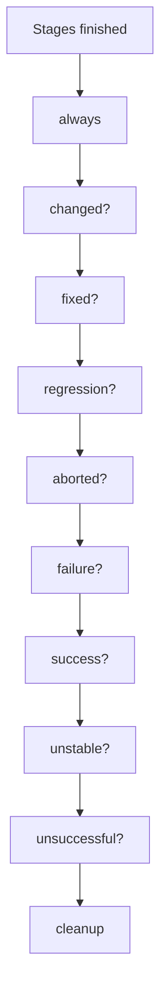

# Post Conditions

## Introduction

Some things must happen at the end of a build no matter what: publish test results, clean the workspace, tell the team. Other things should only happen in specific situations: notify on failure, celebrate when a broken build is fixed, archive artifacts only on success.

In Declarative pipelines, the `post` section handles all of this. It runs **after** the pipeline or a stage finishes, and each block inside it is tied to a **condition** based on the build result.

An analogy: `post` is the checklist a pilot runs after landing. Some items are always done (shut down engines, log the flight); others depend on what happened (file an incident report only if something went wrong).

## The Basic Shape

```groovy
pipeline {
    agent any
    stages {
        stage('Test') {
            steps {
                sh 'echo running tests'
            }
        }
    }
    post {
        always {
            echo 'This runs no matter what'
        }
        success {
            echo 'Build succeeded'
        }
        failure {
            echo 'Build failed'
        }
    }
}
```

Example output:

```text
[Pipeline] { (Test)
+ echo running tests
running tests
[Pipeline] }
[Pipeline] stage
[Pipeline] { (Declarative: Post Actions)
[Pipeline] echo
This runs no matter what
[Pipeline] echo
Build succeeded
[Pipeline] }
Finished: SUCCESS
```

## All Post Conditions

Jenkins evaluates the conditions in this fixed order, regardless of how you order them in the file:

| Order | Condition | Runs when |
| --- | --- | --- |
| 1 | `always` | Always |
| 2 | `changed` | The result differs from the previous completed build |
| 3 | `fixed` | This build succeeded and the previous one failed or was unstable |
| 4 | `regression` | This build failed, was unstable or aborted, and the previous one succeeded |
| 5 | `aborted` | The build was aborted, usually by a user or a timeout |
| 6 | `failure` | The build or stage failed |
| 7 | `success` | The build or stage succeeded |
| 8 | `unstable` | The result is UNSTABLE, typically from test failures or quality gates |
| 9 | `unsuccessful` | The result is anything except SUCCESS |
| 10 | `cleanup` | Always, **after** every other condition has run |



`changed`, `fixed` and `regression` compare with the **previous** build, so they are what you want for "only tell me when something changes" notifications.

## Pipeline-Level vs Stage-Level post

`post` can appear at the end of the `pipeline` block and inside any `stage`.

```groovy
pipeline {
    agent any
    stages {
        stage('Unit tests') {
            steps {
                sh 'mkdir -p reports && echo "<testsuite tests=\\"1\\"><testcase name=\\"t1\\"/></testsuite>" > reports/unit.xml'
            }
            post {
                always {
                    junit 'reports/unit.xml'          // stage-level: publish this stage's results
                }
            }
        }
        stage('Package') {
            steps {
                sh 'mkdir -p dist && echo app > dist/app.txt'
            }
        }
    }
    post {
        success {
            archiveArtifacts artifacts: 'dist/**'     // pipeline-level: only for a good build
        }
        cleanup {
            cleanWs()                                 // pipeline-level: always last
        }
    }
}
```

Example output (abridged):

```text
[Pipeline] { (Unit tests)
+ mkdir -p reports
+ echo '<testsuite tests="1"><testcase name="t1"/></testsuite>'
Post stage
[Pipeline] junit
Recording test results
[Checks API] No suitable checks publisher found.
[Pipeline] { (Package)
...
[Pipeline] { (Declarative: Post Actions)
[Pipeline] archiveArtifacts
Archiving artifacts
[Pipeline] cleanWs
[WS-CLEANUP] Deleting project workspace...
[WS-CLEANUP] done
Finished: SUCCESS
```

Guidelines:

- **Stage-level `post`** is for things that belong to that stage, such as publishing its test report or stopping a test database it started.
- **Pipeline-level `post`** is for the overall outcome, such as notifications, archiving release artifacts and workspace cleanup.
- At stage level, `success` and `failure` refer to the **stage's** result.

`cleanWs()` comes from the **Workspace Cleanup** plugin (`ws-cleanup`). If you don't have it, `deleteDir()` is a built-in alternative.

## Reading the Result Inside post

The `currentBuild` global variable gives details about the run:

```groovy
post {
    always {
        script {
            echo "Result: ${currentBuild.currentResult}"
            echo "Duration: ${currentBuild.durationString}"
            def prev = currentBuild.previousBuild
            echo "Previous result: ${prev ? prev.result : 'none'}"
        }
    }
}
```

Example output:

```text
[Pipeline] echo
Result: SUCCESS
[Pipeline] echo
Duration: 12 sec and counting
[Pipeline] echo
Previous result: FAILURE
```

Use `currentBuild.currentResult` rather than `currentBuild.result`. The latter is `null` while the build is still considered successful, which is a common source of confusing `if` checks.

## Which Blocks Fire? Worked Examples

It helps to work through a few build histories. Assume a pipeline with every condition defined:

| Previous build | This build | Blocks that run (in order) |
| --- | --- | --- |
| SUCCESS | SUCCESS | `always`, `success`, `cleanup` |
| SUCCESS | FAILURE | `always`, `changed`, `regression`, `failure`, `unsuccessful`, `cleanup` |
| FAILURE | FAILURE | `always`, `failure`, `unsuccessful`, `cleanup` |
| FAILURE | SUCCESS | `always`, `changed`, `fixed`, `success`, `cleanup` |
| SUCCESS | UNSTABLE | `always`, `changed`, `regression`, `unstable`, `unsuccessful`, `cleanup` |
| UNSTABLE | SUCCESS | `always`, `changed`, `fixed`, `success`, `cleanup` |
| SUCCESS | ABORTED | `always`, `changed`, `regression`, `aborted`, `unsuccessful`, `cleanup` |
| (first build) | SUCCESS | `always`, `success`, `cleanup` (no previous build to compare) |

Two patterns stand out: `unsuccessful` is a convenient catch-all for "anything but green", and `changed` fires on every transition in either direction.

## The Scripted Equivalent

Scripted pipelines have no `post`. The same behavior is built with `try` / `catch` / `finally`, which shows how much `post` does for you:

```groovy
node {
    try {
        stage('Test') {
            sh './run-tests.sh'
        }
        currentBuild.result = 'SUCCESS'
    } catch (err) {
        currentBuild.result = 'FAILURE'
        throw err
    } finally {
        def prev = currentBuild.previousBuild?.result
        def now = currentBuild.currentResult
        if (now == 'SUCCESS' && prev != null && prev != 'SUCCESS') {
            echo 'fixed'
        }
        junit allowEmptyResults: true, testResults: 'reports/*.xml'
        deleteDir()
    }
}
```

This is one of the strongest arguments for Declarative, discussed in [Declarative vs Scripted Pipelines](./4-jenkins-declarative-vs-scripted.mdx).

## Notifications from post

Typical notification steps (each needs its plugin and some system configuration):

- `mail`, a basic Pipeline step that sends through the SMTP server configured in **Manage Jenkins → System**;
- `emailext` from the **Email Extension** plugin, for HTML templates;
- `slackSend` from the **Slack Notification** plugin;
- Microsoft Teams via the **Office 365 Connector** plugin or a webhook call with `curl`.

```groovy
post {
    failure {
        mail to: 'team-billing@example.com',
             subject: "FAILED: ${env.JOB_NAME} #${env.BUILD_NUMBER}",
             body: "See ${env.BUILD_URL}console"
    }
    fixed {
        slackSend channel: '#billing-ci', color: 'good',
                  message: "Fixed: ${env.JOB_NAME} #${env.BUILD_NUMBER} (${env.BUILD_URL})"
    }
}
```

Setting up these integrations is covered in [Notifications: Email, Slack and Teams](../12-jenkins-administration/6-jenkins-notifications.mdx).

## What Happens If post Itself Fails?

Steps in `post` can fail too, for example when the mail server is down. A failing `post` step marks the build as failed. Two habits help:

1. Put **non-essential** steps such as notifications inside `catchError` so a broken mail server does not turn a green build red:

```groovy
post {
    always {
        catchError(buildResult: null, stageResult: null) {
            mail to: 'team@example.com', subject: "Build ${currentBuild.currentResult}", body: env.BUILD_URL
        }
    }
}
```

2. Use `junit` with `allowEmptyResults: true` in `always` blocks, so a build that failed **before** tests ran does not get a second, misleading error about missing test reports.

## Real-World Scenario

Your team's #ci channel receives a message for every build of 25 repositories, roughly 400 messages a day. People have muted the channel, so real breakages go unnoticed for hours.

**Goal:** notify only when something **changes**, notify the right people, and still publish reports and clean up on every build.

```groovy
pipeline {
    agent { label 'linux' }

    stages {
        stage('Build') {
            steps {
                sh './gradlew assemble'
            }
        }
        stage('Test') {
            steps {
                sh './gradlew test'
            }
            post {
                always {
                    junit allowEmptyResults: true, testResults: 'build/test-results/test/*.xml'
                }
            }
        }
    }

    post {
        regression {
            slackSend channel: '#billing-ci', color: 'danger',
                      message: "Broken: ${env.JOB_NAME} #${env.BUILD_NUMBER} (${env.BUILD_URL})"
        }
        fixed {
            slackSend channel: '#billing-ci', color: 'good',
                      message: "Back to green: ${env.JOB_NAME} #${env.BUILD_NUMBER}"
        }
        failure {
            script {
                if (env.BRANCH_NAME == 'main') {
                    mail to: 'billing-oncall@example.com',
                         subject: "main is failing: ${env.JOB_NAME} #${env.BUILD_NUMBER}",
                         body: "${env.BUILD_URL}console"
                }
            }
        }
        cleanup {
            cleanWs()
        }
    }
}
```

Now the channel only hears about transitions (green to red, red to green), on-call gets email for every failing `main` build, and every build still publishes test results and cleans up.

**Why this approach:** `regression` and `fixed` cut noise without losing information. Each build still records its state in Jenkins; only notifications change.

**When not to use it:** for a release or deployment pipeline, people often want a message for **every** run, success included, as an audit trail. Use `always` there.

| Approach | Pros | Cons | Best for |
| --- | --- | --- | --- |
| Notify in `always` | Complete record | Very noisy | Release and deploy pipelines |
| Notify in `failure` | Every failure seen | Repeated alerts while broken | Small teams, few builds |
| Notify in `regression` and `fixed` | Low noise, clear transitions | A second failure for a different reason is not announced | Busy CI channels |
| No pipeline notifications, use SCM status checks | Feedback in the pull request | Nothing for post-merge breakages | PR-driven workflows, see [Pull Request Builds](../5-jenkins-scm-integration/4-jenkins-pull-request-builds.mdx) |

## Common Mistakes

1. **Assuming `post` order follows your file.** It is fixed: `always` first, `cleanup` last.
2. **Cleaning the workspace in `always`.** If another `post` block (such as `success` archiving artifacts) runs after `always`, the files are gone. Put cleanup in `cleanup`.
3. **Checking `currentBuild.result == 'SUCCESS'`.** It may be `null`. Use `currentBuild.currentResult`.
4. **Letting notifications fail the build.** Wrap them in `catchError`.
5. **Publishing test reports only in `success`.** Test reports matter most when the build fails; use `always`.

## Summary

- `post` runs after a pipeline or stage, with conditions based on the result.
- Order: `always`, `changed`, `fixed`, `regression`, `aborted`, `failure`, `success`, `unstable`, `unsuccessful`, `cleanup`.
- Use stage-level `post` for stage resources and reports, pipeline-level `post` for overall outcomes.
- `fixed` and `regression` make low-noise notifications easy.
- Put workspace cleanup in `cleanup`, and protect builds from failing notifications with `catchError`.

## Exercises

1. Write a pipeline with every post condition, each printing its name. Run it once successfully, then make it fail, then make it succeed again. Note which blocks ran each time.
2. Make a stage call `unstable 'flaky'` and see which conditions fire.
3. Abort a running build that sleeps for 60 seconds and check that `aborted` runs.
4. Move a `cleanWs()` call from `always` to `cleanup` in a pipeline that archives artifacts on success, and explain the difference.

Next: run stages only when they should run, in [Conditional Stages with when](./8-jenkins-when-conditions.mdx).
