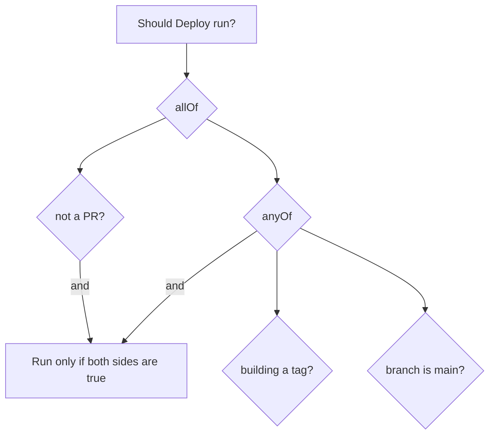

# Conditional Stages with when

## Introduction

Not every stage should run on every build. You probably want to deploy only from `main`, publish a release only for a version tag, run the slow end-to-end suite only for pull requests into `main`, and skip the front-end build when only back-end files changed.

The `when` directive in Declarative pipelines answers "should this stage run?". If the condition is false, the stage is **skipped**, and the UI shows it as skipped (usually a grey box), so readers can see that it was intentionally not run.

Think of `when` as the sign on a door: "Staff only" or "Open on weekdays". The room (stage) always exists in the building plan (pipeline); the sign decides whether you walk in this time.

## A First Example

```groovy
pipeline {
    agent any
    stages {
        stage('Build') {
            steps {
                echo 'Building on every branch'
            }
        }
        stage('Deploy') {
            when {
                branch 'main'
            }
            steps {
                echo 'Deploying from main'
            }
        }
    }
}
```

Example output on a feature branch in a Multibranch job:

```text
[Pipeline] { (Build)
[Pipeline] echo
Building on every branch
[Pipeline] }
[Pipeline] stage
[Pipeline] { (Deploy)
Stage "Deploy" skipped due to when conditional
[Pipeline] }
Finished: SUCCESS
```

:::caution
`branch`, `changeRequest`, `tag` and `buildingTag` rely on information that **Multibranch Pipeline** jobs provide (such as `BRANCH_NAME`, `CHANGE_ID` and `TAG_NAME`). In a plain Pipeline job they never match, so the stage is always skipped. Use `expression` with `GIT_BRANCH` or a parameter there, or switch to a [Multibranch Pipeline](../5-jenkins-scm-integration/1-jenkins-multibranch-pipelines.mdx).
:::

## Built-in Conditions

| Condition | Runs the stage when | Example |
| --- | --- | --- |
| `branch` | The branch name matches a pattern | `branch 'release/*'` |
| `buildingTag` | The build is for any tag | `buildingTag()` |
| `tag` | The tag name matches a pattern | `tag 'v*'` |
| `changeRequest` | The build is for a pull/merge request (optionally filtered) | `changeRequest target: 'main'` |
| `changeset` | Files changed in this build match a pattern | `changeset 'docs/**'` |
| `changelog` | A commit message in this build matches a regex | `changelog '.*\\[deploy\\].*'` |
| `environment` | An environment variable has a given value | `environment name: 'DEPLOY_TO', value: 'prod'` |
| `equals` | Two values are equal | `equals expected: 2, actual: currentBuild.number` |
| `expression` | A Groovy expression returns true | `expression { params.RUN_E2E }` |
| `triggeredBy` | The build was started by a given cause | `triggeredBy 'TimerTrigger'` |
| `not`, `allOf`, `anyOf` | Combine other conditions | `not { branch 'main' }` |

### Branch and tag patterns

`branch`, `tag` and `changeset` use **Ant-style glob** patterns by default (`*`, `**`, `?`). You can switch the comparator:

```groovy
when { branch pattern: 'release-\\d+\\.\\d+', comparator: 'REGEXP' }
when { branch pattern: 'main', comparator: 'EQUALS' }
when { tag pattern: 'v*', comparator: 'GLOB' }
```

Note the double backslashes: inside a Groovy single-quoted string, `\\d` becomes the regex `\d`.

### Pull request builds

```groovy
stage('E2E tests') {
    when {
        changeRequest target: 'main'
    }
    steps {
        sh './run-e2e.sh'
    }
}
```

`changeRequest` alone matches any PR. Filters include `id`, `target`, `branch`, `fork`, `title`, `author`, `authorEmail` and others, with an optional `comparator`. See [Pull Request Builds](../5-jenkins-scm-integration/4-jenkins-pull-request-builds.mdx).

### Changed files

```groovy
stage('Build frontend') {
    when {
        changeset 'frontend/**'
    }
    steps {
        dir('frontend') {
            sh 'npm ci && npm run build'
        }
    }
}
```

`changeset` looks at the changes Jenkins recorded for **this** build, meaning commits since the previous build of the same job. That has surprising edge cases: the **first** build of a new branch has an empty changelog, so the stage is skipped. For pull requests and monorepos, many teams compute the diff against the target branch themselves, as shown in [Building Monorepos](../5-jenkins-scm-integration/6-jenkins-monorepo-builds.mdx). Add `caseSensitive: true` if you need case-sensitive matching.

### Expressions

`expression` takes a closure that returns a Boolean. It is the most flexible condition:

```groovy
parameters {
    booleanParam(name: 'RUN_E2E', defaultValue: false, description: 'Run end-to-end tests')
}
...
stage('E2E') {
    when {
        expression { params.RUN_E2E }
    }
    steps {
        sh './run-e2e.sh'
    }
}
```

```groovy
when {
    expression { return env.GIT_BRANCH == 'origin/main' }
}
```

Keep expressions short. If one needs more than a line or two, move the logic into a shared library function.

### Build causes

```groovy
when { triggeredBy 'TimerTrigger' }                         // nightly cron builds
when { triggeredBy 'SCMTrigger' }                           // polling found changes
when { triggeredBy cause: 'UserIdCause', detail: 'alice' }  // started by user alice
```

`triggeredBy` is useful for running a slow security scan only in the nightly build.

## Combining Conditions

When you list several conditions directly, **all** must be true (an implicit `allOf`):

```groovy
when {
    branch 'main'
    environment name: 'DEPLOY_ENABLED', value: 'true'
}
```

Explicit combinations:

```groovy
when {
    anyOf {
        branch 'main'
        branch 'release/*'
    }
}
```

```groovy
when {
    allOf {
        not { changeRequest() }
        anyOf {
            buildingTag()
            branch 'main'
        }
    }
}
```



## When Is when Evaluated?

By default, a stage's `when` runs **after** Jenkins enters the stage's `agent`, `input` and `options`. That has costs:

- If the stage declares its own `agent`, Jenkins may wait for and allocate an executor (or start a Kubernetes pod) just to discover the stage should be skipped.
- If the stage has `input`, users may be asked to approve something that will then be skipped.

Three flags move the evaluation earlier:

| Flag | Effect |
| --- | --- |
| `beforeAgent true` | Evaluate `when` before allocating the stage's agent |
| `beforeInput true` | Evaluate `when` before the `input` prompt |
| `beforeOptions true` | Evaluate `when` before applying stage `options` such as `timeout` |

If several are set, `beforeOptions` takes precedence over `beforeInput`, which takes precedence over `beforeAgent`.

```groovy
stage('Deploy to production') {
    agent { label 'deployer' }
    when {
        beforeAgent true
        beforeInput true
        tag 'v*'
    }
    input {
        message 'Deploy this release to production?'
        submitter 'release-managers'
    }
    steps {
        sh './deploy.sh production'
    }
}
```

:::tip
Make `beforeAgent true` a habit whenever a stage has its own `agent`. There is rarely a reason to grab an executor for a stage that will be skipped.
:::

## when vs if

You can also skip work with an `if` inside a `script` block. The difference is visibility:

| Aspect | `when` | `if` in `script` |
| --- | --- | --- |
| Stage shown as skipped | Yes | No; the stage runs and does nothing, or is missing in Scripted |
| Restart from stage | Works naturally | Harder to reason about |
| Avoids allocating an agent | Yes, with `beforeAgent` | No; the stage's agent is already allocated |
| Arbitrary logic | Via `expression` | Yes |

Use `when` to decide whether a **stage** runs, and `if` for small decisions **inside** a stage.

## Real-World Scenario

Your team ships a web API with this release flow:

- Every branch and pull request: build and unit tests.
- Pull requests into `main`: also run end-to-end tests.
- `main`: deploy automatically to staging.
- Tags like `v1.4.0`: deploy to production after approval.
- Nightly: run a dependency vulnerability scan.

All of it lives in one `Jenkinsfile` in a Multibranch job:

```groovy
pipeline {
    agent none

    triggers {
        cron(env.BRANCH_NAME == 'main' ? 'H 3 * * *' : '')
    }

    stages {
        stage('Build and unit test') {
            agent { label 'linux' }
            steps {
                sh './ci/build.sh && ./ci/unit-test.sh'
            }
        }
        stage('E2E tests') {
            agent { label 'linux' }
            when {
                beforeAgent true
                changeRequest target: 'main'
            }
            steps {
                sh './ci/e2e.sh'
            }
        }
        stage('Deploy to staging') {
            agent { label 'deployer' }
            when {
                beforeAgent true
                branch 'main'
                not { triggeredBy 'TimerTrigger' }
            }
            steps {
                sh './ci/deploy.sh staging'
            }
        }
        stage('Deploy to production') {
            agent { label 'deployer' }
            when {
                beforeAgent true
                beforeInput true
                tag pattern: 'v\\d+\\.\\d+\\.\\d+', comparator: 'REGEXP'
            }
            input {
                message 'Deploy to production?'
                submitter 'release-managers'
            }
            steps {
                sh './ci/deploy.sh production'
            }
        }
        stage('Nightly vulnerability scan') {
            agent { label 'linux' }
            when {
                beforeAgent true
                triggeredBy 'TimerTrigger'
            }
            steps {
                sh './ci/dependency-scan.sh'
            }
        }
    }
}
```

The `cron` trick enables the nightly trigger only on `main`, so feature branches do not run nightly builds.

**Why this approach:** one file describes the whole flow; every build shows all five stages, with skipped ones greyed out, so anyone can see what happened and why. `beforeAgent` prevents wasted executors.

**When not to use it:** if production deployments need a completely separate permission model or audit trail, a dedicated deployment job (triggered with parameters, possibly in another folder with stricter access) may be better than a stage gated by `when`. See [Environments and Promotion](../10-jenkins-deployment/1-jenkins-environments-and-promotion.mdx).

| Approach | Pros | Cons | Best for |
| --- | --- | --- | --- |
| `when` conditions in one Jenkinsfile | One source of truth, skipped stages visible | File grows with every rule | Most branch-based flows |
| Separate jobs per environment | Separate permissions, simpler pipelines | Duplication, harder to see the full flow | Strict separation of duties |
| `if` inside `script` | Arbitrary logic | Hidden skips, agents still allocated | Small in-stage decisions |
| GitOps (deploy by commit to a config repo) | Deployment state in Git | More moving parts | Kubernetes platforms, see [Jenkins with GitOps and Argo CD](../10-jenkins-deployment/7-jenkins-gitops.mdx) |

## Common Mistakes

1. **Using `branch` in a plain Pipeline job.** It only works in Multibranch jobs.
2. **Forgetting `beforeAgent true`.** Skipped stages still allocate agents or pods.
3. **Trusting `changeset` on the first build of a branch.** The changelog is empty, so the stage is skipped.
4. **Single backslashes in regex patterns.** Use `\\d` inside Groovy strings.
5. **Complex logic in `expression`.** Keep it to a line; move the rest to a library function.
6. **Comparing parameters as strings.** `params.RUN_E2E` is a Boolean; `env.RUN_E2E` is the string `'true'`.

## Summary

- `when` decides whether a Declarative stage runs; skipped stages remain visible.
- Built-in conditions: `branch`, `tag`, `buildingTag`, `changeRequest`, `changeset`, `changelog`, `environment`, `equals`, `expression`, `triggeredBy`, combined with `allOf`, `anyOf`, `not`.
- Branch, tag and PR conditions need Multibranch jobs.
- Use `beforeAgent`, `beforeInput` and `beforeOptions` to evaluate conditions early.
- Use `when` for stage-level decisions and `if` only for small decisions inside a stage.

## Exercises

1. In a Multibranch job, add a stage that runs only on branches matching `feature/*`. Push two branches and compare.
2. Add a `booleanParam` called `SKIP_TESTS` and use `when { not { expression { params.SKIP_TESTS } } }` on the test stage.
3. Create a stage with its own `agent` and a `when` that is always false. Check the log with and without `beforeAgent true`.
4. Use the [Declarative Directive Generator](./9-jenkins-pipeline-syntax-generator.mdx) to build an `anyOf` condition with `branch` and `tag`.

Next, learn the tools that write this syntax for you in [Snippet Generator and Pipeline Syntax Tools](./9-jenkins-pipeline-syntax-generator.mdx).
