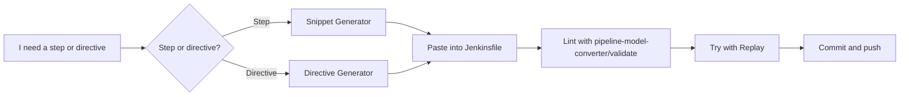

# Snippet Generator and Pipeline Syntax Tools

## Introduction

Jenkins has thousands of plugins, and many of them add their own pipeline steps with their own parameters. Nobody remembers them all. Was it `credentialsId` or `credentialId`? Does `junit` take `testResults` or `testResultsPattern`? Which parameters does `checkout` need for a private Git repository?

You do not have to guess. Every Jenkins controller ships with built-in **Pipeline Syntax** tools that generate correct code for the steps and plugins installed **on that controller**:

- **Snippet Generator**: builds a step call from a form.
- **Declarative Directive Generator**: builds `options`, `when`, `triggers`, `agent` and other directive blocks.
- **Global Variable Reference**: documents `env`, `params`, `currentBuild`, `scm` and variables added by plugins or shared libraries.
- **Steps Reference**: online documentation for every public plugin step.

Add the Declarative **linter** and **Replay** and you have a fast feedback loop: generate, paste, validate, try, commit.

Think of the Snippet Generator as a phrasebook for the Jenkins DSL. You know what you want to say ("check out this repo with these credentials"); it tells you exactly how to say it.

## Where to Find the Tools

Open any Pipeline job and click **Pipeline Syntax** in the left sidebar, or go directly to these URLs on your controller:

| Tool | URL path | Generates |
| --- | --- | --- |
| Snippet Generator | `/pipeline-syntax` | Step calls (`sh`, `checkout`, `withCredentials`, ...) |
| Declarative Directive Generator | `/directive-generator` | Directive blocks (`options`, `when`, `triggers`, ...) |
| Global Variable Reference | `/pipeline-syntax/globals` | Documentation for `env`, `params`, `currentBuild`, ... |
| Online documentation | `https://www.jenkins.io/doc/pipeline/steps/` | Reference for all steps from public plugins |

For example, if your Jenkins runs at `https://jenkins.example.com`, the Snippet Generator is at `https://jenkins.example.com/pipeline-syntax`.



## Using the Snippet Generator

The workflow is always the same:

1. Pick a step from the **Sample Step** dropdown.
2. Fill in the form. The fields and help texts (the `?` icons) come from the plugin itself.
3. Click **Generate Pipeline Script**.
4. Copy the result into your Jenkinsfile.

### Example 1: checking out a private repository

Choose **checkout: Check out from version control**, select **Git**, enter the repository URL, pick a credential and set the branch. The generated code looks like this:

```groovy
checkout scmGit(
    branches: [[name: '*/main']],
    extensions: [],
    userRemoteConfigs: [[credentialsId: 'github-app-creds', url: 'https://github.com/example/billing-api.git']]
)
```

The `scmGit` form is what current versions of the Git plugin generate; older tutorials show the longer `$class: 'GitSCM'` form, which still works. If you only need to check out the repository that contains the Jenkinsfile, you don't need any of this. `checkout scm` (or Declarative's automatic checkout) does it.

### Example 2: binding an SSH key

Choose **withCredentials: Bind credentials to variables**, click **Add** and pick **SSH User Private Key**:

```groovy
withCredentials([sshUserPrivateKey(credentialsId: 'deploy-key',
                                   keyFileVariable: 'SSH_KEY',
                                   usernameVariable: 'SSH_USER')]) {
    // some block
}
```

Fill in the block yourself, using single-quoted shell strings:

```groovy
withCredentials([sshUserPrivateKey(credentialsId: 'deploy-key',
                                   keyFileVariable: 'SSH_KEY',
                                   usernameVariable: 'SSH_USER')]) {
    sh 'ssh -i "$SSH_KEY" -o StrictHostKeyChecking=accept-new "$SSH_USER@app01.example.com" uptime'
}
```

Example output:

```text
[Pipeline] withCredentials
[Pipeline] {
[Pipeline] sh
+ ssh -i **** -o StrictHostKeyChecking=accept-new deploy@app01.example.com uptime
 10:42:17 up 12 days,  3:01,  0 users,  load average: 0.08, 0.05, 0.01
[Pipeline] }
[Pipeline] // withCredentials
```

### Example 3: publishing test results

Choose **junit: Archive JUnit-formatted test results**, enter `build/test-results/**/*.xml`, and tick **Do not fail the build on empty test results**:

```groovy
junit allowEmptyResults: true, testResults: 'build/test-results/**/*.xml'
```

### Reading the generated code critically

The generator shows every option you touched, and sometimes options at their default values. Trim what you don't need. Shorter calls are easier to read and less likely to break when a plugin changes a default.

:::tip
The **Sample Step** list doubles as an inventory of what is installed. If a step from a tutorial is missing, the plugin that provides it is not installed on your controller (or a newer version is required). Check with your Jenkins admin before installing anything; see [Plugin Management](../7-jenkins-plugins/0-jenkins-plugin-management.mdx).
:::

## Using the Declarative Directive Generator

The Snippet Generator only produces **steps**. For Declarative **directives** (`agent`, `environment`, `input`, `options`, `parameters`, `post`, `stage`, `tools`, `triggers`, `when`), use the Directive Generator at `/directive-generator`.

### Example: options

Choose **options: Options**, add **Timeout Enforcer** (30 minutes) and **Discard old builds** (keep 20):

```groovy
options {
  timeout(time: 30, unit: 'MINUTES')
  buildDiscarder(logRotator(numToKeepStr: '20'))
}
```

### Example: a nested when

Choose **when: When Condition**, add **anyOf**, and inside it add **branch** (`main`) and **tag** (`v*`):

```groovy
when {
  anyOf {
    branch 'main'
    tag 'v*'
  }
}
```

### Example: a stage skeleton

Choose **stage: Stage**, name it `Deploy`, and pick **steps** as the content type. The generator inserts a placeholder where steps belong:

```groovy
stage('Deploy') {
  steps {
    // One or more steps need to be included within the steps block.
  }
}
```

The Directive Generator does not generate steps; combine it with the Snippet Generator.

## Global Variable Reference

`/pipeline-syntax/globals` lists variables you can use without declaring them, with plugin-specific additions:

| Variable | What it gives you |
| --- | --- |
| `env` | Environment variables, such as `env.BUILD_NUMBER` |
| `params` | Build parameters with their real types |
| `currentBuild` | The running build: `currentResult`, `number`, `durationString`, `previousBuild`, `getBuildCauses()` |
| `scm` | The SCM configuration of a Pipeline-from-SCM or Multibranch job, used by `checkout scm` |
| `docker` | Methods from the Docker Pipeline plugin, when installed |
| Shared library globals | Every `vars/*.groovy` from loaded libraries, with their help text |

Example: listing build causes, which helps when debugging `triggeredBy`:

```groovy
pipeline {
    agent any
    stages {
        stage('Causes') {
            steps {
                script {
                    for (c in currentBuild.getBuildCauses()) {
                        echo "Cause: ${c._class} - ${c.shortDescription}"
                    }
                }
            }
        }
    }
}
```

Example output:

```text
[Pipeline] echo
Cause: hudson.model.Cause$UserIdCause - Started by user Alice Example
```

Because the page is generated from your controller, it is the most accurate reference for **your** installation, including the help text of your own shared library steps.

## Validating and Trying Changes

Generated code can still be placed wrong (for example, a step outside `steps`). Two tools close the loop:

**The Declarative linter** checks structure without running anything:

```bash
curl -s -X POST --user "$JENKINS_USER:$JENKINS_API_TOKEN" \
  -F "jenkinsfile=<Jenkinsfile" \
  "$JENKINS_URL/pipeline-model-converter/validate"
```

Example output:

```text
Jenkinsfile successfully validated.
```

**Replay** reruns a finished build with an edited script, without committing. Open a build, click **Replay**, paste your change, click **Run**. It requires the Run/Replay permission. When it works, copy the change back into the Jenkinsfile and commit. More in [Restart from Stage and Replay](../4-jenkins-pipeline-advanced/7-jenkins-restart-and-replay.mdx).

Editor integrations, such as the VS Code "Jenkins Pipeline Linter Connector" extension, call the same linter endpoint from your editor. Some editors also understand the Groovy DSL descriptor that the Pipeline Syntax page offers for IntelliJ IDEA, which gives basic auto-completion for steps.

## Walkthrough: Assembling a Pipeline from Generated Pieces

Here is how the tools fit together when you build a pipeline for a project you don't know well. Goal: a Maven project that builds on an agent labeled `maven`, publishes tests, archives the JAR on success, and aborts after 20 minutes.

**Step 1: skeleton from the Directive Generator.** Generate the `agent` directive (Label: `maven`) and an `options` block with a 20-minute timeout.

**Step 2: steps from the Snippet Generator.** Generate `sh` (script: `./mvnw -B verify`), `junit` (test results `target/surefire-reports/*.xml`) and `archiveArtifacts` (`target/*.jar`, fingerprint on).

**Step 3: a `post` block from the Directive Generator.** Choose **post**, add **always** and **success** conditions; it inserts placeholders where the steps go.

**Step 4: assemble and trim.**

```groovy
pipeline {
    agent { label 'maven' }

    options {
        timeout(time: 20, unit: 'MINUTES')
    }

    stages {
        stage('Verify') {
            steps {
                sh './mvnw -B verify'
            }
        }
    }

    post {
        always {
            junit allowEmptyResults: true, testResults: 'target/surefire-reports/*.xml'
        }
        success {
            archiveArtifacts artifacts: 'target/*.jar', fingerprint: true
        }
    }
}
```

**Step 5: lint, Replay, commit.**

```bash
curl -s -X POST --user "$JENKINS_USER:$JENKINS_API_TOKEN" \
  -F "jenkinsfile=<Jenkinsfile" "$JENKINS_URL/pipeline-model-converter/validate"
```

Example output:

```text
Jenkinsfile successfully validated.
```

Every line came from a tool that knows your installed plugins, so the only things left to check are logic and design.

## Cheat Sheet: Generator Output for Common Tasks

| Task | Sample Step in the Snippet Generator | Typical output |
| --- | --- | --- |
| Run a shell command | `sh: Shell Script` | `sh './build.sh'` |
| Publish test results | `junit: Archive JUnit-formatted test results` | `junit 'reports/*.xml'` |
| Keep build outputs | `archiveArtifacts: Archive the artifacts` | `archiveArtifacts artifacts: 'dist/**'` |
| Use a secret | `withCredentials: Bind credentials to variables` | `withCredentials([string(credentialsId: 'tok', variable: 'TOK')]) { ... }` |
| Check out another repo | `checkout: Check out from version control` | `checkout scmGit(...)` |
| Move files between agents | `stash: Stash some files to be used later in the build` | `stash name: 'dist', includes: 'dist/**'` |
| Use a tool installation | `tool: Use a tool from a predefined Tool Installation` | `tool name: 'JDK-21', type: 'jdk'` |
| Add to the environment | `withEnv: Set environment variables` | `withEnv(['A=1']) { ... }` |

Exact labels in the dropdown can vary slightly between plugin versions.

## Real-World Scenario

A developer on your team needs to add SonarQube analysis to a Java pipeline. The admins have installed the **SonarQube Scanner** plugin and configured a server named `sonar-prod`. The developer has never used the plugin.

**Workflow:**

1. Open `/pipeline-syntax` and look for steps from the plugin. `withSonarQubeEnv: Prepare SonarQube Scanner environment` and `waitForQualityGate` appear in the dropdown.
2. Generate `withSonarQubeEnv('sonar-prod') { ... }` and `waitForQualityGate abortPipeline: true`.
3. Open `/directive-generator` to generate a `timeout` option for the quality-gate stage, since waiting on an external server should never hang forever.
4. Assemble the stage, run the linter, then try it with **Replay** on the last `main` build.
5. Commit through a pull request.

```groovy
stage('Code quality') {
    options {
        timeout(time: 10, unit: 'MINUTES')
    }
    steps {
        withSonarQubeEnv('sonar-prod') {
            sh './mvnw -B sonar:sonar'
        }
        waitForQualityGate abortPipeline: true
    }
}
```

This is a simplified example; the full setup, including webhook configuration for the quality gate, is in [Code Quality with SonarQube](../9-jenkins-build-and-test/6-jenkins-code-quality.mdx).

**Why this approach:** the generated code matches the plugin version actually installed, so the developer does not copy outdated parameters from a three-year-old blog post. Lint and Replay catch mistakes before they land on `main`.

**When it is not enough:** generators show *syntax*, not *design*. They will not tell you that a step belongs in `post`, that a secret should be single-quoted, or that a long Groovy loop should be a shell script. Pair them with the best practices in this tutorial and [Pipeline Best Practices](../13-jenkins-best-practices/0-jenkins-pipeline-best-practices.mdx).

| Approach | Pros | Cons | Best for |
| --- | --- | --- | --- |
| Snippet and Directive Generators | Exact match for installed plugins | Verbose output, no design advice | Unfamiliar steps and directives |
| Online Steps Reference | Searchable, covers all public plugins | May describe a different plugin version than yours | Exploring what is possible |
| Copying from blogs or AI assistants | Fast, often includes context | May be outdated or invent parameters | Ideas; always verify with the generator |
| Linter and Replay | Catch errors before committing | Linter checks Declarative structure only | Every change to a Jenkinsfile |

## Common Mistakes

1. **Pasting a Snippet Generator step into the wrong place.** Steps go inside `steps`, `script` or `post` condition blocks, not directly in `stage`.
2. **Using generator output from a different controller.** Plugin versions differ; regenerate on the controller that will run the pipeline.
3. **Keeping every generated default.** Trim unnecessary parameters.
4. **Ignoring the Global Variable Reference.** It documents `currentBuild` methods and your own library steps.
5. **Trusting copied snippets without checking.** If a parameter does not appear in the generator form, it probably doesn't exist in your plugin version.

## Summary

- **Snippet Generator** (`/pipeline-syntax`) builds step calls for the plugins installed on your controller.
- **Declarative Directive Generator** (`/directive-generator`) builds directive blocks like `options` and `when`.
- **Global Variable Reference** (`/pipeline-syntax/globals`) documents `env`, `params`, `currentBuild` and library globals.
- Validate with the linter endpoint `pipeline-model-converter/validate`, and experiment safely with **Replay**.
- Generators give correct syntax, not good design; combine them with best practices.

## Exercises

1. Use the Snippet Generator to create an `archiveArtifacts` call that fingerprints `target/*.jar` and allows an empty archive. Remove any parameters you don't need.
2. Use the Directive Generator to create a `triggers` block with a nightly `cron` and a `parameters` block with a `choice`.
3. Open the Global Variable Reference on your controller and find three `currentBuild` properties not mentioned on this page.
4. Generate a `withCredentials` block for a username/password credential, then use it in a single-quoted `sh` step and run the linter on the result.

This completes Pipeline Basics. Continue with [Parallel Stages](../4-jenkins-pipeline-advanced/0-jenkins-parallel-stages.mdx) in the Advanced Pipelines section.
