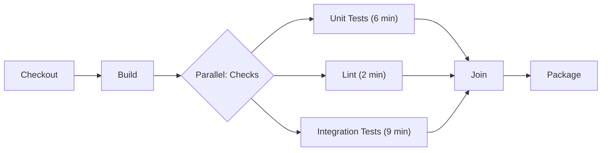
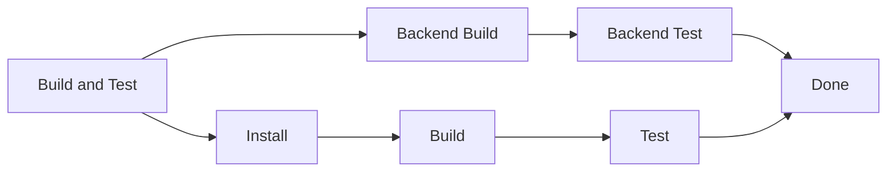

# Parallel Stages

## Introduction

A pipeline that runs every check one after another wastes time. If unit tests take 6 minutes, linting takes 2 minutes and integration tests take 9 minutes, a sequential pipeline makes every developer wait 17 minutes for feedback. None of those checks depend on each other, so there is no reason to queue them.

Jenkins lets you run independent work at the same time with **parallel stages**. Instead of a single line of stages, the pipeline fans out into several branches, waits for all of them, and then continues. With enough executors, the example above finishes in about 9 minutes: the length of the slowest branch.

Think of a restaurant kitchen. The chef does not cook the soup, then the steak, then the dessert. Three cooks work at once, and the plates go out together when the slowest dish is ready. Parallel stages work the same way, and like a kitchen, they only help if you have enough cooks (executors) and the dishes really are independent.

This page covers:

- The Declarative `parallel` block and how branches behave
- `failFast` and the `parallelsAlwaysFailFast()` option
- Sequential stages inside a parallel branch
- Giving each branch its own agent
- The Scripted `parallel` step and dynamically generated branches
- When parallelism helps, and when it just moves the bottleneck

If stages, steps and agents are new to you, read [Stages and Steps](../3-jenkins-pipeline-basics/5-jenkins-stages-and-steps.mdx) and [Declarative Pipeline Syntax](../3-jenkins-pipeline-basics/2-jenkins-declarative-pipeline.mdx) first.

## How Parallel Execution Works

A parallel stage is a parent stage whose body is a `parallel` block instead of `steps`. Each child stage is a **branch**. Jenkins starts all branches together, and the parent stage finishes only when every branch has finished.



Key points:

- Branches are **independent**. They do not share variables safely, and you should not rely on their order.
- The parent stage waits for the slowest branch. Total time is roughly the longest branch, not the sum.
- Each branch needs an executor if it runs on an agent. With one executor, parallel branches still run, but they wait their turn for the node.
- The build result combines the branch results. If any branch fails, the parent stage fails.

## Your First Parallel Stage

Here is a minimal Declarative pipeline with three branches. It uses `echo` and `sh` with `sleep` so you can run it on any Linux agent and watch the timing.

```groovy
pipeline {
    agent any

    stages {
        stage('Build') {
            steps {
                echo 'Compiling...'
                sh 'sleep 2'
            }
        }

        stage('Checks') {
            parallel {
                stage('Unit Tests') {
                    steps {
                        echo 'Running unit tests'
                        sh 'sleep 6'
                    }
                }
                stage('Lint') {
                    steps {
                        echo 'Running linter'
                        sh 'sleep 2'
                    }
                }
                stage('Integration Tests') {
                    steps {
                        echo 'Running integration tests'
                        sh 'sleep 9'
                    }
                }
            }
        }

        stage('Package') {
            steps {
                echo 'Packaging artifact'
            }
        }
    }
}
```

Example output (console log, trimmed):

```text
[Pipeline] stage (Build)
Compiling...
+ sleep 2
[Pipeline] stage (Checks)
[Pipeline] parallel
[Pipeline] { (Branch: Unit Tests)
[Pipeline] { (Branch: Lint)
[Pipeline] { (Branch: Integration Tests)
[Unit Tests] Running unit tests
[Lint] Running linter
[Integration Tests] Running integration tests
[Unit Tests] + sleep 6
[Lint] + sleep 2
[Integration Tests] + sleep 9
[Pipeline] // parallel
[Pipeline] stage (Package)
Packaging artifact
Finished: SUCCESS
```

The console log interleaves lines from all branches and prefixes each with the branch name. For a clearer picture, open the build in the **Pipeline Graph View** (plugin ID `pipeline-graph-view`), which draws branches side by side and lets you read each branch's log on its own.

:::note
`agent any` at the top means all three branches share the same agent. Each branch still needs a free executor on that agent. If the node has only one executor, Jenkins serializes them and you gain nothing. Check executor counts in [Labels, Executors and Scheduling](../6-jenkins-agents/6-jenkins-labels-and-executors.mdx).
:::

### Rules for the parallel block

The Declarative syntax enforces a few rules:

- A stage must contain exactly one of `steps`, `stages`, `parallel` or `matrix`.
- Branches inside `parallel` are stages. They can have their own `agent`, `environment`, `when`, `post`, `options` and `tools`.
- A branch can contain sequential `stages`, but it cannot contain another `parallel` block. Declarative does not allow parallel nested inside parallel.
- The parent stage can have `post`, `when`, `options` and `failFast`, but not `steps`.

## Failing Fast

By default, when one branch fails, Jenkins lets the others keep running to completion. That gives you the full picture (maybe both lint and tests are broken), but it also burns agent time on a build that is already red.

Add `failFast true` to the parent stage to abort the remaining branches as soon as one fails:

```groovy
pipeline {
    agent any
    stages {
        stage('Checks') {
            failFast true
            parallel {
                stage('Fast Failure') {
                    steps {
                        sh 'sleep 1 && exit 1'
                    }
                }
                stage('Slow Branch') {
                    steps {
                        sh 'sleep 30'
                        echo 'You will not see this line'
                    }
                }
            }
        }
    }
}
```

Example output:

```text
[Fast Failure] + sleep 1
[Slow Branch] + sleep 30
[Fast Failure] + exit 1
[Pipeline] // parallel
Failed in branch Fast Failure
Sending interrupt signal to process
[Slow Branch] Terminated
Finished: FAILURE
```

To turn on fail-fast for every parallel stage in a pipeline, use the pipeline-level option instead of repeating `failFast true`:

```groovy
pipeline {
    agent any
    options {
        parallelsAlwaysFailFast()
    }
    stages {
        stage('Checks') {
            parallel {
                stage('A') { steps { echo 'A' } }
                stage('B') { steps { echo 'B' } }
            }
        }
    }
}
```

| Setting | Behavior on first failure | Good for |
| --- | --- | --- |
| Default (no fail-fast) | Other branches keep running | Seeing every failure in one run, nightly builds |
| `failFast true` on a stage | Other branches in that stage are aborted | Pull request builds where speed matters |
| `parallelsAlwaysFailFast()` | Applies fail-fast to every parallel stage | Teams that want one consistent policy |

:::tip
Aborted branches are marked as aborted, not failed. When you read the result, look for the branch that actually failed first. The `Failed in branch ...` line in the console tells you which one it was.
:::

## Sequential Stages Inside a Branch

Sometimes a branch is itself a short pipeline. For example, the frontend branch must install dependencies, then build, then test. Use `stages` inside the branch:

```groovy
pipeline {
    agent none
    stages {
        stage('Build and Test') {
            parallel {
                stage('Backend') {
                    agent { label 'linux' }
                    stages {
                        stage('Backend Build') {
                            steps { sh './gradlew assemble' }
                        }
                        stage('Backend Test') {
                            steps { sh './gradlew test' }
                        }
                    }
                }
                stage('Frontend') {
                    agent { label 'linux' }
                    stages {
                        stage('Install') {
                            steps { sh 'npm ci' }
                        }
                        stage('Build') {
                            steps { sh 'npm run build' }
                        }
                        stage('Test') {
                            steps { sh 'npm test' }
                        }
                    }
                }
            }
        }
    }
}
```



The `agent` on each branch is allocated once and shared by the nested stages, so the frontend `npm ci` output is still there when `npm run build` runs.

## Giving Each Branch Its Own Agent

Parallel branches become powerful when each one runs on a different machine or container. Set `agent none` at the top so the pipeline does not hold an executor while it waits, then put an `agent` on each branch.

```groovy
pipeline {
    agent none
    stages {
        stage('Cross-Platform Tests') {
            parallel {
                stage('Linux') {
                    agent { label 'linux' }
                    steps {
                        sh 'uname -a'
                        sh './run-tests.sh'
                    }
                }
                stage('Windows') {
                    agent { label 'windows' }
                    steps {
                        bat 'ver'
                        bat 'run-tests.bat'
                    }
                }
                stage('Python 3.13 in Docker') {
                    agent {
                        docker { image 'python:3.13-slim' }
                    }
                    steps {
                        sh 'python --version'
                    }
                }
            }
        }
    }
}
```

Each branch now gets its own workspace on its own node. That has two consequences:

1. Files created in one branch are **not visible** in another. If branches need the same build output, build once and share it with `stash` and `unstash` (see [Stash, Unstash and Artifacts](./4-jenkins-stash-and-artifacts.mdx)).
2. Each branch does its own checkout. In Declarative, the default checkout happens whenever a stage allocates an agent.

The Docker agent needs the `docker-workflow` plugin and Docker on the agent. See [Docker Agents](../6-jenkins-agents/3-jenkins-docker-agents.mdx).

:::tip
Testing the same code on many platforms or versions is so common that Jenkins has a dedicated directive for it. If your branches differ only in a value (OS, JDK version, browser), use a [matrix](./1-jenkins-matrix-builds.mdx) instead of copy-pasting branches.
:::

## Scripted Parallel and Dynamic Branches

Declarative branches are fixed when you write the Jenkinsfile. Sometimes you only know the branches at run time, for example one branch per service in a monorepo or one per test shard. The `parallel` **step** takes a map of branch names to closures, and you can build that map in code.

### Basic Scripted parallel

```groovy
node {
    stage('Checks') {
        parallel(
            'Unit Tests': {
                sh 'sleep 3 && echo unit ok'
            },
            'Lint': {
                sh 'sleep 1 && echo lint ok'
            }
        )
    }
}
```

### Building branches in a loop

The common pattern is a `script` block inside Declarative that builds a map and passes it to `parallel`:

```groovy
pipeline {
    agent none
    stages {
        stage('Test Shards') {
            steps {
                script {
                    def shards = 4
                    def branches = [:]

                    for (int i = 0; i < shards; i++) {
                        def index = i   // capture the loop value for the closure
                        branches["Shard ${index}"] = {
                            node('linux') {
                                checkout scm
                                sh "./run-tests.sh --shard ${index} --total ${shards}"
                            }
                        }
                    }

                    parallel branches
                }
            }
        }
    }
}
```

Example output:

```text
[Pipeline] parallel
[Pipeline] { (Branch: Shard 0)
[Pipeline] { (Branch: Shard 1)
[Pipeline] { (Branch: Shard 2)
[Pipeline] { (Branch: Shard 3)
[Shard 0] + ./run-tests.sh --shard 0 --total 4
[Shard 1] + ./run-tests.sh --shard 1 --total 4
[Shard 2] + ./run-tests.sh --shard 2 --total 4
[Shard 3] + ./run-tests.sh --shard 3 --total 4
```

:::warning
Always copy the loop variable into a new local variable (`def index = i`) before using it in the closure. Closures capture variables, not values. Without the copy, a classic `for` loop can leave every branch seeing the final value of `i`. The [Groovy Essentials for Pipelines](./5-jenkins-groovy-for-pipelines.mdx) page explains why.
:::

To enable fail-fast in the Scripted form, add the special `failFast` key to the map:

```groovy
branches.failFast = true
parallel branches
```

### Dynamic branches from a file

A realistic monorepo example reads a list of services and creates one branch each. `readJSON` comes from the `pipeline-utility-steps` plugin.

```json
{
  "services": ["billing", "accounts", "notifications"]
}
```

```groovy
pipeline {
    agent { label 'linux' }
    stages {
        stage('Test Services') {
            steps {
                script {
                    def config = readJSON file: 'services.json'
                    def branches = [:]
                    for (String svc : config.services) {
                        def name = svc
                        branches[name] = {
                            dir("services/${name}") {
                                sh 'make test'
                            }
                        }
                    }
                    parallel branches
                }
            }
        }
    }
}
```

All three branches here share one agent and one workspace, but each works in a different subdirectory, so they do not collide. If branches write to the **same** files, they will collide. Give them separate directories or separate agents.

## Real-World Scenario

Your team maintains a Spring Boot API with a React admin frontend in one repository. Pull request builds take 22 minutes: backend unit tests (7 minutes), backend integration tests against PostgreSQL (10 minutes), frontend tests (4 minutes) and a dependency scan (1 minute), all sequential. Developers have started merging without waiting for CI.

The Jenkins cluster has Kubernetes pod agents, so executors are not scarce. You restructure the pipeline:

```groovy
pipeline {
    agent none
    options {
        parallelsAlwaysFailFast()
        timeout(time: 30, unit: 'MINUTES')
    }
    stages {
        stage('Build') {
            agent { label 'linux' }
            steps {
                sh './gradlew assemble -x test'
                stash name: 'backend-jar', includes: 'build/libs/*.jar'
            }
        }
        stage('Verify') {
            parallel {
                stage('Backend Unit') {
                    agent { label 'linux' }
                    steps {
                        sh './gradlew test'
                    }
                    post {
                        always { junit 'build/test-results/test/*.xml' }
                    }
                }
                stage('Backend Integration') {
                    agent { label 'linux-docker' }
                    steps {
                        sh './gradlew integrationTest'
                    }
                    post {
                        always { junit 'build/test-results/integrationTest/*.xml' }
                    }
                }
                stage('Frontend') {
                    agent { docker { image 'node:22-alpine' } }
                    steps {
                        dir('admin-ui') {
                            sh 'npm ci'
                            sh 'npm test -- --ci'
                        }
                    }
                }
                stage('Dependency Scan') {
                    agent { label 'linux' }
                    steps {
                        sh './gradlew dependencyCheckAnalyze'
                    }
                }
            }
        }
        stage('Publish Snapshot') {
            when { branch 'main' }
            agent { label 'linux' }
            steps {
                unstash 'backend-jar'
                sh 'ls build/libs'
            }
        }
    }
}
```

The PR build now takes about 2 minutes of build plus 10 minutes for the slowest branch, so roughly 12 minutes instead of 22.

**Why this approach:** the four checks are independent, agents are elastic, and the slowest check (integration tests) dominates. Fail-fast on PRs frees agents quickly when something obvious breaks. `junit` in each branch's `post` means test reports are recorded even when a branch fails.

**When to use it:**

- Checks are independent and each takes more than a minute or so.
- You have spare executors or an elastic agent pool.
- Feedback time matters more than total compute time.

**When not to use it:**

- Executors are scarce. Parallel branches will wait in the queue, and the build may get slower because each branch repeats checkout and setup.
- The branches are tiny. A 5-second lint check is not worth a separate agent and a separate checkout.
- The steps share mutable state, such as one database or one output folder, and are not designed for concurrency.

**Alternatives and trade-offs:**

| Approach | Pros | Cons | Best for |
| --- | --- | --- | --- |
| Sequential stages | Simple, cheap, predictable logs | Slow feedback | Small projects, one executor |
| Declarative `parallel` | Readable, visualized well, per-branch agents | Branches fixed in the Jenkinsfile | A known set of independent checks |
| `matrix` | No duplication for value combinations | Only for "same steps, different values" | OS, version and browser grids |
| Scripted `parallel` with a map | Branches computed at run time | More Groovy, harder to read and lint | Test shards, monorepo services |
| Parallelism inside the tool (`pytest -n`, Gradle `--parallel`) | No extra agents or checkouts | Bound to one machine's CPU | CPU-bound tests on a big agent |

## Common Mistakes

- **Expecting a speed-up with one executor.** Parallel branches on a single-executor node run one at a time. Check the executor count or use per-branch agents.
- **Sharing files between branches on different agents.** Each agent has its own workspace. Use `stash` and `unstash`, or build in a stage before the parallel stage.
- **Writing to the same directory from branches on one agent.** Two `npm ci` runs in the same folder will corrupt each other. Use `dir()` with separate folders.
- **Holding an executor with a top-level agent.** With `agent any` at the top and agents on branches, the top-level executor sits idle during the parallel stage. Use `agent none` at the top when branches have their own agents.
- **Closure capture bugs in loops.** Copy loop variables into a local before creating the closure.
- **Too many branches.** Fifty branches each doing a fresh checkout can overload your SCM server and the controller. Group work into a sensible number of shards.
- **Reading interleaved console logs.** Use the Pipeline Graph View, or the per-branch log, instead of the merged console.

## Summary

- A `parallel` block runs independent stages at the same time. The parent stage waits for the slowest branch.
- `failFast true` (per stage) or `parallelsAlwaysFailFast()` (per pipeline) aborts sibling branches when one fails.
- Branches can contain sequential `stages`, but Declarative does not allow parallel nested inside parallel.
- Use `agent none` at the top and an `agent` per branch to spread work across machines, and remember each branch has its own workspace.
- The Scripted `parallel` step takes a map, which lets you generate branches dynamically.
- Parallelism needs executors. Without them, it only adds overhead.

## Exercises

1. Take the first example on this page and run it on an agent with one executor, then with three. Compare the build durations shown in the build history.
2. Add `failFast true` to the parent stage and make the Lint branch fail with `exit 1`. Confirm that the other branches are aborted.
3. Write a `script` block that reads a comma-separated parameter such as `SERVICES=billing,accounts,search` and creates one parallel branch per service.
4. Rewrite a cross-platform parallel stage as a [matrix](./1-jenkins-matrix-builds.mdx) and compare the two Jenkinsfiles.

Related pages:

- [Matrix Builds](./1-jenkins-matrix-builds.mdx)
- [Stash, Unstash and Artifacts](./4-jenkins-stash-and-artifacts.mdx)
- [Labels, Executors and Scheduling](../6-jenkins-agents/6-jenkins-labels-and-executors.mdx)
- [Build Caching and Speed](../9-jenkins-build-and-test/8-jenkins-build-caching.mdx)
- For general pipeline design theory, see the [CI/CD tutorial](/docs/devops/cicd).
