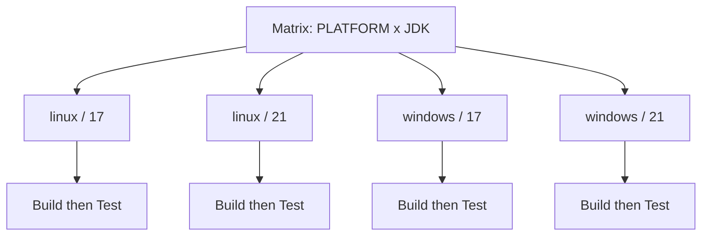
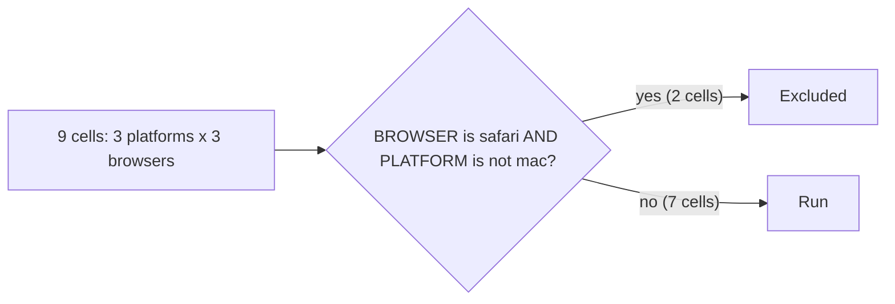

# Matrix Builds

## Introduction

Libraries and apps often need to work in more than one environment. A Java library might support JDK 17, 21 and 25. A web app might need testing on Chrome, Firefox and Safari. A CLI tool might ship for Linux, macOS and Windows. Testing every combination by hand is impossible, and writing a separate parallel branch for each combination quickly turns your Jenkinsfile into a wall of copy-paste.

The Declarative **matrix** directive solves this. You declare **axes** (for example `PLATFORM` and `JDK`) and their values, and Jenkins generates one **cell** for every combination. Each cell runs the same stages with different axis values, and all cells run in parallel.

An analogy: a paint shop testing a new paint on three materials at four temperatures does not write twelve separate instructions. It writes one test procedure and a grid. The matrix directive is that grid.

This page covers:

- `axes`, `axis`, `name` and `values`
- Excluding combinations with `excludes` and `notValues`
- Per-cell `agent`, `when`, `environment` and `post`
- `failFast` for matrices
- Filtering cells with parameters
- When a matrix is the wrong tool

This page assumes you know [Parallel Stages](./0-jenkins-parallel-stages.mdx), because a matrix is a generated set of parallel branches.

## How a Matrix Expands



With two axes of 2 values each, you get 2 × 2 = 4 cells. With three axes of 3, 4 and 2 values, you get 24 cells. The number grows fast, so plan your axes carefully.

Inside each cell:

- The stages listed under the matrix's `stages` run **sequentially**.
- Each axis value is available as an environment variable named after the axis, for example `env.PLATFORM` or `${PLATFORM}` in a double-quoted string.
- All cells start in parallel, limited only by available executors.

## Your First Matrix

This example works on any Linux agent. It prints the axis values so you can see the expansion.

```groovy
pipeline {
    agent any
    stages {
        stage('Test Matrix') {
            matrix {
                axes {
                    axis {
                        name 'OS_NAME'
                        values 'ubuntu', 'debian'
                    }
                    axis {
                        name 'PYTHON'
                        values '3.12', '3.13'
                    }
                }
                stages {
                    stage('Test') {
                        steps {
                            echo "Testing on ${OS_NAME} with Python ${PYTHON}"
                        }
                    }
                }
            }
        }
    }
}
```

Example output (trimmed):

```text
[Pipeline] parallel
[Pipeline] { (Branch: Matrix - OS_NAME = 'ubuntu', PYTHON = '3.12')
[Pipeline] { (Branch: Matrix - OS_NAME = 'ubuntu', PYTHON = '3.13')
[Pipeline] { (Branch: Matrix - OS_NAME = 'debian', PYTHON = '3.12')
[Pipeline] { (Branch: Matrix - OS_NAME = 'debian', PYTHON = '3.13')
Testing on ubuntu with Python 3.12
Testing on ubuntu with Python 3.13
Testing on debian with Python 3.12
Testing on debian with Python 3.13
[Pipeline] // parallel
Finished: SUCCESS
```

Jenkins names each branch after its axis values, which is what you see in the Pipeline Graph View.

### Structure rules

- `matrix` replaces `steps`, `stages` or `parallel` in a stage. A stage has exactly one of them.
- `axes` and `stages` are required. `excludes` is optional.
- Axis values are strings. Write numbers as strings, as in `'3.12'`, so `'3.10'` does not become `3.1`.
- The matrix can have its own `agent`, `environment`, `input`, `options`, `post`, `tools` and `when`. These apply to **each cell**.

## Running Each Cell in the Right Environment

Printing values is not useful on its own. In practice each cell needs a matching runtime. There are two common patterns.

### Pattern 1: a Docker image per cell

Use the axis value in the image tag. This needs the `docker-workflow` plugin and Docker on the agent.

```groovy
pipeline {
    agent none
    stages {
        stage('Python Versions') {
            matrix {
                agent {
                    docker { image "python:${PYTHON}-slim" }
                }
                axes {
                    axis {
                        name 'PYTHON'
                        values '3.11', '3.12', '3.13'
                    }
                }
                stages {
                    stage('Install') {
                        steps {
                            sh 'python -m pip install --quiet -r requirements.txt'
                        }
                    }
                    stage('Test') {
                        steps {
                            sh 'python -m pytest --junitxml=reports/junit.xml'
                        }
                    }
                }
                post {
                    always {
                        junit 'reports/*.xml'
                    }
                }
            }
        }
    }
}
```

Example output (one cell):

```text
[Matrix - PYTHON = '3.12'] + python -m pip install --quiet -r requirements.txt
[Matrix - PYTHON = '3.12'] + python -m pytest --junitxml=reports/junit.xml
[Matrix - PYTHON = '3.12'] ============ 42 passed in 3.10s ============
[Matrix - PYTHON = '3.12'] Recording test results
```

### Pattern 2: an agent label per cell

Use the axis value in the agent label so each OS cell lands on a matching machine.

```groovy
pipeline {
    agent none
    stages {
        stage('Cross-Platform') {
            matrix {
                agent { label "${PLATFORM}" }
                axes {
                    axis {
                        name 'PLATFORM'
                        values 'linux', 'windows', 'macos'
                    }
                }
                stages {
                    stage('Build') {
                        steps {
                            script {
                                if (isUnix()) {
                                    sh './build.sh'
                                } else {
                                    bat 'build.bat'
                                }
                            }
                        }
                    }
                }
            }
        }
    }
}
```

`isUnix()` returns true on Linux and macOS agents, so the same stage works on all three. You need agents carrying the labels `linux`, `windows` and `macos`. See [Labels, Executors and Scheduling](../6-jenkins-agents/6-jenkins-labels-and-executors.mdx).

## Excluding Combinations

Real grids have holes. Safari does not run on Linux. An old JDK may not be supported on a new OS. Use `excludes` to drop cells.

```groovy
pipeline {
    agent none
    stages {
        stage('Browser Tests') {
            matrix {
                axes {
                    axis {
                        name 'PLATFORM'
                        values 'linux', 'windows', 'mac'
                    }
                    axis {
                        name 'BROWSER'
                        values 'chrome', 'firefox', 'safari'
                    }
                }
                excludes {
                    exclude {
                        axis {
                            name 'BROWSER'
                            values 'safari'
                        }
                        axis {
                            name 'PLATFORM'
                            notValues 'mac'
                        }
                    }
                }
                agent { label "${PLATFORM}" }
                stages {
                    stage('E2E') {
                        steps {
                            echo "E2E on ${PLATFORM} / ${BROWSER}"
                        }
                    }
                }
            }
        }
    }
}
```

How to read this exclude: remove cells where `BROWSER` is `safari` **and** `PLATFORM` is **not** `mac`. That removes linux/safari and windows/safari, leaving 7 of the 9 cells.

Rules for excludes:

- Each `exclude` block removes cells that match **all** of its axis conditions.
- Multiple `exclude` blocks are evaluated separately. A cell is removed if it matches any of them.
- `values` means "matches one of these". `notValues` means "matches none of these".



## Per-Cell Conditions with when

Axes and excludes are fixed before the run starts. To skip cells based on parameters or branch at run time, put a `when` on the matrix. It is evaluated for each cell.

```groovy
pipeline {
    agent none
    parameters {
        choice(name: 'PLATFORM_FILTER', choices: ['all', 'linux', 'windows', 'mac'],
               description: 'Run only one platform')
    }
    stages {
        stage('Matrix') {
            matrix {
                when {
                    beforeAgent true
                    anyOf {
                        expression { params.PLATFORM_FILTER == 'all' }
                        expression { params.PLATFORM_FILTER == env.PLATFORM }
                    }
                }
                axes {
                    axis {
                        name 'PLATFORM'
                        values 'linux', 'windows', 'mac'
                    }
                }
                agent { label "${PLATFORM}" }
                stages {
                    stage('Test') {
                        steps { echo "Testing ${PLATFORM}" }
                    }
                }
            }
        }
    }
}
```

With `PLATFORM_FILTER=windows`, the linux and mac cells show as skipped, and only the windows cell runs. This is handy when a developer is debugging a single platform and does not want to wait for the whole grid. See [Build Parameters](../2-jenkins-jobs/2-jenkins-build-parameters.mdx) and [Conditional Stages with when](../3-jenkins-pipeline-basics/8-jenkins-when-conditions.mdx).

:::tip
By default, Declarative evaluates `when` **after** entering the stage's agent. For a filter like this one, add `beforeAgent true` inside the `when` block, so skipped cells never wait for or occupy an executor. Leave it out only when the condition needs files from the workspace.
:::

## Failing Fast and Per-Cell post

Like `parallel`, a matrix keeps running other cells after one fails. Add `failFast true` to the stage that contains the matrix to stop early, or use the pipeline option `parallelsAlwaysFailFast()`, which also applies to matrices.

```groovy
stage('Matrix') {
    failFast true
    matrix {
        axes {
            axis {
                name 'JDK'
                values '17', '21', '25'
            }
        }
        stages {
            stage('Test') {
                steps { echo "Testing with JDK ${JDK}" }
            }
        }
        post {
            failure {
                echo "Cell JDK=${JDK} failed"
            }
        }
    }
}
```

The `post` inside `matrix` runs once per cell. A `post` on the outer stage runs once after all cells finish. Use the per-cell `post` for cell-specific reports (such as `junit`) and the outer `post` for a single summary notification.

:::caution
For pull request builds, fail-fast saves agent time. For a nightly compatibility build, it hides information: if JDK 17 fails first, you never learn whether JDK 25 also fails. Choose per pipeline.
:::

## Per-Cell Environment and Tools

You can compute values for each cell with `environment`, or pick a Jenkins-managed tool installation with `tools`:

```groovy
matrix {
    axes {
        axis {
            name 'JDK'
            values '17', '21'
        }
    }
    tools {
        jdk "jdk-${JDK}"
    }
    environment {
        REPORT_DIR = "reports/jdk-${JDK}"
    }
    stages {
        stage('Test') {
            steps {
                sh 'java -version'
                sh 'mkdir -p "$REPORT_DIR"'
            }
        }
    }
}
```

The `tools` block requires JDK installations named `jdk-17` and `jdk-21` under **Manage Jenkins > Tools**. Many teams prefer Docker images per cell instead, because the runtime is then pinned in the Jenkinsfile rather than in controller configuration.

## Real-World Scenario

Your team maintains an open-source Java client library. Users run it on JDK 17, 21 and 25, and on Linux and Windows. Last month a Windows-only path bug slipped into a release because CI ran only on Linux with JDK 21. You want every pull request to check the whole support matrix, but Windows agents are expensive and limited to two.

```groovy
pipeline {
    agent none
    options {
        timeout(time: 45, unit: 'MINUTES')
    }
    stages {
        stage('Compatibility') {
            failFast true
            matrix {
                axes {
                    axis {
                        name 'PLATFORM'
                        values 'linux', 'windows'
                    }
                    axis {
                        name 'JDK'
                        values '17', '21', '25'
                    }
                }
                excludes {
                    exclude {
                        axis {
                            name 'PLATFORM'
                            values 'windows'
                        }
                        axis {
                            name 'JDK'
                            values '17'
                        }
                    }
                }
                agent { label "${PLATFORM}" }
                tools {
                    jdk "jdk-${JDK}"
                }
                stages {
                    stage('Test') {
                        steps {
                            script {
                                if (isUnix()) {
                                    sh './mvnw -B verify'
                                } else {
                                    bat 'mvnw.cmd -B verify'
                                }
                            }
                        }
                    }
                }
                post {
                    always {
                        junit allowEmptyResults: true, testResults: 'target/surefire-reports/*.xml'
                    }
                }
            }
        }
    }
}
```

The team decided JDK 17 on Windows is covered well enough by JDK 21 on Windows plus JDK 17 on Linux, so that cell is excluded to save scarce Windows capacity. Five cells run per pull request.

**Why this approach:** all cells run the same steps and differ only in two values. A matrix expresses that in one place. Adding JDK 26 later is a one-word change.

**When to use it:**

- The same build or test must run against several versions, platforms or configurations.
- The grid is small to medium (single digits to a few dozen cells).

**When not to use it:**

- Each combination needs different steps. Use separate parallel stages instead.
- The grid is huge. 4 OS × 5 runtimes × 4 databases is 80 cells per commit. Run a smaller "smoke" grid on pull requests and the full grid nightly.
- The axes are only known at run time (for example, read from a file). Declarative axes are static. Use Scripted `parallel` with a generated map (see [Parallel Stages](./0-jenkins-parallel-stages.mdx)).

**Alternatives and trade-offs:**

| Approach | Pros | Cons | Best for |
| --- | --- | --- | --- |
| Declarative `matrix` | Concise, validated, good visualization | Static axes, all cells run the same stages | Version and platform grids |
| Hand-written `parallel` branches | Full control per branch | Duplication, easy to drift | 2-3 combinations with different steps |
| Scripted `parallel` built in a loop | Axes from files or parameters | More Groovy, less validation | Dynamic grids |
| Multi-configuration (freestyle matrix) job | Older, familiar UI | Not Pipeline-as-code, legacy | Existing legacy jobs only |
| Build tool's own matrix (tox, nox, Gradle toolchains) | Same matrix runs locally | One machine, no OS axis | Language-version testing |

## Common Mistakes

- **Combinatorial explosion.** Every new axis multiplies the cell count. Count cells before adding an axis, and use excludes or a nightly job for the full grid.
- **Not enough executors.** Twelve cells on three executors means four waves. The grid still works, but slower than you expect.
- **Numeric-looking values.** Quote values like `'3.10'`. Jenkins treats axis values as strings, and quoting avoids surprises.
- **Expecting to nest matrices.** You cannot put a matrix inside another matrix or inside a parallel branch. Flatten the axes into one matrix.
- **Confusing excludes logic.** Remember that one `exclude` block is an AND of its axes, while separate `exclude` blocks are ORed.
- **Report collisions.** If cells share a workspace (same agent, `agent any` at the top), test report paths can overwrite each other. Use per-cell agents or per-cell report directories.
- **Very large matrices in one Jenkinsfile.** Declarative generates code for each cell, and very large pipelines can hit JVM method size limits ("Method code too large"). Keep the matrix stages short and move logic into scripts or a [shared library](../8-jenkins-shared-libraries/0-jenkins-shared-libraries-introduction.mdx).

## Summary

- A `matrix` generates one parallel cell for each combination of axis values.
- Axis values are exposed as environment variables named after the axis.
- `excludes` removes combinations. Each `exclude` matches all its axes, and `notValues` inverts a match.
- `agent`, `when`, `tools`, `environment` and `post` inside `matrix` apply per cell.
- `failFast true` on the enclosing stage stops other cells when one fails.
- Keep grids small on pull requests. Run the full grid on a schedule if needed.

## Exercises

1. Build a matrix with axes `NODE` (`20`, `22`) and `OS_NAME` (`alpine`, `bookworm`) that runs `node --version` in the Docker image `node:${NODE}-${OS_NAME}`.
2. Add an exclude so that `NODE=20` runs only on `bookworm`.
3. Add a `choice` parameter that limits the run to a single `NODE` version using a `when` block.
4. Convert a pipeline with three nearly identical parallel branches into a matrix and compare line counts.

Related pages:

- [Parallel Stages](./0-jenkins-parallel-stages.mdx)
- [Docker Agents](../6-jenkins-agents/3-jenkins-docker-agents.mdx)
- [Test Reports with JUnit](../9-jenkins-build-and-test/4-jenkins-test-reports.mdx)
- [Pipeline Options and Tuning](./6-jenkins-pipeline-options.mdx)
