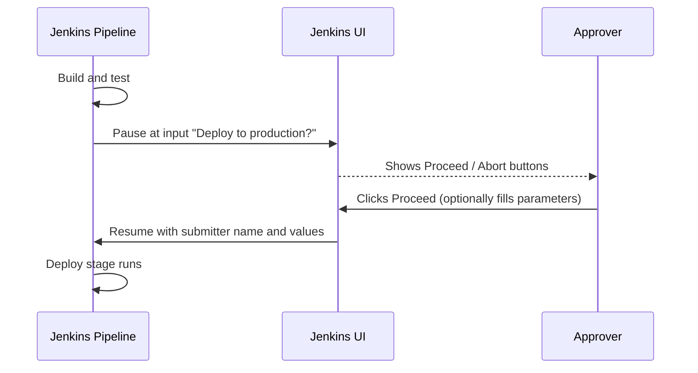
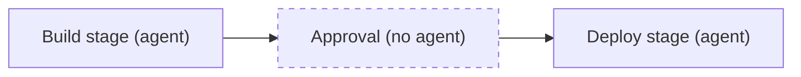

# Manual Input and Approvals

## Introduction

Not every pipeline should run straight through to production. A bank may require a release manager to approve each production deployment. A team may want a human to look at a staging environment before traffic shifts. A database migration might need someone to pick the target region first.

Jenkins handles this with **input**: a pipeline pauses at a defined point, shows a prompt in the UI, and waits until an authorized person clicks **Proceed** or **Abort**. The person can also supply values, such as a version number or a "reason for release" text field.

Think of it as a boarding gate at an airport. Passengers (builds) flow through check-in and security automatically, but nobody boards until the gate agent (approver) scans the pass. The gate agent can also turn someone away.

This page covers:

- The stage-level `input` directive in Declarative Pipeline
- The `input` step in `script` blocks and Scripted Pipeline
- Restricting who can approve with `submitter`
- Asking for parameters at approval time
- Avoiding the classic mistake: holding an executor while waiting
- Timeouts, concurrency control and auditing

The step comes from the **Pipeline: Input Step** plugin (`pipeline-input-step`), which is installed with the standard Pipeline plugins.

## How Input Works



While paused:

- The build shows as running, and the stage shows as "paused for input".
- A link to the prompt appears in the console log and in the Pipeline Graph View.
- No CPU is used, but an executor **is** used if the pause happens inside a `node` or stage `agent`. More on that below.
- If someone clicks **Abort**, the build ends with result `ABORTED`.

## The Declarative input Directive

The cleanest way to add an approval gate in Declarative is the stage-level `input` directive:

```groovy
pipeline {
    agent none
    stages {
        stage('Build') {
            agent { label 'linux' }
            steps {
                echo 'Building release 1.4.0'
            }
        }
        stage('Deploy to Production') {
            input {
                message 'Deploy release 1.4.0 to production?'
                ok 'Deploy'
                submitter 'release-managers,alice'
                submitterParameter 'APPROVER'
            }
            agent { label 'deploy' }
            steps {
                echo "Deploying, approved by ${APPROVER}"
            }
        }
    }
}
```

Example output:

```text
[Pipeline] stage (Deploy to Production)
[Pipeline] input
Deploy release 1.4.0 to production?
Deploy or Abort
Approved by alice
[Pipeline] node
Running on deploy-agent-1 in /var/jenkins/workspace/release-pipeline
Deploying, approved by alice
Finished: SUCCESS
```

The directive's options:

| Option | Required | Meaning |
| --- | --- | --- |
| `message` | Yes | The question shown to the approver |
| `id` | No | Identifier for the input. Defaults to a value based on the stage name |
| `ok` | No | Label for the proceed button |
| `submitter` | No | Comma-separated users or groups allowed to approve. Default: anyone with permission to build the job |
| `submitterParameter` | No | Name of an environment variable that receives the approver's user ID |
| `parameters` | No | Values the approver must fill in, using the same syntax as the `parameters` directive |

### Why the directive is better than an input step inside steps

The stage-level directive pauses **after** `options` but **before** the stage's `agent` is allocated and before `when` is evaluated. That means the pipeline does not hold an executor while it waits for a human. With an approval that might take hours, this matters a lot.

:::tip
If you want `when` to be checked before the prompt appears (for example, only ask for approval on the `main` branch), add `beforeInput true` inside the `when` block. Otherwise users on feature branches will see an approval prompt for a stage that would be skipped anyway.
:::

```groovy
stage('Deploy to Production') {
    when {
        beforeInput true
        branch 'main'
    }
    input {
        message 'Deploy to production?'
    }
    steps {
        echo 'Deploying'
    }
}
```

## Asking for Values at Approval Time

Approvers often need to make a choice: which environment, which version, or a ticket reference for the audit log. Add `parameters`:

```groovy
pipeline {
    agent none
    stages {
        stage('Release') {
            input {
                message 'Release settings'
                ok 'Start release'
                submitterParameter 'APPROVER'
                parameters {
                    choice(name: 'TARGET_REGION', choices: ['eu-west-1', 'us-east-1'],
                           description: 'Region to deploy first')
                    string(name: 'CHANGE_TICKET', defaultValue: '',
                           description: 'Change ticket ID, for example CHG-1234')
                    booleanParam(name: 'RUN_SMOKE_TESTS', defaultValue: true,
                                 description: 'Run smoke tests after deploy')
                }
            }
            agent { label 'deploy' }
            steps {
                echo "Region: ${TARGET_REGION}"
                echo "Ticket: ${CHANGE_TICKET}"
                echo "Smoke tests: ${RUN_SMOKE_TESTS}"
                echo "Approver: ${APPROVER}"
            }
        }
    }
}
```

Example output:

```text
[Pipeline] input
Input requested
Approved by bob
[Pipeline] node
Region: eu-west-1
Ticket: CHG-1234
Smoke tests: true
Approver: bob
```

In the directive form, each parameter becomes an environment variable for the rest of the stage. It is not visible in later stages unless you copy it into a global variable.

## The input Step in script Blocks and Scripted Pipeline

The `input` **step** gives more control. It returns a value you can store and use anywhere:

- With no parameters, it returns nothing when approved.
- With one parameter, it returns that parameter's value.
- With several parameters (or one parameter plus `submitterParameter`), it returns a map keyed by name.

```groovy
pipeline {
    agent none
    stages {
        stage('Choose Version') {
            steps {
                script {
                    def answer = input(
                        message: 'Which version should we promote?',
                        ok: 'Promote',
                        submitterParameter: 'approver',
                        parameters: [
                            string(name: 'VERSION', defaultValue: '1.4.0', description: 'Semantic version')
                        ]
                    )
                    env.PROMOTE_VERSION = answer.VERSION
                    env.PROMOTE_APPROVER = answer.approver
                }
            }
        }
        stage('Promote') {
            agent { label 'deploy' }
            steps {
                echo "Promoting ${env.PROMOTE_VERSION} (approved by ${env.PROMOTE_APPROVER})"
            }
        }
    }
}
```

Example output:

```text
Which version should we promote?
Promote or Abort
Approved by carol
[Pipeline] stage (Promote)
Promoting 1.4.1 (approved by carol)
```

Because the `Choose Version` stage has no agent (the pipeline uses `agent none`), the wait does not hold an executor. The value is copied into `env` so later stages can read it.

In Scripted Pipeline, the same rule applies: call `input` **outside** any `node` block.

```groovy
stage('Build') {
    node('linux') {
        sh 'echo building'
    }
}

stage('Approve') {
    input message: 'Deploy to production?', ok: 'Deploy'   // no node held here
}

stage('Deploy') {
    node('deploy') {
        sh 'echo deploying'
    }
}
```

## Never Hold an Executor While Waiting

This is the most common input mistake:

```groovy
// Anti-pattern: holds an agent executor for as long as the human takes
pipeline {
    agent { label 'linux' }          // top-level agent for the whole run
    stages {
        stage('Approve') {
            steps {
                input 'Deploy?'        // waits here, executor stays busy
            }
        }
    }
}
```

With a top-level agent, the executor stays allocated during the pause. If ten builds wait over a weekend on a two-executor agent, nothing else can build. Fixes:

1. Use `agent none` at the top and give agents to the stages that need them.
2. Use the stage-level `input` directive, which runs before the stage agent is allocated.
3. For Scripted, keep `input` outside `node`.



:::note
Leaving the workspace means files from the build stage are not automatically there when the deploy stage gets a new agent. `stash` the build output before the approval and `unstash` it after, or deploy from an archived artifact. See [Stash, Unstash and Artifacts](./4-jenkins-stash-and-artifacts.mdx).
:::

## Timeouts on Approvals

A forgotten approval keeps a build open forever, and with durable Pipelines it even survives controller restarts. Wrap the input in a timeout. When the time runs out, the build is aborted.

```groovy
stage('Approval') {
    options {
        timeout(time: 2, unit: 'HOURS')
    }
    input {
        message 'Deploy to production?'
    }
    steps {
        echo 'Approved in time'
    }
}
```

Stage `options` are evaluated before the `input` directive, so the timeout covers the wait. In a `script` block, wrap the step yourself:

```groovy
script {
    timeout(time: 30, unit: 'MINUTES') {
        input message: 'Promote to staging?'
    }
}
```

Example output when nobody answers:

```text
Promote to staging?
Proceed or Abort
Cancelling nested steps due to timeout
Timeout has been exceeded
Finished: ABORTED
```

More timeout patterns are on [Timeouts, Retries and Error Handling](./3-jenkins-timeouts-and-retries.mdx).

## Controlling Concurrent Approvals

If several builds pile up waiting for approval, an approver may click Proceed on an old one and deploy stale code. Two common protections:

**1. Only one build at a time.** `disableConcurrentBuilds()` queues new builds until the current one finishes. Adding `abortPrevious: true` aborts the older running build instead.

```groovy
options {
    disableConcurrentBuilds(abortPrevious: true)
}
```

**2. Milestones.** The `milestone` step (plugin `pipeline-milestone-step`) aborts older builds once a newer build passes the same milestone. Placing milestones around the approval means approving build 42 automatically cancels build 41 if it is still waiting.

```groovy
stage('Approval') {
    steps {
        milestone(1)
        input message: 'Deploy?'
        milestone(2)
    }
}
```

**3. Locks.** If several pipelines deploy to the same environment, the `lock` step from the Lockable Resources plugin (`lockable-resources`) ensures only one deploys at a time:

```groovy
stage('Deploy Staging') {
    steps {
        lock(resource: 'staging-environment') {
            sh './deploy.sh staging'
        }
    }
}
```

## Real-World Scenario

Your company runs a payments API. Compliance rules say production deployments must be approved by someone in the `release-managers` group, and the approval must be traceable to a change ticket. Developers deploy to staging many times a day without approval.

```groovy
pipeline {
    agent none
    options {
        disableConcurrentBuilds()
        buildDiscarder(logRotator(numToKeepStr: '50'))
    }
    stages {
        stage('Build') {
            agent { label 'linux' }
            steps {
                sh './gradlew build'
                stash name: 'app', includes: 'build/libs/*.jar'
            }
        }
        stage('Deploy Staging') {
            when { branch 'main' }
            agent { label 'deploy' }
            steps {
                unstash 'app'
                sh './deploy.sh staging'
            }
        }
        stage('Production Approval') {
            when {
                beforeInput true
                branch 'main'
            }
            options {
                timeout(time: 8, unit: 'HOURS')
            }
            input {
                message 'Promote this build to production?'
                ok 'Approve'
                submitter 'release-managers'
                submitterParameter 'APPROVER'
                parameters {
                    string(name: 'CHANGE_TICKET', description: 'Approved change ticket ID')
                }
            }
            steps {
                script {
                    if (!(env.CHANGE_TICKET ==~ /CHG-\d+/)) {
                        error "Invalid change ticket: ${env.CHANGE_TICKET}"
                    }
                    env.PROD_APPROVER = env.APPROVER
                    env.PROD_TICKET = env.CHANGE_TICKET
                }
                echo "Approved by ${env.APPROVER} under ${env.CHANGE_TICKET}"
            }
        }
        stage('Deploy Production') {
            when { branch 'main' }
            agent { label 'deploy' }
            steps {
                unstash 'app'
                sh './deploy.sh production'
            }
            post {
                success {
                    echo "Production deploy by ${env.PROD_APPROVER}, ticket ${env.PROD_TICKET}"
                }
            }
        }
    }
}
```

**Why this approach:** the approval lives next to the deploy code, it is versioned in Git, and Jenkins records who approved each run in the build log. `submitter` enforces the group, `beforeInput` hides the prompt on feature branches, and the approval stage holds no executor.

**When to use it:**

- Human judgment or a compliance sign-off is truly required.
- Approvals are infrequent compared with builds.

**When not to use it:**

- As a substitute for automated tests. If people click Approve without looking, the gate only adds delay.
- For approvals that need rich workflow (multiple approvers, reminders, delegation). Jenkins input is a single click by one person.
- In teams practicing continuous deployment, where automated checks and canaries replace manual gates.

**Alternatives and trade-offs:**

| Approach | Pros | Cons | Best for |
| --- | --- | --- | --- |
| Jenkins `input` | Built in, simple, logged in build | One approver, approvals hidden in build logs, waiting builds pile up | Small teams, occasional manual gates |
| Separate promotion job triggered by a person | Clear, no long-running paused builds | Two jobs to maintain, artifact must be passed along | Releases from a chosen past build |
| Pull request approval on a deploy repo (GitOps) | Strong audit trail in Git, reviews | Needs GitOps tooling such as Argo CD | Kubernetes teams |
| External change management (ticket API check) | Fits enterprise compliance | Integration work, slower | Regulated industries |
| Automated gates (tests, canary metrics) | Fast, consistent | Needs good monitoring | Continuous deployment |

See [Environments and Promotion](../10-jenkins-deployment/1-jenkins-environments-and-promotion.mdx) and [Jenkins with GitOps and Argo CD](../10-jenkins-deployment/7-jenkins-gitops.mdx) for the deployment side.

## Common Mistakes

- **Holding an executor during input.** Use `agent none` at the top, the stage-level directive, or keep `input` outside `node`.
- **No timeout.** Paused builds stay open indefinitely. Always wrap approvals in a timeout.
- **No `submitter`.** Without it, anyone who can build the job can approve. Restrict it to a user or group, and make sure your [authorization strategy](../11-jenkins-security/2-jenkins-authorization.mdx) actually defines that group.
- **Losing parameter values.** Directive parameters exist only inside that stage. Copy them into `env` in a `script` block if later stages need them.
- **Approving stale builds.** Use `disableConcurrentBuilds`, milestones or a promotion-job design so an old build cannot overwrite a newer deploy.
- **Interpolating approver input into shell commands.** Values typed by a person are untrusted. Validate them (as with the ticket regex above) and pass them through environment variables with single-quoted `sh` scripts rather than Groovy interpolation.

## Summary

- `input` pauses a pipeline until an authorized person proceeds or aborts.
- The Declarative stage-level `input` directive runs before the stage agent is allocated, so it does not hold an executor.
- `submitter` restricts approvers. `submitterParameter` records who approved. `parameters` collects values.
- The `input` step returns values you can store in variables, which is useful in `script` blocks.
- Combine approvals with timeouts, `disableConcurrentBuilds`, milestones or locks.
- Manual gates are a trade-off. Use them for real decisions, not as a replacement for tests.

## Exercises

1. Write a pipeline with `agent none`, a build stage on any agent, and an approval stage using the `input` directive. Confirm in **Build Executor Status** that no executor is busy while it waits.
2. Add a `choice` parameter to the approval that selects `blue` or `green`, and print the choice in the next stage.
3. Wrap the approval in a 2-minute timeout, do not approve, and check the build result.
4. Start two builds of the same job with `milestone` steps around the input. Approve the newer one and see what happens to the older build.

Related pages:

- [Timeouts, Retries and Error Handling](./3-jenkins-timeouts-and-retries.mdx)
- [Conditional Stages with when](../3-jenkins-pipeline-basics/8-jenkins-when-conditions.mdx)
- [Deployment Pipelines](../10-jenkins-deployment/0-jenkins-deployment-pipelines.mdx)
- [Authorization and Role-Based Access](../11-jenkins-security/2-jenkins-authorization.mdx)
