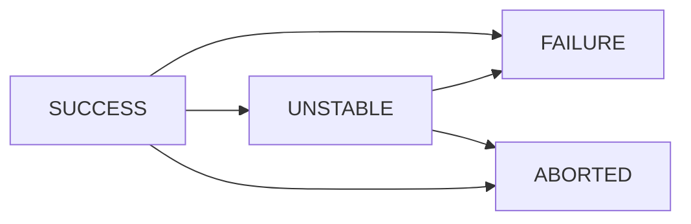
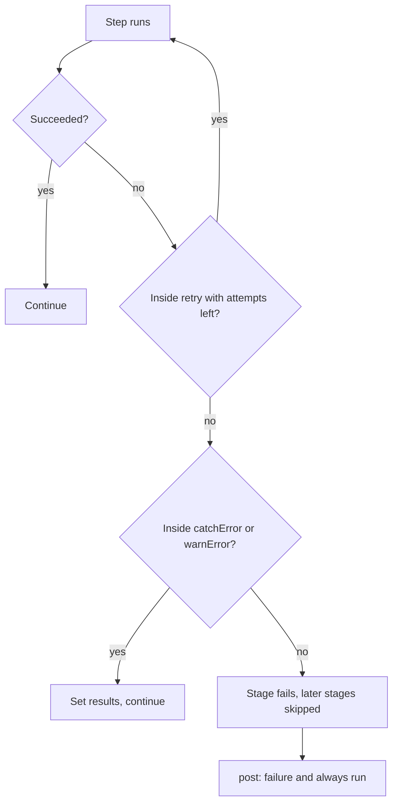

# Timeouts, Retries and Error Handling

## Introduction

Pipelines fail for two very different reasons:

1. **Real failures.** The code does not compile, a test fails, a security scan finds a critical issue. The pipeline should stop and report it clearly.
2. **Infrastructure noise.** A package mirror times out, an agent disconnects, a Docker pull hits a rate limit, a test hangs forever. Rerunning often fixes it.

A resilient pipeline treats these differently. It retries the noisy parts a limited number of times, puts time limits on anything that can hang, lets non-critical checks fail without breaking the build, and always cleans up and reports.

Think of a delivery driver. If the customer's door is locked (real failure), the driver reports "undeliverable". If traffic is jammed (noise), the driver waits a bit or takes another route. But a driver who circles the block forever helps nobody, so there is always a deadline.

This page covers:

- `timeout` at pipeline, stage and step level, including activity-based timeouts
- `retry`, including retrying only on agent loss
- `catchError`, `warnError`, `unstable` and `error` for controlling build and stage results
- `try` / `catch` / `finally` in `script` blocks
- How these interact with `post` conditions
- When retries hide real problems

The basic `post` section is covered in [Post Conditions](../3-jenkins-pipeline-basics/7-jenkins-post-conditions.mdx). This page builds on it.

## Build Results in Jenkins

Every build and every stage ends with one of these results:

| Result | Meaning | Typical cause |
| --- | --- | --- |
| `SUCCESS` | Everything passed | Normal run |
| `UNSTABLE` | Completed, but something is not right | Test failures recorded by `junit`, `unstable` step |
| `FAILURE` | A step failed | Non-zero exit code, `error` step |
| `ABORTED` | Stopped by a user or timeout | Abort button, `timeout`, rejected `input` |
| `NOT_BUILT` | Skipped | Stage skipped after an earlier failure |

A build's result can only get **worse** during a run. Once it is `FAILURE`, nothing sets it back to `SUCCESS`.



## Timeouts

### Pipeline-wide timeout

Put a ceiling on the whole run so a stuck build never occupies agents for days:

```groovy
pipeline {
    agent any
    options {
        timeout(time: 1, unit: 'HOURS')
    }
    stages {
        stage('Build') {
            steps {
                sh './build.sh'
            }
        }
    }
}
```

### Stage timeout

Stages have different normal durations. Give each a limit that fits:

```groovy
stage('Integration Tests') {
    options {
        timeout(time: 20, unit: 'MINUTES')
    }
    steps {
        sh './run-integration-tests.sh'
    }
}
```

:::note
When a stage has its own `agent`, the stage timeout also counts the time spent waiting for that agent. If agents take a while to provision (for example, cloud VMs), allow for that or put the timeout on the steps instead.
:::

### Step timeout

Wrap one risky command:

```groovy
steps {
    timeout(time: 5, unit: 'MINUTES') {
        sh 'npm ci'
    }
    sh 'npm test'
}
```

Example output when the limit is hit:

```text
+ npm ci
Cancelling nested steps due to timeout
Sending interrupt signal to process
Terminated
Timeout has been exceeded
Finished: ABORTED
```

Note the result is `ABORTED`, not `FAILURE`. Keep this in mind when writing `post` blocks: a `failure` block will not run for a timeout, but an `aborted` block will.

### Activity-based timeouts

A long test suite might legitimately run for 40 minutes, but if it prints nothing for 5 minutes, it is probably hung. Use `activity: true` to time out on **inactivity** in the log:

```groovy
timeout(time: 5, unit: 'MINUTES', activity: true) {
    sh './run-long-test-suite.sh'
}
```

The timer resets every time the block writes to the log. This catches deadlocks without punishing slow-but-healthy builds.

| Timeout type | Catches | Misses |
| --- | --- | --- |
| Absolute (`time`) | Runaway builds of any kind | Hangs in a short window, if the limit is generous |
| Activity (`activity: true`) | Silent hangs and deadlocks | A process that loops while printing |

## Retries

### Retry a block

`retry(n)` runs the block up to `n` times in total, stopping at the first success:

```groovy
steps {
    retry(3) {
        sh 'curl -fsSL https://example.com/install.sh -o install.sh'
    }
}
```

Example output with one transient failure:

```text
+ curl -fsSL https://example.com/install.sh -o install.sh
curl: (28) Operation timed out after 30001 milliseconds
ERROR: script returned exit code 28
Retrying
+ curl -fsSL https://example.com/install.sh -o install.sh
[Pipeline] }
Finished: SUCCESS
```

### Retry with a delay

`retry` does not wait between attempts. Hitting a rate-limited service again immediately often fails again. Add a `sleep` on failure:

```groovy
script {
    int attempt = 0
    retry(4) {
        attempt++
        if (attempt > 1) {
            sleep(time: 10 * attempt, unit: 'SECONDS')   // 20s, 30s, 40s
        }
        sh 'docker pull registry.example.com/base/python:3.13'
    }
}
```

### Retry a whole stage

In Declarative, use the stage-level `retry` option. The entire stage, including agent allocation, runs again on failure:

```groovy
stage('E2E Tests') {
    options {
        retry(2)
    }
    agent { label 'browser' }
    steps {
        sh './run-e2e.sh'
    }
}
```

### Retry only when the agent is lost

Retrying everything also retries genuine test failures, which wastes time and hides problems. The `retry` step accepts `conditions` that restrict retries to infrastructure problems:

- `agent()`: the agent went offline or its connection was lost.
- `nonresumable()`: the step could not survive a controller restart.
- `kubernetesAgent()`: provided by the `kubernetes` plugin, for pods that were deleted or evicted.

```groovy
pipeline {
    agent none
    stages {
        stage('Build on Spot Instance') {
            steps {
                retry(count: 2, conditions: [agent(), nonresumable()]) {
                    node('linux-spot') {
                        checkout scm
                        sh './gradlew build'
                    }
                }
            }
        }
    }
}
```

With this, a compile error fails immediately, but if the spot instance is reclaimed mid-build, Jenkins runs the whole `node` block again on a fresh agent.

For Kubernetes pod agents in Declarative, the `kubernetes` agent has a `retries` option that does the same for lost pods:

```groovy
pipeline {
    agent {
        kubernetes {
            yamlFile 'KubernetesPod.yaml'
            retries 2
        }
    }
    stages {
        stage('Build') {
            steps {
                sh 'make build'
            }
        }
    }
}
```

See [Kubernetes Pod Agents](../6-jenkins-agents/4-jenkins-kubernetes-agents.mdx) for the pod template setup.

### Waiting for a condition

`waitUntil` retries a block until it returns true. It backs off between attempts automatically. Always combine it with a timeout:

```groovy
timeout(time: 3, unit: 'MINUTES') {
    waitUntil(initialRecurrencePeriod: 5000) {
        def code = sh(script: 'curl -s -o /dev/null -w "%{http_code}" http://staging.internal/health',
                      returnStdout: true).trim()
        return code == '200'
    }
}
```

This is a common pattern for waiting until a freshly deployed service is healthy.

## Controlling Results Instead of Failing

Not every problem should fail the build. Jenkins has steps that let you set the result deliberately.

### error: fail on purpose

```groovy
script {
    if (!fileExists('dist/app.tar.gz')) {
        error 'Package not found, refusing to continue'
    }
}
```

`error` fails the build with a clean message and no stack trace.

### unstable: mark but continue

```groovy
script {
    def warnings = sh(script: 'grep -c WARN build.log || true', returnStdout: true).trim() as int
    if (warnings > 50) {
        unstable "Too many warnings: ${warnings}"
    }
}
```

The build and the current stage turn yellow (`UNSTABLE`) and the pipeline continues.

### warnError: a failure becomes a warning

```groovy
stage('Optional Lint') {
    steps {
        warnError('Lint failed') {
            sh 'npm run lint'
        }
    }
}
```

If the block fails, the build and stage become `UNSTABLE`, and the pipeline continues.

### catchError: full control over results

`catchError` catches a failure and lets you choose the build result and the stage result separately:

```groovy
stage('Dependency Audit') {
    steps {
        catchError(buildResult: 'SUCCESS', stageResult: 'FAILURE') {
            sh 'npm audit --audit-level=high'
        }
    }
}
```

Here the stage shows red so people notice it, but the overall build stays green and later stages run. Common combinations:

| Goal | Step |
| --- | --- |
| Stop the build with a message | `error 'message'` |
| Mark yellow, keep going | `unstable 'message'` |
| Failure becomes yellow, keep going | `warnError('message') { ... }` |
| Stage red, build green, keep going | `catchError(buildResult: 'SUCCESS', stageResult: 'FAILURE') { ... }` |
| Stage and build red, but keep going to later stages | `catchError(buildResult: 'FAILURE', stageResult: 'FAILURE') { ... }` |

:::caution
`catchError` and `warnError` catch interruptions (abort clicks and timeouts) by default too. If a user aborts the build during a `catchError` block and you want the abort to stop the pipeline, set `catchInterruptions: false`.
:::

## try, catch and finally

Inside `script` blocks and Scripted Pipeline, you can use normal Groovy exception handling. Use it when you need logic the declarative steps cannot express, such as cleaning up a resource you created.

```groovy
stage('Integration Tests') {
    steps {
        script {
            sh 'docker run -d --name test-db -e POSTGRES_PASSWORD=test postgres:17'
            try {
                sh './run-integration-tests.sh'
            } catch (err) {
                echo "Integration tests failed: ${err.getMessage()}"
                throw err   // rethrow so the build still fails
            } finally {
                sh 'docker rm -f test-db || true'
            }
        }
    }
}
```

Example output:

```text
+ docker run -d --name test-db -e POSTGRES_PASSWORD=test postgres:17
3f2a9c1e7b4d...
+ ./run-integration-tests.sh
FAILED tests/test_orders.py::test_refund
ERROR: script returned exit code 1
Integration tests failed: script returned exit code 1
+ docker rm -f test-db
test-db
Finished: FAILURE
```

:::warning
Do not write `catch (err)` and then swallow the exception. A timeout or an Abort click is delivered as an exception too (`org.jenkinsci.plugins.workflow.steps.FlowInterruptedException`). If you catch everything and continue, the build ignores aborts and timeouts. Either rethrow, or use `catchError`, which handles this correctly.
:::

In Declarative, prefer `post` for cleanup when it is enough. It is simpler and always runs:

```groovy
stage('Integration Tests') {
    steps {
        sh 'docker run -d --name test-db -e POSTGRES_PASSWORD=test postgres:17'
        sh './run-integration-tests.sh'
    }
    post {
        always {
            sh 'docker rm -f test-db || true'
        }
    }
}
```

## How It All Fits Together



Order matters when you nest steps. `timeout` outside `retry` limits the **total** time for all attempts. `timeout` inside `retry` limits **each** attempt:

```groovy
// Each attempt gets 5 minutes, up to 3 attempts (15 minutes max)
retry(3) {
    timeout(time: 5, unit: 'MINUTES') {
        sh './flaky-download.sh'
    }
}

// All attempts together get 5 minutes
timeout(time: 5, unit: 'MINUTES') {
    retry(3) {
        sh './flaky-download.sh'
    }
}
```

:::note
On current versions of the Pipeline plugins, a `timeout` that fires **inside** `retry` counts as a failed attempt, so the block is retried. A user clicking **Abort** is not retried, because an abort is meant to stop the work. Older installations behaved differently here (see JENKINS-51454), so test the behavior on your instance before you rely on it.
:::

## Real-World Scenario

Your team builds a Node.js service on Kubernetes pod agents that run on cheap spot nodes. Three kinds of trouble keep showing up:

- Pods are evicted when spot nodes are reclaimed, killing builds halfway.
- `npm ci` sometimes hangs for 40 minutes when the internal registry is slow.
- The optional license scanner breaks once a week, which blocks releases even though its result is informational.

```groovy
pipeline {
    agent {
        kubernetes {
            yamlFile 'ci/pod.yaml'
            retries 2
        }
    }
    options {
        timeout(time: 45, unit: 'MINUTES')
    }
    stages {
        stage('Install') {
            steps {
                retry(3) {
                    timeout(time: 4, unit: 'MINUTES', activity: true) {
                        sh 'npm ci'
                    }
                }
            }
        }
        stage('Test') {
            steps {
                sh 'npm test -- --ci --reporters=default --reporters=jest-junit'
            }
            post {
                always {
                    junit 'junit.xml'
                }
            }
        }
        stage('License Scan') {
            steps {
                catchError(buildResult: 'SUCCESS', stageResult: 'UNSTABLE') {
                    sh 'npx license-checker --failOn "GPL-3.0"'
                }
            }
        }
    }
    post {
        failure {
            echo 'Build failed. Check the Test stage first.'
        }
        aborted {
            echo 'Build aborted or timed out.'
        }
    }
}
```

**Why this approach:** each problem gets the narrowest fix. Pod loss is retried with a fresh pod, not on test failures. `npm ci` gets an inactivity timeout and a few attempts, which handles registry stalls. The license scan cannot block a release, but its stage still shows yellow so someone looks at it. A global timeout caps the worst case.

**When to use retries:**

- Network downloads, registry pulls, package installs.
- Agent or pod loss on spot or preemptible capacity.
- Calls to external services you do not control.

**When not to use retries:**

- Unit tests that fail intermittently. A retry hides a flaky test, and flaky tests often point to real race conditions. Fix or quarantine them.
- Deployments that are not idempotent. Retrying a half-finished database migration can make things worse.
- Anything that costs money per attempt without a cap.

**Alternatives and trade-offs:**

| Approach | Pros | Cons | Best for |
| --- | --- | --- | --- |
| `retry(n)` on a block | Simple | Retries real failures too | Network operations |
| `retry` with `agent()` / `kubernetesAgent()` conditions | Only retries infrastructure loss | Needs scripted `node` block or the kubernetes `retries` option | Spot, preemptible and pod agents |
| Retries inside the tool (`curl --retry`, Gradle, npm settings) | Finer control, backoff built in | Configured per tool | Downloads and package managers |
| `catchError` / `warnError` | Non-critical checks cannot block | Easy to ignore warnings forever | Informational scans |
| Fix the root cause (mirror, cache, better agents) | Removes the noise | Takes time | Recurring problems |

## Common Mistakes

- **No timeouts at all.** One hung build can occupy an agent for days. Set a pipeline-wide timeout as a safety net.
- **Retrying tests.** It turns flaky tests into slow, green builds and hides real bugs.
- **Catching and ignoring all exceptions.** Aborts and timeouts are exceptions too. Rethrow or use `catchError`.
- **Expecting `failure` to run on timeout.** Timeouts produce `ABORTED`. Add an `aborted` post condition or use `unsuccessful`, which covers both.
- **Nesting in the wrong order.** Decide whether `timeout` should limit each attempt or all attempts, and nest accordingly.
- **Setting `currentBuild.result = 'SUCCESS'` to "fix" a failure.** Results only get worse. Use `catchError` with the result you want instead.
- **No backoff.** Immediate retries against a rate-limited service usually fail again.

## Summary

- Separate real failures from infrastructure noise, and handle them differently.
- `timeout` exists at pipeline, stage and step level. `activity: true` catches silent hangs. A timeout produces `ABORTED`.
- `retry(n)` repeats a block. Conditions like `agent()` and `kubernetesAgent()` limit retries to lost agents.
- `error`, `unstable`, `warnError` and `catchError` let you set build and stage results deliberately.
- Use `try` / `finally` for cleanup in scripts, but never swallow interruptions. In Declarative, `post` is often simpler.
- Retries are a tool for noise, not a fix for flaky tests.

## Exercises

1. Write a stage that runs `sleep 120` inside a 30-second timeout. Add `post` blocks for `failure` and `aborted`, and observe which one runs.
2. Simulate a flaky command with `sh 'test $((RANDOM % 3)) -eq 0'` and wrap it in `retry(5)`. Run it several times and count attempts in the log.
3. Make a lint stage that fails, wrapped in `catchError(buildResult: 'SUCCESS', stageResult: 'FAILURE')`. Check the stage and build colors.
4. Rewrite a `try` / `catch` that swallows all errors so that aborts still stop the build.

Related pages:

- [Post Conditions](../3-jenkins-pipeline-basics/7-jenkins-post-conditions.mdx)
- [Pipeline Options and Tuning](./6-jenkins-pipeline-options.mdx)
- [Manual Input and Approvals](./2-jenkins-input-and-approvals.mdx)
- [Troubleshooting Jenkins](../12-jenkins-administration/7-jenkins-troubleshooting.mdx)
