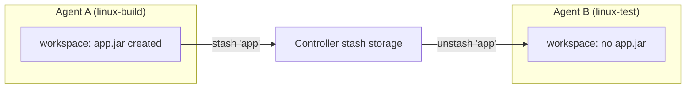
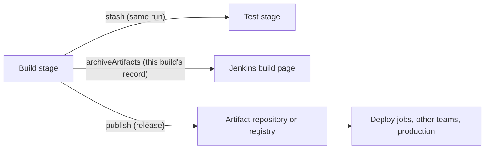

# Stash, Unstash and Artifacts

## Introduction

As soon as a pipeline uses more than one agent, files stop following you around. You compile a JAR on a Linux agent, then the test stage runs on a different agent, and the JAR is not there. Each agent has its own [workspace](../2-jenkins-jobs/3-jenkins-workspaces.mdx), and workspaces are not shared.

Jenkins gives you two built-in tools for moving files, and they solve different problems:

- **`stash` / `unstash`**: a short-term "carry this to the next stage" mechanism **within one run**. Stashes are normally deleted when the run ends.
- **`archiveArtifacts`**: keep files **after** the run, attached to the build, so people and other jobs can download them later.

An analogy: stash is the tray a nurse carries from one room to another during an operation. Archived artifacts are what goes into the patient's permanent record. And for the things you ship to customers, there is a pharmacy: an artifact repository such as Nexus, Artifactory, a container registry or an object store.

This page covers:

- `stash` and `unstash` with includes and excludes
- Why stashes are for small files
- `archiveArtifacts` and fingerprinting
- Copying artifacts between jobs
- When to use an external artifact repository instead
- Keeping stashes for Restart from Stage

## The Problem: Separate Workspaces



When a stage has its own `agent`, it gets a workspace on that agent. Even when two stages land on the same machine, Jenkins may give them different workspace directories (for example `my-job` and `my-job@2`) when builds run concurrently. Never assume files from an earlier stage are present unless both stages share the same agent allocation.

## stash and unstash

`stash` saves files matching a pattern under a name. `unstash` restores them into the current workspace, on whatever agent is running the current stage.

```groovy
pipeline {
    agent none
    stages {
        stage('Build') {
            agent { label 'linux' }
            steps {
                sh '''
                    mkdir -p dist
                    echo "console.log('hello')" > dist/app.js
                    echo "v1.2.3" > dist/VERSION
                '''
                stash name: 'dist', includes: 'dist/**'
            }
        }
        stage('Test') {
            agent { label 'linux' }
            steps {
                unstash 'dist'
                sh 'ls -l dist && cat dist/VERSION'
            }
        }
    }
}
```

Example output:

```text
[Pipeline] stash
Stashed 2 file(s)
...
[Pipeline] unstash
+ ls -l dist
-rw-r--r-- 1 jenkins jenkins 21 Oct 11 10:02 app.js
-rw-r--r-- 1 jenkins jenkins  7 Oct 11 10:02 VERSION
+ cat dist/VERSION
v1.2.3
```

### stash parameters

| Parameter | Default | Purpose |
| --- | --- | --- |
| `name` | required | Name used to `unstash` later. Unique within the run |
| `includes` | all files | Ant-style pattern, for example `build/libs/*.jar` or `dist/**` |
| `excludes` | none | Pattern of files to leave out |
| `useDefaultExcludes` | `true` | Skip SCM metadata such as `.git` |
| `allowEmpty` | `false` | Allow a stash that matches no files instead of failing |

Ant-style patterns use `*` for any characters in one path segment and `**` for any number of directories. Multiple patterns are comma-separated: `includes: 'dist/**,package.json'`.

```groovy
stash name: 'test-inputs',
      includes: 'src/**,package.json,package-lock.json',
      excludes: '**/*.md,**/node_modules/**'
```

### Stashes are for small files

Stashed files are copied from the agent to the controller (by default, stored in the build directory on the controller) and then back to an agent on unstash. That makes them convenient but not cheap:

- Large stashes slow down the build and fill the controller's disk.
- Every byte travels through the controller, which is often the most loaded machine in the system.

Use stashes for things like compiled output, a test bundle or a generated config file. Do not stash `node_modules`, a Docker image tarball or a multi-gigabyte dataset. For large data, rebuild on the target agent, use a cache, or push to an external store.

:::tip
If your Jenkins runs on AWS, the **Artifact Manager on S3** plugin (`artifact-manager-s3`) can store both archived artifacts and stashes in an S3 bucket instead of on the controller's disk. Transfers use temporary (presigned) S3 URLs, which takes disk and bandwidth load off the controller. Similar plugins exist for other object stores. Check [plugins.jenkins.io](https://plugins.jenkins.io/) for current options.
:::

### Fan-out: build once, test in parallel

Stashes shine with [parallel stages](./0-jenkins-parallel-stages.mdx): build once, then let several agents unstash the same output.

```groovy
pipeline {
    agent none
    stages {
        stage('Build') {
            agent { label 'linux' }
            steps {
                sh './gradlew assemble'
                stash name: 'jar', includes: 'build/libs/*.jar'
            }
        }
        stage('Verify') {
            parallel {
                stage('Smoke Test') {
                    agent { label 'linux' }
                    steps {
                        unstash 'jar'
                        sh 'java -jar build/libs/*.jar --smoke-test'
                    }
                }
                stage('Container Scan') {
                    agent { label 'docker' }
                    steps {
                        unstash 'jar'
                        sh 'docker build -t app:ci .'
                    }
                }
            }
        }
    }
}
```

## Archiving Artifacts

`archiveArtifacts` copies files from the workspace into the build's record on the controller (or into an external artifact manager, if one is configured). They show up as download links on the build page and stay as long as the build is kept.

```groovy
pipeline {
    agent { label 'linux' }
    stages {
        stage('Build') {
            steps {
                sh '''
                    mkdir -p build/libs
                    echo "fake jar" > build/libs/app-1.2.3.jar
                    echo "<html>report</html>" > build/report.html
                '''
            }
        }
    }
    post {
        success {
            archiveArtifacts artifacts: 'build/libs/*.jar', fingerprint: true
        }
        always {
            archiveArtifacts artifacts: 'build/report.html', allowEmptyArchive: true
        }
    }
}
```

Example output:

```text
[Pipeline] archiveArtifacts
Archiving artifacts
Recording fingerprints
[Pipeline] archiveArtifacts
Archiving artifacts
Finished: SUCCESS
```

Useful parameters:

| Parameter | Purpose |
| --- | --- |
| `artifacts` | Comma-separated Ant patterns of files to keep |
| `excludes` | Patterns to leave out |
| `allowEmptyArchive` | Warn instead of failing when nothing matches |
| `fingerprint` | Record an MD5 fingerprint to track the file across jobs |
| `onlyIfSuccessful` | Archive only if the build succeeded so far |
| `followSymlinks` | Whether to follow symbolic links in the workspace |

Archived artifacts are kept until the build is deleted. Control that with `buildDiscarder` (see [Pipeline Options and Tuning](./6-jenkins-pipeline-options.mdx)), which can delete old artifacts while keeping the build records:

```groovy
options {
    buildDiscarder(logRotator(numToKeepStr: '50', artifactNumToKeepStr: '10'))
}
```

### Fingerprints

A fingerprint is a checksum Jenkins records for a file. If job A archives `app-1.2.3.jar` with a fingerprint, and job B later uses the same file and fingerprints it too, Jenkins can show that build B used the output of build A. This answers questions like "which build produced the JAR running in production?"

```groovy
fingerprint 'build/libs/*.jar'
```

## Copying Artifacts Between Jobs

Sometimes a separate job needs the output of another job, for example a deployment job that deploys what the build job produced. The **Copy Artifact** plugin (`copyartifact`) provides the `copyArtifacts` step:

```groovy
pipeline {
    agent { label 'deploy' }
    parameters {
        string(name: 'BUILD_NUMBER_TO_DEPLOY', defaultValue: '', description: 'Leave empty for last successful')
    }
    stages {
        stage('Fetch') {
            steps {
                script {
                    def sel = params.BUILD_NUMBER_TO_DEPLOY ?
                        specific(params.BUILD_NUMBER_TO_DEPLOY) : lastSuccessful()
                    copyArtifacts(projectName: 'my-app/main',
                                  selector: sel,
                                  filter: 'build/libs/*.jar',
                                  fingerprintArtifacts: true)
                }
                sh 'ls build/libs'
            }
        }
    }
}
```

The source job must allow copying. In the source Jenkinsfile, add:

```groovy
options {
    copyArtifactPermission('my-deploy-job')
}
```

The step and selector names above come from the Copy Artifact plugin. Use the [Snippet Generator](../3-jenkins-pipeline-basics/9-jenkins-pipeline-syntax-generator.mdx) on your instance to confirm the exact options for your installed version.

## When to Use an Artifact Repository Instead

Jenkins artifacts are tied to a build record. Delete the build, or lose the controller, and they are gone. For anything you release, use a proper repository:

| Kind of output | Better home |
| --- | --- |
| Java JARs, Maven artifacts | Nexus, Artifactory, GitHub Packages |
| npm, PyPI packages | Private registry or the public registry |
| Container images | A container registry (ECR, ACR, GCR, Harbor, Docker Hub) |
| Static sites, large bundles | Object storage such as S3 or Azure Blob |
| Test reports, logs, small binaries | Jenkins `archiveArtifacts` is fine |



## Stashes and Restart from Stage

By default, stashes are deleted when a run finishes. That breaks [Restart from Stage](./7-jenkins-restart-and-replay.mdx): if you restart from `Test`, the stash created in `Build` no longer exists. Keep stashes from recent completed runs with `preserveStashes`:

```groovy
options {
    preserveStashes(buildCount: 5)
}
```

`buildCount` must be between 1 and 50. Without an argument, stashes of the most recent completed run are kept.

## Real-World Scenario

Your team builds a React frontend and a Go backend in one repository. The pipeline builds the frontend on a Node agent, embeds it into the Go binary on a Go agent, tests on Linux and macOS agents, and deploys from a deploy agent that holds the cloud credentials. Releases also need to be downloadable by the QA team for manual testing.

```groovy
pipeline {
    agent none
    options {
        preserveStashes(buildCount: 3)
        buildDiscarder(logRotator(numToKeepStr: '30', artifactNumToKeepStr: '5'))
    }
    stages {
        stage('Frontend') {
            agent { docker { image 'node:22-alpine' } }
            steps {
                dir('web') {
                    sh 'npm ci && npm run build'
                }
                stash name: 'web-dist', includes: 'web/dist/**'
            }
        }
        stage('Backend') {
            agent { docker { image 'golang:1.25' } }
            steps {
                unstash 'web-dist'
                sh 'go build -o bin/app ./cmd/app'
                stash name: 'binary', includes: 'bin/app'
            }
        }
        stage('Test') {
            parallel {
                stage('Linux') {
                    agent { label 'linux' }
                    steps {
                        unstash 'binary'
                        sh './bin/app --self-test'
                    }
                }
                stage('macOS') {
                    agent { label 'macos' }
                    steps {
                        echo 'Cross-compiled macOS build would be tested here'
                    }
                }
            }
        }
        stage('Publish') {
            agent { label 'linux' }
            steps {
                unstash 'binary'
                archiveArtifacts artifacts: 'bin/app', fingerprint: true
            }
        }
    }
}
```

**Why this approach:** the web bundle and the binary are small, so stashes are a good fit for moving them between Docker and native agents within one run. The final binary is archived and fingerprinted so QA can download it from the build page, and old artifacts are cleaned up automatically. `preserveStashes` allows restarting from `Test` without rebuilding.

**When to use stashes:** small files, within one run, across agents.

**When not to use them:** large files, across runs, or for anything that must survive the build being deleted. For releases to production, push the binary or image to a repository and deploy from there, so deployment does not depend on Jenkins build records.

**Alternatives and trade-offs:**

| Approach | Pros | Cons | Best for |
| --- | --- | --- | --- |
| `stash` / `unstash` | Built in, no setup | Goes through controller, deleted after run, slow for big files | Small files between stages |
| Single agent for the whole pipeline | No copying at all | Less parallelism, one toolchain image | Simple pipelines |
| `archiveArtifacts` | Downloadable, linked to build | Uses controller disk unless externalized | Reports, small binaries, QA builds |
| `copyArtifacts` between jobs | Reuses outputs across jobs | Couples jobs, needs permissions | Separate deploy jobs |
| External repository or registry | Durable, versioned, shareable | Extra system and credentials | Releases and production deploys |
| Shared volume or cache | Fast for big dependencies | Concurrency and cleanup issues | Dependency caches, see [Build Caching and Speed](../9-jenkins-build-and-test/8-jenkins-build-caching.mdx) |

## Common Mistakes

- **Assuming files survive across agents.** Each stage with its own agent has its own workspace. Stash or rebuild.
- **Stashing huge directories.** `node_modules` or build caches in a stash slow every build and load the controller. Use caches or rebuild.
- **Patterns that match nothing.** `stash` fails on an empty match unless `allowEmpty: true`. Check paths relative to the workspace root, not your `dir()` block.
- **Unstashing into the wrong directory.** Files are restored with the paths they had relative to the workspace when stashed. `unstash` inside `dir('sub')` puts them under `sub/`.
- **Archiving everything forever.** Without `buildDiscarder`, artifacts accumulate on the controller disk. Set retention limits.
- **Treating Jenkins as the release store.** Builds get deleted, controllers get rebuilt. Publish release artifacts to a repository.
- **Restart from Stage failing on missing stash.** Add `preserveStashes()`.

## Summary

- Stages on different agents have different workspaces. Files do not move by themselves.
- `stash` and `unstash` move small files within one run, through the controller.
- `archiveArtifacts` keeps files with the build record so people and jobs can download them. Add `fingerprint: true` to trace them.
- `copyArtifacts` (Copy Artifact plugin) lets one job pull another job's artifacts.
- Release outputs belong in an artifact repository or registry.
- `preserveStashes()` keeps stashes so Restart from Stage works.

## Exercises

1. Build a pipeline with `agent none` and two stages on different agents. Create a file in the first stage and show that it is missing in the second. Then fix it with `stash` and `unstash`.
2. Archive a generated HTML report with `allowEmptyArchive: true` and open it from the build page.
3. Add `buildDiscarder(logRotator(numToKeepStr: '10', artifactNumToKeepStr: '2'))` and run the job a few times. Check which builds still have artifacts.
4. Add `preserveStashes()` and use Restart from Stage to rerun the second stage without rerunning the first.

Related pages:

- [Workspaces](../2-jenkins-jobs/3-jenkins-workspaces.mdx)
- [Build History and Artifacts](../2-jenkins-jobs/4-jenkins-build-history-and-artifacts.mdx)
- [Restart from Stage and Replay](./7-jenkins-restart-and-replay.mdx)
- [Building and Pushing Docker Images](../9-jenkins-build-and-test/7-jenkins-docker-image-builds.mdx)
