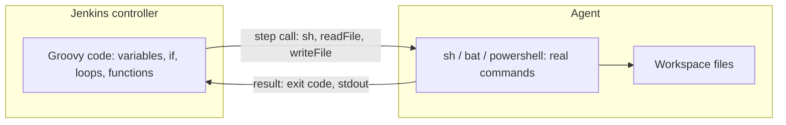
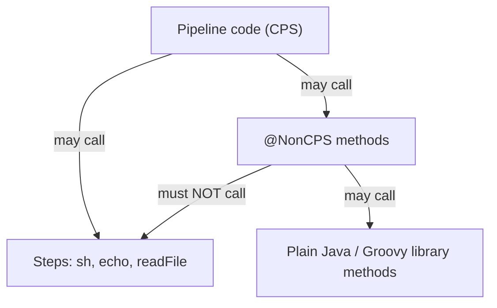

# Groovy Essentials for Pipelines

## Introduction

Every Jenkinsfile is a Groovy program. Declarative Pipeline hides most of that behind a structured syntax, but sooner or later you write a `script` block, a loop that generates parallel branches, or a helper function. At that point, you are writing Groovy, and a few Jenkins-specific rules come into play.

Groovy in Jenkins is not quite the Groovy you would run on your laptop:

- Your code runs on the **controller**, not the agent. Only steps such as `sh` run on the agent.
- It runs through the **CPS** (Continuation Passing Style) interpreter, which lets pipelines pause and survive restarts, at the cost of some odd behavior.
- It usually runs in a **sandbox** that blocks many methods until an administrator approves them.

Think of it like writing instructions for a stage manager rather than acting on stage yourself. You (the Groovy code) decide what happens next, and the actors (agents) do the physical work. The stage manager also writes down every instruction so the show can resume after a power cut. That bookkeeping is CPS.

This page teaches the Groovy you actually need, and the traps that catch nearly everyone. For when to choose Scripted over Declarative, see [Declarative vs Scripted Pipelines](../3-jenkins-pipeline-basics/4-jenkins-declarative-vs-scripted.mdx).

## Where Groovy Runs



This has practical consequences:

- `new File('pom.xml').text` reads from the **controller's** file system, not the workspace on the agent. Use the `readFile` step instead.
- CPU-heavy Groovy (parsing a 50 MB log in a loop) slows the controller for everyone. Do heavy work in a shell or Python script on the agent.
- Groovy cannot see agent environment variables or tools directly. Ask through steps.

```groovy
// Wrong: reads the controller's disk, usually fails or reads the wrong file
def version = new File('VERSION').text

// Right: the step reads from the workspace on the agent
def version = readFile('VERSION').trim()
```

## Variables and Types

```groovy
pipeline {
    agent any
    stages {
        stage('Variables') {
            steps {
                script {
                    def name = 'payments-api'        // dynamic type
                    String region = 'eu-west-1'      // explicit type
                    int replicas = 3
                    boolean isRelease = env.BRANCH_NAME == 'main'

                    echo "name=${name}, region=${region}, replicas=${replicas}, release=${isRelease}"
                }
            }
        }
    }
}
```

Example output:

```text
name=payments-api, region=eu-west-1, replicas=3, release=false
```

Variables declared with `def` inside a `script` block are local to that block. To share a value between stages, either declare it at the top of the Jenkinsfile (outside `pipeline`) or store it in `env`:

```groovy
def imageTag   // script-level variable, visible in all script blocks

pipeline {
    agent any
    stages {
        stage('Compute') {
            steps {
                script {
                    imageTag = "1.0.${env.BUILD_NUMBER}"
                    env.DEPLOY_ENV = 'staging'
                }
            }
        }
        stage('Use') {
            steps {
                echo "Tag ${imageTag} to ${env.DEPLOY_ENV}"
            }
        }
    }
}
```

:::caution
Everything stored in `env` becomes a **string**. `env.COUNT = 3` followed by `env.COUNT + 1` gives `"31"`, not `4`. Convert explicitly with `env.COUNT as int` or `env.COUNT.toInteger()`. Booleans have the same issue: `env.FLAG = false` stores the string `"false"`, which is truthy in Groovy. Use `env.FLAG == 'true'` to test it. Values from `params` keep their types (a `booleanParam` is a real boolean).
:::

## Strings

Groovy has several string forms, and choosing the right one matters for both correctness and security.

| Form | Example | Interpolates `${...}`? | Multi-line? |
| --- | --- | --- | --- |
| Single quotes | `'hello $USER'` | No | No |
| Double quotes (GString) | `"hello ${name}"` | Yes, by Groovy | No |
| Triple single quotes | `'''...'''` | No | Yes |
| Triple double quotes | `"""..."""` | Yes, by Groovy | Yes |

The key question is: **who should replace the variable, Groovy or the shell?**

```groovy
environment {
    GREETING = 'hello'
}
steps {
    // Groovy replaces ${env.GREETING} before the shell sees it
    sh "echo ${env.GREETING} from Groovy"

    // The shell replaces $GREETING, Groovy passes the text through untouched
    sh 'echo $GREETING from the shell'

    // Multi-line shell script, shell does the substitution
    sh '''
        set -eu
        echo "Building on $NODE_NAME"
        echo "Greeting: $GREETING"
    '''
}
```

Example output:

```text
+ echo hello from Groovy
hello from Groovy
+ echo hello from the shell
hello from the shell
+ set -eu
+ echo 'Building on linux-agent-1'
Building on linux-agent-1
+ echo 'Greeting: hello'
Greeting: hello
```

:::warning
Never put secrets in a Groovy-interpolated (double-quoted) string. The Jenkins documentation states that Groovy string interpolation should never be used with credentials: the secret is substituted before the command reaches the agent and can leak, for example through process listings. Use single quotes and let the shell read the variable:

```groovy
withCredentials([string(credentialsId: 'api-token', variable: 'TOKEN')]) {
    sh 'curl -H "Authorization: Bearer $TOKEN" https://api.example.com/deploy'   // safe
    // sh "curl -H 'Authorization: Bearer ${TOKEN}' ..."                          // unsafe
}
```

The same applies to user-supplied parameters: interpolating them into `sh` with Groovy can allow command injection. See [Credentials Management](../11-jenkins-security/3-jenkins-credentials.mdx).
:::

Useful string methods:

```groovy
def branch = 'feature/JIRA-123-login'
echo branch.startsWith('feature/') ? 'feature branch' : 'other'
echo branch.replace('/', '-')            // feature-JIRA-123-login
echo branch.split('/')[1]                // JIRA-123-login
echo branch.toUpperCase()
echo "  padded  ".trim()
```

## Lists and Maps

```groovy
script {
    def services = ['api', 'worker', 'scheduler']
    services << 'webhooks'                // append
    echo "Count: ${services.size()}"      // 4
    echo "First: ${services[0]}"          // api

    def replicas = [api: 3, worker: 2, scheduler: 1]
    replicas.webhooks = 2                 // add a key
    echo "API replicas: ${replicas.api}"
    echo "Has worker? ${replicas.containsKey('worker')}"

    for (String svc : services) {
        echo "${svc} -> ${replicas[svc]}"
    }
}
```

Example output:

```text
Count: 4
First: api
API replicas: 3
Has worker? true
api -> 3
worker -> 2
scheduler -> 1
webhooks -> 2
```

Map keys written without quotes (`[api: 3]`) are strings. To use a variable's value as a key, wrap it in parentheses: `[(keyVar): 3]`.

## Control Flow

```groovy
script {
    def env_name = params.TARGET ?: 'dev'     // Elvis operator: default if empty or null

    if (env_name == 'prod') {
        echo 'Production deployment'
    } else if (env_name in ['staging', 'qa']) {
        echo 'Pre-production deployment'
    } else {
        echo 'Development deployment'
    }

    switch (env_name) {
        case 'prod':
            echo 'Replicas: 6'
            break
        case ~/stag.*/:                       // regex match
            echo 'Replicas: 2'
            break
        default:
            echo 'Replicas: 1'
    }
}
```

For the common case of "should this stage run?", prefer the Declarative `when` directive over `if` inside `script`. It shows skipped stages clearly in the UI. See [Conditional Stages with when](../3-jenkins-pipeline-basics/8-jenkins-when-conditions.mdx).

## Getting Data Back from Steps

Many decisions depend on command output. `sh` can return stdout or the exit code instead of failing:

```groovy
script {
    def commit = sh(script: 'git rev-parse --short HEAD', returnStdout: true).trim()
    echo "Commit: ${commit}"

    int status = sh(script: 'grep -q "TODO" src/main.py', returnStatus: true)
    if (status == 0) {
        unstable 'Found TODO markers in src/main.py'
    }
}
```

Example output:

```text
+ git rev-parse --short HEAD
Commit: 4f2c9ab
+ grep -q TODO src/main.py
```

Always `.trim()` stdout. It ends with a newline that breaks comparisons and image tags.

For structured data, use the **Pipeline Utility Steps** plugin (`pipeline-utility-steps`) rather than parsing text by hand or using Groovy's JSON classes, which are often blocked by the sandbox:

```groovy
script {
    def pkg = readJSON file: 'package.json'
    echo "Package ${pkg.name} version ${pkg.version}"

    def cfg = readYaml file: 'deploy/config.yaml'
    echo "Replicas: ${cfg.replicas}"

    writeJSON file: 'build-info.json', json: [commit: env.GIT_COMMIT, build: env.BUILD_NUMBER]
}
```

## Functions

You can define functions at the top level of a Jenkinsfile and call them from `script` blocks:

```groovy
def semverBump(String version, String part) {
    def parts = version.tokenize('.').collect { it as int }
    if (part == 'major') {
        return "${parts[0] + 1}.0.0"
    }
    if (part == 'minor') {
        return "${parts[0]}.${parts[1] + 1}.0"
    }
    return "${parts[0]}.${parts[1]}.${parts[2] + 1}"
}

def logStatus(String status) {
    echo "Build ${env.JOB_NAME} #${env.BUILD_NUMBER}: ${status}"
}

pipeline {
    agent any
    stages {
        stage('Version') {
            steps {
                script {
                    echo semverBump('1.4.2', 'minor')
                }
            }
        }
    }
    post {
        always { script { logStatus(currentBuild.currentResult) } }
    }
}
```

Example output:

```text
1.5.0
Build my-app/main #57: SUCCESS
```

When the same functions appear in several repositories, move them into a [shared library](../8-jenkins-shared-libraries/0-jenkins-shared-libraries-introduction.mdx) instead of copying them.

## Closures

A closure is a block of code you can store and call later. You have been using them all along: `steps { ... }`, `retry(3) { ... }` and `parallel` branches are closures.

```groovy
script {
    def greet = { String who -> "Hello, ${who}" }
    echo greet('Jenkins')

    def branches = [:]
    ['unit', 'lint'].each { kind ->
        branches[kind] = { echo "Running ${kind}" }
    }
    parallel branches
}
```

`each`, `collect`, `findAll` and similar methods work in modern Pipeline versions, but note the capture rule from [Parallel Stages](./0-jenkins-parallel-stages.mdx): with a classic `for` loop, copy the loop variable into a local before using it in a closure, because closures capture variables, not values.

## CPS: Why Pipelines Behave Strangely

Jenkins runs pipeline Groovy through a CPS transformation so that a running pipeline can be paused, saved to disk and resumed, for example after a controller restart or while waiting for `input`. To make that possible, local variables must be **serializable**, and some Groovy features behave differently.

### NotSerializableException

Objects that cannot be serialized, such as a regex `Matcher`, break the pipeline if they are still in a local variable when a step runs:

```groovy
script {
    def m = ('release-1.4.2' =~ /(\d+)\.(\d+)\.(\d+)/)
    if (m) {
        echo "Major: ${m[0][1]}"
    }
    sh 'echo next step'      // may fail: java.io.NotSerializableException: java.util.regex.Matcher
}
```

Fixes: extract the value and drop the object before the next step, or move the logic into a `@NonCPS` method.

```groovy
@NonCPS
def majorVersion(String text) {
    def m = (text =~ /(\d+)\.(\d+)\.(\d+)/)
    return m ? m[0][1] : null
}

// in a script block:
// echo "Major: ${majorVersion('release-1.4.2')}"
```

### @NonCPS rules

`@NonCPS` marks a method to run as normal Groovy, without the CPS transform. It is faster and avoids serialization problems. The catch:

- A `@NonCPS` method **must not call pipeline steps** (`sh`, `echo`, `node`, `readFile` and so on) or other non-`@NonCPS` methods from your script.
- CPS code may call `@NonCPS` code. The reverse is not allowed.
- Use it for pure data work: parsing, sorting, string manipulation.

Some Groovy methods that take closures, such as `sort` with a comparator closure, do not work correctly in CPS code. Wrapping them in a `@NonCPS` method fixes it:

```groovy
@NonCPS
def sortByPriority(List services) {
    return services.sort(false) { a, b -> a.priority <=> b.priority }
}
```

Jenkins documents these cases in [Pipeline CPS method mismatches](https://www.jenkins.io/doc/book/pipeline/cps-method-mismatches/). If you see a log message like "expected to call ... but wound up catching ...", that page explains the cause.



## The Sandbox and Script Approval

Pipelines from SCM normally run in the **Groovy sandbox**. It allows common operations and blocks methods that could harm the controller, such as file system access, `System.exit`, or reflection. When your script calls a blocked method, the build fails with a message like:

```text
org.jenkinsci.plugins.scriptsecurity.sandbox.RejectedAccessException:
Scripts not permitted to use method groovy.json.JsonSlurperClassic parseText java.lang.String
```

An administrator can approve the signature under **Manage Jenkins > In-process Script Approval**, but think twice: some approvals open security holes for every pipeline on the instance. The better options are usually:

1. Use a step that does the job, such as `readJSON` instead of `JsonSlurper`.
2. Move trusted code into a shared library loaded as a trusted (global) library.
3. Do the work in a shell or Python script on the agent.

The full story is in [Script Security and Sandboxing](../11-jenkins-security/5-jenkins-script-security.mdx).

## Real-World Scenario

Your platform team supports 40 microservices. Each repository has a `deploy.json` listing environments and replica counts. The pipeline must read it, compute an image tag from the Git commit, validate the target environment, and generate one deploy branch per environment. An earlier version used `JsonSlurper`, `new File()` and a regex in the main script. It failed randomly with `NotSerializableException` and needed three script approvals.

```groovy
@NonCPS
def isValidTag(String tag) {
    return tag ==~ /^[0-9a-f]{7}-\d+$/
}

pipeline {
    agent { label 'linux' }
    parameters {
        choice(name: 'TARGET', choices: ['dev', 'staging', 'prod'], description: 'Deploy target')
    }
    stages {
        stage('Prepare') {
            steps {
                script {
                    def cfg = readJSON file: 'deploy.json'
                    def commit = sh(script: 'git rev-parse --short=7 HEAD', returnStdout: true).trim()
                    env.IMAGE_TAG = "${commit}-${env.BUILD_NUMBER}"

                    if (!isValidTag(env.IMAGE_TAG)) {
                        error "Unexpected tag format: ${env.IMAGE_TAG}"
                    }
                    if (!cfg.environments.containsKey(params.TARGET)) {
                        error "deploy.json has no environment '${params.TARGET}'"
                    }
                    env.REPLICAS = cfg.environments[params.TARGET].replicas.toString()
                }
            }
        }
        stage('Deploy') {
            steps {
                sh '''
                    echo "Deploying tag $IMAGE_TAG to $TARGET with $REPLICAS replicas"
                '''
            }
        }
    }
}
```

Example output:

```text
+ git rev-parse --short=7 HEAD
+ echo 'Deploying tag 4f2c9ab-58 to staging with 2 replicas'
Deploying tag 4f2c9ab-58 to staging with 2 replicas
```

**Why this approach:** file reading happens through `readJSON` on the agent, so no sandbox approvals are needed. The regex lives in a `@NonCPS` method, so no `Matcher` is ever held across a step. Values handed to the shell go through environment variables and a single-quoted script, not Groovy interpolation. Parameters are both type-checked by Jenkins (a `choice`) and validated against the config.

**When to write Groovy:**

- Small decisions and data shaping that drive pipeline structure (which branches, which environments).
- Glue between steps: reading a value, setting `env`, choosing a path.

**When not to:**

- Business logic, heavy parsing or long loops. Put that in a script in the repository and run it with `sh`, where it is testable and runs on the agent.
- Anything that needs many sandbox approvals. That is a sign the code belongs in a trusted shared library or in a script on the agent.

**Alternatives and trade-offs:**

| Approach | Pros | Cons | Best for |
| --- | --- | --- | --- |
| Pure Declarative, no `script` | Easiest to read and validate | Limited logic | Most pipelines |
| Small `script` blocks | Flexible, inline | Groovy and CPS quirks | Glue logic |
| Helper functions in the Jenkinsfile | Reusable within one repo | Copy-paste across repos | One project |
| Shared library | Reusable, testable, can be trusted | Versioning and maintenance | Many repos |
| Shell or Python scripts on the agent | Testable locally, no CPS or sandbox issues | Another language in the repo | Heavy logic and parsing |

## Common Mistakes

- **Reading files with `new File()`.** That reads the controller's disk. Use `readFile`, `readJSON`, `readYaml` or `fileExists`.
- **Treating `env` values as numbers or booleans.** They are strings. Convert explicitly.
- **Double-quoting secrets or user input into `sh`.** Use single quotes and environment variables.
- **Holding non-serializable objects across steps.** Matchers, some iterators and JSON parser objects cause `NotSerializableException`. Use `@NonCPS` helpers or plain values.
- **Calling steps from `@NonCPS` methods.** This produces confusing behavior and log warnings. Keep `@NonCPS` methods pure.
- **Forgetting `.trim()` on `returnStdout`.** The trailing newline breaks comparisons.
- **Writing a program in the Jenkinsfile.** Long Groovy is slow on the controller, hard to test and fragile. Keep the Jenkinsfile as orchestration.

## Summary

- Pipeline Groovy runs on the controller. Steps like `sh` run on agents.
- Use single quotes for shell-side variables and for anything secret. Use double quotes only for Groovy values you trust.
- Lists, maps, closures, `if`, `switch` and functions work as in normal Groovy, with CPS caveats.
- `env` holds strings only. `params` keeps types.
- `@NonCPS` methods are for pure data work and must not call steps.
- The sandbox blocks risky methods. Prefer steps and shared libraries over script approvals.

## Exercises

1. Write a pipeline that reads `package.json` with `readJSON` and fails with `error` if the `version` field is missing.
2. Set `env.RETRIES = 3` and print `env.RETRIES + 1`. Fix it to print `4`.
3. Write a `@NonCPS` function that takes a list of maps with `name` and `size` fields and returns the names sorted by size.
4. Find a Jenkinsfile that interpolates a credential with double quotes and rewrite it safely.

Related pages:

- [Scripted Pipeline Syntax](../3-jenkins-pipeline-basics/3-jenkins-scripted-pipeline.mdx)
- [Environment Variables](../3-jenkins-pipeline-basics/6-jenkins-environment-variables.mdx)
- [Custom Steps with vars](../8-jenkins-shared-libraries/2-jenkins-global-vars.mdx)
- [Script Security and Sandboxing](../11-jenkins-security/5-jenkins-script-security.mdx)
