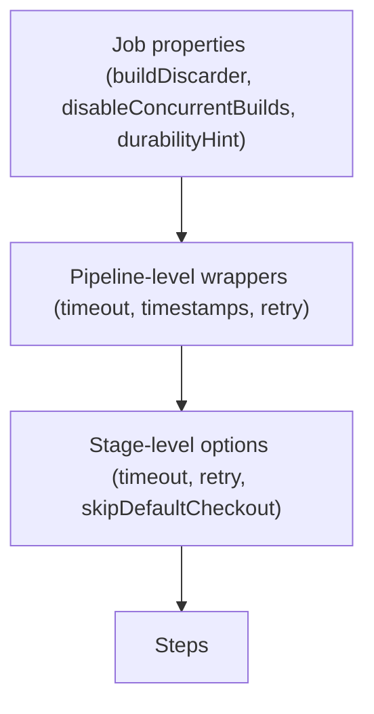
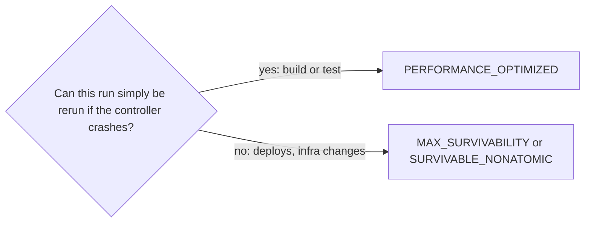

# Pipeline Options and Tuning

## Introduction

The `stages` of a pipeline describe **what** to do. The `options` directive describes **how** Jenkins should run it: how many old builds to keep, whether two builds may run at once, how long a build may take, whether to check out code automatically, and how much Jenkins should write to disk to survive a crash.

These settings rarely get attention until something goes wrong: the controller disk fills with ten thousand old builds, two deployments run at the same time, or a hung build blocks an agent all weekend. A few lines of `options` prevent all of that.

Think of options as the house rules posted in a shared workshop: "clean up after yourself", "one person on the lathe at a time", "no machine runs unattended overnight". They do not change the work, but they keep the shop usable for everyone.

This page covers:

- The most useful pipeline-level options and what each solves
- Stage-level options
- Durability settings and what they trade
- Practical performance tuning for pipelines and the controller
- A sensible default `options` block

## Where Options Go

```groovy
pipeline {
    agent any
    options {
        // pipeline-level options: apply to the whole run
        buildDiscarder(logRotator(numToKeepStr: '30'))
        timeout(time: 1, unit: 'HOURS')
    }
    stages {
        stage('Build') {
            options {
                // stage-level options: apply to this stage only
                timeout(time: 10, unit: 'MINUTES')
                retry(2)
            }
            steps {
                sh 'make build'
            }
        }
    }
}
```



Pipeline options fall into two groups:

- **Job properties** such as `buildDiscarder` and `disableConcurrentBuilds`. They change the job's configuration. Because the Jenkinsfile is read during a build, a changed property takes effect from that build onward, which is why a newly added setting sometimes seems to apply "one build late".
- **Wrappers** such as `timeout` and `timestamps`. They wrap the run itself.

## Build Retention: buildDiscarder

Every build keeps its log, its test results and its archived artifacts on the controller. Without limits, this grows forever and slows down the UI, backups and restarts.

```groovy
options {
    buildDiscarder(logRotator(
        numToKeepStr: '50',          // keep at most 50 builds
        daysToKeepStr: '30',         // and none older than 30 days
        artifactNumToKeepStr: '10',  // artifacts only on the newest 10
        artifactDaysToKeepStr: '7'
    ))
}
```

Use the build count for busy jobs and the days limit for jobs that run rarely. Keep artifacts for fewer builds than logs, because artifacts are usually much larger.

:::tip
Builds marked **Keep this build forever** in the UI are never discarded. Use that for release builds you might need to audit, rather than keeping every build.
:::

## Concurrency: disableConcurrentBuilds

By default, Jenkins can run several builds of the same job at once. That is good for pull requests but dangerous for deployments.

```groovy
options {
    disableConcurrentBuilds()
}
```

New builds wait in the queue until the running one finishes. With `abortPrevious: true`, a new build **aborts** the running one instead:

```groovy
options {
    disableConcurrentBuilds(abortPrevious: true)
}
```

| Setting | Behavior | Best for |
| --- | --- | --- |
| Default | Builds run concurrently | Independent pull request builds |
| `disableConcurrentBuilds()` | Queue newer builds | Deploy jobs, jobs using a shared resource |
| `disableConcurrentBuilds(abortPrevious: true)` | Newest wins, older is aborted | PR branches where only the latest commit matters |

For finer control, such as "only one deploy to staging across all jobs", use the `lock` step from the Lockable Resources plugin (see [Manual Input and Approvals](./2-jenkins-input-and-approvals.mdx)).

## Time Limits and Logging

```groovy
options {
    timeout(time: 45, unit: 'MINUTES')
    timestamps()
    ansiColor('xterm')
}
```

- `timeout` aborts the whole run after the limit. See [Timeouts, Retries and Error Handling](./3-jenkins-timeouts-and-retries.mdx) for stage and step variants.
- `timestamps()` prefixes each log line with a time, which makes it easy to see where time goes. It comes from the Timestamper plugin (`timestamper`). The plugin can also enable timestamps globally for all pipelines.
- `ansiColor('xterm')` renders colored output from tools like npm, Gradle or pytest. It comes from the AnsiColor plugin (`ansicolor`).

Example output with timestamps:

```text
10:02:11  + ./gradlew test
10:04:57  BUILD SUCCESSFUL in 2m 46s
10:04:58  Recording test results
```

## Checkout Control

In Declarative, every stage that allocates an agent automatically checks out the source. That is usually right, but not always.

```groovy
options {
    skipDefaultCheckout()          // do not check out automatically
    checkoutToSubdirectory('src')  // or: check out into a subfolder
}
```

Use `skipDefaultCheckout()` when:

- A stage only needs a stashed artifact, not the source (for example a deploy stage).
- You want to customize the checkout, such as a shallow clone, sparse checkout or extra submodule handling, and call `checkout` yourself.

```groovy
pipeline {
    agent { label 'linux' }
    options {
        skipDefaultCheckout()
    }
    stages {
        stage('Checkout') {
            steps {
                checkout scmGit(
                    branches: [[name: env.BRANCH_NAME ?: 'main']],
                    extensions: [cloneOption(shallow: true, depth: 1, noTags: true)],
                    userRemoteConfigs: scm.userRemoteConfigs
                )
            }
        }
        stage('Build') {
            steps {
                sh 'make build'
            }
        }
    }
}
```

Generate the exact `checkout` syntax for your Git plugin version with the [Snippet Generator](../3-jenkins-pipeline-basics/9-jenkins-pipeline-syntax-generator.mdx). Git checkouts are covered in depth in [Git Integration](../5-jenkins-scm-integration/0-jenkins-git-integration.mdx).

## Other Pipeline Options

| Option | What it does | When to use it |
| --- | --- | --- |
| `retry(n)` | Reruns the whole pipeline on failure | Rarely. Prefer stage or step retries |
| `skipStagesAfterUnstable()` | Skip later stages once the build is `UNSTABLE` | Do not deploy when tests failed |
| `quietPeriod(seconds)` | Wait before starting, merging rapid triggers | Repos with bursts of pushes |
| `parallelsAlwaysFailFast()` | Fail fast in every parallel stage and matrix | Pull request pipelines |
| `preserveStashes(buildCount: n)` | Keep stashes for Restart from Stage | Pipelines with long early stages |
| `newContainerPerStage()` | With a top-level `docker` agent, use a fresh container per stage | Stages that must not see each other's changes |
| `overrideIndexTriggers(bool)` | Override branch indexing triggers for this branch job | Multibranch jobs with special trigger needs |
| `disableResume()` | Do not resume the run after a controller restart | Jobs that cannot safely continue mid-way |
| `disableRestartFromStage()` | Hide "Restart from Stage" for this pipeline | Pipelines where partial reruns are unsafe |
| `copyArtifactPermission('job')` | Let another job copy this job's artifacts | With the Copy Artifact plugin |

Example: never deploy an unstable build.

```groovy
pipeline {
    agent any
    options {
        skipStagesAfterUnstable()
    }
    stages {
        stage('Test') {
            steps {
                sh './gradlew test || true'
                junit 'build/test-results/test/*.xml'   // marks UNSTABLE on test failures
            }
        }
        stage('Deploy') {
            steps {
                echo 'Deploying'   // skipped if Test made the build UNSTABLE
            }
        }
    }
}
```

Example output when one test fails:

```text
[Pipeline] junit
Recording test results
[Pipeline] stage (Deploy)
Stage "Deploy" skipped due to earlier stage(s) marking the build as unstable
Finished: UNSTABLE
```

## Stage-Level Options

Inside a stage, the commonly used options are:

- `timeout(...)`: limits this stage. When the stage has its own `agent`, the time includes waiting for the agent.
- `retry(n)`: reruns the stage on failure.
- `skipDefaultCheckout()`: skips the automatic checkout for this stage's agent.
- `timestamps()`: timestamps this stage's log only.

Stage options are evaluated before the stage's `agent` is allocated and before its `when` condition, so a stage `timeout` also covers an `input` directive in that stage.

## Durability: Speed vs Crash Safety

Jenkins Pipeline saves its state to disk as it runs so it can resume after a controller restart. That I/O costs time, especially for pipelines with many steps. Jenkins lets you choose a **durability level**:

| Level | What it means | Trade-off |
| --- | --- | --- |
| `MAX_SURVIVABILITY` | Writes every step atomically. The default | Slowest, safest |
| `SURVIVABLE_NONATOMIC` | Writes every step, without atomic writes | Faster, small risk of data loss if the OS crashes |
| `PERFORMANCE_OPTIMIZED` | Greatly reduces disk writes | Fastest. Running builds may not resume after an abrupt (unclean) controller shutdown |

Set it per pipeline:

```groovy
options {
    durabilityHint('PERFORMANCE_OPTIMIZED')
}
```

You can also set a global default under **Manage Jenkins > System > Pipeline Speed/Durability Settings**, and override it on specific jobs.

:::note
Graceful restarts are safe at every level. The difference only shows after an abrupt shutdown, such as a crash, an out-of-memory kill or a lost VM. Jenkins' own guidance suggests `PERFORMANCE_OPTIMIZED` for most build and test pipelines, which can simply be rerun, and a higher level for auditable work such as production deployments.
:::



## Performance Tuning for Pipelines

Pipeline speed is mostly about what runs on agents, but the controller does real work for every step. These guidelines come from the Jenkins documentation on scaling pipelines:

1. **Do less in Groovy.** Every step and every CPS-transformed line costs controller CPU and disk. Move loops, parsing and logic into shell or Python scripts that run on agents.
2. **Use fewer, larger steps.** Ten consecutive `sh` steps can usually be one `sh '''...'''` block.
3. **Keep logs reasonable.** Do not dump huge outputs to the console. Write them to a file, compress it, and archive it.
4. **Choose the durability level** above.
5. **Discard old builds** with `buildDiscarder`.
6. **Use `agent none` at the top** when stages have their own agents, so idle executors are not held.
7. **Keep plugins and Pipeline components up to date.** Performance fixes land regularly.

Before and after, consolidating steps:

```groovy
// Before: five steps, five round trips to the agent, five log entries
sh 'npm ci'
sh 'npm run lint'
sh 'npm run build'
sh 'npm test'
sh 'npm pack'

// After: one step
sh '''
    set -e
    npm ci
    npm run lint
    npm run build
    npm test
    npm pack
'''
```

:::caution
Consolidation has a cost: the stage view shows one step instead of five, so it is harder to see which command failed. Keep separate steps (or separate stages) for things people need to see at a glance, and consolidate the noisy helper commands.
:::

Controller-level tuning (JVM heap, garbage collection, storage) is covered in [Performance Tuning](../12-jenkins-administration/4-jenkins-performance-tuning.mdx).

## Options in Scripted Pipeline

Scripted Pipeline has no `options` directive. Job properties are set with the `properties` step, and wrappers become blocks:

```groovy
properties([
    buildDiscarder(logRotator(numToKeepStr: '30')),
    disableConcurrentBuilds(),
    durabilityHint('PERFORMANCE_OPTIMIZED')
])

timeout(time: 1, unit: 'HOURS') {
    timestamps {
        node('linux') {
            checkout scm
            sh 'make build'
        }
    }
}
```

:::warning
`properties` replaces the job's properties with the list you pass. Any property not in the list (including build parameters and triggers set by the same call earlier) is removed. Always set all properties in one `properties` call.
:::

## Real-World Scenario

Your Jenkins controller has 1,200 pipeline jobs. The disk is 90% full, the UI is slow, two staging deployments recently ran at the same time and left the environment half-updated, and a few builds hung for days. You agree on a team-wide default options block and put it in every Jenkinsfile (later, in a [pipeline template](../8-jenkins-shared-libraries/7-jenkins-pipeline-templates.mdx)).

```groovy
pipeline {
    agent none
    options {
        buildDiscarder(logRotator(numToKeepStr: '30', artifactNumToKeepStr: '5'))
        timeout(time: 60, unit: 'MINUTES')
        timestamps()
        durabilityHint('PERFORMANCE_OPTIMIZED')
        parallelsAlwaysFailFast()
        skipStagesAfterUnstable()
    }
    stages {
        stage('Build and Test') {
            agent { label 'linux' }
            steps {
                sh './gradlew build'
            }
            post {
                always { junit 'build/test-results/**/*.xml' }
            }
        }
        stage('Deploy Staging') {
            when { branch 'main' }
            agent { label 'deploy' }
            options {
                lock(resource: 'staging-environment')
                timeout(time: 15, unit: 'MINUTES')
            }
            steps {
                sh './deploy.sh staging'
            }
        }
    }
}
```

The stage-level `lock` option comes from the Lockable Resources plugin. Deploy pipelines for production use the default durability instead of `PERFORMANCE_OPTIMIZED`.

**Why this approach:** `buildDiscarder` stops disk growth, the timeout ends hung builds, the lock serializes staging deploys across all jobs, and `PERFORMANCE_OPTIMIZED` cuts controller I/O for jobs that can be rerun safely.

**When to standardize options:** as soon as more than a handful of teams share a controller. Disk, executors and controller CPU are shared resources.

**When not to:** do not force the same timeout or durability on every job. A 4-hour nightly integration suite and a 2-minute lint job need different limits. Provide defaults that teams can override.

**Alternatives and trade-offs:**

| Approach | Pros | Cons | Best for |
| --- | --- | --- | --- |
| `options` in each Jenkinsfile | Visible, versioned with code | Copy-paste, drift between repos | Few repos |
| Pipeline template in a shared library | One place to change defaults | Less visible to app teams | Many repos |
| Global settings (durability, Timestamper) | Applies everywhere without edits | Hidden from Jenkinsfiles | Instance-wide baselines |
| JCasC and Job DSL | Whole instance as code | More tooling | Platform teams, see [Configuration as Code](../12-jenkins-administration/0-jenkins-configuration-as-code.mdx) |

## Common Mistakes

- **No `buildDiscarder`.** The controller disk fills up and the UI slows down.
- **Using pipeline-level `retry`.** It reruns everything, including stages that passed. Retry the specific stage or step instead.
- **`disableConcurrentBuilds(abortPrevious: true)` on deploy jobs.** Aborting a deploy midway can leave an environment half-updated. Queue deploys instead.
- **`PERFORMANCE_OPTIMIZED` for production deploys.** A controller crash during the deploy loses the run's state. Use a higher durability level for critical work.
- **Expecting a new option to apply immediately.** Job properties from the Jenkinsfile are applied when the build reads the file, so some changes appear from the next build.
- **Calling `properties` twice in Scripted Pipeline.** The second call wipes out the first.

## Summary

- `options` controls how a pipeline runs: retention, concurrency, timeouts, logging, checkout and durability.
- `buildDiscarder`, `timeout` and `disableConcurrentBuilds` are worth adding to nearly every pipeline.
- Stage options (`timeout`, `retry`, `skipDefaultCheckout`, `timestamps`, `lock`) are evaluated before the stage agent and `when`.
- Durability levels trade crash safety for speed. `PERFORMANCE_OPTIMIZED` suits rerunnable builds.
- Pipeline performance improves when you do less in Groovy, use fewer steps and keep logs small.
- Scripted Pipeline uses `properties([...])` and wrapper blocks instead of `options`.

## Exercises

1. Add `buildDiscarder(logRotator(numToKeepStr: '5'))` to a job, run it 8 times, and confirm only 5 builds remain.
2. Add `disableConcurrentBuilds()` and trigger two builds quickly. Then try `abortPrevious: true` and compare.
3. Add `timestamps()` and find the slowest step in your pipeline from the log.
4. Write a Scripted Pipeline equivalent of the "Real-World Scenario" options using `properties` and wrapper blocks.

Related pages:

- [Timeouts, Retries and Error Handling](./3-jenkins-timeouts-and-retries.mdx)
- [Stash, Unstash and Artifacts](./4-jenkins-stash-and-artifacts.mdx)
- [Performance Tuning](../12-jenkins-administration/4-jenkins-performance-tuning.mdx)
- [Pipeline Best Practices](../13-jenkins-best-practices/0-jenkins-pipeline-best-practices.mdx)
