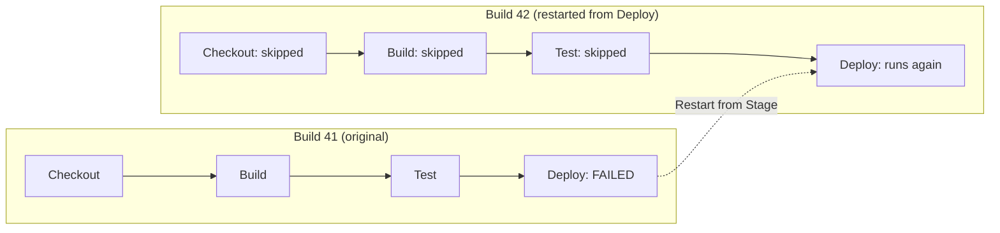
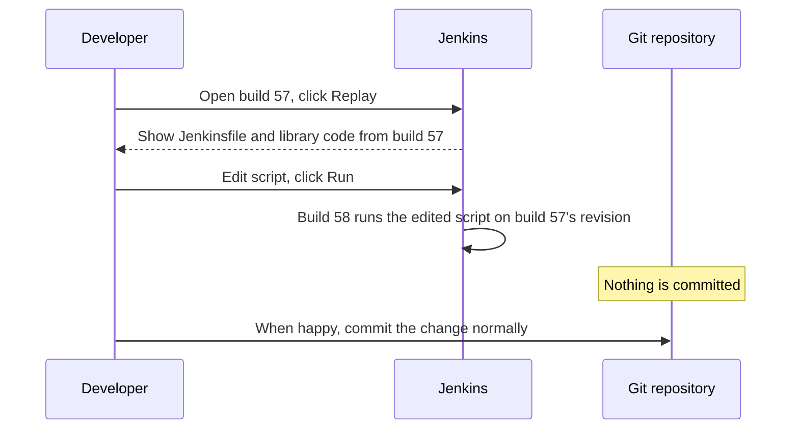
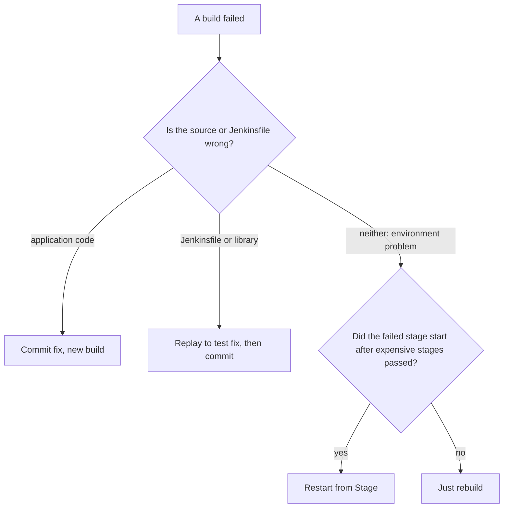

# Restart from Stage and Replay

## Introduction

A 40-minute pipeline fails in its last stage because the deploy target was briefly unreachable. Running the whole thing again wastes 35 minutes of build and test that already passed. Or you are fixing a typo in a Jenkinsfile and each attempt means a commit, a push and a full run, just to find the next typo.

Jenkins has two features for these situations:

- **Restart from Stage**: start a new run that skips the stages before the one you pick, reusing the original run's inputs. Use it when the code is fine but something failed for an outside reason.
- **Replay**: start a new run with an **edited** copy of the pipeline script (and shared library code), without committing anything. Use it to experiment with and debug pipeline code.

An analogy: Restart from Stage is like resuming a video game from the last checkpoint instead of level 1. Replay is like a director's "let's try that scene again with a different line", without rewriting the published script.

This page covers:

- How Restart from Stage works, and why stashes matter
- Restarting from the classic UI and from Pipeline Graph View
- How Replay works and what you can edit
- Permissions and security implications
- Limitations of both features, and when a fresh build is the right answer

## Restart from Stage

### How it works

Restart from Stage is available for **Declarative** pipelines, with no extra configuration in the Jenkinsfile. When you restart a completed run from stage `X`:

1. Jenkins creates a **new build** with a new build number.
2. It reuses the original run's inputs: the same SCM revision, the same build parameters and any preserved stashes.
3. Stages before `X` are marked as skipped. Execution starts at `X` and continues normally.



### Restarting from the UI

**Classic UI:** open the completed build, choose **Restart from Stage** in the left side panel, pick the stage from the drop-down list, and submit.

**Pipeline Graph View** (plugin `pipeline-graph-view`): open the build's graph, click the stage, and use the **Restart** button in the stage details.

Example output of the restarted run:

```text
Restarted from build #41, stage Deploy
[Pipeline] stage (Checkout)
Stage "Checkout" skipped due to this build restarting at stage "Deploy"
[Pipeline] stage (Build)
Stage "Build" skipped due to this build restarting at stage "Deploy"
[Pipeline] stage (Test)
Stage "Test" skipped due to this build restarting at stage "Deploy"
[Pipeline] stage (Deploy)
+ ./deploy.sh staging
Deployed version 1.4.2 to staging
Finished: SUCCESS
```

### Stashes: the most common problem

Skipped stages do not run, so anything they would have produced in the workspace is not there. If `Deploy` needs the JAR built in `Build`, the restarted run must get it from somewhere. That is what stashes are for, but stashes are normally deleted when a run completes.

Keep them with the `preserveStashes` option:

```groovy
pipeline {
    agent none
    options {
        preserveStashes(buildCount: 5)
    }
    stages {
        stage('Build') {
            agent { label 'linux' }
            steps {
                sh '''
                    mkdir -p build/libs
                    echo "app 1.4.2" > build/libs/app.jar
                '''
                stash name: 'app', includes: 'build/libs/*.jar'
            }
        }
        stage('Test') {
            agent { label 'linux' }
            steps {
                unstash 'app'
                sh 'cat build/libs/app.jar'
            }
        }
        stage('Deploy') {
            agent { label 'deploy' }
            steps {
                unstash 'app'
                sh './deploy.sh staging'
            }
        }
    }
}
```

- `preserveStashes()` keeps stashes from the most recent completed run.
- `preserveStashes(buildCount: 5)` keeps them for the last five completed runs. The value must be between 1 and 50.

Without the option, restarting from `Deploy` fails at `unstash 'app'`:

```text
ERROR: No such saved stash 'app'
Finished: FAILURE
```

Design restartable pipelines so that every stage gets its inputs from a stash, an archived artifact or an external repository, not from files left in a workspace by an earlier stage.

:::tip
A stage that has its own `agent` gets a fresh workspace allocation in the restarted run. Pipelines with one top-level agent are restartable too, but files from skipped stages will be missing unless they come from a stash. Writing stages as if each could run on its own makes restart work reliably.
:::

### Limitations of Restart from Stage

- **Declarative only.** Scripted pipelines do not have this feature.
- **Top-level stages only.** You cannot restart a single branch of a `parallel` stage or a stage nested inside sequential `stages`. You restart from the top-level parent, which reruns all of its branches.
- **Completed runs only.** You restart from a finished build, not one still running.
- **Stages skipped because of an earlier failure cannot be chosen.** If `Test` failed and `Deploy` never ran, you cannot restart from `Deploy`. Stages skipped because their `when` condition was false can be chosen.
- **Same code.** The restarted run uses the original run's SCM revision and Jenkinsfile. If you fixed the Jenkinsfile in a new commit, start a new build instead.
- **Side effects are not undone.** If `Deploy` half-finished before failing, restarting runs it again. The deploy step must be safe to repeat (idempotent).

### Disabling restart

For pipelines where a partial rerun is unsafe (for example, a release pipeline whose later stages depend on fresh state from earlier stages), hide the feature:

```groovy
options {
    disableRestartFromStage()
}
```

This option applies to the whole pipeline. It cannot be set inside a stage.

## Replay

### How it works

Replay starts a new run of a past build with the **same** SCM revision and parameters, but lets you edit the pipeline script first. Steps:

1. Open a build that started successfully (it can be finished or still running).
2. Click **Replay** in the left menu.
3. Jenkins shows the main script in an editor. If the pipeline loaded files with `load` or used shared library code, those are shown in separate editors too.
4. Edit and click **Run**.



Nothing is committed, and the job's configuration does not change. Replay is a scratchpad. When the fix works, you must copy it back into the `Jenkinsfile` (or library) and commit it through your normal review process.

### A typical Replay session

Your build fails with this Jenkinsfile:

```groovy
pipeline {
    agent { docker { image 'python:3.13-slim' } }
    stages {
        stage('Test') {
            steps {
                sh 'pip install -r requirements.txt'
                sh 'pytest --junitxml=reports/junit.xml'
            }
            post {
                always {
                    junit 'report/*.xml'
                }
            }
        }
    }
}
```

Example output:

```text
+ pytest --junitxml=reports/junit.xml
============ 31 passed in 2.84s ============
[Pipeline] junit
Recording test results
ERROR: No test report files were found. Configuration error?
Finished: FAILURE
```

The path in `junit` is wrong (`report` instead of `reports`). Instead of committing a guess, you open **Replay**, change the line to `junit 'reports/*.xml'`, and run it:

```text
[Pipeline] junit
Recording test results
[Pipeline] }
Finished: SUCCESS
```

Now you commit the one-line fix with confidence.

### Replay and shared libraries

When a pipeline uses a [shared library](../8-jenkins-shared-libraries/0-jenkins-shared-libraries-introduction.mdx), Replay shows the library files that the build loaded (for example `vars/buildApp.groovy`), and you can edit them for that one replay. This is one of the fastest ways to debug library changes, alongside proper [library tests](../8-jenkins-shared-libraries/6-jenkins-library-testing.mdx).

:::caution
Libraries configured as trusted (global libraries outside the sandbox) can run arbitrary code on the controller. Jenkins therefore restricts editing trusted library code in Replay to highly privileged users. Check the [Script Security and Sandboxing](../11-jenkins-security/5-jenkins-script-security.mdx) page and the current Jenkins documentation for the exact permission rules on your version.
:::

### Replay permissions

- Replaying with edits requires the **Run / Replay** permission. **Job / Configure** implies it.
- In a Multibranch Pipeline, branch jobs are not configurable, but users with Run / Replay can still experiment through Replay.
- Users who have **Job / Build** but not Run / Replay see a **Rebuild** option instead: it reruns the same definition without allowing edits.

Replayed scripts still run in the Groovy sandbox when the original did. Replay does not give a user more power than they would have by committing a Jenkinsfile, but it does skip code review, so grant Run / Replay deliberately on sensitive jobs such as production deploys. See [Authorization and Role-Based Access](../11-jenkins-security/2-jenkins-authorization.mdx).

### Limitations of Replay

- **Only builds that started.** If a Jenkinsfile has a syntax error and never started, there is nothing to replay. Fix it locally or with the [Declarative linter](../3-jenkins-pipeline-basics/9-jenkins-pipeline-syntax-generator.mdx) first.
- **Changes are not saved.** Keep a copy of larger edits outside Jenkins, and always commit the final version.
- **Same revision.** Replay runs on the original build's source revision. Application code changes still need a commit.
- **Behavior can differ slightly.** For pipelines outside Multibranch, commit information can differ between the original and the replayed run.
- **Easy to forget.** A pipeline that only works because of a replay is not fixed. The next commit runs the old Jenkinsfile.

## Choosing Between Restart, Replay and a New Build

| Situation | Best option | Why |
| --- | --- | --- |
| Deploy failed because the target was briefly down | Restart from Stage | Code and artifacts are fine, skip rebuilding |
| Flaky integration test in the middle of the pipeline | Restart from Stage, then fix the flaky test | Saves time now, but do not make it a habit |
| Typo or wrong path in the Jenkinsfile | Replay, then commit | Fast experiment without commit noise |
| Debugging a shared library step | Replay | Edit library code for one run |
| Application code bug | New commit, new build | The source must change |
| Credentials or agent configuration fixed | Restart from Stage or rebuild | Pipeline code did not change |
| Jenkinsfile changed in Git since the failed run | New build | Restart and Replay use the old revision |



## Real-World Scenario

Your team ships a mobile backend. The pipeline builds (8 minutes), runs integration tests against a temporary database (20 minutes), builds a container image, and then deploys to staging and production. Two problems keep wasting time:

- Staging deploys sometimes fail because the cluster API is briefly unavailable during maintenance. Each failure costs 30 minutes of rebuild.
- Engineers improving the shared library push many "fix CI" commits while debugging.

The team makes the pipeline restartable and agrees on a Replay workflow:

```groovy
@Library('platform-lib@v3') _

pipeline {
    agent none
    options {
        preserveStashes(buildCount: 3)
        buildDiscarder(logRotator(numToKeepStr: '40'))
    }
    stages {
        stage('Build') {
            agent { label 'linux' }
            steps {
                sh './gradlew assemble'
                stash name: 'app', includes: 'build/libs/*.jar,Dockerfile'
            }
        }
        stage('Integration Tests') {
            agent { label 'linux-docker' }
            steps {
                unstash 'app'
                sh './gradlew integrationTest'
            }
        }
        stage('Image') {
            agent { label 'linux-docker' }
            steps {
                unstash 'app'
                sh 'docker build -t registry.example.com/mobile-api:${BUILD_NUMBER} .'
                sh 'docker push registry.example.com/mobile-api:${BUILD_NUMBER}'
                script {
                    // Record the tag so a restarted run deploys the same image
                    writeFile file: 'image.txt', text: "registry.example.com/mobile-api:${env.BUILD_NUMBER}"
                }
                stash name: 'image-ref', includes: 'image.txt'
            }
        }
        stage('Deploy Staging') {
            agent { label 'deploy' }
            steps {
                unstash 'image-ref'
                retry(2) {
                    sh './deploy.sh staging "$(cat image.txt)"'
                }
            }
        }
    }
}
```

Note the image reference stash. A restarted run gets a **new** build number, so using `${BUILD_NUMBER}` directly in the deploy stage would point at an image tag that was never pushed. Passing the reference through a preserved stash keeps the restarted deploy pointed at the image that build actually produced.

The team's rules:

1. Infrastructure failure in Deploy: Restart from Stage `Deploy Staging`.
2. Pipeline or library bug: Replay to find the fix, then commit it through a pull request. No "fix CI" commit chains.
3. Anything else: a new build from a new commit.

**Why this approach:** restarts save the 28 minutes of build and test, stashes make restarted stages self-sufficient, and Replay keeps experiments out of Git history while still requiring a reviewed commit for the real fix.

**When to use these features:** long pipelines with expensive early stages, and active development of pipeline code.

**When not to:**

- Short pipelines, where a full rebuild costs less attention than picking a stage.
- Release pipelines that must be fully reproducible from a single run, where you may prefer `disableRestartFromStage()` and a fresh build.
- As a routine workaround for flaky tests or flaky infrastructure. Track restarts. If one stage is restarted every day, fix the cause.

**Alternatives and trade-offs:**

| Approach | Pros | Cons | Best for |
| --- | --- | --- | --- |
| Restart from Stage | Skips passed stages, keeps inputs | Declarative only, top-level stages, needs stashes | Environment failures late in a pipeline |
| Replay | Edit pipeline and library code without committing | Not saved, easy to forget, needs permission | Debugging pipeline code |
| Rebuild with the same parameters | Simple, full fresh run | Repeats everything | Short pipelines |
| Split into separate jobs (build, then deploy) | Rerun deploy any time with any artifact | More jobs, artifact passing | Promotion workflows, see [Environments and Promotion](../10-jenkins-deployment/1-jenkins-environments-and-promotion.mdx) |
| `retry` inside the stage | Recovers automatically | Can hide real problems | Known transient failures |

## Common Mistakes

- **Forgetting `preserveStashes`.** Restarted stages fail with "No such saved stash".
- **Relying on files from skipped stages.** A restarted stage only has what it unstashes or downloads.
- **Using `BUILD_NUMBER` to find artifacts from earlier stages.** The restarted run has a new number. Pass references explicitly.
- **Non-idempotent stages.** Rerunning a stage that half-completed (database migration, payment test charge) can cause duplicates. Make stages safe to repeat.
- **Leaving fixes in Replay.** The next commit runs the old Jenkinsfile. Always commit the change.
- **Expecting a restart to pick up a new Jenkinsfile.** It uses the original revision. Start a new build after pushing changes.
- **Granting Run / Replay broadly on production jobs.** Replay skips code review. Restrict it on sensitive pipelines.

## Summary

- Restart from Stage starts a new Declarative run at a chosen top-level stage, reusing the original revision, parameters and preserved stashes.
- Add `preserveStashes()` so restarted stages can get their inputs. Use `disableRestartFromStage()` where partial reruns are unsafe.
- Replay reruns a build with edited pipeline and library code, without committing. Commit the final change afterwards.
- Replay needs Run / Replay permission. Users with only Job / Build get Rebuild.
- Use restart for environment failures, Replay for pipeline-code debugging, and a new build for source changes.

## Exercises

1. Create a three-stage Declarative pipeline whose last stage fails with `exit 1`. Restart from the last stage after changing nothing, and check the skipped-stage messages in the log.
2. Make the last stage depend on a file stashed in the first stage. Restart without `preserveStashes()` and observe the error. Then add the option and try again.
3. Introduce a wrong `junit` path in a Jenkinsfile, fix it using Replay, then commit the fix.
4. Ask a teammate who has only Job / Build permission to open a build and confirm that they see Rebuild instead of Replay.

Related pages:

- [Stash, Unstash and Artifacts](./4-jenkins-stash-and-artifacts.mdx)
- [Pipeline Options and Tuning](./6-jenkins-pipeline-options.mdx)
- [Troubleshooting Jenkins](../12-jenkins-administration/7-jenkins-troubleshooting.mdx)
- [Jenkins Anti-Patterns](../13-jenkins-best-practices/1-jenkins-anti-patterns.mdx)
