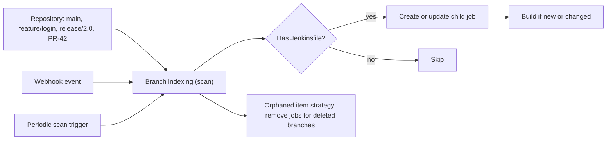
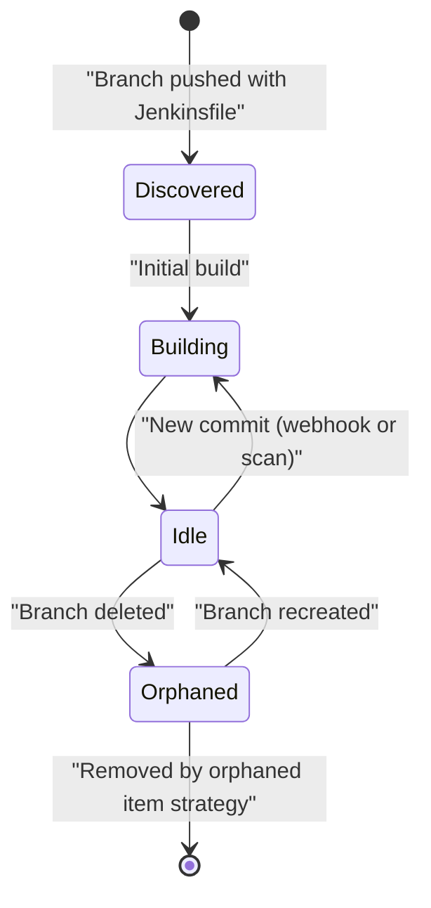

# Multibranch Pipelines

## Introduction

A single Pipeline job builds one branch. Real teams have dozens of branches at once: `main`, release branches, and a short-lived feature branch per developer. Creating and deleting a job by hand for each of them does not scale.

A **Multibranch Pipeline** is a folder-like job that watches a repository and manages child jobs for you:

- Every branch that contains a `Jenkinsfile` gets its own Pipeline job.
- New branches get a job automatically, and deleted branches have theirs cleaned up.
- With a platform plugin (GitHub, GitLab, Bitbucket and others), pull requests and tags get jobs too.

It is like a hotel front desk. Each guest (branch) that checks in with a reservation (a `Jenkinsfile`) gets a room (a job) with its own history. When the guest checks out (branch deleted), the room is cleaned and freed. Nobody has to call the manager to set up a room.

Multibranch is the standard way to run Jenkins pipelines today, and the next pages in this section build on it: [Pull Request Builds](./4-jenkins-pull-request-builds.mdx) and [Organization Folders](./5-jenkins-organization-folders.mdx). It comes from the **Pipeline: Multibranch** plugin (`workflow-multibranch`) and the **Branch API** plugin (`branch-api`), both part of the suggested plugins.

## How Multibranch Works



The key operation is **branch indexing** (also called "scanning"). Jenkins lists the branches, pull requests and tags in the repository, checks for a `Jenkinsfile` in each, and compares the head commit with what it built last time:

- **New branch** → create a job and build it.
- **Changed branch** (new head commit) → build it.
- **Unchanged branch** → do nothing.
- **Branch gone** → mark the job as orphaned and remove it according to the orphaned item strategy.

Indexing runs when you click **Scan Multibranch Pipeline Now**, on a periodic trigger, or when a webhook arrives from the Git platform.

## Creating a Multibranch Pipeline

1. **New Item** → enter a name without spaces, for example `payments-api` → select **Multibranch Pipeline** → **OK**.
2. Under **Branch Sources**, click **Add source**:
   - **Git** for any Git server (branches only, no pull requests).
   - **GitHub**, **GitLab Project** or **Bitbucket** when the platform plugin is installed. These add pull request discovery, status reporting and webhooks.
3. Enter the repository URL and credentials.
4. Under **Behaviours**, choose what to discover. The defaults differ per source.
5. Under **Build Configuration**, keep **Mode: by Jenkinsfile** and **Script Path: `Jenkinsfile`**, or point to another path such as `ci/Jenkinsfile`.
   :::tip
   Script Path is per Multibranch job, not per branch. Two Multibranch jobs can point at the same repository with different Script Paths, for example `ci/Jenkinsfile.build` and `ci/Jenkinsfile.nightly`. That pattern is used for [monorepos](./6-jenkins-monorepo-builds.mdx).
   :::

6. Under **Scan Multibranch Pipeline Triggers**, enable **Periodically if not otherwise run** with an interval such as 1 day. Webhooks will do the fast work, and the periodic scan is a safety net.
7. Under **Orphaned Item Strategy**, keep old items for a bounded time, for example 7 days and at most 20 items.
8. **Save**. Jenkins runs the first scan immediately.

Example scan log:

```text
Started by user admin
[Fri Oct 09 10:12:01 UTC 2026] Starting branch indexing...
 > git ls-remote -h -- https://git.example.com/acme/payments-api.git # timeout=10
Checking branches...
  Checking branch main
      'Jenkinsfile' found
    Met criteria
Scheduled build for branch: main
  Checking branch feature/login
      'Jenkinsfile' found
    Met criteria
Scheduled build for branch: feature/login
  Checking branch docs-only
      'Jenkinsfile' not found
    Does not meet criteria
Processed 3 branches
[Fri Oct 09 10:12:04 UTC 2026] Finished branch indexing. Indexing took 3.1 sec
Finished: SUCCESS
```

:::note
The Jenkins documentation points out that, without webhooks or a periodic trigger, a plain Multibranch Pipeline does not notice new or deleted branches by itself. Organization Folders scan periodically by default. Always configure at least one of the two.
:::

## A Branch-Aware Jenkinsfile

Every branch runs the `Jenkinsfile` from that same branch. To make one file behave differently per branch, use the variables and `when` conditions that Multibranch provides.

| Variable | Set for | Example |
| --- | --- | --- |
| `BRANCH_NAME` | Every child job | `main`, `feature/login`, `PR-42`, `v2.1.0` |
| `CHANGE_ID` | Pull or merge requests | `42` |
| `CHANGE_TARGET` | Pull or merge requests | `main` |
| `CHANGE_BRANCH` | Pull or merge requests | `feature/login` |
| `CHANGE_AUTHOR`, `CHANGE_TITLE`, `CHANGE_URL` | Pull or merge requests | `alice`, `Add login page`, link |
| `TAG_NAME` | Tag builds | `v2.1.0` |

```groovy
pipeline {
    agent any
    options {
        buildDiscarder(logRotator(numToKeepStr: '20'))
        // A newer push to the same branch aborts the older, now-pointless build
        disableConcurrentBuilds(abortPrevious: true)
    }
    stages {
        stage('Build and Test') {
            steps {
                echo "Building ${env.BRANCH_NAME} at ${env.GIT_COMMIT}"
                sh './gradlew build'
            }
        }
        stage('Publish Snapshot') {
            when { branch 'main' }
            steps { sh './gradlew publish -Psnapshot' }
        }
        stage('Deploy to Staging') {
            when { branch pattern: 'release/.*', comparator: 'REGEXP' }
            steps { sh './deploy.sh staging' }
        }
        stage('Release') {
            when { buildingTag() }
            steps { sh "./deploy.sh production ${env.TAG_NAME}" }
        }
    }
}
```

Example output for the `feature/login` branch:

```text
[Pipeline] stage (Build and Test)
Building feature/login at 9c2d41b7a0e3...
+ ./gradlew build
BUILD SUCCESSFUL in 41s
[Pipeline] stage (Publish Snapshot)
Stage "Publish Snapshot" skipped due to when conditional
[Pipeline] stage (Deploy to Staging)
Stage "Deploy to Staging" skipped due to when conditional
[Pipeline] stage (Release)
Stage "Release" skipped due to when conditional
Finished: SUCCESS
```

The `branch` condition only works in Multibranch jobs, because it reads `BRANCH_NAME`. More conditions are covered in [Conditional Stages with when](../3-jenkins-pipeline-basics/8-jenkins-when-conditions.mdx).

## Behaviours: What Gets Discovered

Behaviours (also called "traits") decide which heads become jobs. The exact list depends on the branch source plugin. These are the common ones on the GitHub source:

| Behaviour | Options | Typical choice |
| --- | --- | --- |
| Discover branches | Exclude branches that are also filed as PRs / Only branches that are also filed as PRs / All branches | "Exclude branches that are also filed as PRs", so each change builds once, as a PR |
| Discover pull requests from origin | Merged with target / Current PR revision / Both | "Merging the pull request with the current target branch revision" |
| Discover pull requests from forks | Same strategies, plus a trust policy | "From users with Admin or Write permission" |
| Discover tags | none | Add if you release from tags |
| Filter by name (with regular expression or wildcards) | Pattern | Limit noisy repositories, for example `main release/* PR-*` |
| Clean before checkout, shallow clone and others | Git options | Same as in [Git Integration](./0-jenkins-git-integration.mdx) |

Pull request trust and strategies are explained in detail in [Pull Request Builds](./4-jenkins-pull-request-builds.mdx).

### Tags Are Discovered but Not Built by Default

A common surprise: after adding **Discover tags**, tag jobs appear but never run automatically. The Branch API plugin builds everything **except tags** by default, so that an index scan does not suddenly redeploy hundreds of old releases.

To build new tags automatically, install the **Basic Branch Build Strategies** plugin (`basic-branch-build-strategies`) and add build strategies under the branch source:

- **Regular branches**
- **Change requests**
- **Tags**, optionally with "Ignore tags older than" a number of days

:::caution
As soon as you add any build strategy, the default "build everything except tags" is switched off. If you add only the Tags strategy, branches and pull requests stop building automatically. Add all three.
:::

### Suppressing Automatic Builds

Sometimes you want jobs to exist but not to build on every push, for example for long-lived maintenance branches. Under **Property strategy**, choose **Named branches get different properties** and give those branches the **Suppress automatic SCM triggering** property. The job can still be started by hand or by an upstream job.

## Plain Git Source vs Platform Sources

The generic **Git** branch source works with any Git server, but it only knows about branches and tags. Platform sources talk to the hosting API as well:

| Capability | Git source | GitHub / GitLab / Bitbucket source |
| --- | --- | --- |
| Discover branches | Yes | Yes |
| Discover tags | Yes | Yes |
| Discover pull or merge requests | No | Yes, including forks with trust policies |
| Report build status to the commit or PR | No | Yes |
| Register webhooks automatically | No | Yes, when the credential has permission |
| `CHANGE_*` variables | No | Yes |
| Works with a self-hosted Gitea, Gerrit or bare Git server | Yes | Only through their own plugins |

Pick the platform source whenever one exists for your Git host. Fall back to the Git source for bare servers, or install the dedicated plugin (for example Gitea or Gerrit) if there is one.

## Troubleshooting Branch Indexing

When a branch does not get a job, or a job does not build, open the Multibranch Pipeline and click **Scan Multibranch Pipeline Log**. Most problems show up there.

| Log message | Likely cause | Fix |
| --- | --- | --- |
| `'Jenkinsfile' not found` | File missing on that branch, or Script Path differs | Commit the file or fix Script Path |
| `Does not meet criteria` | A behaviour or filter excludes the head | Check name filters and discovery strategies |
| Head found and job exists, but no build starts | A build strategy or the suppression property is blocking it | Review build strategies and property strategy |
| `Could not fetch branches from source` | Wrong credentials or no network path | Test credentials, check proxy and firewall |
| HTTP 403 or rate-limit messages | API limit on GitHub or Bitbucket | Use a GitHub App or adjust the API rate-limit strategy |

If a webhook arrived but nothing happened, the event log is separate: open **Multibranch Pipeline Events** on the job. It shows each received event and whether it matched this repository.

## Where Things Live on Disk and in URLs

Each child job has its own build history, its own workspace and its own URL. Branch names containing `/` are encoded in URLs:

```text
https://jenkins.example.com/job/payments-api/job/feature%252Flogin/
```

Workspaces for Multibranch jobs use shortened, sanitized directory names to stay within path-length limits. The exact format varies between Jenkins versions, so never hard-code it. An illustrative example:

```text
/var/jenkins_home/workspace/payments-api_feature_login_a3f9c1
```

Keep this in mind when you write scripts that construct job URLs. Use `env.JOB_NAME` and `env.BUILD_URL` rather than building paths yourself.

## Defining a Multibranch Pipeline as Code

Clicking through the UI is fine for learning, but production setups usually generate jobs with [Job DSL](../12-jenkins-administration/1-jenkins-job-dsl.mdx). This uses Job DSL's dynamic API, which mirrors the plugin's configuration. Check the exact names on your instance at `/plugin/job-dsl/api-viewer/index.html`, because they depend on installed plugin versions.

```groovy
multibranchPipelineJob('payments-api') {
    displayName('Payments API')
    branchSources {
        branchSource {
            source {
                github {
                    id('payments-api-github')            // stable, unique per source
                    repoOwner('acme')
                    repository('payments-api')
                    repositoryUrl('https://github.com/acme/payments-api')
                    configuredByUrl(true)
                    credentialsId('github-app')
                    traits {
                        gitHubBranchDiscovery { strategyId(1) }       // exclude branches filed as PRs
                        gitHubPullRequestDiscovery { strategyId(1) }  // merge with target
                        gitHubTagDiscovery()
                    }
                }
            }
        }
    }
    factory {
        workflowBranchProjectFactory { scriptPath('Jenkinsfile') }
    }
    orphanedItemStrategy {
        discardOldItems { daysToKeep(7); numToKeep(20) }
    }
    triggers {
        periodicFolderTrigger { interval('1d') }
    }
}
```

The `strategyId` numbers map to the options in the UI. In the GitHub plugin source, branch discovery uses 1 (exclude branches filed as PRs), 2 (only branches filed as PRs) and 3 (all branches). Pull request discovery uses 1 (merge), 2 (head) and 3 (both).

When the seed job runs:

```text
Processing DSL script jobs/payments_api.groovy
Added items:
    GeneratedJob{name='payments-api'}
Finished: SUCCESS
```

If you later remove the `multibranchPipelineJob` block from the seed script, Job DSL can delete or disable the generated job, depending on the seed job's "Action for removed jobs" setting. Choose that setting deliberately before you rely on it.

## The Lifecycle of a Branch Job



Orphaned jobs are shown with a strike-through name until they are removed. Their build history is deleted with them, so keep anything you need (test reports, artifacts) in an external store if the history matters after the branch is merged.

## Real-World Scenario

A 12-person team builds a SaaS helpdesk. They currently have three hand-made Pipeline jobs: `helpdesk-main`, `helpdesk-release` and `helpdesk-dev`. Developers test feature branches by editing `helpdesk-dev` to point at their branch, which causes fights and broken builds. Last month someone forgot to switch it back before a demo.

**Solution.** Replace the three jobs with one Multibranch Pipeline:

1. Branch source: GitHub, with **Discover branches** (exclude branches filed as PRs), **Discover pull requests from origin** (merge), and **Discover tags**.
2. Build strategies: regular branches, change requests, and tags not older than 3 days.
3. Orphaned item strategy: keep 7 days, at most 30 items.
4. A single `Jenkinsfile` where every branch runs build and test, `main` publishes snapshots, `release/*` deploys to staging, and tags deploy to production behind an approval. See [Manual Input and Approvals](../4-jenkins-pipeline-advanced/2-jenkins-input-and-approvals.mdx).
5. `disableConcurrentBuilds(abortPrevious: true)` so rapid pushes do not queue stale builds.

Each developer now gets an isolated job per branch with no setup, and the deployment rules are reviewed in pull requests because they live in the `Jenkinsfile`.

**Why this approach.** The branches already exist in Git. Multibranch makes Jenkins mirror them instead of making people mirror them by hand. The `Jenkinsfile` is versioned with the code, so a release branch keeps the pipeline it was cut with.

**When to use it / when not to.** Use Multibranch for any repository with more than one active branch, which is almost all of them. A plain Pipeline job is still right for jobs that are not tied to branches: nightly maintenance, a seed job, a data backfill, or a pipeline that orchestrates several repositories.

**Alternatives and trade-offs.**

| Approach | Pros | Cons | Best for |
| --- | --- | --- | --- |
| One Pipeline job per branch, made by hand | Full control per job | Manual work, drift, forgotten jobs | Very small or static projects |
| Single job with a branch parameter | One job to manage | Shared history, collisions, no PR status | Ad-hoc manual builds |
| Multibranch Pipeline | Automatic jobs per branch, PR and tag; cleanup | Indexing load; `Jenkinsfile` changes are per branch | Most repositories |
| Organization Folder | Multibranch for every repository automatically | Less per-repository control | Many repositories, see [Organization Folders](./5-jenkins-organization-folders.mdx) |
| GitHub Actions or GitLab CI | No server to run, native PR integration | Less control over agents and plugins | Teams already on those platforms, see [Jenkins vs alternatives](../0-jenkins-fundamentals/3-jenkins-vs-alternatives.mdx) |

## Common Mistakes

- **No webhook and no periodic scan.** New branches never appear. Configure webhooks and a daily scan as a fallback.
- **Expecting tags to build automatically.** They are discovered but not built until you add build strategies, and then you must add branch and change-request strategies too.
- **Deploying from every branch.** Guard deployments with `when { branch 'main' }` or `buildingTag()`. Feature branches should never reach production.
- **Building each change twice.** Discovering all branches plus origin pull requests builds the same commit as a branch and as a PR. Use "Exclude branches that are also filed as PRs".
- **Unbounded orphaned item strategy.** Thousands of dead branch jobs fill the disk and slow the UI.
- **Using spaces in the job name.** The Jenkins documentation warns that spaces expose bugs in scripts that do not expect them in paths.
- **Changing the `Jenkinsfile` on `main` and expecting old branches to pick it up.** Each branch uses its own copy. Rebase or merge `main` into the branch.

## Summary

- A Multibranch Pipeline creates one child Pipeline job per branch, pull request or tag that contains a `Jenkinsfile`.
- Branch indexing discovers heads. Run it through webhooks plus a periodic safety-net scan.
- Behaviours control what is discovered, build strategies control what is built automatically, and the orphaned item strategy controls cleanup.
- Use `BRANCH_NAME`, `CHANGE_*` and `TAG_NAME` with `when` conditions to give each kind of branch the right stages.
- Define Multibranch jobs as code with Job DSL for repeatability.

## Exercises

1. Create a Multibranch Pipeline for a test repository with a `Git` branch source. Push a new branch and observe what happens with and without a periodic scan trigger.
2. Add **Discover tags** and push a tag. Then install Basic Branch Build Strategies, add only the Tags strategy, and observe that branch builds stop. Fix it.
3. Write a `Jenkinsfile` that runs unit tests everywhere, integration tests only on `main` and `release/*`, and prints `TAG_NAME` on tag builds.
4. Convert your job to a Job DSL script and run it from a seed job.
5. Delete a branch in Git and watch the job become orphaned. Then change the orphaned item strategy to keep it for 1 day and confirm when it disappears.

Next: connect Multibranch to GitHub with apps and webhooks in [GitHub Integration and Webhooks](./2-jenkins-github-integration.mdx). Related: [Git Integration](./0-jenkins-git-integration.mdx), [Declarative Pipeline Syntax](../3-jenkins-pipeline-basics/2-jenkins-declarative-pipeline.mdx), and [Pipeline Options and Tuning](../4-jenkins-pipeline-advanced/6-jenkins-pipeline-options.mdx).
