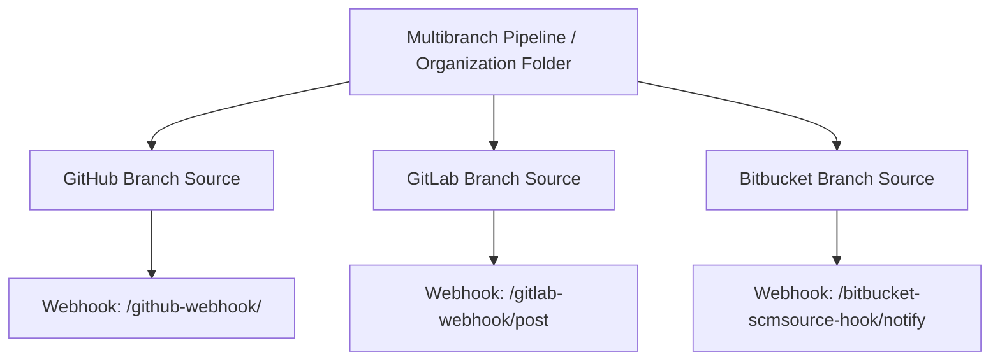

# GitLab and Bitbucket Integration

## Introduction

Not every team hosts code on GitHub. GitLab (gitlab.com or self-managed) and Bitbucket (Cloud or Data Center) are just as common, especially in companies that already use other Atlassian or GitLab products.

The good news: the Jenkins model is the same on every platform. A **branch source plugin** teaches [Multibranch Pipelines](./1-jenkins-multibranch-pipelines.mdx) and [Organization Folders](./5-jenkins-organization-folders.mdx) how to:

1. Authenticate to the platform API.
2. Discover branches, merge or pull requests, and tags.
3. Receive webhooks.
4. Report build status back to the commit and the merge or pull request.

Once you understand the [GitHub integration](./2-jenkins-github-integration.mdx), GitLab and Bitbucket are mostly a matter of different names, token types and webhook URLs. This page covers those differences.



## Platform Comparison at a Glance

| Topic | GitHub | GitLab | Bitbucket |
| --- | --- | --- | --- |
| Plugin ID | `github-branch-source` | `gitlab-branch-source` | `cloudbees-bitbucket-branch-source` |
| Change request name | Pull request (`PR-42`) | Merge request (`MR-42`) | Pull request (`PR-42`) |
| Org Folder source name | GitHub Organization | GitLab Group | Bitbucket Team/Project (Workspace on Cloud) |
| Recommended credential | GitHub App | Personal, group or project access token | Cloud: API token or access token. Data Center: HTTP access token |
| Webhook endpoint | `/github-webhook/` | `/gitlab-webhook/post` | `/bitbucket-scmsource-hook/notify` |
| Status shown as | Commit status or Check | Pipeline status on the commit | Build status on the commit |

Plugin names and options change over time. Always check the current docs on [plugins.jenkins.io](https://plugins.jenkins.io/) before upgrading.

## GitLab

### Plugins

- **GitLab Branch Source** (`gitlab-branch-source`): GitLab server configuration, webhook and system hook management, the **GitLab Project** branch source and the **GitLab Group** organization folder source.
- **GitLab API** (`gitlab-api`): the client library, installed as a dependency.

There is also an older, separate **GitLab** plugin (`gitlab-plugin`) aimed at Freestyle and single-branch Pipeline jobs, with steps such as `gitlabCommitStatus`. For Multibranch and Organization Folders, use GitLab Branch Source. Do not mix both on the same job, or you may get duplicate builds and statuses.

### Step 1: Create a Token

In GitLab, create an access token with the `api` scope:

- A **personal access token** of a dedicated bot user is simplest.
- A **group access token** avoids depending on a personal account.
- Add the `sudo` scope only if an admin token must manage system hooks or comment as another user.

In Jenkins, store it as a **GitLab Personal Access Token** credential (the plugin also accepts other secret text credentials, and has a `gitlabGroupAccessToken` kind for group tokens).

### Step 2: Configure the GitLab Server

**Manage Jenkins → System → GitLab → Add GitLab Server**:

- **Server URL**: `https://gitlab.com` or your instance, for example `https://gitlab.example.com`.
- **Credentials**: the token from Step 1. **Test connection** should report the user it authenticated as.
- **Manage Web Hooks**: let the plugin create project webhooks automatically.
- **Manage System Hooks**: optional, requires an admin token. Lets Jenkins notice deleted projects.
- **Secret Token**: used to authenticate webhook payloads. Generate one in **Advanced**.

The same in [Configuration as Code](../12-jenkins-administration/0-jenkins-configuration-as-code.mdx), with secrets coming from environment variables:

```yaml
credentials:
  system:
    domainCredentials:
      - credentials:
          - gitlabPersonalAccessToken:
              scope: SYSTEM
              id: "gitlab-token"
              token: "${GITLAB_TOKEN}"
unclassified:
  gitLabServers:
    servers:
      - name: "gitlab-main"
        serverUrl: "https://gitlab.example.com"
        credentialsId: "gitlab-token"
        manageWebHooks: true
        manageSystemHooks: false
        secretToken: "${GITLAB_WEBHOOK_SECRET}"
        hooksRootUrl: ""
```

`scope: SYSTEM` means pipelines cannot read this token. Only Jenkins itself uses it, for scanning and hook management. That is the safer choice for an admin-level API token.

### Step 3: Webhooks

If **Manage Web Hooks** is enabled, saving a job creates the webhook in GitLab. To create it by hand (for example when the token lacks Maintainer rights), add a project webhook:

- **URL**: `https://jenkins.example.com/gitlab-webhook/post`
- **Secret token**: the same secret as in Jenkins
- **Triggers**: Push events, Tag push events, Merge request events, Comments (Note) events

The Jenkins URL must be reachable from GitLab, so `localhost` does not work. For system hooks, the URL is `/gitlab-systemhook/post`.

### Step 4: The Multibranch Job and Behaviours

**New Item → Multibranch Pipeline → Add source → GitLab Project**. Choose the server, enter the owner (a user, group or `group/subgroup` path), and pick the project from the list.

Default behaviours:

| Behaviour | Options |
| --- | --- |
| Discover branches | Only branches that are not also filed as MRs / Only branches filed as MRs / All branches |
| Discover merge requests from origin | Merged with current target revision / Current MR revision / Both |
| Discover merge requests from forks | Same strategies, plus trust: **Nobody**, **Members**, **Trusted Members** (recommended: Developer, Maintainer or Owner access), **Everyone** |

Useful additional behaviours include **Tag discovery**, **Log build status as comment on GitLab**, **Trigger build on merge request comment** (default comment `jenkins rebuild`, only trusted members by default), and **Filter by name**.

The plugin documentation is explicit that **Everyone** should not be used for forks, because it can expose pipeline secrets. With Members or Trusted Members, MRs from untrusted authors build the target branch's `Jenkinsfile` instead of theirs.

### Using GitLab Information in the Pipeline

Merge requests get the standard Multibranch variables (`CHANGE_ID`, `CHANGE_TARGET`, `CHANGE_BRANCH` and so on). Builds triggered by a webhook also get `GITLAB_*` variables from the payload. Check `GITLAB_OBJECT_KIND` first: it is `push`, `tag_push`, `merge_request` or `none`.

```groovy
pipeline {
    agent any
    stages {
        stage('Context') {
            steps {
                sh '''
                    echo "Branch:      $BRANCH_NAME"
                    echo "Event kind:  ${GITLAB_OBJECT_KIND:-none}"
                    echo "MR target:   ${CHANGE_TARGET:-n/a}"
                    echo "Pushed by:   ${GITLAB_USER_USERNAME:-n/a}"
                '''
            }
        }
        stage('Test') {
            steps { sh 'make test' }
        }
    }
}
```

Example output for merge request 17:

```text
+ echo 'Branch:      MR-17'
Branch:      MR-17
+ echo 'Event kind:  merge_request'
Event kind:  merge_request
+ echo 'MR target:   main'
MR target:   main
+ echo 'Pushed by:   n/a'
Pushed by:   n/a
```

Build results appear as a pipeline status on the commit in GitLab. One limitation documented by the plugin: GitLab does not accept pipeline statuses on merge requests from forks, for security reasons.

### GitLab Job DSL Example

```groovy
multibranchPipelineJob('billing-service') {
    branchSources {
        branchSource {
            source {
                gitlab {
                    id('billing-service-gitlab')
                    serverName('gitlab-main')
                    projectOwner('acme/backend')
                    projectPath('acme/backend/billing-service')
                    credentialsId('gitlab-checkout')
                    traits {
                        gitLabBranchDiscovery { strategyId(1) }
                        gitLabOriginDiscovery { strategyId(1) }
                        gitLabForkDiscovery {
                            strategyId(1)
                            trust { gitLabTrustPermissions() }
                        }
                    }
                }
            }
        }
    }
}
```

As with every dynamic Job DSL example, confirm the names in your instance's API viewer at `/plugin/job-dsl/api-viewer/index.html`.

## Bitbucket

### Plugin and Editions

The **Bitbucket Branch Source** plugin (ID `cloudbees-bitbucket-branch-source`, maintained under `jenkinsci/bitbucket-branch-source-plugin`) supports both editions:

- **Bitbucket Cloud** (bitbucket.org): repositories live in **workspaces**.
- **Bitbucket Data Center**: repositories live in **projects** with a project key. The plugin documents support only for Data Center versions still within Atlassian's end-of-support window.

Atlassian also publishes its own **Bitbucket Server Integration** plugin for Data Center. It is a valid alternative with its own job types. This page uses Bitbucket Branch Source because it works for both editions with the same Multibranch model.

### Step 1: Credentials (This Changed Recently)

Bitbucket's authentication options have changed, so older blog posts are often wrong:

| Edition | Credential | How to store in Jenkins |
| --- | --- | --- |
| Cloud | **User API token with scopes** (replaces app passwords) | Username with password: your **Atlassian account email** as username, the API token as password |
| Cloud | Repository, project or workspace **access token** | Secret text |
| Cloud | OAuth consumer (private) | Username with password: consumer key and secret |
| Cloud | App passwords | **No longer usable.** The plugin docs state Atlassian deprecated them from September 9, 2025 and has removed them |
| Data Center | **HTTP access token** | Username with password: Bitbucket username (not email) plus the token |
| Data Center | Username and password | Only without SSO or MFA. Not recommended |

Give the credential at least read access to repositories and pull requests, plus webhook read and write if Jenkins should register hooks. The plugin docs note that an API token without scopes does not work, and that the username must be the email address.

### Step 2: Endpoints and Webhooks

**Manage Jenkins → System → Bitbucket Endpoints**:

- Bitbucket Cloud is present by default. Add a **Bitbucket Data Center** endpoint with its server URL if you use Data Center.
- Tick **Manage hooks** and choose a credential allowed to manage webhooks, so Jenkins registers them automatically.
- Enable **signature verification** and select a Secret text credential holding the webhook secret.

For manual registration, the callback URLs are:

```text
Cloud:        https://jenkins.example.com/bitbucket-scmsource-hook/notify
Data Center:  https://jenkins.example.com/bitbucket-scmsource-hook/notify?server_url=https://bitbucket.example.com
```

The `server_url` value must match the endpoint configured in Jenkins exactly, or events are discarded. If Jenkins sits behind a reverse proxy, the Jenkins root URL must match **Manage Jenkins → System → Jenkins Location**.

### Step 3: Multibranch and Organization Folders

- **Multibranch Pipeline → Add source → Bitbucket**: choose the server, credential, owner (workspace ID on Cloud, project key on Data Center) and repository.
- **Organization Folder → Bitbucket Team/Project**: imports every repository in the workspace or project. On Data Center use the **project key**, not the display name.

The behaviours mirror GitHub's: discover branches, discover pull requests from origin, discover pull requests from forks with a trust policy (`Nobody`, `Forks in the same account`, `Everyone`), discover tags, and **Checkout over SSH** if you want a separate SSH key for cloning.

The plugin's README shows its symbols in a JCasC-friendly form:

```yaml
multibranch:
  branchSource:
    bitbucket:
      repoOwner: "acme"
      repository: "storefront"
      credentialsId: "bitbucket-api-token"
      traits:
        - bitbucketBranchDiscovery:
            strategyId: 1
        - bitbucketPullRequestDiscovery:
            strategyId: 1
        - bitbucketSshCheckout:
            credentialsId: "bitbucket-ssh-key"
```

### Build Status in Bitbucket

The plugin posts an "in progress" status after checkout and a final status at the end. Jenkins results map to Bitbucket states as follows (from the plugin's user guide):

| Jenkins result | Bitbucket Cloud | Bitbucket Data Center |
| --- | --- | --- |
| SUCCESS | SUCCESSFUL | SUCCESSFUL |
| UNSTABLE | SUCCESSFUL or FAILED (configurable) | SUCCESSFUL or FAILED (configurable) |
| FAILURE | FAILED | FAILED |
| ABORTED, NOT_BUILT | FAILED or STOPPED (configurable) | FAILED or CANCELLED (configurable) |
| Running | INPROGRESS | INPROGRESS |

Decide deliberately how UNSTABLE (for example, failing tests marked as unstable) is reported. If it maps to SUCCESSFUL, merge checks will let those PRs through.

### Bitbucket Variables

After `checkout scm`, the plugin adds `BITBUCKET_REPOSITORY`, `BITBUCKET_OWNER`, `BITBUCKET_PROJECT_KEY` and `BITBUCKET_SERVER_URL`, which help when you call the Bitbucket REST API from a pipeline:

```groovy
stage('Report') {
    steps {
        sh 'echo "Repo $BITBUCKET_OWNER/$BITBUCKET_REPOSITORY on $BITBUCKET_SERVER_URL"'
    }
}
```

Output:

```text
+ echo 'Repo acme/storefront on https://bitbucket.org'
Repo acme/storefront on https://bitbucket.org
```

## Writing Platform-Neutral Jenkinsfiles

Because all three plugins fill the same Multibranch variables, you can write one `Jenkinsfile` that works everywhere. Prefer:

- `when { changeRequest() }` over checking `BRANCH_NAME.startsWith('PR-')`, because GitLab uses `MR-`.
- `env.CHANGE_TARGET` and `env.CHANGE_ID` over platform-specific variables.
- Platform-specific variables (`GITLAB_*`, `BITBUCKET_*`) only in clearly separated, optional stages.

```groovy
stage('PR-only checks') {
    when { changeRequest() }
    steps {
        echo "Change ${env.CHANGE_ID} into ${env.CHANGE_TARGET}"
        sh 'make lint'
    }
}
```

## Real-World Scenario

An insurance company runs Bitbucket Data Center for legacy teams and is moving new projects to self-managed GitLab. Jenkins must serve both during a two-year migration, and security requires that pipelines never see admin tokens.

**Solution.**

1. Configure both a Bitbucket Data Center endpoint and a GitLab server in JCasC. The scanning and hook-management tokens are `SYSTEM`-scoped credentials, so pipelines cannot bind them.
2. Use one Organization Folder per Bitbucket project and one per GitLab group. Each folder has its own read-only checkout credential in folder scope.
3. Use the "Trusted Members" fork policy on GitLab and "Forks in the same account" on Bitbucket.
4. Keep a shared library with platform-neutral steps that rely only on `CHANGE_*` variables, so a repository's `Jenkinsfile` does not change when it moves from Bitbucket to GitLab. See [Shared Libraries Introduction](../8-jenkins-shared-libraries/0-jenkins-shared-libraries-introduction.mdx).
5. Map Bitbucket's UNSTABLE result to FAILED so merge checks block PRs with failing tests.

**Why this approach.** Jenkins is the stable layer while the Git host changes underneath. Branch source plugins abstract most differences, and platform-neutral pipelines make each repository migration a configuration change rather than a rewrite.

**When to use it / when not to.** This fits organizations with mixed hosting or upcoming migrations. If you are fully committed to GitLab, compare carefully with GitLab CI, which is built in and needs no webhook plumbing.

**Alternatives and trade-offs.**

| Approach | Pros | Cons | Best for |
| --- | --- | --- | --- |
| Jenkins + branch source plugins | One CI for every Git host, consistent pipelines | Plugins and tokens per platform to maintain | Mixed or migrating environments |
| GitLab CI/CD | Native, zero integration work, MR pipelines built in | Tied to GitLab, different runner model | Teams fully on GitLab |
| Bitbucket Pipelines (Cloud) | Native, simple YAML | Build-minute limits, less flexible agents | Small teams on Bitbucket Cloud |
| Older single-job plugins (`gitlab-plugin`, `bitbucket-plugin`) | Work with Freestyle jobs | No automatic branch or PR jobs | Legacy Freestyle setups |

## Common Mistakes

- **Using a Bitbucket Cloud username instead of the email** with an API token. Authentication fails during scanning.
- **Following old guides that use Bitbucket app passwords.** They no longer work. Create scoped API tokens or access tokens.
- **Data Center webhook URL without `server_url`**, or with a value that differs from the endpoint (for example a trailing slash). Events are silently ignored.
- **Using the GitLab project name instead of its path.** The owner and project fields expect namespace paths such as `acme/backend`.
- **Installing both `gitlab-plugin` and `gitlab-branch-source` hooks on the same project.** Expect duplicate builds.
- **Trusting Everyone for forks.** Untrusted contributors can change the `Jenkinsfile` and read secrets.
- **Testing webhooks against `localhost`.** GitLab and Bitbucket must reach a real hostname.

## Summary

- GitLab and Bitbucket integrate through branch source plugins that work exactly like GitHub's: discovery, webhooks and status reporting for Multibranch Pipelines and Organization Folders.
- GitLab: `gitlab-branch-source`, an `api`-scoped token, webhook at `/gitlab-webhook/post`, merge requests named `MR-n`, and trust policies such as Trusted Members.
- Bitbucket: `cloudbees-bitbucket-branch-source` for Cloud and Data Center, API tokens or access tokens (app passwords are gone), webhook at `/bitbucket-scmsource-hook/notify`.
- Keep admin tokens `SYSTEM`-scoped and give pipelines only read-only, folder-scoped checkout credentials.
- Write platform-neutral pipelines with `changeRequest()` and `CHANGE_*` variables.

## Exercises

1. Run a GitLab CE container locally, configure the GitLab server in Jenkins through JCasC, and create a Multibranch job for a test project.
2. Open a merge request and confirm that the job `MR-1` appears and that GitLab shows the pipeline status.
3. For Bitbucket Cloud, create a scoped API token, store it correctly (email as username), and scan a repository.
4. Rewrite a `Jenkinsfile` that checks `BRANCH_NAME.startsWith('PR-')` so it works on GitHub, GitLab and Bitbucket.

Next: how pull and merge requests are built safely in [Pull Request Builds](./4-jenkins-pull-request-builds.mdx). Related: [Git Integration](./0-jenkins-git-integration.mdx), [Authentication and SSO](../11-jenkins-security/1-jenkins-authentication.mdx), and [Migrating to or from Jenkins](../13-jenkins-best-practices/3-jenkins-migrating-to-other-ci.mdx).
