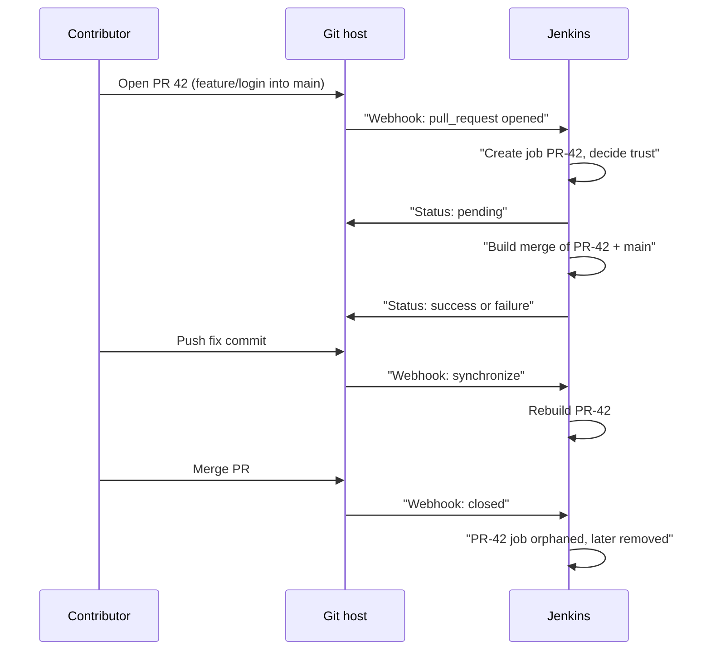
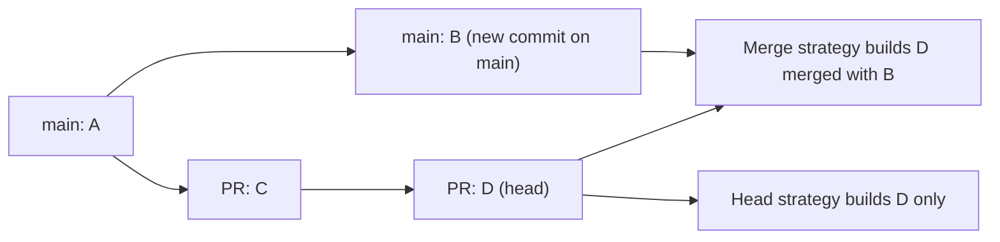

# Pull Request Builds

## Introduction

A pull request (GitHub, Bitbucket) or merge request (GitLab) is a question: "Is it safe to merge this change?" A **pull request build** answers it before the merge happens, by building and testing the change and reporting a green or red status on the PR.

That moves failures from "main is broken, everyone is blocked" to "this one PR is red, its author fixes it". It is the core of continuous integration, explained in general terms in the [CI/CD tutorial](/docs/devops/cicd).

In Jenkins, PR builds come from [Multibranch Pipelines](./1-jenkins-multibranch-pipelines.mdx) with a platform branch source ([GitHub](./2-jenkins-github-integration.mdx), [GitLab or Bitbucket](./3-jenkins-gitlab-bitbucket.mdx)). Every open PR becomes a child job named `PR-42` (or `MR-42` on GitLab). This page covers the decisions that make PR builds useful and safe:

1. **Which revision** to build: the PR branch as is, or the PR merged into its target.
2. **Whom to trust**: especially for PRs from forks.
3. **What to run** in a PR versus on `main`.
4. **How results gate merges**, and how to re-run builds.

## The Pull Request Build Lifecycle



## Head vs Merge: Which Revision to Build

Branch sources offer three discovery strategies for pull requests. The names below are from the GitHub source. GitLab and Bitbucket use the same three ideas.

| Strategy | What is built | Status context (GitHub) | Pros | Cons |
| --- | --- | --- | --- | --- |
| Merging the pull request with the current target branch revision | A temporary merge of the PR into the latest target | `continuous-integration/jenkins/pr-merge` | Tests what `main` will look like after merging | A push to `main` triggers rebuilds of every open PR. Fails if there are conflicts |
| The current pull request revision | The PR's head commit exactly | `continuous-integration/jenkins/pr-head` | Stable, matches what the author tested locally | Misses breakages caused by recent changes on `main` |
| Both | Two builds per PR | both | Maximum information | Twice the load |



**Rule of thumb:** use the **merge** strategy as the default. It catches "works on my branch, breaks on main" problems. If the rebuild storm after every push to `main` becomes too expensive, add the **Basic Branch Build Strategies** plugin and enable "Ignore rebuilding merge branches when only the target branch changed" on the Change requests strategy. PRs then rebuild only when their own commits change, and the target catches up on the next push.

## A PR-Aware Jenkinsfile

PRs should get fast, thorough feedback. Deployments and publishing should never run for them. The `changeRequest` condition and the `CHANGE_*` variables make this explicit:

```groovy
pipeline {
    agent { label 'linux' }
    options {
        disableConcurrentBuilds(abortPrevious: true)  // new push cancels the outdated PR build
        timeout(time: 30, unit: 'MINUTES')
    }
    stages {
        stage('Build') {
            steps { sh './gradlew assemble' }
        }
        stage('Unit Tests') {
            steps { sh './gradlew test' }
            post { always { junit 'build/test-results/test/*.xml' } }
        }
        stage('PR Checks') {
            when { changeRequest() }
            steps {
                echo "PR #${env.CHANGE_ID} '${env.CHANGE_TITLE}' by ${env.CHANGE_AUTHOR} into ${env.CHANGE_TARGET}"
                sh './gradlew spotlessCheck dependencyCheckAnalyze'
            }
        }
        stage('Integration Tests (PRs into main)') {
            when { changeRequest target: 'main' }
            steps { sh './gradlew integrationTest' }
        }
        stage('Publish') {
            when {
                allOf {
                    branch 'main'
                    not { changeRequest() }
                }
            }
            steps { sh './gradlew publish' }
        }
    }
}
```

Example output for PR 42:

```text
[Pipeline] stage (PR Checks)
PR #42 'Add login page' by alice into main
+ ./gradlew spotlessCheck dependencyCheckAnalyze
BUILD SUCCESSFUL in 1m 12s
[Pipeline] stage (Integration Tests (PRs into main))
+ ./gradlew integrationTest
BUILD SUCCESSFUL in 3m 40s
[Pipeline] stage (Publish)
Stage "Publish" skipped due to when conditional
Finished: SUCCESS
```

`changeRequest` accepts filters such as `target`, `branch`, `fork`, `author`, `title` and `id`, with an optional `comparator` of `EQUALS` (default), `GLOB` or `REGEXP`. For example, `when { changeRequest branch: 'hotfix/*', comparator: 'GLOB' }` matches PRs whose source branch is a hotfix branch. See [Conditional Stages with when](../3-jenkins-pipeline-basics/8-jenkins-when-conditions.mdx).

## Finding What the PR Changed

Many pipelines want the list of files a PR touches, for example to skip documentation-only PRs or build only affected services in a [monorepo](./6-jenkins-monorepo-builds.mdx). The reliable way is to compare against the target branch with a three-dot diff, which uses the merge base:

```groovy
stage('Changed files') {
    when { changeRequest() }
    steps {
        withCredentials([gitUsernamePassword(credentialsId: 'github-app')]) {
            sh '''
                git fetch --no-tags --depth=200 origin \
                    "+refs/heads/${CHANGE_TARGET}:refs/remotes/origin/${CHANGE_TARGET}"
                git diff --name-only "origin/${CHANGE_TARGET}...HEAD" | tee changed-files.txt
            '''
        }
        script {
            def changed = readFile('changed-files.txt').readLines()
            if (changed && changed.every { it.startsWith('docs/') || it.endsWith('.md') }) {
                echo 'Documentation-only change: skipping the heavy test suite'
                env.DOCS_ONLY = 'true'
            }
        }
    }
}
```

Example output:

```text
+ git fetch --no-tags --depth=200 origin +refs/heads/main:refs/remotes/origin/main
+ git diff --name-only origin/main...HEAD
+ tee changed-files.txt
docs/login.md
README.md
Documentation-only change: skipping the heavy test suite
```

Later stages can then use `when { not { environment name: 'DOCS_ONLY', value: 'true' } }`. A GitHub App credential works with `gitUsernamePassword` because it provides a username and a short-lived token. Use whatever read-only checkout credential your setup provides. If you use shallow clones, fetch enough history for Git to find the merge base, or the diff fails with `no merge base`.

:::note
Declarative's `changeset` condition looks at the build's changelog, not at a diff against the target. For PRs on GitHub and some other sources, it examines the changelogs of all builds of that PR. On the very first build, the changelog can be empty and `changeset` then evaluates to false with the log line `Warning, empty changelog`. The explicit diff above avoids that surprise.
:::

## Trust: Pull Requests from Forks

Anyone who can read a public repository can fork it and open a PR. Their PR can change **anything**: the code, the tests, the build scripts and the `Jenkinsfile`. If Jenkins ran that `Jenkinsfile` with your credentials, an attacker could print your secrets or use your agents.

Branch sources therefore define a **trust policy** for fork PRs. The GitHub options:

| Trust policy | Behaviour |
| --- | --- |
| Nobody | All fork PRs are untrusted |
| Collaborators | PRs from repository collaborators are trusted (including read-only team members) |
| From users with Admin or Write permission | Trusted only if the fork owner can write to the origin repository. **Recommended** by the plugin |
| Everyone | All fork PRs are trusted. Dangerous on public repositories |

GitLab offers Nobody, Members, Trusted Members (recommended) and Everyone. Bitbucket offers Nobody, Forks in the same account and Everyone.

**What "untrusted" means.** For an untrusted PR, Jenkins still builds the PR's code, but it reads the **`Jenkinsfile` from the target branch** of the origin repository instead of from the fork. The contributor cannot change the pipeline definition. You will see a message like this in the log:

```text
Loading trusted files from base branch main at 7a1c9e0 rather than 3be1d22
```

If the untrusted PR also edited the `Jenkinsfile`, Jenkins prints a warning that the file `has been modified in an untrusted revision` and ignores the edit. Contributors are often confused by this: their pipeline change "does nothing". The fix is for a maintainer to review it and push it to an origin branch.

:::warning
Trust protects the `Jenkinsfile`, not everything else. An untrusted PR still controls the **code the pipeline runs**: unit tests, `Makefile`, `package.json` scripts, Gradle build files. If a stage wraps `sh './gradlew test'` in `withCredentials`, a malicious PR can change a test to send the credential somewhere. The Jenkins security documentation calls out exactly this pattern.
:::

Practical rules:

1. **No secrets in PR builds** unless the PR is trusted. Put secret-using stages behind `when { not { changeRequest() } }`, or behind a check that the PR is not from a fork (`when { not { changeRequest fork: '.*', comparator: 'REGEXP' } }`; test this filter on your platform before relying on it).
2. **Isolate PR builds** on separate, disposable agents without access to production networks, for example ephemeral [Kubernetes pod agents](../6-jenkins-agents/4-jenkins-kubernetes-agents.mdx) with a dedicated label.
3. **Use the least-privileged checkout credential**, scoped to the folder, with read-only access. With GitHub App credentials, set "Read-only access to repository contents" for untrusted contexts.
4. **Read sensitive config with `readTrusted`.** The `readTrusted` step reads a file from the same revision as the `Jenkinsfile`. For untrusted PRs that means the target branch, and the build fails if the PR modified the file.

```groovy
script {
    // Fails the build if an untrusted PR changed deploy/allowed-images.txt
    def allowed = readTrusted('deploy/allowed-images.txt').readLines()
    echo "Allowed base images: ${allowed}"
}
```

## Making PR Builds Fast

A PR build that takes 45 minutes gets ignored. Common techniques:

| Technique | How |
| --- | --- |
| Cancel outdated builds | `disableConcurrentBuilds(abortPrevious: true)` |
| Skip draft PRs | GitHub behaviour **Ignore pull requests marked as drafts** |
| Run checks in parallel | [Parallel Stages](../4-jenkins-pipeline-advanced/0-jenkins-parallel-stages.mdx) |
| Fail fast | Run lint and unit tests before slow integration tests |
| Cache dependencies | See [Build Caching and Speed](../9-jenkins-build-and-test/8-jenkins-build-caching.mdx) |
| Shallow clone | **Shallow clone** behaviour or `cloneOption` |
| Build only what changed | Changed-file detection, see [Building Monorepos](./6-jenkins-monorepo-builds.mdx) |

## Re-running PR Builds

Flaky tests and infrastructure hiccups happen. Ways to re-run a PR build:

- **Jenkins UI**: open the `PR-42` job and click **Build Now**, or **Replay** a run. See [Restart from Stage and Replay](../4-jenkins-pipeline-advanced/7-jenkins-restart-and-replay.mdx).
- **GitHub Checks re-run button**: with the GitHub Checks plugin, a failed check gets a **Re-run** button in GitHub that schedules a new build.
- **PR comments on GitHub**: the **GitHub PR Comment Build** plugin (`github-pr-comment-build`) adds a branch property that triggers a build when a comment matches a regular expression (default `^REBUILD$`). Since mid-2022 it only reacts to trusted users unless you allow untrusted ones.
- **MR comments on GitLab**: the **Trigger build on merge request comment** behaviour (default comment `jenkins rebuild`), limited to trusted members by default.

## Gating Merges

A PR build is only a safety net if failing builds block merging. Configure this on the Git host, not in Jenkins:

- **GitHub**: branch protection or rulesets on `main` with **Require status checks to pass**, selecting `continuous-integration/jenkins/pr-merge` or your GitHub Checks name.
- **GitLab**: **Pipelines must succeed** in the project's merge request settings.
- **Bitbucket**: merge checks requiring successful builds. Remember how UNSTABLE is mapped (see [GitLab and Bitbucket Integration](./3-jenkins-gitlab-bitbucket.mdx)).

A status appears in the "required" list only after Jenkins has reported it at least once, so run one PR build before configuring the rule.

## A Configuration Checklist per Repository

Before turning on PR builds for a repository, answer these questions. Writing the answers in the repository's `README` or in your [shared library](../8-jenkins-shared-libraries/7-jenkins-pipeline-templates.mdx) defaults saves arguments later.

| Question | Typical answer for a private repository | Typical answer for a public repository |
| --- | --- | --- |
| Discover origin PRs? | Yes, merge strategy | Yes, merge strategy |
| Discover fork PRs? | Usually not needed | Yes, trust users with write permission |
| Also build branches that have PRs? | No, exclude them | No, exclude them |
| Secrets available in PR builds? | Only read-only, low-risk ones | None |
| Agent pool for PRs | Normal pool | Isolated, disposable pool |
| Draft PRs | Build them (early feedback) | Ignore them (save capacity) |
| Required status on the Git host | Yes | Yes |
| Re-run mechanism | Jenkins UI or Checks re-run | Comment trigger limited to trusted users |

### Inspecting PR Metadata in a Build

When debugging conditions, print every change-related variable once:

```groovy
stage('Debug PR metadata') {
    when { changeRequest() }
    steps {
        sh 'env | grep -E "^(BRANCH_NAME|CHANGE_)" | sort'
    }
}
```

Example output for a fork PR on GitHub:

```text
BRANCH_NAME=PR-57
CHANGE_AUTHOR=bob
CHANGE_BRANCH=fix-typo
CHANGE_FORK=bob
CHANGE_ID=57
CHANGE_TARGET=main
CHANGE_TITLE=Fix typo in README
CHANGE_URL=https://github.com/acme/sdk/pull/57
```

## Real-World Scenario

You maintain a popular open-source SDK on GitHub. Outside contributors send around 30 PRs a week from forks. The full test suite includes integration tests against a sandbox API that needs an API key. Last year someone opened a PR that modified a test to print environment variables.

**Solution.**

1. Fork discovery with **From users with Admin or Write permission** trust and the **merge** strategy. Outside PRs are untrusted, so they always run the maintainers' `Jenkinsfile` from `main`.
2. Every PR, trusted or not, runs lint, unit tests and contract tests with recorded responses. No credentials, on disposable pod agents labelled `pr-sandbox` that have no egress to internal networks.
3. Integration tests with the sandbox key run only on `main` and on PRs from origin branches (maintainers):

```groovy
stage('Integration (trusted only)') {
    when {
        anyOf {
            branch 'main'
            allOf {
                changeRequest()
                expression { env.CHANGE_FORK == null }   // PR from the origin repository, not a fork
            }
        }
    }
    steps {
        withCredentials([string(credentialsId: 'sandbox-api-key', variable: 'SANDBOX_API_KEY')]) {
            sh './gradlew integrationTest'
        }
    }
}
```

4. When an outside PR needs integration testing, a maintainer reviews the code, then pushes the contributor's commits to an origin branch and opens a maintainer PR, where integration tests run.
5. GitHub branch protection requires the `pr-merge` status.

`CHANGE_FORK` is set by the branch source when a PR comes from a fork. Its exact value differs between plugins, so the check above only tests whether it is present.

**Why this approach.** It splits the pipeline by **trust**, not by convenience. Untrusted code never runs in a context where secrets exist, and maintainers explicitly opt a change into the privileged path after reading it.

**When to use it / when not to.** Essential for public repositories and any repository that accepts external forks. For a private repository where every contributor is an employee with write access, simple origin PR discovery is enough and fork discovery can be omitted.

**Alternatives and trade-offs.**

| Approach | Pros | Cons | Best for |
| --- | --- | --- | --- |
| Trust nobody, no secrets in PR builds | Safest | Integration coverage only after merge or maintainer re-push | Public open-source projects |
| Trust users with write permission | Collaborators get full pipelines | Compromised collaborator account is a risk | Private and inner-source repositories |
| Maintainer approval via comment trigger | Flexible, keeps humans in the loop | Approval does not stop later pushes unless rechecked | Medium-size communities |
| Trust everyone | No friction | Secrets and agents exposed to anyone | Never on public repositories |
| Mock external services in PRs | Fast, no secrets needed | Mocks can drift from reality | Complementing any of the above |

## Common Mistakes

- **Running deployments for PRs.** Always guard deploy and publish stages with `branch` and `not { changeRequest() }`.
- **Wrapping test commands in `withCredentials` for PR builds.** The PR controls the test code. Secrets leak even though the `Jenkinsfile` is trusted.
- **Choosing "Everyone" as the fork trust policy** to "make it work". Fix credentials scoping instead.
- **Building every PR twice** (head and merge, or branch and PR). Pick one strategy unless you really need both.
- **Expecting `changeset` to compare against the target branch.** It reads changelogs. Use an explicit `git diff origin/target...HEAD`.
- **Not gating merges.** Without a required status check, a red PR build is only advice.
- **Too-shallow clones** that make merge-base calculations fail. Fetch enough depth.

## Summary

- PR builds run each pull or merge request as its own job (`PR-n` or `MR-n`) and report the result back to the Git host.
- The **merge** strategy tests the future state of the target. The **head** strategy tests exactly what the author pushed. Choose deliberately, and use build strategies to limit rebuild storms.
- Fork trust decides whose `Jenkinsfile` runs. Untrusted PRs use the target branch's `Jenkinsfile`, but their code still runs, so keep secrets out of PR builds.
- Use `changeRequest()`, `CHANGE_*` variables, and explicit diffs against `CHANGE_TARGET` to shape PR pipelines.
- Gate merges with required status checks on the Git host.

## Exercises

1. Configure a Multibranch job with the merge strategy. Open a PR, then push a commit to `main`, and observe the PR rebuild. Then enable "Ignore rebuilding merge branches when only the target branch changed" and repeat.
2. From a second GitHub account, fork your test repository, change the `Jenkinsfile` in the fork, and open a PR. Find the log line showing the trusted `Jenkinsfile` was used.
3. Add a stage that skips the test suite for documentation-only PRs, using the changed-files technique.
4. Configure branch protection to require the Jenkins status and verify that a failing PR cannot be merged.

Next: scale all of this across every repository in [Organization Folders](./5-jenkins-organization-folders.mdx). Related: [Script Security and Sandboxing](../11-jenkins-security/5-jenkins-script-security.mdx), [Credentials Management](../11-jenkins-security/3-jenkins-credentials.mdx), and [Pipeline Best Practices](../13-jenkins-best-practices/0-jenkins-pipeline-best-practices.mdx).
