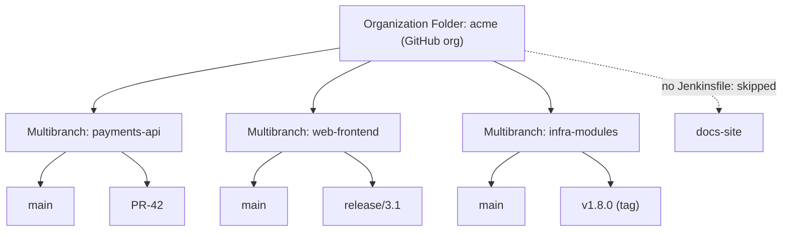
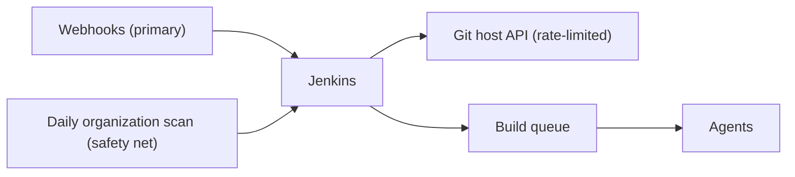

# Organization Folders

## Introduction

A [Multibranch Pipeline](./1-jenkins-multibranch-pipelines.mdx) automates jobs for the branches of **one** repository. But companies rarely have one repository. They have 20, 200 or 2,000, and new ones appear every week. If someone has to create a Multibranch job by hand for every new repository, Jenkins falls behind and people stop trusting it.

An **Organization Folder** goes one level higher. It watches an entire account on your Git host and creates a Multibranch Pipeline for every repository that contains a `Jenkinsfile`:

- **GitHub**: a GitHub organization or user ("GitHub Organization").
- **GitLab**: a group, subgroup or user ("GitLab Group").
- **Bitbucket**: a Cloud workspace or a Data Center project ("Bitbucket Team/Project").
- Also Gitea and a few others, through their plugins.

If a Multibranch Pipeline is a hotel front desk that gives each guest a room, an Organization Folder is the hotel chain's head office: whenever a new hotel (repository) opens with a reservation system (`Jenkinsfile`), it sets up the front desk automatically.

The Jenkins documentation describes Organization Folders as monitoring an entire organization and automatically creating Multibranch Pipelines for repositories with branches or pull requests that contain a `Jenkinsfile`. The feature is implemented in the platform branch source plugins you met in [GitHub Integration](./2-jenkins-github-integration.mdx) and [GitLab and Bitbucket Integration](./3-jenkins-gitlab-bitbucket.mdx), on top of the Branch API plugin.

## The Three Levels



1. **Organization Folder**: scans the account and lists repositories ("Scan Organization").
2. **Multibranch Pipeline** per repository: scans branches, PRs and tags.
3. **Pipeline job** per branch, PR or tag: runs the builds.

Configuration flows downward. Behaviours, credentials, build strategies and properties set on the Organization Folder apply to every repository inside it.

## Creating a GitHub Organization Folder

Prerequisites: the GitHub Branch Source plugin and a **GitHub App** credential installed on the organization (see [GitHub Integration and Webhooks](./2-jenkins-github-integration.mdx)).

1. **New Item** → name it after the organization, for example `acme` → **Organization Folder** → **OK**.
2. Under **Repository Sources** (or **Projects**), add **GitHub Organization**:
   - **API endpoint**: GitHub.com or your GitHub Enterprise Server.
   - **Credentials**: `github-app`.
   - **Owner**: `acme`.
3. **Behaviours** for repositories:
   - **Filter by name (with regular expression)**, for example `^(?!sandbox-).*` to skip sandbox repositories.
   - **Exclude archived repositories**.
   - **Exclude repositories that are forks of another repository**.
   - **Filter by Repository Topics**, for example only repositories tagged `jenkins`.
4. **Behaviours** for branches and PRs inside each repository: discover branches, PRs from origin, PRs from forks, tags (same as in [Pull Request Builds](./4-jenkins-pull-request-builds.mdx)).
5. **Project Recognizers**: **Pipeline Jenkinsfile** with **Script Path** `Jenkinsfile`. Only repositories containing this file get a Multibranch job.
6. **Scan Organization Triggers**: **Periodically if not otherwise run**, for example 1 day.
7. **Orphaned Item Strategy**: for removed repositories, for example keep 7 days.
8. **Child Orphaned Item Strategy** (in recent versions): the same for branches inside each repository.
9. **Save**, then open **Scan Organization Log**.

Example scan log:

```text
[Fri Oct 09 11:02:10 UTC 2026] Starting organization scan...
Connecting to https://api.github.com using github-app
Looking up repositories of organization acme
Proposing payments-api
Proposing web-frontend
Proposing infra-modules
Proposing docs-site
    'Jenkinsfile' not found
  Does not meet criteria
Ignoring sandbox-alice (does not match name filter)
Finished examining acme

4 repositories were processed (query completed)
[Fri Oct 09 11:02:31 UTC 2026] Finished organization scan. Scan took 21 sec
Finished: SUCCESS
```

When the GitHub App's webhook is configured, a new repository with a `Jenkinsfile` appears in Jenkins within seconds of its first push, without any Jenkins change.

:::tip
The **Scan Organization** step only needs to find one branch with a `Jenkinsfile` to create a repository's Multibranch job. The full branch scan happens inside each repository job, so look there when a branch is missing.
:::

## Organization Folders as Code

Organization Folders are long-lived infrastructure, so define them as code. With [Job DSL](../12-jenkins-administration/1-jenkins-job-dsl.mdx), using the dynamic API (check names in your instance's API viewer at `/plugin/job-dsl/api-viewer/index.html`):

```groovy
organizationFolder('acme') {
    displayName('ACME (GitHub)')
    description('All ACME repositories with a Jenkinsfile. Managed by the platform team via Job DSL.')
    organizations {
        github {
            repoOwner('acme')
            apiUri('https://api.github.com')
            credentialsId('github-app')
            traits {
                sourceRegexFilter { regex('^(?!sandbox-).*') }
                gitHubExcludeArchivedRepositories()
                gitHubBranchDiscovery { strategyId(1) }
                gitHubPullRequestDiscovery { strategyId(1) }
                gitHubForkDiscovery {
                    strategyId(1)
                    trust { gitHubTrustPermissions() }
                }
                gitHubTagDiscovery()
            }
        }
    }
    projectFactories {
        workflowMultiBranchProjectFactory { scriptPath('Jenkinsfile') }
    }
    orphanedItemStrategy {
        discardOldItems { daysToKeep(7) }
    }
    triggers {
        periodicFolderTrigger { interval('1d') }
    }
}
```

You can run this from a seed job, or embed it in [JCasC](../12-jenkins-administration/0-jenkins-configuration-as-code.mdx) using the Job DSL integration so that a freshly started controller recreates the folder:

```yaml
jobs:
  - script: >
      organizationFolder('acme') {
        organizations {
          github {
            repoOwner('acme')
            apiUri('https://api.github.com')
            credentialsId('github-app')
          }
        }
        projectFactories {
          workflowMultiBranchProjectFactory { scriptPath('Jenkinsfile') }
        }
      }
```

The `jobs:` key requires both the Configuration as Code and Job DSL plugins.

For GitLab the navigator is `gitlab` with a `projectOwner` such as `acme/backend`. For Bitbucket it is `bitbucket` with a `repoOwner` (workspace ID on Cloud or project key on Data Center). A sketch of both, with the same caveat about checking the API viewer:

```groovy
organizationFolder('acme-gitlab-backend') {
    organizations {
        gitlab {
            serverName('gitlab-main')          // name from Manage Jenkins -> System -> GitLab
            projectOwner('acme/backend')       // group or subgroup path
            credentialsId('gitlab-checkout')
            traits {
                gitLabBranchDiscovery { strategyId(1) }
                gitLabOriginDiscovery { strategyId(1) }
            }
        }
    }
    projectFactories {
        workflowMultiBranchProjectFactory { scriptPath('Jenkinsfile') }
    }
}

organizationFolder('acme-bitbucket') {
    organizations {
        bitbucket {
            repoOwner('acme')                  // Cloud workspace ID
            credentialsId('bitbucket-api-token')
            traits {
                bitbucketBranchDiscovery { strategyId(1) }
                bitbucketPullRequestDiscovery { strategyId(1) }
            }
        }
    }
    projectFactories {
        workflowMultiBranchProjectFactory { scriptPath('Jenkinsfile') }
    }
}
```

## Folder-Level Configuration

Because an Organization Folder is a folder, it can hold configuration that applies only to its contents.

### Folder-Scoped Credentials

Credentials stored in the folder (**acme → Credentials → Folder → Add Credentials**) are visible to pipelines inside it, but not to the rest of Jenkins:

```groovy
withCredentials([string(credentialsId: 'acme-sonar-token', variable: 'SONAR_TOKEN')]) {
    sh './gradlew sonar -Dsonar.token=$SONAR_TOKEN'
}
```

This is the basic tool for multi-tenant Jenkins: team A's folder holds team A's secrets. Combine it with [authorization](../11-jenkins-security/2-jenkins-authorization.mdx) so only team A can see and configure its folder.

### Folder-Level Shared Libraries

Under **Pipeline Libraries** on the folder, you can attach a [shared library](../8-jenkins-shared-libraries/0-jenkins-shared-libraries-introduction.mdx) available to every repository in the organization, for example the company's standard steps. Folder-level libraries are **untrusted** (they run in the Groovy sandbox), while global libraries configured under **Manage Jenkins** are trusted.

### Property and Build Strategies

The same branch property strategies (such as suppressing automatic triggering for some branches) and build strategies (such as building tags) can be set once at the folder and inherited by every repository.

## Security Considerations

An Organization Folder concentrates power: one credential reaches every repository, and every repository's `Jenkinsfile` runs on your agents.

- **Anyone who can push a `Jenkinsfile` to any repository in the organization can run code in Jenkins.** That includes new repositories created by any member. Use the topic or name filter, or restrict who can create repositories, if that is a concern.
- **Scan credentials are usable by pipelines** if they are in a scope pipelines can reach. The Jenkins guide on securing Organization Folders recommends repository-restricted credentials, separate folders for repository subsets, and removing permissions the credential does not need (such as webhook management, by registering webhooks manually).
- **With GitHub App credentials**, use the repository access strategy "Infer accessible repository" and a read-only default permissions strategy so each pipeline's token reaches only its own repository.
- **Centralized pipelines** remove the risk of users editing the pipeline. Plugins such as **Pipeline: Multibranch with defaults** or the inline-definition plugin let the folder supply a fixed pipeline instead of reading each repository's `Jenkinsfile`. The trade-off is less flexibility for teams.

More in [Jenkins Security Overview](../11-jenkins-security/0-jenkins-security-overview.mdx).

## Scaling Organization Folders



Large organizations stress three things:

| Pressure point | Symptom | Mitigation |
| --- | --- | --- |
| API rate limit | Scans sleep waiting for quota | GitHub App, webhooks, daily rather than hourly scans, filters |
| Controller memory and disk | Slow UI, large `JENKINS_HOME` | Orphaned item strategies, `buildDiscarder` in every pipeline, fewer discovered heads |
| Build storms | Queue explodes after a mass change, such as a shared-file update in 300 repositories | Build strategies, throttling, more agents, staggered rollouts |

Some teams split one huge organization into several folders, for example by topic or team prefix. Each folder then has its own credentials, filters and scan schedule.

## Troubleshooting

| Symptom | Where to look | Common cause |
| --- | --- | --- |
| Repository missing from the folder | **Scan Organization Log** | No `Jenkinsfile` on any branch, name or topic filter, archived repository, or credential cannot see it |
| Repository present but a branch missing | The repository's **Scan Multibranch Pipeline Log** | Branch discovery strategy, branch filter, or no `Jenkinsfile` on that branch |
| New repository appears only after a day | Webhook deliveries on the Git host | Webhook not configured on the App or organization, so only the periodic scan finds it |
| Scan takes very long | Scan log timestamps | API rate limit sleeping, or thousands of repositories without filters |
| Every repository rebuilt at once | Build history of many jobs | A full re-index after changing folder-level behaviours or build strategies |

That last row deserves a warning: changing a folder-level behaviour (for example, switching the PR discovery strategy) triggers a re-index of every repository, which can schedule a build for every changed head. Make such changes outside working hours, or add build strategies first.

## Moving Existing Jobs into an Organization Folder

When you adopt Organization Folders on an existing Jenkins, you usually already have hand-made jobs for the same repositories. Plan the switch:

1. Create the Organization Folder **alongside** the old jobs, with a filter matching only one pilot repository.
2. Compare the pilot's builds and statuses with the old job for a few days. Watch for duplicate statuses on the Git host, because both jobs report.
3. Widen the filter in steps, and disable (do not delete yet) the old jobs as their repositories move.
4. Export anything you must keep from the old jobs' history, such as release build logs or artifacts. Jenkins does not move build history between jobs.
5. Delete the old jobs once nobody has needed them for a release cycle.

## Real-World Scenario

A fintech company has 140 GitHub repositories across 9 teams. Jenkins has 90 hand-made Multibranch jobs, some pointing at renamed or archived repositories. New repositories wait days for a platform engineer to "add them to Jenkins". Each team wants its own SonarQube token and Docker registry credentials, and auditors want proof that team A cannot use team B's secrets.

**Solution.**

1. Agree on one convention: every repository has a GitHub topic naming its team, for example `team-payments`.
2. Generate one Organization Folder per team from a Job DSL seed job. Each uses the same GitHub App but a different **Filter by Repository Topics** value:

```groovy
def teams = ['payments', 'lending', 'onboarding']   // in practice, read from a YAML file

teams.each { team ->
    organizationFolder("team-${team}") {
        displayName("Team ${team.capitalize()}")
        organizations {
            github {
                repoOwner('acme-fintech')
                apiUri('https://api.github.com')
                credentialsId('github-app')
                traits {
                    gitHubTopicsFilter { topicList("team-${team}") }
                    gitHubExcludeArchivedRepositories()
                    gitHubBranchDiscovery { strategyId(1) }
                    gitHubPullRequestDiscovery { strategyId(1) }
                }
            }
        }
        projectFactories {
            workflowMultiBranchProjectFactory { scriptPath('Jenkinsfile') }
        }
        orphanedItemStrategy { discardOldItems { daysToKeep(14) } }
        triggers { periodicFolderTrigger { interval('1d') } }
    }
}
```

The `topicList` parameter matches the trait's constructor in the GitHub Branch Source plugin. Dynamic DSL names can still differ between plugin versions, so confirm them in your API viewer.

3. Store each team's SonarQube and registry credentials in its folder, and grant the team's group Job/Build and Job/Configure only on its folder with folder-based authorization.
4. Delete the 90 hand-made jobs after verifying each repository appears in the right folder.

Seed job output:

```text
Processing DSL script jobs/team_folders.groovy
Added items:
    GeneratedJob{name='team-payments'}
    GeneratedJob{name='team-lending'}
    GeneratedJob{name='team-onboarding'}
Finished: SUCCESS
```

**Why this approach.** Repository onboarding becomes self-service: add a `Jenkinsfile` and a topic. Folder boundaries give each team isolated credentials and permissions, which is what the auditors asked for, while the platform team keeps one definition in code.

**When to use it / when not to.** Use Organization Folders when most repositories in an account should be built the same way, and when new repositories appear regularly. Prefer individual Multibranch jobs when only a handful of repositories need Jenkins, when each needs very different settings, or when you need per-repository credentials that your Git host cannot scope.

**Alternatives and trade-offs.**

| Approach | Pros | Cons | Best for |
| --- | --- | --- | --- |
| Hand-made Multibranch per repository | Full per-repository control | Manual onboarding, drift, stale jobs | A few repositories |
| Organization Folder | Zero-touch onboarding, inherited settings | Coarser control, one credential reaches many repositories | Many similar repositories |
| Several Organization Folders with filters | Team isolation with automation | Needs naming or topic conventions | Multi-team organizations |
| Job DSL seed generating Multibranch jobs from a list | Explicit, reviewed list of repositories | List must be maintained | Regulated environments that want explicit approval |
| Platform-native CI per repository (Actions, GitLab CI) | No central server | Pipelines duplicated across repositories | Teams without shared Jenkins needs |

## Common Mistakes

- **Expecting a repository without a `Jenkinsfile` to appear.** The project recognizer skips it. Check the Script Path matches.
- **Using a personal token with access to only some repositories**, then wondering why others are missing. The scan sees only what the credential sees.
- **No orphaned item strategy.** Deleted and renamed repositories leave dead jobs behind.
- **Scanning hourly** in a big organization. You burn API quota. Use webhooks plus a daily scan.
- **Putting all teams' secrets at the global level.** Every repository in every folder can use them. Use folder-scoped credentials.
- **Forgetting that new repositories run code immediately.** Combine filters and repository-creation permissions on the Git host.
- **Renaming the Organization Folder or changing the project naming strategy** carelessly. Jobs can be recreated and build history lost.

## Summary

- Organization Folders scan a whole GitHub organization, GitLab group or Bitbucket workspace or project, and create a Multibranch Pipeline for each repository with a `Jenkinsfile`.
- Configure repository filters, branch and PR behaviours, project recognizers, scan triggers and orphaned item strategies once at the folder level.
- Define folders as code with Job DSL or JCasC, and use folder-scoped credentials and libraries for team isolation.
- Mind security: one credential and every `Jenkinsfile` in the organization meet in one place. Restrict credentials and consider centralized pipelines where needed.
- Scale with webhooks, filters, daily scans and multiple folders.

## Exercises

1. Create an Organization Folder for a test GitHub organization or your user account. Add a `Jenkinsfile` to a new repository and time how long it takes to appear.
2. Add a name filter that excludes repositories starting with `tmp-`, and confirm the scan log reports them as ignored.
3. Write a Job DSL script that creates two Organization Folders for two topics, and run it from a seed job.
4. Add a folder-scoped credential and prove that a pipeline in another folder cannot use it.

Next: one repository, many projects in [Building Monorepos](./6-jenkins-monorepo-builds.mdx). Related: [Pipeline Templates for Many Teams](../8-jenkins-shared-libraries/7-jenkins-pipeline-templates.mdx), [Authorization and Role-Based Access](../11-jenkins-security/2-jenkins-authorization.mdx), and [Project: Company-Wide Shared Library](../14-jenkins-projects/4-jenkins-project-shared-library.mdx).
