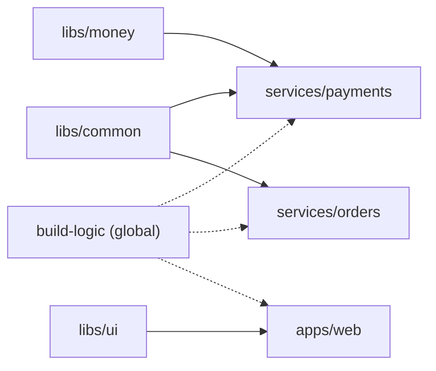

# Building Monorepos

## Introduction

A **monorepo** keeps many projects (services, libraries, apps) in one Git repository. Companies choose it for atomic cross-project changes, one version of shared code, and simpler refactoring. The cost shows up in CI: if every commit rebuilds and retests everything, a one-line change in one service waits 40 minutes for 30 unrelated services.

The goal of a monorepo pipeline is simple to state: **build and test only what a change affects, but never miss something it affects.** Doing it well means answering three questions:

1. **What changed?** Which files does this commit or PR touch?
2. **What does that affect?** Which projects own or depend on those files?
3. **How do we run it?** One pipeline with conditional or dynamic stages, or one job per project?

Think of a large apartment building with a single water supply. When a pipe on floor 7 is repaired, you test the water on floor 7 and every floor fed through that pipe, not every tap in the building, but also not just the one tap next to the repair.

This page shows four Jenkins approaches, from the simplest to the most scalable, and when each fits. It builds on [Pull Request Builds](./4-jenkins-pull-request-builds.mdx) and [Multibranch Pipelines](./1-jenkins-multibranch-pipelines.mdx).

## The Example Repository

```text
acme-platform/
├── Jenkinsfile
├── ci/
│   └── affected.py
├── build-logic/            # shared build configuration
├── libs/
│   ├── common/
│   ├── money/
│   └── ui/
├── services/
│   ├── payments/           # uses libs/money, libs/common
│   └── orders/             # uses libs/common
└── apps/
    └── web/                # uses libs/ui
```



A change to `libs/common` must build `payments` and `orders`, but not `web`. A change to `build-logic` must build everything.

## Approach 1: `changeset` Conditions

The quickest start is Declarative's `changeset` condition, which runs a stage only if the build's changelog contains a matching file:

```groovy
pipeline {
    agent any
    stages {
        stage('payments') {
            when {
                anyOf {
                    changeset 'services/payments/**'
                    changeset 'libs/money/**'
                    changeset 'libs/common/**'
                }
            }
            steps { dir('services/payments') { sh './gradlew build' } }
        }
        stage('orders') {
            when {
                anyOf {
                    changeset 'services/orders/**'
                    changeset 'libs/common/**'
                }
            }
            steps { dir('services/orders') { sh './gradlew build' } }
        }
        stage('web') {
            when { changeset 'apps/web/**' }
            steps { dir('apps/web') { sh 'npm ci && npm test' } }
        }
    }
}
```

Example output after a commit touching only `apps/web/src/App.tsx`:

```text
Stage "payments" skipped due to when conditional
Stage "orders" skipped due to when conditional
[Pipeline] stage (web)
+ npm ci
added 812 packages in 21s
+ npm test
Tests: 64 passed, 64 total
```

`changeset` takes a glob pattern by default (case-insensitive), and accepts `comparator: 'REGEXP'` and `caseSensitive: true`.

### The Changelog Trap

`changeset` does **not** diff against `main`. It reads the **changelog** Jenkins recorded for the build: the commits since the previous build of the same job. Reading the Declarative plugin's source shows the consequences:

- On the **first build** of a branch, the changelog is usually empty. `changeset` returns false for every stage, and the log says `Warning, empty changelog. Probably because this is the first build.` A new branch can pass CI with nothing built.
- For **pull requests** on supported sources, it examines the changelogs of all builds of that PR, which is closer to what you want, but still depends on build history.
- If a build is skipped or aborted, the next build's changelog only covers commits since the previous build, which may hide changes from the aborted one.

So `changeset` is fine for small repositories where an occasional full build is acceptable. For correctness, compute the change set yourself.

## Approach 2: Compute Affected Projects and Run Dynamic Parallel Stages

Instead of relying on the changelog, diff against a known base and map files to projects with a small script that lives in the repository.

### Step 1: The Mapping Script

`ci/affected.py` reads changed paths on standard input and prints the affected services as JSON:

```python
#!/usr/bin/env python3
"""Print the services affected by a list of changed files (one path per line on stdin)."""
import json
import sys

# Which directories belong to which service, and which shared libraries each service uses.
SERVICES = {
    "payments": {"path": "services/payments/", "uses": ["libs/money/", "libs/common/"]},
    "orders":   {"path": "services/orders/",   "uses": ["libs/common/"]},
    "web":      {"path": "apps/web/",          "uses": ["libs/ui/"]},
}
# Changes here affect every service (build tooling, root config).
GLOBAL_PATHS = ["build-logic/", "Jenkinsfile", "ci/"]


def affected(changed_files):
    if any(f.startswith(g) for f in changed_files for g in GLOBAL_PATHS):
        return sorted(SERVICES)
    result = set()
    for name, svc in SERVICES.items():
        prefixes = [svc["path"]] + svc["uses"]
        if any(f.startswith(p) for f in changed_files for p in prefixes):
            result.add(name)
    return sorted(result)


if __name__ == "__main__":
    files = [line.strip() for line in sys.stdin if line.strip()]
    print(json.dumps(affected(files)))
```

Try it locally:

```bash
printf 'libs/common/retry.py\napps/web/README.md\n' | python3 ci/affected.py
printf 'docs/adr/0007.md\n' | python3 ci/affected.py
printf 'build-logic/java.gradle\n' | python3 ci/affected.py
```

Output:

```text
["orders", "payments", "web"]
[]
["orders", "payments", "web"]
```

Keeping the mapping in a script (not in Groovy) has two benefits: developers can run it on their laptops, and you can unit test it with ordinary Python tooling.

### Step 2: Choose the Base to Diff Against

| Build type | Base | Why |
| --- | --- | --- |
| Pull request | `origin/${CHANGE_TARGET}` with a three-dot diff | Everything the PR changes relative to where it branched |
| `main` branch | `GIT_PREVIOUS_SUCCESSFUL_COMMIT` | Everything since the last green build, so failures are retried |
| First build or no previous success | Build everything | Safe default |

### Step 3: The Jenkinsfile

```groovy
def affectedServices = []

pipeline {
    agent { label 'linux' }
    options {
        disableConcurrentBuilds(abortPrevious: true)
        timeout(time: 60, unit: 'MINUTES')
    }
    stages {
        stage('Detect changes') {
            steps {
                script {
                    String range
                    if (env.CHANGE_TARGET) {
                        withCredentials([gitUsernamePassword(credentialsId: 'github-app')]) {
                            sh "git fetch --no-tags --depth=500 origin +refs/heads/${env.CHANGE_TARGET}:refs/remotes/origin/${env.CHANGE_TARGET}"
                        }
                        range = "origin/${env.CHANGE_TARGET}...HEAD"
                    } else if (env.GIT_PREVIOUS_SUCCESSFUL_COMMIT) {
                        range = "${env.GIT_PREVIOUS_SUCCESSFUL_COMMIT} HEAD"
                    }

                    if (range) {
                        String json = sh(
                            script: "git diff --name-only ${range} | python3 ci/affected.py",
                            returnStdout: true
                        ).trim()
                        affectedServices = readJSON(text: json) as List
                    } else {
                        echo 'No base to compare with: building everything'
                        affectedServices = ['payments', 'orders', 'web']
                    }
                    echo "Affected services: ${affectedServices}"
                    currentBuild.description = affectedServices ? affectedServices.join(', ') : 'nothing to build'
                }
            }
        }
        stage('Build affected') {
            when { expression { return !affectedServices.isEmpty() } }
            steps {
                script {
                    def branches = [:]
                    for (svc in affectedServices) {
                        def name = svc   // capture loop variable for the closure
                        branches[name] = {
                            stage(name) {
                                sh "make -C ${serviceDir(name)} test"
                            }
                        }
                    }
                    parallel branches
                }
            }
        }
    }
}

String serviceDir(String name) {
    return [payments: 'services/payments', orders: 'services/orders', web: 'apps/web'][name]
}
```

Notes on this pipeline:

- For a PR, the command is `git diff --name-only origin/main...HEAD`. The three dots compare against the merge base, so commits that landed on `main` after the PR branched are not counted.
- `readJSON` comes from the **Pipeline Utility Steps** plugin (`pipeline-utility-steps`).
- The `def name = svc` line avoids a classic closure-capture bug, explained in [Groovy Essentials for Pipelines](../4-jenkins-pipeline-advanced/5-jenkins-groovy-for-pipelines.mdx).
- `currentBuild.description` shows the affected services in the build history, which helps when people ask "why didn't my service build?".

Example output for a PR touching `libs/common/retry.py`:

```text
+ git diff --name-only origin/main...HEAD
+ python3 ci/affected.py
[Pipeline] echo
Affected services: [orders, payments]
[Pipeline] stage (Build affected)
[Pipeline] parallel
[Pipeline] { (Branch: orders)
[Pipeline] { (Branch: payments)
+ make -C services/orders test
+ make -C services/payments test
...
[Pipeline] // parallel
Finished: SUCCESS
```

More on dynamic parallelism in [Parallel Stages](../4-jenkins-pipeline-advanced/0-jenkins-parallel-stages.mdx).

## Approach 3: One Multibranch Job per Project

Instead of one pipeline that decides what to build, create **several Multibranch jobs on the same repository**, each with its own Script Path:

```text
services/payments/Jenkinsfile
services/orders/Jenkinsfile
apps/web/Jenkinsfile
```

Each job then needs to ignore commits that do not concern it. Options:

- The **Multibranch Build Strategy Extension** plugin (`multibranch-build-strategy-extension`) adds build strategies such as "Cancel build by excluded regions strategy" and an included-regions variant. Regions use Ant-style patterns, one per line, for example:

```text
services/payments/**
libs/money/**
libs/common/**
build-logic/**
```

- Or start every job and have its first stage exit early when nothing relevant changed (Approach 2 logic with a single service).

Generate these jobs with [Job DSL](../12-jenkins-administration/1-jenkins-job-dsl.mdx) from a list of projects, so adding a service is one line.

:::caution
If several jobs report to GitHub for the same commit, give each a distinct status or check name. The GitHub Checks plugin documentation warns that jobs keeping the default name `Jenkins` overwrite each other's check on the same commit, so a PR can show green while another job failed. Set a per-job name under **Status Checks Properties**.
:::

| | One pipeline (Approach 2) | One job per project (Approach 3) |
| --- | --- | --- |
| Build history | Mixed across projects | Separate per project |
| Ownership | Central | Each team owns its `Jenkinsfile` |
| Required status checks | One check to require | One per project; hard to require "only the ones that ran" |
| Cross-project ordering | Easy inside one pipeline | Needs upstream/downstream triggers |
| Number of webhook-triggered scans | One | One per job |

## Approach 4: Let the Build Tool Decide

Modern monorepo build tools already know the dependency graph and can compute affected projects themselves. Jenkins then just provides the base revision and runs the tool:

| Tool | Ecosystem | Affected command (check the tool's docs for current flags) |
| --- | --- | --- |
| Nx | JavaScript/TypeScript, plugins for others | `npx nx affected -t test --base=origin/main --head=HEAD` |
| Turborepo | JavaScript/TypeScript | `npx turbo run test --filter="...[origin/main]"` |
| Bazel | Polyglot | Query changed targets with `bazel query` or a helper such as bazel-diff |
| Pants | Python, Go, Java and others | `pants --changed-since=origin/main --changed-dependents=transitive test` |
| Gradle | JVM | Composite builds with build cache; affected detection usually needs a plugin or custom logic |

```groovy
stage('Affected tests (Nx)') {
    when { changeRequest() }
    steps {
        withCredentials([gitUsernamePassword(credentialsId: 'github-app')]) {
            sh "git fetch --no-tags origin +refs/heads/${env.CHANGE_TARGET}:refs/remotes/origin/${env.CHANGE_TARGET}"
        }
        sh "npx nx affected -t lint test build --base=origin/${env.CHANGE_TARGET} --head=HEAD"
    }
}
```

These tools are more accurate than path prefixes because they read real imports and build files. They also add remote caching, so unchanged projects are not rebuilt even when they run. The cost is adopting the tool across the repository. Related techniques are in [Build Caching and Speed](../9-jenkins-build-and-test/8-jenkins-build-caching.mdx).

## Checkout Tips for Big Monorepos

- **Shallow clones**, but deep enough for the merge base (`depth` of a few hundred commits is a common compromise).
- **Sparse checkout** for per-project jobs, using `sparseCheckout(sparseCheckoutPaths: [[path: 'services/payments/'], [path: 'libs/']])`.
- **Reference repositories** on static agents.
- **Persistent workspaces or caches** for dependency downloads.

All are explained in [Git Integration](./0-jenkins-git-integration.mdx).

## Real-World Scenario

A logistics startup has a monorepo with 14 services (Go and Java), 6 shared libraries and a React frontend. CI runs everything on every PR: 52 minutes on average. Developers batch changes to avoid CI, which makes PRs bigger and reviews worse.

**Solution.**

1. Write `ci/affected.py` with the service map and a list of global paths, plus unit tests for it. Run it in the first stage.
2. Use the PR target as the base for PRs and `GIT_PREVIOUS_SUCCESSFUL_COMMIT` on `main`. Build everything when no base exists.
3. Run affected services in dynamic parallel stages on Kubernetes pod agents.
4. Keep one required status check (the single pipeline), so branch protection stays simple.
5. Run a **nightly full build** of `main` to catch anything the mapping missed, and treat any nightly-only failure as a bug in the mapping.

Average PR time drops to the time of the slowest affected service, and the nightly build provides a safety net.

**Why this approach.** A single pipeline keeps one required check and one place to reason about the graph, while dynamic parallel stages give per-service speed. A script-based mapping is transparent, testable and does not require adopting a new build tool immediately.

**When to use it / when not to.** This works for monorepos with up to a few dozen projects and a dependency graph you can describe by directories. When the graph is large or changes often, or when the mapping keeps drifting from reality, move to a graph-aware build tool (Approach 4). For a repository with only two or three projects, plain `changeset` conditions plus a periodic full build may be enough.

**Alternatives and trade-offs.**

| Approach | Pros | Cons | Best for |
| --- | --- | --- | --- |
| Build everything every time | Simple, never misses anything | Slow, expensive | Small repositories |
| `changeset` conditions | Built in, quick to add | Changelog-based, empty on first build | Small monorepos with a nightly full build |
| Affected script + dynamic parallel | Accurate base, testable, one required check | Mapping must be maintained | Medium monorepos |
| One Multibranch job per project | Clear ownership and history | Many jobs and checks, cross-project ordering is hard | Loosely coupled projects owned by different teams |
| Graph-aware build tool (Nx, Turborepo, Bazel, Pants) | Most accurate, caching | Tool adoption and learning curve | Large monorepos |
| Split into multiple repositories | Simple CI per repository | Loses atomic cross-project changes | Projects that rarely change together |

## Common Mistakes

- **Trusting `changeset` for correctness.** New branches can skip every stage. Diff against an explicit base, or force a full build when the changelog is empty.
- **Forgetting reverse dependencies.** A change in a shared library must rebuild every consumer. Encode "uses" relationships, not just ownership.
- **No global paths.** Changes to build tooling, CI scripts or root configuration must trigger everything.
- **Too-shallow clones.** `git diff origin/main...HEAD` fails without a merge base. Fetch enough depth.
- **Closure capture in dynamic `parallel` loops.** Copy the loop variable into a local before creating the closure.
- **Duplicate check names** when several jobs report on one commit. Name each one.
- **No periodic full build.** Mapping errors stay hidden until a release.

## Summary

- Monorepo CI should build exactly what a change affects. That needs a reliable change set, a dependency mapping, and a way to run only the affected work.
- `changeset` conditions are easy but based on changelogs, so they are empty on first builds and miss diff semantics.
- Computing changes with `git diff` against the PR target or the last successful commit, mapping them with a script, and running dynamic parallel stages is accurate and testable.
- One Multibranch job per project gives separate ownership and history at the cost of more jobs and status checks.
- Graph-aware tools such as Nx, Turborepo, Bazel or Pants are the most accurate option for large repositories.
- Always keep a periodic full build as a safety net.

## Exercises

1. Create a small monorepo with two services and one shared library. Implement Approach 1 and observe what happens on the first build of a new branch.
2. Replace it with Approach 2. Write unit tests for `affected.py` covering a library change, a global change and a docs-only change.
3. Add a nightly job that builds everything on `main` and compares its results with the last affected-only build.
4. Set up two Multibranch jobs on the same repository with different Script Paths, and give each a distinct GitHub check name.

This completes the Source Control Integration section. Next, learn where builds actually run in [Controller and Agents](../6-jenkins-agents/0-jenkins-controller-and-agents.mdx). Related: [Matrix Builds](../4-jenkins-pipeline-advanced/1-jenkins-matrix-builds.mdx), [Organization Folders](./5-jenkins-organization-folders.mdx), and [Pipeline Best Practices](../13-jenkins-best-practices/0-jenkins-pipeline-best-practices.mdx).
