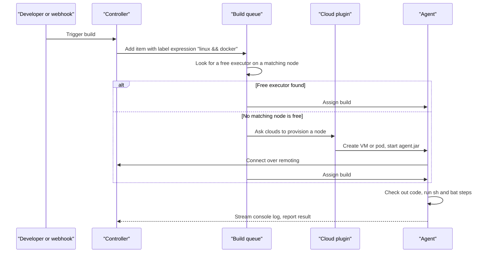
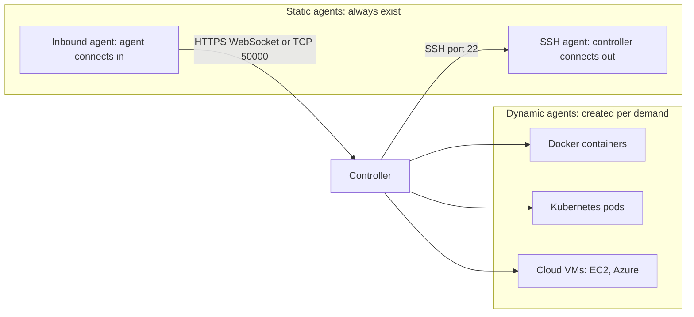
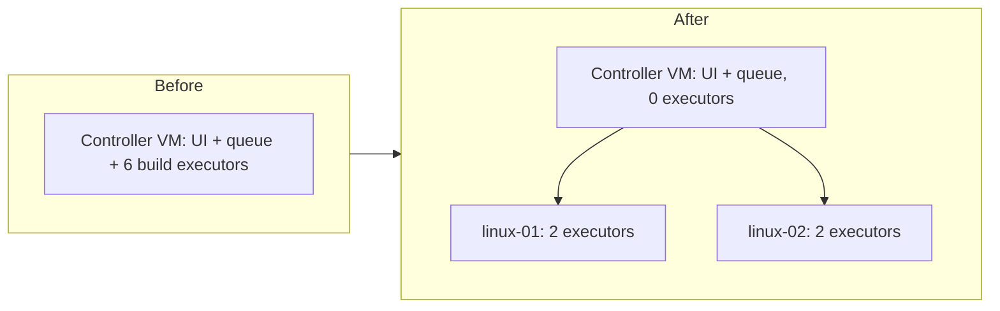

# Controller and Agents

## Introduction

A fresh Jenkins install can run builds straight away. It does that on the **built-in node**, which is the controller process itself. That is fine for a first "Hello World", but it is the wrong design for anything real. A real Jenkins setup has one **controller** that coordinates the work and a set of **agents** that do it.

This page explains that split:

- what the controller does and what agents do,
- what nodes, agents, executors and clouds are, and how they relate,
- how a build gets from the queue onto an agent,
- the ways an agent can connect (SSH, inbound, containers, clouds),
- why you should set the built-in node to **0 executors**,
- what parts of a Pipeline run on the controller even when you use agents.

An analogy: the controller is an air traffic control tower. It knows every flight, assigns runways and keeps the logs. It does not fly planes. Agents are the runways and the planes. If the tower staff started taxiing planes themselves, the radio would go quiet and every flight in the area would suffer. That is what happens when heavy builds run on the controller.

The [Jenkins Architecture](../0-jenkins-fundamentals/2-jenkins-architecture.mdx) page introduced these parts. This section goes deep on agents: how to connect them, how to pick them, and how to scale them.

## The Vocabulary

Jenkins uses several closely related words. Getting them straight saves a lot of confusion when you read logs and docs.

| Term | Meaning | Example |
| --- | --- | --- |
| **Controller** | The central Jenkins Java process. Serves the UI, holds config, schedules builds. Formerly called "master". | `jenkins.example.com` |
| **Node** | Any machine (or container) that can run builds, including the controller's built-in node. | `built-in`, `linux-01` |
| **Agent** | A node other than the controller. Formerly called "slave". Runs a small Java process (`agent.jar`) that talks to the controller. | A VM, a container, a Kubernetes pod |
| **Executor** | A slot on a node that runs one build (or one Pipeline `node` block) at a time. | A node with 4 executors runs 4 builds at once |
| **Label** | A tag on a node, used to pick where a build runs. | `linux`, `docker`, `windows`, `gpu` |
| **Cloud** | A plugin-provided source of agents that are created on demand and removed afterwards. | Kubernetes, Amazon EC2, Docker, Azure VMs |
| **Launcher** | How the controller starts or accepts the agent connection. | SSH, inbound (agent connects to controller) |
| **Remoting** | The library and protocol used between controller and agent. | `agent.jar`, `JNLP4-connect`, WebSocket |

A quick way to remember: **nodes have executors, executors run builds, labels pick nodes, and clouds create nodes.**

## How a Build Reaches an Agent



Step by step:

1. Something triggers a build: a person, a webhook, a timer or another job.
2. The controller puts a **queue item** in the build queue. The item carries a **label expression**, for example `linux && docker`, or nothing at all, which means "any node".
3. The scheduler looks for a node that matches the label and has a free executor.
4. If none is free, cloud plugins (Kubernetes, EC2 and so on) can **provision** a new agent. Static agents simply wait.
5. The build runs on the agent. The controller receives the console output and the final result, and stores them in `JENKINS_HOME`.

## What Runs Where in a Pipeline

This surprises many people: even with agents, part of every Pipeline runs **on the controller**.

```groovy
pipeline {
    agent { label 'linux' }
    stages {
        stage('Build') {
            steps {
                script {
                    // This Groovy logic runs on the CONTROLLER
                    def services = ['api', 'web', 'worker']
                    for (s in services) {
                        // The sh step runs on the AGENT
                        sh "echo building ${s} on \$(hostname)"
                    }
                }
            }
        }
    }
}
```

Example output:

```text
[Pipeline] Start of Pipeline
[Pipeline] node
Running on linux-01 in /home/jenkins/agent/workspace/demo
[Pipeline] {
[Pipeline] stage
[Pipeline] { (Build)
[Pipeline] script
[Pipeline] {
[Pipeline] sh
+ hostname
+ echo building api on linux-01
building api on linux-01
[Pipeline] sh
+ echo building web on linux-01
building web on linux-01
[Pipeline] sh
+ echo building worker on linux-01
building worker on linux-01
...
[Pipeline] End of Pipeline
Finished: SUCCESS
```

| Runs on the controller | Runs on the agent |
| --- | --- |
| The Pipeline Groovy itself: variables, loops, `if`, `script` blocks | `sh`, `bat`, `powershell` |
| Parsing the Jenkinsfile and the stage graph | `checkout scm` and `git` (the actual clone) |
| Evaluating `when` conditions and choosing the next stage | Build tools: Maven, npm, Docker CLI |
| Writing build logs and storing results | Files in the workspace |
| Credentials lookup | Test runs, and the files that `readFile`/`writeFile` touch |

The rule that follows: **do heavy work in shell steps, not in Groovy.** Parsing a 200 MB log with Groovy code burns controller CPU and memory. Running `grep` in an `sh` step burns agent CPU, which is what agents are for. The [Groovy Essentials for Pipelines](../4-jenkins-pipeline-advanced/5-jenkins-groovy-for-pipelines.mdx) page covers this in more detail.

## Why Not Build on the Controller?

The Jenkins documentation says running tasks on the built-in node "is discouraged for security, performance, and scalability reasons." Each reason in plain words:

- **Security.** A build on the built-in node runs as the same OS user as Jenkins itself. Any script in any branch could read `JENKINS_HOME`, including `secrets/` and every credential's encrypted file, and the key to decrypt them. On an agent, a malicious build can only damage that agent.
- **Performance.** A `mvn package` or `npm ci` that eats 4 GB of RAM and every CPU core competes with the web UI, the queue and every running Pipeline's Groovy. The whole instance gets slow.
- **Scalability.** One machine has fixed resources. Agents let you add capacity without touching the controller.
- **Stability.** A build that fills the disk on an agent fails one build. A build that fills the controller's disk can corrupt `JENKINS_HOME`.

### Set the built-in node to 0 executors

In the UI: **Manage Jenkins → Nodes → Built-In Node → Configure → Number of executors: 0**.

The same setting as [Configuration as Code (JCasC)](../12-jenkins-administration/0-jenkins-configuration-as-code.mdx):

```yaml
jenkins:
  numExecutors: 0
  mode: EXCLUSIVE
```

`numExecutors: 0` removes the build slots. `mode: EXCLUSIVE` means "only build jobs with label expressions matching this node", a second guard in case someone adds executors back later.

:::note Lightweight tasks still run on the controller
Even with 0 executors, the controller runs "flyweight" tasks: the outer part of every Pipeline that only coordinates work. These do not use executor slots. That is expected and fine.
:::

## Ways to Connect an Agent

There are a handful of connection styles. Each gets its own page in this section.



| Style | Who opens the connection | Typical use | Page |
| --- | --- | --- | --- |
| SSH agent | Controller → agent (SSH) | Linux VMs and bare-metal machines you manage | [SSH Agents](./1-jenkins-ssh-agents.mdx) |
| Inbound agent | Agent → controller | Machines behind a firewall or NAT, Windows desktops | [Inbound (JNLP) Agents](./2-jenkins-inbound-agents.mdx) |
| Docker agent | Build runs in a container on a Docker host | Per-stage toolchains, clean environments | [Docker Agents](./3-jenkins-docker-agents.mdx) |
| Kubernetes pod | Plugin creates a pod per build | Elastic, isolated builds on a cluster | [Kubernetes Pod Agents](./4-jenkins-kubernetes-agents.mdx) |
| Cloud VM | Plugin creates a VM per demand | Heavy or special builds, Windows, macOS-like needs | [Cloud Agents on AWS and Azure](./5-jenkins-cloud-agents.mdx) |

### Agent requirements

Every agent, whatever the connection style, needs:

- A **supported Java runtime** for `agent.jar`. The Jenkins Java support policy applies to all components, including agents. At the time of writing that means Java 21 or Java 25. Check the [Java support policy](https://www.jenkins.io/doc/book/platform-information/support-policy-java/) because this changes over time.
- A **remote root directory** (the agent's working directory), such as `/home/jenkins/agent`. Workspaces live under it.
- The **build tools** your jobs need: Git, a JDK for compiling, Node.js, Docker CLI and so on. These are separate from the Java that runs `agent.jar`. Your build JDK can be a different version.
- **Network reachability** in one direction: controller to agent (SSH) or agent to controller (inbound).

## Your First Agent in Five Minutes

The quickest way to see an agent working on a laptop is the official `jenkins/inbound-agent` image. The full walkthrough is on the [Inbound Agents](./2-jenkins-inbound-agents.mdx) page. Here is the short version.

1. In Jenkins: **Manage Jenkins → Nodes → New Node**. Name it `docker-agent-1`, choose **Permanent Agent**.
2. Set **Remote root directory** to `/home/jenkins/agent`, **Labels** to `linux`, **Launch method** to **Launch agent by connecting it to the controller**, and tick **Use WebSocket**.
3. Save. The node page shows a command with a secret.
4. Run the agent container with that secret:

```bash
docker run -d --init --name docker-agent-1 \
  --network jenkins \
  jenkins/inbound-agent:jdk21 \
  -url http://jenkins:8080 \
  -webSocket \
  -secret 3f2c...your-secret... \
  -name docker-agent-1 \
  -workDir /home/jenkins/agent
```

Example output from `docker logs docker-agent-1`:

```text
INFO: Using /home/jenkins/agent/remoting as a remoting work directory
INFO: Both error and output logs will be printed to /home/jenkins/agent/remoting
INFO: Agent discovery successful
INFO: WebSocket connection open
INFO: Connected
```

5. Run a Pipeline that targets the label:

```groovy
pipeline {
    agent { label 'linux' }
    stages {
        stage('Where am I?') {
            steps {
                sh 'echo "Node: $NODE_NAME"; hostname; java -version'
            }
        }
    }
}
```

Example output:

```text
Running on docker-agent-1 in /home/jenkins/agent/workspace/where-am-i
[Pipeline] sh
+ echo Node: docker-agent-1
Node: docker-agent-1
+ hostname
5b2a1c9e0f44
+ java -version
openjdk version "21.0.8" 2025-07-15 LTS
```

The `--network jenkins` flag assumes your controller runs in Docker on a network called `jenkins`, as in [Installing Jenkins with Docker](../1-jenkins-installation/0-jenkins-install-docker.mdx). Adjust `-url` to however the agent can reach your controller.

## Static vs Dynamic Agents

The biggest design decision in this section is whether agents are **static** (long-lived, always there) or **dynamic** (created for a build, destroyed after).

| Aspect | Static agents | Dynamic agents |
| --- | --- | --- |
| Lifecycle | Days to years | Minutes, per build or per idle timeout |
| Environment drift | Accumulates (old files, caches, tool versions) | None, every build starts clean |
| Warm caches | Yes, fast repeat builds | Lost unless you add a cache volume |
| Startup delay | None | Seconds (container) to minutes (VM) |
| Cost when idle | You pay for them all the time | Close to zero |
| Setup effort | Low for a few machines | Higher: cloud plugin, images, permissions |
| Good for | Special hardware, licensed tools, small teams | Bursty load, many teams, isolation |

Most mature setups use both: dynamic agents for everyday builds, plus a few static agents for things like a GPU box, a hardware test rig or a macOS machine. [Choosing an Agent Strategy](./7-jenkins-agent-strategies.mdx) works through that decision.

## Real-World Scenario

Your team runs a SaaS helpdesk product. Jenkins was installed two years ago on one 8-core VM and all 40 jobs run on the built-in node with 6 executors. Lately the UI freezes during the afternoon, and a security review flagged that any branch build can read `/var/lib/jenkins/secrets`.

**The plan:**

1. Add two Linux VMs as [SSH agents](./1-jenkins-ssh-agents.mdx) with the label `linux`, 2 executors each.
2. Install the same tools on them as on the controller (JDK, Node.js, Docker CLI). Better: build them from one script or Ansible playbook.
3. Change every job's agent from `agent any` to `agent { label 'linux' }` so nothing depends on the controller's tools.
4. Set the built-in node to 0 executors and `EXCLUSIVE` mode.
5. Watch the queue for a week. If jobs wait, add a third agent or move to [Kubernetes pod agents](./4-jenkins-kubernetes-agents.mdx).



**Why this approach:** it fixes the security finding (builds can no longer read the controller's secrets) and the performance problem (builds no longer compete with the UI) with the smallest change. SSH agents need no new infrastructure.

**When to use it:** a small to medium team on VMs, without a Kubernetes cluster.

**When not to use it:** if your company already runs Kubernetes, skip straight to pod agents. You avoid managing VMs entirely.

**Alternatives and trade-offs:**

| Approach | Pros | Cons | Best for |
| --- | --- | --- | --- |
| Keep building on the controller | Zero effort | Insecure, slow, cannot scale | Throwaway labs only |
| Static SSH agents | Simple, warm caches, no new infra | Drift, idle cost, manual scaling | Small teams on VMs |
| Kubernetes pod agents | Clean builds, elastic, per-build tool images | Needs a cluster and pod YAML skills | Teams already on Kubernetes |
| Cloud VM agents (EC2, Azure) | Elastic, full VMs | VM boot time, cloud IAM setup | Heavy or Windows builds in the cloud |
| Separate controllers per team | Isolates blast radius | More instances to upgrade and secure | Large organizations |

## Common Mistakes

- **Leaving executors on the built-in node.** Even 1 executor lets any job with no label run on the controller. Set it to 0.
- **Using `agent any` everywhere.** It runs on any node with free executors, including ones that lack the tools you need. Use labels.
- **Doing heavy work in Groovy.** Loops over big files in `script` blocks run on the controller. Push the work into `sh` steps.
- **Assuming the agent sees controller files.** The workspace is on the agent. Paths like `/var/jenkins_home/...` do not exist there.
- **Agents with an unsupported Java.** After a Jenkins upgrade that drops an old Java, agents running that Java fail to connect. Upgrade agent Java first.
- **Snowflake agents.** Hand-configured agents drift apart. Build them from code (Ansible, Packer, Dockerfiles).

## Summary

- The **controller** coordinates: UI, queue, configuration, Pipeline Groovy, logs. **Agents** do the build work.
- Nodes have executors, executors run builds, labels pick nodes, clouds create nodes.
- Pipeline Groovy logic runs on the controller, while `sh`/`bat` and checkouts run on the agent.
- Set the built-in node to 0 executors for security, performance and stability.
- Agents connect over SSH (controller connects out) or inbound (agent connects in), or are created on demand as containers, pods or VMs.
- Every agent needs a supported Java runtime for `agent.jar`, which is separate from your build JDK.

## Exercises

1. Start the inbound agent container from this page, connect it, and run the "Where am I?" Pipeline. Then stop the container and run the Pipeline again. What does the console say while it waits?
2. Set the built-in node to 0 executors and run a job with `agent any` when no agents are online. Read the queue message.
3. Write a Pipeline with a `script` block that loops five times and calls `sh 'hostname'`. Which parts appear on the agent?
4. List every job on an existing Jenkins that uses `agent any` or no label at all. Decide which labels they really need.

Related pages:

- [SSH Agents](./1-jenkins-ssh-agents.mdx)
- [Inbound (JNLP) Agents](./2-jenkins-inbound-agents.mdx)
- [Labels, Executors and Scheduling](./6-jenkins-labels-and-executors.mdx)
- [Securing Agents and the Controller](../11-jenkins-security/6-jenkins-securing-agents.mdx)
- For background on distributed build systems in general, see the [CI/CD tutorial](/docs/devops/cicd).
