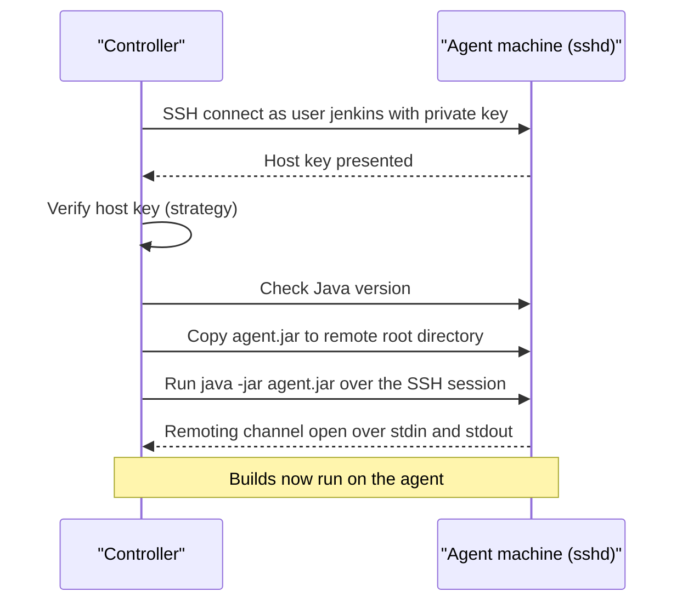

# SSH Agents

## Introduction

An **SSH agent** is a machine that the Jenkins controller logs into over SSH, copies `agent.jar` to, and starts. The controller opens the connection. The agent only needs to run an SSH server and have Java installed. This is the classic, most widely used way to attach Linux build machines, and the Jenkins scaling guide calls SSH "the preferred and the most stable way" to connect controller and agent.

It works like a site manager who has the keys to every workshop. Each morning they unlock a workshop, switch on the machines and hand over the day's jobs. The workshops never need to phone in. They just need a lock that the manager's key fits.

SSH agents are provided by the **SSH Build Agents** plugin (plugin ID `ssh-slaves`; the ID keeps the old name). It is installed on most Jenkins controllers and is part of the suggested plugins in the setup wizard.

On this page you will:

- prepare a Linux machine to be an agent,
- create an SSH key and a Jenkins credential,
- add the node in the UI and choose a host key verification strategy,
- define the same node as code with JCasC,
- try it all locally with the `jenkins/ssh-agent` Docker image,
- learn the common failures and how to fix them.

## How an SSH Agent Starts



Key points:

- The remoting channel runs **inside the SSH session**. No extra port is needed on the controller.
- The controller **re-copies `agent.jar`** whenever it reconnects, so the agent always matches the controller version. You never upgrade agents by hand.
- If the connection drops, the controller can relaunch the agent automatically.

## Step 1: Prepare the Agent Machine

On a fresh Ubuntu or Debian VM, create a dedicated user, install Java and the build tools:

```bash
# Run as root or with sudo on the agent machine
sudo useradd --create-home --shell /bin/bash jenkins
sudo apt-get update
sudo apt-get install -y openjdk-21-jre-headless git
sudo mkdir -p /home/jenkins/agent
sudo chown -R jenkins:jenkins /home/jenkins/agent
java -version
```

Example output:

```text
openjdk version "21.0.8" 2025-07-15
OpenJDK Runtime Environment (build 21.0.8+9-Ubuntu-0ubuntu124.04.1)
OpenJDK 64-Bit Server VM (build 21.0.8+9-Ubuntu-0ubuntu124.04.1, mixed mode, sharing)
```

The Java here only runs `agent.jar`. It must be a version Jenkins supports (Java 21 or 25 at the time of writing; see the [Java support policy](https://www.jenkins.io/doc/book/platform-information/support-policy-java/)). Your projects can still compile with other JDKs installed side by side.

:::tip Build agents from code
Put these steps in an Ansible playbook, a cloud-init file or a Packer template. When you need a fourth agent, or need to rebuild a broken one, you run the script again instead of remembering what you typed. See the [Ansible tutorial](/docs/devops/ansible).
:::

## Step 2: Create a Key Pair

Generate a dedicated key for Jenkins. Do not reuse a personal key.

```bash
ssh-keygen -t ed25519 -f ~/.ssh/jenkins_agent_key -C "jenkins-controller" -N ""
ls ~/.ssh/jenkins_agent_key*
```

Example output:

```text
Generating public/private ed25519 key pair.
Your identification has been saved in /home/you/.ssh/jenkins_agent_key
Your public key has been saved in /home/you/.ssh/jenkins_agent_key.pub
/home/you/.ssh/jenkins_agent_key  /home/you/.ssh/jenkins_agent_key.pub
```

Install the **public** key on the agent:

```bash
sudo mkdir -p /home/jenkins/.ssh
cat jenkins_agent_key.pub | sudo tee -a /home/jenkins/.ssh/authorized_keys
sudo chown -R jenkins:jenkins /home/jenkins/.ssh
sudo chmod 700 /home/jenkins/.ssh
sudo chmod 600 /home/jenkins/.ssh/authorized_keys
```

Test it from your workstation before involving Jenkins:

```bash
ssh -i ~/.ssh/jenkins_agent_key jenkins@agent-01.internal 'java -version'
```

If that fails, Jenkins will fail too. Fix SSH first.

## Step 3: Add the Private Key as a Credential

In Jenkins: **Manage Jenkins → Credentials → System → Global credentials → Add Credentials**.

| Field | Value |
| --- | --- |
| Kind | SSH Username with private key |
| ID | `agent-ssh-key` |
| Username | `jenkins` |
| Private Key | Enter directly, paste the contents of `jenkins_agent_key` |
| Passphrase | Empty, or the passphrase if you set one |

The credential is stored encrypted on the controller. The [Credentials Management](../11-jenkins-security/3-jenkins-credentials.mdx) page covers credential scopes and rotation.

## Step 4: Create the Node

**Manage Jenkins → Nodes → New Node**, enter `agent-01`, choose **Permanent Agent**.

| Field | Example | Notes |
| --- | --- | --- |
| Number of executors | `2` | Start with 1 per 2 CPU cores for typical builds |
| Remote root directory | `/home/jenkins/agent` | Workspaces and `agent.jar` live here |
| Labels | `linux docker jdk21` | Space-separated |
| Usage | Only build jobs with label expressions matching this node | Keeps random jobs off special machines |
| Launch method | Launch agents via SSH | |
| Host | `agent-01.internal` | DNS name or IP |
| Credentials | `jenkins (agent-ssh-key)` | |
| Host Key Verification Strategy | Known hosts file Verification Strategy | See below |
| Availability | Keep this agent online as much as possible | |

Save. The node page shows the agent log. A good launch ends like this:

```text
[10/11/26 09:14:02] [SSH] Opening SSH connection to agent-01.internal:22.
[10/11/26 09:14:02] [SSH] SSH host key matches key in Known Hosts file. Connection will be allowed.
[10/11/26 09:14:03] [SSH] Authentication successful.
[10/11/26 09:14:03] [SSH] The remote user's environment is:
...
[10/11/26 09:14:04] [SSH] Starting agent process: cd "/home/jenkins/agent" && java  -jar remoting.jar -workDir /home/jenkins/agent -jar-cache /home/jenkins/agent/remoting/jarCache
Agent successfully connected and online
```

### Host key verification strategies

When the controller connects, the agent presents its **SSH host key**. Checking it protects you from a man-in-the-middle pretending to be your agent and receiving your builds and secrets. The plugin offers four strategies:

| Strategy | How it works | Use it when |
| --- | --- | --- |
| **Known hosts file Verification Strategy** | Checks `~/.ssh/known_hosts` of the Jenkins user on the controller | You manage `known_hosts` (for example with Ansible). Recommended for static agents. |
| **Manually provided key Verification Strategy** | You paste the expected host key into the node config | Few agents, keys known up front, config as code |
| **Manually trusted key Verification Strategy** | Trusts the key on first connect (optionally after an admin approves), then pins it | Convenient for small setups. Similar to SSH "trust on first use". |
| **Non verifying Verification Strategy** | Accepts any key | Never in production. Only disposable lab setups. |

To fill `known_hosts` on a controller that runs as the `jenkins` user:

```bash
sudo -u jenkins ssh-keyscan -t ed25519 agent-01.internal | sudo -u jenkins tee -a /var/lib/jenkins/.ssh/known_hosts
```

In the official Docker image the home is `/var/jenkins_home`, so the file is `/var/jenkins_home/.ssh/known_hosts`. Compare the scanned fingerprint with the one on the agent (`ssh-keygen -lf /etc/ssh/ssh_host_ed25519_key.pub`) before trusting it.

## Step 5: Use It from a Pipeline

```groovy
pipeline {
    agent { label 'linux && jdk21' }
    stages {
        stage('Info') {
            steps {
                sh '''
                  echo "Running on $NODE_NAME"
                  echo "Workspace: $WORKSPACE"
                  uname -a
                '''
            }
        }
    }
}
```

Example output:

```text
Running on agent-01 in /home/jenkins/agent/workspace/ssh-demo
[Pipeline] sh
+ echo Running on agent-01
Running on agent-01
+ echo Workspace: /home/jenkins/agent/workspace/ssh-demo
Workspace: /home/jenkins/agent/workspace/ssh-demo
+ uname -a
Linux agent-01 6.8.0-45-generic #45-Ubuntu SMP x86_64 GNU/Linux
```

## Try It Locally with Docker

The official Jenkins docs use the `jenkins/ssh-agent` image for a quick local test. It runs `sshd` and reads your public key from the `JENKINS_AGENT_SSH_PUBKEY` environment variable.

```bash
docker run -d --rm --name agent1 \
  --network jenkins \
  -e "JENKINS_AGENT_SSH_PUBKEY=$(cat ~/.ssh/jenkins_agent_key.pub)" \
  jenkins/ssh-agent:jdk21
docker ps --filter name=agent1
```

Example output:

```text
CONTAINER ID   IMAGE                     COMMAND        STATUS         PORTS    NAMES
8c1d2e3f4a5b   jenkins/ssh-agent:jdk21   "setup-sshd"   Up 3 seconds   22/tcp   agent1
```

Then create a node with **Host** `agent1` (the container name works as a hostname on the shared Docker network), **Remote root directory** `/home/jenkins/agent`, credential username `jenkins`, and for a lab, the **Non verifying** strategy. If the controller is not on a Docker network, publish the port with `-p 2222:22` and use the host's address with port 2222 (under **Advanced**).

## Define SSH Nodes as Code

Clicking through forms does not scale and is not reviewable. With [JCasC](../12-jenkins-administration/0-jenkins-configuration-as-code.mdx) the same node looks like this:

```yaml
jenkins:
  numExecutors: 0
  nodes:
    - permanent:
        name: "agent-01"
        labelString: "linux docker jdk21"
        mode: EXCLUSIVE
        numExecutors: 2
        remoteFS: "/home/jenkins/agent"
        launcher:
          ssh:
            host: "agent-01.internal"
            port: 22
            credentialsId: "agent-ssh-key"
            launchTimeoutSeconds: 60
            maxNumRetries: 3
            retryWaitTime: 30
            sshHostKeyVerificationStrategy:
              knownHostsFileKeyVerificationStrategy: {}
    - permanent:
        name: "agent-02"
        labelString: "linux docker jdk21"
        mode: EXCLUSIVE
        numExecutors: 2
        remoteFS: "/home/jenkins/agent"
        launcher:
          ssh:
            host: "agent-02.internal"
            port: 22
            credentialsId: "agent-ssh-key"
            sshHostKeyVerificationStrategy:
              knownHostsFileKeyVerificationStrategy: {}
```

The structure follows the official JCasC `build_agents` demo. The safest way to get the exact keys for your plugin version is to configure one node in the UI and use **Manage Jenkins → Configuration as Code → View Configuration** to export it.

:::note The credential must exist too
`credentialsId` refers to a credential that JCasC or someone else must create. Never commit the private key in plain text. Load it from a secret source; see [External Secrets with Vault and Cloud Secret Managers](../11-jenkins-security/4-jenkins-external-secrets.mdx).
:::

## Useful Advanced Settings

Under **Advanced** in the SSH launcher:

| Setting | Default | When to change |
| --- | --- | --- |
| Port | 22 | Agent's `sshd` runs on another port |
| JavaPath | Empty, Jenkins searches for Java | Several Java versions installed, pick one explicitly, for example `/usr/lib/jvm/java-21-openjdk-amd64/bin/java` |
| JVM Options | Empty | Set agent heap, for example `-Xmx512m` |
| Prefix Start Agent Command | Empty | Wrap the start command, for example with `nice` or a Windows OpenSSH shell |
| Connection Timeout in Seconds | 210 | Slow networks or slow-booting machines |
| Maximum Number of Retries | 10 | Lower it so broken agents fail fast |
| Seconds To Wait Between Retries | 15 | |

## Windows over SSH

Windows agents can also use SSH, through the OpenSSH server built into modern Windows. The setup works, but it has more pitfalls (shells, paths, services) than Linux. Many teams use [inbound agents](./2-jenkins-inbound-agents.mdx) for Windows instead. The plugin's documentation has a dedicated Windows section; follow it if you choose SSH.

## Troubleshooting

| Symptom in agent log | Likely cause | Fix |
| --- | --- | --- |
| `Connection refused` | `sshd` not running or wrong port | `systemctl status ssh`, check firewall and port |
| `Authentication failed` | Wrong user, key not in `authorized_keys`, bad permissions | Test with `ssh -i` manually; `chmod 700 .ssh`, `600 authorized_keys` |
| `Host key ... not found in known_hosts` | Known hosts strategy and no entry | Run `ssh-keyscan` as the Jenkins user, verify fingerprint |
| `java: command not found` | Java not on the non-interactive `PATH` | Install Java, or set **JavaPath** |
| `UnsupportedClassVersionError` | Agent Java too old for this Jenkins | Upgrade agent Java to a supported version |
| Agent goes offline: "Disk space is too low" | Workspace or Docker images filled the disk | Clean workspaces, prune images, add monitoring |

## Real-World Scenario

Your team builds a C++ desktop application. Builds need a licensed compiler installed on two powerful bare-metal machines in the office server room. Jenkins runs on a VM in the same network. Nobody wants those machines to run anything else.

**The solution:**

1. Create a `jenkins` user on both machines and install Java 21 next to the compiler.
2. Add one SSH key credential and two permanent nodes, `cxx-01` and `cxx-02`, with the label `cxx-licensed` and usage **Only build jobs with label expressions matching this node**.
3. Use the **Known hosts file** strategy, with `known_hosts` managed by Ansible.
4. Define both nodes in JCasC so a rebuilt controller gets them back automatically.
5. Jobs use `agent { label 'cxx-licensed' }`.

**Why this approach:** the machines are fixed, physical and on the same network as the controller. SSH needs no extra ports on the controller and the controller automatically restarts the agent after reboots. EXCLUSIVE mode keeps unrelated jobs from using the license.

**When to use SSH agents:** long-lived Linux or Unix machines that the controller can reach. Special hardware, licensed tools, or a small fixed fleet.

**When not to:** the controller cannot reach the agent (agent behind NAT or a strict firewall). Use [inbound agents](./2-jenkins-inbound-agents.mdx). Load is bursty and you have Kubernetes or a cloud account. Use [dynamic agents](./7-jenkins-agent-strategies.mdx).

**Alternatives and trade-offs:**

| Approach | Pros | Cons | Best for |
| --- | --- | --- | --- |
| SSH agent | Stable, controller manages lifecycle, no inbound port on controller | Controller must reach agent; host keys to manage | Linux VMs and servers on a reachable network |
| Inbound agent | Works through NAT and firewalls | You manage the agent process as a service | Windows, remote offices, locked-down networks |
| Kubernetes pods | Clean per-build environment, elastic | Needs a cluster, cold caches | Many teams, bursty load |
| Cloud VMs | Elastic, any OS image | VM boot time, cloud permissions | Heavy builds, spiky demand |

## Common Mistakes

- **Using the Non verifying strategy in production.** It turns host keys off entirely. Use known hosts or manually provided keys.
- **Reusing a personal SSH key.** When you leave the company, builds break. Use a dedicated key per controller.
- **Giving the `jenkins` user passwordless sudo.** Every build could become root. Install tools ahead of time instead.
- **Installing tools only on one agent.** Builds then pass or fail depending on which agent they land on. Use one provisioning script for all agents with the same label.
- **Forgetting disk cleanup.** Static agents accumulate workspaces. Use `cleanWs()` or the `deleteDir()` step in `post`, and monitor free space.

## Summary

- SSH agents are started by the controller over SSH. The agent needs `sshd`, a `jenkins` user and a supported Java.
- The plugin is **SSH Build Agents** (`ssh-slaves`). It copies `agent.jar` automatically, so agents stay in sync with the controller.
- Store the private key as an **SSH Username with private key** credential.
- Always verify host keys: prefer **Known hosts file** or **Manually provided key** strategies.
- Define nodes in JCasC so they are reviewable and survive a controller rebuild.

## Exercises

1. Run the `jenkins/ssh-agent:jdk21` container, connect it as `agent1` and run a Pipeline that prints `$NODE_NAME`.
2. Switch the node from **Non verifying** to **Known hosts file**. Make the connection fail first, then fix it with `ssh-keyscan`.
3. Export your node definition with **View Configuration** and compare it with the JCasC example on this page.
4. Set **Maximum Number of Retries** to 0, stop the agent container, and watch how the node reports the failure.

Related pages:

- [Controller and Agents](./0-jenkins-controller-and-agents.mdx)
- [Inbound (JNLP) Agents](./2-jenkins-inbound-agents.mdx)
- [Labels, Executors and Scheduling](./6-jenkins-labels-and-executors.mdx)
- [Securing Agents and the Controller](../11-jenkins-security/6-jenkins-securing-agents.mdx)
- Official docs: [Using Jenkins agents](https://www.jenkins.io/doc/book/using/using-agents/) and the [SSH Build Agents plugin](https://plugins.jenkins.io/ssh-slaves/)
